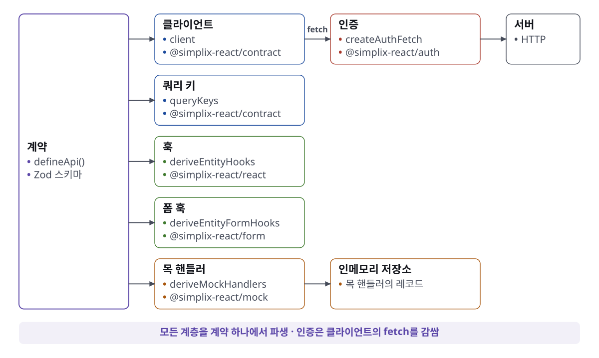

<p align="center">
  
</p>

# SimpliX React

[English](./README.md) | **한국어**

[](https://www.npmjs.com/package/simplix-react)
[](https://github.com/simplix-framework/simplix-react/blob/main/LICENSE)

OpenAPI 명세에서 재사용할 수 있는 도메인 패키지를 자동으로 생성하는 패키지 우선 React 프레임워크입니다.

## SimpliX React란

simplix-react는 OpenAPI 명세에서 재사용할 수 있는 도메인 패키지를 자동으로 생성하는 패키지 우선 React 프레임워크입니다. API를 한 번 정의하면 그 정의에서 타입 안전한 클라이언트, React Query 훅(hook), 폼 훅, 목(mock) 핸들러를 파생해 계약(contract)부터 컴포넌트까지 이어 줍니다.



## 주요 기능

- **계약 기반**: 엔티티(entity)와 그 오퍼레이션(operation)을 Zod 스키마로 한 번 정의하면 나머지는 모두 파생합니다.
- **처음부터 끝까지 타입 안전**: API 계약에서 React 훅, UI 컴포넌트까지 TypeScript 타입을 추론합니다.
- **파생 훅**: `deriveEntityHooks`가 오퍼레이션마다 훅을 하나씩 만듭니다(`useList`, `useGet`, `useCreate`, `useUpdate`, `useDelete`, list 오퍼레이션의 `useInfiniteList`).
- **목 우선 개발**: 같은 계약에서 MSW 핸들러와 인메모리 저장소를 파생합니다.
- **모노레포 구조**: 필요한 패키지부터 단계적으로 도입할 수 있습니다.

## 패키지

| 패키지 | npm | 설명 |
| --- | --- | --- |
| [contract](./packages/contract) | [](https://www.npmjs.com/package/@simplix-react/contract) | Zod 스키마 기반의 타입 안전한 API 계약 |
| [react](./packages/react) | [](https://www.npmjs.com/package/@simplix-react/react) | 계약에서 파생한 React Query 훅 |
| [form](./packages/form) | [](https://www.npmjs.com/package/@simplix-react/form) | 계약에서 파생한 TanStack Form 훅 |
| [auth](./packages/auth) | [](https://www.npmjs.com/package/@simplix-react/auth) | 인증 미들웨어(Bearer, API Key, OAuth2, 사용자 정의) |
| [access](./packages/access) | [](https://www.npmjs.com/package/@simplix-react/access) | React 바인딩을 갖춘 CASL 기반 인가(RBAC/ABAC) |
| [ui](./packages/ui) | [](https://www.npmjs.com/package/@simplix-react/ui) | CRUD UI 컴포넌트 라이브러리(목록, 폼, 상세, 트리, 필터) |
| [api](./packages/api) | [](https://www.npmjs.com/package/@simplix-react/api) | 생성된 도메인 패키지가 쓰는 Orval mutator 싱글턴 |
| [mock](./packages/mock) | [](https://www.npmjs.com/package/@simplix-react/mock) | MSW 핸들러와 인메모리 저장소 |
| [i18n](./packages/i18n) | [](https://www.npmjs.com/package/@simplix-react/i18n) | i18next 기반 국제화 |
| [headless](./packages/headless) | [](https://www.npmjs.com/package/@simplix-react/headless) | 웹과 네이티브 UI 키트가 함께 쓰는 플랫폼 중립 로직 |
| [calendar](./packages/calendar) | [](https://www.npmjs.com/package/@simplix-react/calendar) | 도메인에 묶이지 않는 달력 컴포넌트 |
| [gantt-core](./packages/gantt-core) | [](https://www.npmjs.com/package/@simplix-react/gantt-core) | 프레임워크에 의존하지 않는 프로젝트 일정 엔진 |
| [gantt](./packages/gantt) | [](https://www.npmjs.com/package/@simplix-react/gantt) | 일정 엔진 위의 React 간트 차트 |
| [process-core](./packages/process-core) | [](https://www.npmjs.com/package/@simplix-react/process-core) | 프레임워크에 의존하지 않는 절차 모델 |
| [process](./packages/process) | [](https://www.npmjs.com/package/@simplix-react/process) | 절차 모델 위의 React 절차 레인 |
| [testing](./packages/testing) | [](https://www.npmjs.com/package/@simplix-react/testing) | 테스트 유틸리티 |
| [cli](./packages/cli) | [](https://www.npmjs.com/package/@simplix-react/cli) | 프로젝트 스캐폴딩과 검증 CLI |

메타 패키지 [`simplix-react`](./packages/simplix-react)는 `headless`를 제외한 위 패키지를 모두 의존성으로 포함합니다.

## 확장

확장(extension)은 핵심 프레임워크를 특정 서버 환경에 맞추는 백엔드별 구현입니다. 핵심 패키지는 어디서나 쓸 수 있고, 확장은 특정 플랫폼에 맞게 추상 인터페이스를 구현합니다.

확장은 [extensions/](./extensions/) 디렉터리에 있습니다. 구조와 새 확장을 만드는 방법은 [확장 README](./extensions/README.md)를 참고하세요.

| 확장 | 설명 |
| --- | --- |
| [simplix-boot](./extensions/simplix-boot/) | Spring Boot 어댑터: SimpliX(Spring Security) 백엔드용 인증, 접근 제어, 스트림, CLI 플러그인, 공통 유틸리티 |
| [native](./extensions/native/) | React Native(Expo) 확장: 모바일 UI 키트, 런타임, 기기 패키지 |

## 빠른 시작

### 1. 설치

모든 패키지를 한 번에 설치합니다.

```bash
pnpm add simplix-react
pnpm add zod @tanstack/react-query @tanstack/react-query-persist-client \
  @tanstack/query-sync-storage-persister
```

pnpm을 쓸 때는 `.npmrc`에 다음을 추가해 전이 의존성인 `@simplix-react/*` 패키지를 가져올 수 있게 하세요.

```text
public-hoist-pattern[]=@simplix-react/*
```

필요한 패키지만 설치할 수도 있습니다.

```bash
pnpm add @simplix-react/contract @simplix-react/react
pnpm add zod @tanstack/react-query @tanstack/react-query-persist-client \
  @tanstack/query-sync-storage-persister
```

### 2. 계약 정의

```ts
import { z } from "zod";
import { defineApi, simpleQueryBuilder } from "@simplix-react/contract";

const projectSchema = z.object({
  id: z.string(),
  name: z.string(),
  status: z.enum(["active", "archived"]),
});

const api = defineApi({
  domain: "project",
  basePath: "/api",
  entities: {
    project: {
      schema: projectSchema,
      operations: {
        list: { method: "GET", path: "/projects" },
        get: { method: "GET", path: "/projects/:id" },
        create: { method: "POST", path: "/projects", input: projectSchema.omit({ id: true }) },
        update: { method: "PATCH", path: "/projects/:id", input: projectSchema.partial().omit({ id: true }) },
        delete: { method: "DELETE", path: "/projects/:id" },
      },
    },
  },
  queryBuilder: simpleQueryBuilder,
});
```

### 3. 훅 파생

```ts
import { deriveEntityHooks } from "@simplix-react/react";

const hooks = deriveEntityHooks(api);
```

### 4. 컴포넌트에서 사용

```tsx
function ProjectList() {
  const { data: projects, isLoading } = hooks.project.useList();
  const { mutate: createProject } = hooks.project.useCreate();

  if (isLoading) return <p>Loading...</p>;

  return (
    <ul>
      {projects?.map((p) => (
        <li key={p.id}>{p.name}</li>
      ))}
    </ul>
  );
}
```

## 문서

[문서 목차](./docs/ko/README.md)에서 전체 문서를 확인하세요. 상세 문서는 다음과 같습니다.

### 시작하기

- [개요](./docs/ko/getting-started/overview.md): simplix-react의 정의와 계약 하나에서 모든 계층을 파생하는 방식
- [설치](./docs/ko/getting-started/installation.md): 사전 요구 사항, 패키지, 피어 의존성
- [빠른 시작](./docs/ko/getting-started/quick-start.md): 계약, 훅, 컴포넌트, 목 백엔드를 한 번에 따라 하는 실습
- [TypeScript 설정](./docs/ko/getting-started/typescript.md): 권장 tsconfig와 Zod 타입 추론

### 핵심 개념

- [API 계약](./docs/ko/core-concepts/api-contracts.md): 엔티티, 오퍼레이션, 계약 구조
- [스키마 파생](./docs/ko/core-concepts/schema-derivation.md): 계약 하나에서 클라이언트, 훅, 폼 훅, 목 핸들러를 파생하는 과정
- [인증](./docs/ko/core-concepts/authentication.md): 인증 구조와 전략 패턴
- [인가](./docs/ko/core-concepts/authorization.md): CASL 기반 RBAC · ABAC 접근 제어
- [폼 파생](./docs/ko/core-concepts/form-derivation.md): 계약에서 파생하는 폼 훅
- [UI 컴포넌트](./docs/ko/core-concepts/ui-components.md): CRUD UI 컴포넌트 구조
- [국제화](./docs/ko/core-concepts/internationalization.md): 국제화 프레임워크 구조
- [확장](./docs/ko/core-concepts/extensions.md): 백엔드별 어댑터를 담는 확장 구조
- [캐시 무효화](./docs/ko/core-concepts/cache-invalidation.md): 쿼리 자동 무효화
- [목 데이터 계층](./docs/ko/core-concepts/mock-data-layer.md): MSW와 인메모리 저장소 구조

### 가이드

- [엔티티 정의](./docs/ko/guides/defining-entities.md): Zod로 타입 안전한 CRUD 엔티티 정의
- [사용자 정의 오퍼레이션](./docs/ko/guides/custom-operations.md): CRUD 역할 밖의 오퍼레이션
- [상위-하위 관계](./docs/ko/guides/parent-child.md): 중첩 엔티티 계층
- [사용자 정의 fetch](./docs/ko/guides/custom-fetch.md): HTTP 계층 맞춤 설정
- [React 훅 레퍼런스](./docs/ko/guides/react-hooks-reference.md): 훅 API 레퍼런스
- [폼 훅](./docs/ko/guides/form-hooks.md): TanStack Form 연동
- [목 핸들러](./docs/ko/guides/mock-handlers.md): MSW 핸들러 설정
- [목으로 테스트하기](./docs/ko/guides/testing-with-mocks.md): Vitest와 MSW 연동
- [인증](./docs/ko/guides/authentication.md): Bearer, API Key, OAuth2, 사용자 정의 인증
- [인가](./docs/ko/guides/authorization.md): CASL 기반 접근 제어 설정
- [국제화](./docs/ko/guides/internationalization.md): 다국어 설정
- [UI 컴포넌트](./docs/ko/guides/ui-components.md): CRUD 목록, 폼, 상세, 트리 컴포넌트 사용
- [디자인 선택과 추가](./docs/ko/guides/designs.md): UI 디자인 선택과 추가
- [디자인 맞춤 설정](./docs/ko/guides/consumer-design-customization.md): `@simplix-react/ui` 컴포넌트 맞춤 설정
- [스타일과 토큰 설정](./docs/ko/guides/consumer-styling-setup.md): `@simplix-react/ui`의 스타일과 디자인 토큰 설정
- [확장](./docs/ko/guides/extensions.md): 백엔드 확장 만들기와 사용
- [CLI 사용법](./docs/ko/guides/cli-usage.md): 프로젝트 스캐폴딩과 검증
- [LLM 연동](./docs/ko/guides/llm-integration.md): LLM 기능 연동

### 튜토리얼

- [프로젝트 앱](./docs/ko/tutorials/project-app.md): 프로젝트 관리 앱을 처음부터 만들기
- [인증 보호 앱](./docs/ko/tutorials/auth-protected-app.md): 로그인, 로그아웃, 토큰 갱신, 라우트 보호
- [풀스택 목](./docs/ko/tutorials/full-stack-mock.md): 브라우저 안 목 계층으로 완성하는 프론트엔드
- [Petstore OpenAPI](./docs/ko/tutorials/petstore-openapi.md): Swagger Petstore 명세에서 도메인 패키지 생성

### API 레퍼런스

- [API 문서](./docs/api/README.md): TypeDoc으로 생성한 API 레퍼런스(영어)

## 기여

개발 환경 설정, 코딩 표준, 변경 제출 방법은 [CONTRIBUTING.ko.md](./CONTRIBUTING.ko.md)를 참고하세요.

## 라이선스

MIT
