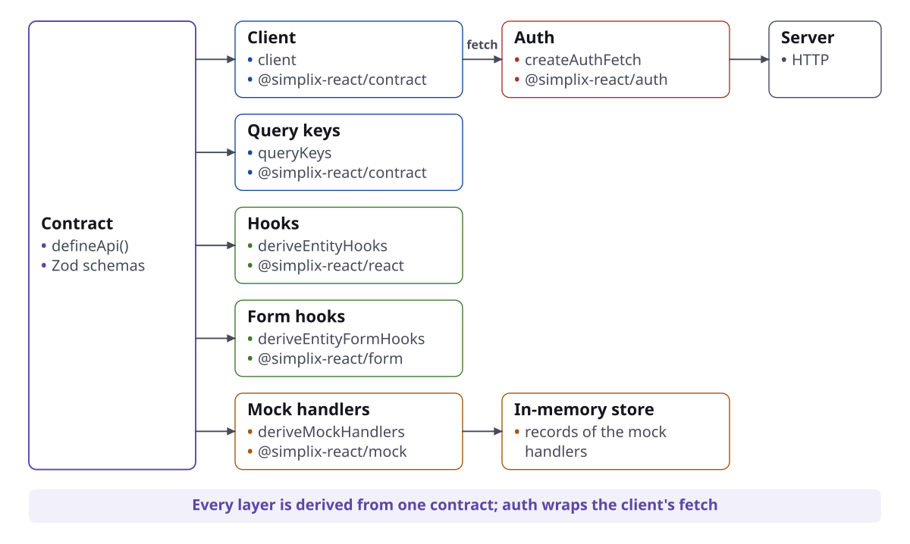

<p align="center">
  
</p>

# SimpliX React

**English** | [한국어](./README.ko.md)

[](https://www.npmjs.com/package/simplix-react)
[](https://github.com/simplix-framework/simplix-react/blob/main/LICENSE)

Package-first React framework that auto-generates reusable domain packages from OpenAPI specs.

## What is SimpliX React?

simplix-react is a package-first React framework that auto-generates reusable domain packages from OpenAPI specs. Define your API surface once and derive type-safe clients, React Query hooks, form hooks, and mock handlers from it, from contract to component.



## Key Features

- **Contract-Driven**: define entities and their operations once with Zod schemas; everything else is derived.
- **Type-Safe End-to-End**: full TypeScript inference from API contract through React hooks to UI components.
- **Derived Hooks**: `deriveEntityHooks` produces one hook per operation (`useList`, `useGet`, `useCreate`, `useUpdate`, `useDelete`, and `useInfiniteList` with the list operation).
- **Mock-First Development**: derive MSW handlers and in-memory mock stores from the same contract.
- **Monorepo Architecture**: modular packages that can be adopted incrementally.

## Packages

| Package | npm | Description |
| --- | --- | --- |
| [contract](./packages/contract) | [](https://www.npmjs.com/package/@simplix-react/contract) | Type-safe API contracts with Zod schemas |
| [react](./packages/react) | [](https://www.npmjs.com/package/@simplix-react/react) | React Query hooks derived from contracts |
| [form](./packages/form) | [](https://www.npmjs.com/package/@simplix-react/form) | TanStack Form hooks derived from contracts |
| [auth](./packages/auth) | [](https://www.npmjs.com/package/@simplix-react/auth) | Authentication middleware (Bearer, API Key, OAuth2, custom) |
| [access](./packages/access) | [](https://www.npmjs.com/package/@simplix-react/access) | CASL-based authorization (RBAC/ABAC) with React bindings |
| [ui](./packages/ui) | [](https://www.npmjs.com/package/@simplix-react/ui) | CRUD UI component library (list, form, detail, tree, filters) |
| [api](./packages/api) | [](https://www.npmjs.com/package/@simplix-react/api) | Orval mutator singleton for generated domain packages |
| [mock](./packages/mock) | [](https://www.npmjs.com/package/@simplix-react/mock) | MSW handlers + in-memory stores |
| [i18n](./packages/i18n) | [](https://www.npmjs.com/package/@simplix-react/i18n) | i18next-based internationalization |
| [headless](./packages/headless) | [](https://www.npmjs.com/package/@simplix-react/headless) | Platform-neutral logic shared by the web and native UI kits |
| [calendar](./packages/calendar) | [](https://www.npmjs.com/package/@simplix-react/calendar) | Domain-agnostic calendar components |
| [gantt-core](./packages/gantt-core) | [](https://www.npmjs.com/package/@simplix-react/gantt-core) | Framework-free project scheduling engine |
| [gantt](./packages/gantt) | [](https://www.npmjs.com/package/@simplix-react/gantt) | Gantt chart for React on the scheduling engine |
| [process-core](./packages/process-core) | [](https://www.npmjs.com/package/@simplix-react/process-core) | Framework-free procedure model |
| [process](./packages/process) | [](https://www.npmjs.com/package/@simplix-react/process) | Procedure lanes for React on the procedure model |
| [testing](./packages/testing) | [](https://www.npmjs.com/package/@simplix-react/testing) | Testing utilities |
| [cli](./packages/cli) | [](https://www.npmjs.com/package/@simplix-react/cli) | Project scaffolding and validation CLI |

The [`simplix-react`](./packages/simplix-react) meta package depends on every package above except `headless`.

## Extensions

Extensions provide backend-specific implementations that adapt the core framework to particular server environments. While core packages are universally applicable, extensions implement abstract interfaces for specific platforms.

Extensions live in the [extensions/](./extensions/) directory. See the [Extensions README](./extensions/README.md) for architecture details and how to create new extensions.

| Extension | Description |
| --- | --- |
| [simplix-boot](./extensions/simplix-boot/) | Spring Boot adapters: auth, access, stream, CLI plugin, and shared utilities for SimpliX (Spring Security) backends |
| [native](./extensions/native/) | React Native (Expo) extension: mobile UI kit, runtime, and device packages |

## Quick Start

### 1. Install

Install all packages at once:

```bash
pnpm add simplix-react
pnpm add zod @tanstack/react-query @tanstack/react-query-persist-client \
  @tanstack/query-sync-storage-persister
```

When using pnpm, add this to your `.npmrc` so transitive `@simplix-react/*` packages are resolvable:

```text
public-hoist-pattern[]=@simplix-react/*
```

Or install only the packages you need:

```bash
pnpm add @simplix-react/contract @simplix-react/react
pnpm add zod @tanstack/react-query @tanstack/react-query-persist-client \
  @tanstack/query-sync-storage-persister
```

### 2. Define a contract

```ts
import { z } from "zod";
import { defineApi, simpleQueryBuilder } from "@simplix-react/contract";

const projectSchema = z.object({
  id: z.string(),
  name: z.string(),
  status: z.enum(["active", "archived"]),
});

const api = defineApi({
  domain: "project",
  basePath: "/api",
  entities: {
    project: {
      schema: projectSchema,
      operations: {
        list: { method: "GET", path: "/projects" },
        get: { method: "GET", path: "/projects/:id" },
        create: { method: "POST", path: "/projects", input: projectSchema.omit({ id: true }) },
        update: { method: "PATCH", path: "/projects/:id", input: projectSchema.partial().omit({ id: true }) },
        delete: { method: "DELETE", path: "/projects/:id" },
      },
    },
  },
  queryBuilder: simpleQueryBuilder,
});
```

### 3. Derive hooks

```ts
import { deriveEntityHooks } from "@simplix-react/react";

const hooks = deriveEntityHooks(api);
```

### 4. Use in a component

```tsx
function ProjectList() {
  const { data: projects, isLoading } = hooks.project.useList();
  const { mutate: createProject } = hooks.project.useCreate();

  if (isLoading) return <p>Loading...</p>;

  return (
    <ul>
      {projects?.map((p) => (
        <li key={p.id}>{p.name}</li>
      ))}
    </ul>
  );
}
```

## Documentation

The [documentation index](./docs/en/README.md) lists every document. Detailed guides:

### Getting Started

- [Overview](./docs/en/getting-started/overview.md): What simplix-react is and how one contract derives every layer
- [Installation](./docs/en/getting-started/installation.md): Prerequisites, packages and peer dependencies
- [Quick Start](./docs/en/getting-started/quick-start.md): Contract, hooks, component and mock backend in one walkthrough
- [TypeScript Setup](./docs/en/getting-started/typescript.md): Recommended tsconfig and Zod type inference

### Core Concepts

- [API Contracts](./docs/en/core-concepts/api-contracts.md): Entities, operations and the contract shape
- [Schema Derivation](./docs/en/core-concepts/schema-derivation.md): How the client, hooks, form hooks and mock handlers derive from one contract
- [Authentication](./docs/en/core-concepts/authentication.md): Auth architecture and strategy pattern
- [Authorization](./docs/en/core-concepts/authorization.md): CASL-based RBAC and ABAC access control
- [Form Derivation](./docs/en/core-concepts/form-derivation.md): Form hooks derived from contracts
- [UI Components](./docs/en/core-concepts/ui-components.md): CRUD UI component architecture
- [Internationalization](./docs/en/core-concepts/internationalization.md): i18n framework architecture
- [Extensions](./docs/en/core-concepts/extensions.md): Extension system for backend-specific adapters
- [Cache Invalidation](./docs/en/core-concepts/cache-invalidation.md): Automatic query invalidation
- [Mock Data Layer](./docs/en/core-concepts/mock-data-layer.md): MSW and in-memory store architecture

### Guides

- [Defining Entities](./docs/en/guides/defining-entities.md): Type-safe CRUD entities with Zod
- [Custom Operations](./docs/en/guides/custom-operations.md): Operations outside the CRUD roles
- [Parent-Child Relationships](./docs/en/guides/parent-child.md): Nested entity hierarchies
- [Custom Fetch](./docs/en/guides/custom-fetch.md): HTTP layer customization
- [React Hooks Reference](./docs/en/guides/react-hooks-reference.md): Hooks API reference
- [Form Hooks](./docs/en/guides/form-hooks.md): TanStack Form integration
- [Mock Handlers](./docs/en/guides/mock-handlers.md): Setting up MSW handlers
- [Testing with Mocks](./docs/en/guides/testing-with-mocks.md): Vitest and MSW integration
- [Authentication](./docs/en/guides/authentication.md): Bearer, API Key, OAuth2 and custom auth
- [Authorization](./docs/en/guides/authorization.md): Setting up CASL-based access control
- [Internationalization](./docs/en/guides/internationalization.md): Multi-language setup
- [UI Components](./docs/en/guides/ui-components.md): CRUD list, form, detail and tree components
- [Choose and Add a Design](./docs/en/guides/designs.md): Picking and adding a UI design
- [Design Customization](./docs/en/guides/consumer-design-customization.md): Customizing `@simplix-react/ui` components
- [Styling and Token Setup](./docs/en/guides/consumer-styling-setup.md): Styles and design tokens for `@simplix-react/ui`
- [Extensions](./docs/en/guides/extensions.md): Creating and using backend extensions
- [CLI Usage](./docs/en/guides/cli-usage.md): Project scaffolding and validation
- [LLM Integration](./docs/en/guides/llm-integration.md): Integrating LLM capabilities

### Tutorials

- [Project App](./docs/en/tutorials/project-app.md): Build a project management app from scratch
- [Auth Protected App](./docs/en/tutorials/auth-protected-app.md): Login, logout, token refresh and route guards
- [Full-Stack Mock](./docs/en/tutorials/full-stack-mock.md): Complete frontend with an in-browser mock layer
- [Petstore OpenAPI](./docs/en/tutorials/petstore-openapi.md): Generate domain packages from the Swagger Petstore spec

### API Reference

- [API Documentation](./docs/api/README.md): TypeDoc-generated API reference

## Contributing

See [CONTRIBUTING.md](./CONTRIBUTING.md) for development setup, coding standards, and how to submit changes.

## License

SimpleCORE License 1.0 (SCL-1.0). See [LICENSE](LICENSE); a Korean translation is in [LICENSE_KO](LICENSE_KO).
