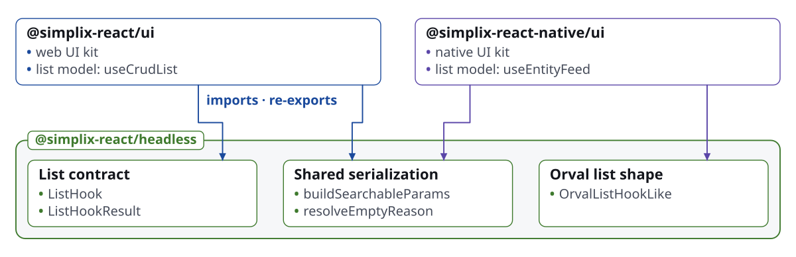

[**Documentation**](../../README.md)

***

[Documentation](../../README.md) / @simplix-react/headless

# @simplix-react/headless

**English** | [한국어](../../_media/README.ko-9.md)

Platform-neutral headless logic shared by the web UI kit (`@simplix-react/ui`) and the native UI kit (`@simplix-react-native/ui`). Nothing in this package touches the DOM or React Native: it holds plain TypeScript and React hooks that run on every platform.



## What it provides

| Area | Exports |
| --- | --- |
| Orval adapters | `adaptOrvalList`, `adaptOrvalGet`, `adaptOrvalCreate`, `adaptOrvalUpdate`, `adaptOrvalDelete`, `adaptOrvalOrder`, `LIST_READ_META` |
| Searchable serialization | `buildSearchableParams`, `SEARCHABLE_KEYWORD_PARAM` |
| Filter vocabulary | `SearchOperator`, `makeFilterKey`, `parseFilterKey`, `getFilterLayout`, `insertFilterSeparators`, operator config tables (`dateOperatorConfig`, `selectOperatorConfig`, `textOperatorOrder`, `numberOperatorOrder`) |
| List contracts | `ListHook`, `ListHookResult`, `SortState`, `PaginationState`, `FilterState`, `EmptyReason`, `CrudMutation` |
| Empty-state classification | `resolveEmptyReason`: ranks a non-success query (`"error"`, `"unavailable"`) above the empty-result reasons |
| In-memory filtering | `matchesFilter` |
| Toast store | `addToast`, `removeToast`, `runToastAction`, `useToastStore` (renderers live in each platform kit) |
| Formatting | `formatBytes`, `toBcp47`, `formatDateShort` / `formatDateMedium` / `formatDateTime` / `formatRelativeTime` / `formatDateRange`, `getMonthNames`, `generateYears` |
| Date math | `startOfDay` … `endOfYear`, `addDays` / `subDays`, `isSameDay` / `isSameMonth` / `isSameWeek`, `parseDate`, `asPlainDate` |
| Semantic-kind date/time encoding | `serializeInstant`, `decodeInstant`, `serializeCalendarDate`, `decodeCalendarDate`, `serializeWallClockTime`, `decodeWallClockTime`, `TimeValue` helpers |
| Application time zone and zone dates | `configureAppTimeZone`, `getAppTimeZone`, `useAppTimeZone`, `zoneDayRange` and the other `zone*` helpers, `elapsedSpan`, `periodStanding`, `daysUntilDay` |
| Clipboard and secure-context fallbacks | `copyText`, `installClipboardFallback`, `installRandomUUIDFallback` |
| List and form state | `paginationHandlers`, `useDebouncedValue`, `useOnline`, `missingRequired` |
| Local ids | `generateLocalId` |
| Theme registry | `THEMES`, `ColorTheme`: the color preset manifest shared by web CSS presets and the native token sheet |

The full list with signatures is in the [API reference](../../_media/README-1.md).

## Consumption

`@simplix-react/ui` re-exports the list contracts, the Orval adapters, the filter vocabulary, the toast store, the formatting and date helpers and the theme registry, so web consumers import those from `@simplix-react/ui`. Native consumers (and `@simplix-react-native/ui` itself) import from `@simplix-react/headless` directly, as does any consumer that needs an export `@simplix-react/ui` does not re-export, such as `buildSearchableParams` or `matchesFilter`.

```ts
import { adaptOrvalList, buildSearchableParams, SearchOperator } from "@simplix-react/headless";
```

The list state machines are intentionally NOT here: the web page model (`useCrudList`) lives in `@simplix-react/ui`, the native feed model (`useEntityFeed`) lives in `@simplix-react-native/ui`. `useCrudList` consumes the `ListHook` contract, and `useEntityFeed` consumes `OrvalListHookLike`, `buildSearchableParams` and `resolveEmptyReason` from this package.

## Enumerations

- [SearchOperator](enumerations/SearchOperator.md)

## Interfaces

- [AdaptOrvalListOptions](interfaces/AdaptOrvalListOptions.md)
- [BuildSearchableParamsOptions](interfaces/BuildSearchableParamsOptions.md)
- [ColorTheme](interfaces/ColorTheme.md)
- [CrudMutation](interfaces/CrudMutation.md)
- [DateRange](interfaces/DateRange.md)
- [ElapsedSpan](interfaces/ElapsedSpan.md)
- [FilterState](interfaces/FilterState.md)
- [ListHook](interfaces/ListHook.md)
- [ListHookResult](interfaces/ListHookResult.md)
- [OrvalGetQueryFields](interfaces/OrvalGetQueryFields.md)
- [OrvalGetResultLike](interfaces/OrvalGetResultLike.md)
- [OrvalMutationLike](interfaces/OrvalMutationLike.md)
- [PaginationHandlers](interfaces/PaginationHandlers.md)
- [PaginationState](interfaces/PaginationState.md)
- [ResolveEmptyReasonInput](interfaces/ResolveEmptyReasonInput.md)
- [RollingWindowOptions](interfaces/RollingWindowOptions.md)
- [SearchableListParams](interfaces/SearchableListParams.md)
- [SortState](interfaces/SortState.md)
- [TimeValue](interfaces/TimeValue.md)
- [Toast](interfaces/Toast.md)
- [ZoneInstantRange](interfaces/ZoneInstantRange.md)
- [ZoneToday](interfaces/ZoneToday.md)

## Type Aliases

- [CalendarDayStyle](type-aliases/CalendarDayStyle.md)
- [CopyOutcome](type-aliases/CopyOutcome.md)
- [DateLike](type-aliases/DateLike.md)
- [ElapsedUnit](type-aliases/ElapsedUnit.md)
- [EmptyReason](type-aliases/EmptyReason.md)
- [OrvalListHookLike](type-aliases/OrvalListHookLike.md)
- [PeriodStanding](type-aliases/PeriodStanding.md)
- [ToastAction](type-aliases/ToastAction.md)

## Variables

- [APP\_TIME\_ZONE](variables/APP_TIME_ZONE.md)
- [dateOperatorConfig](variables/dateOperatorConfig.md)
- [LIST\_READ\_META](variables/LIST_READ_META.md)
- [numberOperatorOrder](variables/numberOperatorOrder.md)
- [SEARCHABLE\_KEYWORD\_PARAM](variables/SEARCHABLE_KEYWORD_PARAM.md)
- [selectOperatorConfig](variables/selectOperatorConfig.md)
- [textOperatorOrder](variables/textOperatorOrder.md)
- [THEMES](variables/THEMES.md)

## Functions

- [adaptOrvalCreate](functions/adaptOrvalCreate.md)
- [adaptOrvalDelete](functions/adaptOrvalDelete.md)
- [adaptOrvalGet](functions/adaptOrvalGet.md)
- [adaptOrvalList](functions/adaptOrvalList.md)
- [adaptOrvalOrder](functions/adaptOrvalOrder.md)
- [adaptOrvalUpdate](functions/adaptOrvalUpdate.md)
- [addDays](functions/addDays.md)
- [addToast](functions/addToast.md)
- [asPlainDate](functions/asPlainDate.md)
- [asZonedInstant](functions/asZonedInstant.md)
- [browserZoneLabel](functions/browserZoneLabel.md)
- [buildSearchableParams](functions/buildSearchableParams.md)
- [calendarDayLabel](functions/calendarDayLabel.md)
- [clampTimeValue](functions/clampTimeValue.md)
- [clampToRange](functions/clampToRange.md)
- [configureAppTimeZone](functions/configureAppTimeZone.md)
- [copyText](functions/copyText.md)
- [daysUntilDay](functions/daysUntilDay.md)
- [decodeCalendarDate](functions/decodeCalendarDate.md)
- [decodeInstant](functions/decodeInstant.md)
- [decodeWallClockTime](functions/decodeWallClockTime.md)
- [elapsedSpan](functions/elapsedSpan.md)
- [elapsedSpanBetween](functions/elapsedSpanBetween.md)
- [elapsedSpanOf](functions/elapsedSpanOf.md)
- [endOfDay](functions/endOfDay.md)
- [endOfMonth](functions/endOfMonth.md)
- [endOfWeek](functions/endOfWeek.md)
- [endOfYear](functions/endOfYear.md)
- [formatBytes](functions/formatBytes.md)
- [formatDateMedium](functions/formatDateMedium.md)
- [formatDateRange](functions/formatDateRange.md)
- [formatDateShort](functions/formatDateShort.md)
- [formatDateTime](functions/formatDateTime.md)
- [formatRelativeTime](functions/formatRelativeTime.md)
- [formatWallClockTime](functions/formatWallClockTime.md)
- [generateLocalId](functions/generateLocalId.md)
- [generateYears](functions/generateYears.md)
- [getAppTimeZone](functions/getAppTimeZone.md)
- [getFilterLayout](functions/getFilterLayout.md)
- [getMonthNames](functions/getMonthNames.md)
- [insertFilterSeparators](functions/insertFilterSeparators.md)
- [installClipboardFallback](functions/installClipboardFallback.md)
- [installRandomUUIDFallback](functions/installRandomUUIDFallback.md)
- [isHourDisabled](functions/isHourDisabled.md)
- [isHourOutOfRange](functions/isHourOutOfRange.md)
- [isMinuteDisabled](functions/isMinuteDisabled.md)
- [isMinuteOutOfRange](functions/isMinuteOutOfRange.md)
- [isSameDay](functions/isSameDay.md)
- [isSameMonth](functions/isSameMonth.md)
- [isSameWeek](functions/isSameWeek.md)
- [isSameZoneDay](functions/isSameZoneDay.md)
- [isYearFirstLocale](functions/isYearFirstLocale.md)
- [makeFilterKey](functions/makeFilterKey.md)
- [matchesFilter](functions/matchesFilter.md)
- [missingRequired](functions/missingRequired.md)
- [offsetAsUtc](functions/offsetAsUtc.md)
- [padTimeUnit](functions/padTimeUnit.md)
- [paginationHandlers](functions/paginationHandlers.md)
- [parseDate](functions/parseDate.md)
- [parseFilterKey](functions/parseFilterKey.md)
- [parseRfc3339](functions/parseRfc3339.md)
- [periodStanding](functions/periodStanding.md)
- [pickedCalendarDay](functions/pickedCalendarDay.md)
- [randomUUIDFrom](functions/randomUUIDFrom.md)
- [removeToast](functions/removeToast.md)
- [resolveEmptyReason](functions/resolveEmptyReason.md)
- [runToastAction](functions/runToastAction.md)
- [serializeCalendarDate](functions/serializeCalendarDate.md)
- [serializeInstant](functions/serializeInstant.md)
- [serializeRfc3339Local](functions/serializeRfc3339Local.md)
- [serializeWallClockTime](functions/serializeWallClockTime.md)
- [startOfDay](functions/startOfDay.md)
- [startOfMonth](functions/startOfMonth.md)
- [startOfWeek](functions/startOfWeek.md)
- [startOfYear](functions/startOfYear.md)
- [subDays](functions/subDays.md)
- [timeAtOrAfter](functions/timeAtOrAfter.md)
- [timePlusHours](functions/timePlusHours.md)
- [to12Hour](functions/to12Hour.md)
- [to24Hour](functions/to24Hour.md)
- [toBcp47](functions/toBcp47.md)
- [toLocalDateString](functions/toLocalDateString.md)
- [useAppTimeZone](functions/useAppTimeZone.md)
- [useDebouncedValue](functions/useDebouncedValue.md)
- [useOnline](functions/useOnline.md)
- [useRollingWindow](functions/useRollingWindow.md)
- [useToastStore](functions/useToastStore.md)
- [useZoneToday](functions/useZoneToday.md)
- [withBrowserZone](functions/withBrowserZone.md)
- [withTime](functions/withTime.md)
- [wrapValue](functions/wrapValue.md)
- [zoneCalendarDate](functions/zoneCalendarDate.md)
- [zoneClockOf](functions/zoneClockOf.md)
- [zoneDateTimeText](functions/zoneDateTimeText.md)
- [zoneDayOf](functions/zoneDayOf.md)
- [zoneDayRange](functions/zoneDayRange.md)
- [zoneDayShifted](functions/zoneDayShifted.md)
- [zoneDayStartInstant](functions/zoneDayStartInstant.md)
- [zoneInstantAt](functions/zoneInstantAt.md)
- [zoneInstantOnDayOf](functions/zoneInstantOnDayOf.md)
- [zoneLabel](functions/zoneLabel.md)
- [zoneLastDaysRange](functions/zoneLastDaysRange.md)
- [zoneMonthRange](functions/zoneMonthRange.md)
- [zonePickedDayRange](functions/zonePickedDayRange.md)
- [zonePickedMonthRange](functions/zonePickedMonthRange.md)
- [zonePickedWeekRange](functions/zonePickedWeekRange.md)
- [zoneTimeOf](functions/zoneTimeOf.md)
- [zoneWeekRange](functions/zoneWeekRange.md)
