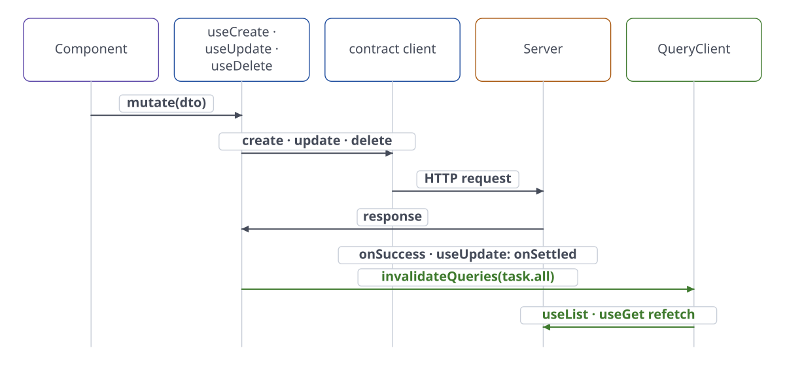

[**Documentation**](../../README.md)

***

[Documentation](../../README.md) / @simplix-react/react

<p align="center">
  
</p>

# @simplix-react/react

**English** | [한국어](../../_media/README.ko-14.md)

Type-safe React Query hooks derived automatically from an `@simplix-react/contract` API contract.

> **Prerequisites:** Requires a contract defined with `@simplix-react/contract`. See [`@simplix-react/contract`](../contract/README.md) first.

## Installation

```bash
pnpm add @simplix-react/react
```

**Peer dependencies:**

| Package | Version |
| --- | --- |
| `@simplix-react/contract` | workspace |
| `@tanstack/react-query` | >= 5.0.0 |
| `@tanstack/react-query-persist-client` | >= 5.0.0 |
| `@tanstack/query-sync-storage-persister` | >= 5.0.0 |
| `react` | >= 18.0.0 |
| `zod` | >= 4.0.0 |

## Quick Example

```tsx
import { defineApi, simpleQueryBuilder } from "@simplix-react/contract";
import { deriveEntityHooks } from "@simplix-react/react";
import { z } from "zod";

// 1. Define the contract
const projectContract = defineApi({
  domain: "project",
  basePath: "/api",
  entities: {
    task: {
      schema: z.object({ id: z.string(), title: z.string(), status: z.string() }),
      operations: {
        list: { method: "GET", path: "/tasks" },
        get: { method: "GET", path: "/tasks/:id" },
        create: {
          method: "POST",
          path: "/tasks",
          input: z.object({ title: z.string(), status: z.string() }),
        },
        update: {
          method: "PATCH",
          path: "/tasks/:id",
          input: z.object({ title: z.string().optional(), status: z.string().optional() }),
        },
        delete: { method: "DELETE", path: "/tasks/:id" },
      },
    },
  },
  queryBuilder: simpleQueryBuilder,
});

// 2. Derive hooks: one call covers every entity and operation
const hooks = deriveEntityHooks(projectContract);

// 3. Use in components
function TaskList() {
  const { data: tasks, isLoading } = hooks.task.useList();
  const createTask = hooks.task.useCreate();

  if (isLoading) return <p>Loading...</p>;

  return (
    <ul>
      {tasks?.map((task) => (
        <li key={task.id}>{task.title}</li>
      ))}
    </ul>
  );
}
```

## API Overview

The package exports hook derivation, query-runtime helpers, and a set of type definitions:

| Export | Kind | Description |
| --- | --- | --- |
| `deriveEntityHooks` | Function | Derives all hooks from a contract |
| `useBatchDetails` | Hook | Runs one detail query per item of a list and combines the results |
| `createLocalQueryStore` | Function | Registers query keys whose cache is persisted to `localStorage` |
| `startOnlineStatusSync` | Function | Keeps React Query's connectivity flag in sync with `navigator.onLine` |
| `resyncOnlineStatus` | Function | Repairs the connectivity flag once, on demand |
| `DerivedEntityHooksResult` | Type | Return type of `deriveEntityHooks` |
| `EntityHooks` | Type | Hook interface for a single entity |
| `EntityHookFor` | Type | Hook type of one entity operation, chosen by its role |
| `OperationHooks` | Type | Hook interface for a top-level operation |
| `DerivedListHook` | Type | List query hook signature |
| `DerivedGetHook` | Type | Detail query hook signature |
| `DerivedCreateHook` | Type | Create mutation hook signature |
| `DerivedUpdateHook` | Type | Update mutation hook signature |
| `DerivedDeleteHook` | Type | Delete mutation hook signature |
| `DerivedInfiniteListHook` | Type | Infinite list query hook signature |
| `DerivedTreeHook` | Type | Tree query hook signature |
| `DerivedQueryHook` | Type | Query hook signature of a custom GET operation |
| `OperationMutationHook` | Type | Mutation hook signature of a custom operation |
| `LocalQueryStoreOptions`, `LocalQueryDef` | Type | Options of `createLocalQueryStore` and of one local query |

## Key Concepts

### Hook Derivation

`deriveEntityHooks()` reads the entity and operation definitions from a contract and derives a typed hook object. Each entity key maps to an `EntityHooks` object, and each top-level operation key maps to an `OperationHooks` object.

```ts
const hooks = deriveEntityHooks(projectContract);
// hooks.task           → EntityHooks<TaskSchema, TaskOperations>
// hooks.archiveProject → OperationHooks<ArchiveInput, ArchiveOutput>
```

An entity hook is named `use` + the operation name (`list` → `useList`, `archive` → `useArchive`). The operation's role decides the hook:

| Role | Hook |
| --- | --- |
| `list` | `useList`, plus `useInfiniteList` |
| `get` | `useGet` |
| `create` | `useCreate` |
| `update` | `useUpdate` |
| `delete` | `useDelete` |
| `tree` | `useTree` |
| custom operation with `GET` | query hook `use<Name>(params?, options?)` |
| custom operation with any other method | mutation hook `use<Name>(options?)` |

A top-level operation gets `hooks.<operation>.useMutation()`.

### Auto-Invalidation

Mutation hooks automatically invalidate related queries:



- **Entity mutations** (`useCreate`, `useUpdate`, `useDelete`) invalidate all queries under the entity's `all` key. `useUpdate` does so when the mutation settles, success or error.
- **Custom entity mutations** invalidate the keys returned by the operation's `invalidates` function, or the entity's `all` key when it has none.
- **Top-level operation mutations** invalidate only the keys returned by the operation's `invalidates` function.

No manual `queryClient.invalidateQueries()` calls are needed.

### TanStack Query Options Passthrough

All hooks accept TanStack Query options as their last argument. Query hooks accept all `UseQueryOptions` except `queryKey` and `queryFn`. Mutation hooks accept all `UseMutationOptions` except `mutationFn`.

```ts
// Pass query options
const { data } = hooks.task.useList({ enabled: false });

// Pass mutation options
const createTask = hooks.task.useCreate(undefined, {
  onSuccess: (data) => console.log("Created:", data),
});
```

### Connectivity Flag Recovery

React Query pauses a fetch while it believes the browser is offline, and it decides that from a cached flag written only by the window `online` / `offline` events. Because the manager detaches those listeners whenever nothing is subscribed, one missed `online` event leaves the flag stuck and every query paused for the lifetime of the page: a list that renders "could not be loaded" and never recovers without a reload.

`startOnlineStatusSync()` repairs the flag from `navigator.onLine`, which is always current: once at boot, and again each time the document becomes visible. Restoring the flag is enough to recover: the `QueryClient` subscribes to the manager itself and resumes paused fetches when it flips back to online.

Call it once where the app creates its `QueryClient`:

```ts
import { QueryClient, QueryClientProvider } from "@tanstack/react-query";
import { startOnlineStatusSync } from "@simplix-react/react";

const queryClient = new QueryClient();

startOnlineStatusSync();
```

`resyncOnlineStatus()` performs the same repair once, for apps that run their own connectivity probe. Both are no-ops where `navigator.onLine` does not exist (server rendering, React Native), so neither overrides a platform-specific connectivity integration.

`focusManager` needs no equivalent: its `isFocused()` reads `document.visibilityState` on every call rather than caching it, so it cannot go stale.

## Hook Reference

### `useList`

Fetches a list of entities. It accepts a parent ID, list params and query options in these combinations:

```ts
// Top-level entity
hooks.task.useList();
hooks.task.useList({ enabled: isReady });

// With filters/sort
hooks.task.useList({
  filters: { status: "open" },
  sort: { field: "createdAt", direction: "desc" },
});

// Child entity with parent ID
hooks.task.useList(projectId);
hooks.task.useList(projectId, { filters: { status: "open" } });
hooks.task.useList(projectId, { filters: { status: "open" } }, { enabled: isReady });
```

For child entities, the query is automatically disabled when `parentId` is falsy. A response shaped `{ data: [...] }` is unwrapped to the array.

### `useGet`

Fetches a single entity by ID.

```ts
const { data: task } = hooks.task.useGet(taskId);
const { data: task } = hooks.task.useGet(taskId, { staleTime: 5000 });
```

The query is automatically disabled when `id` is falsy.

### `useCreate`

Creates a new entity. For child entities, pass the parent ID.

```ts
// Top-level entity
const createTask = hooks.task.useCreate();
createTask.mutate({ title: "New task", status: "open" });

// Child entity
const createTask = hooks.task.useCreate(projectId);
createTask.mutate({ title: "New task", status: "open" });
```

### `useUpdate`

Updates an existing entity.

```ts
// Standard update
const updateTask = hooks.task.useUpdate();
updateTask.mutate({ id: taskId, dto: { status: "done" } });
```

With `optimistic: true`, the hook merges `dto` into the matching item of every cached list and restores the lists when the request fails. The option is missing from the hook's type, so a type-checked call cannot pass it.

### `useDelete`

Deletes an entity by ID.

```ts
const deleteTask = hooks.task.useDelete();
deleteTask.mutate(taskId);
```

### `useInfiniteList`

Fetches paginated data with cursor-based or offset-based pagination. Pagination is managed automatically based on the response's `meta` field.

```ts
const {
  data,
  fetchNextPage,
  hasNextPage,
  isFetchingNextPage,
} = hooks.task.useInfiniteList(projectId, {
  limit: 10,
  filters: { status: "open" },
  sort: { field: "createdAt", direction: "desc" },
});

// Access flattened data
const allTasks = data?.pages.flatMap((page) => page.data) ?? [];
```

The first argument is the parent ID; pass `undefined` for a top-level entity. `limit` defaults to 20. The next page is requested while `meta.hasNextPage` is true, with `meta.nextCursor` when present and the next page number otherwise.

### `useTree`

Fetches the response of a `tree` operation. `params` become query string parameters.

```ts
const { data: tree } = hooks.category.useTree({ rootId: "c1" });
```

### Custom Entity Operation Hooks

A custom entity operation with `GET` derives a query hook, any other method a mutation hook. The value passed to the query hook or to `mutate` becomes the client function's argument, so it fills the operation's first path param, and a mutation hook cannot send an input beside it. For a custom operation of an entity, the hook calls `invalidates` with a map holding one entry, keyed by the operation name and holding the entity's query key factory, and an empty parameter object: inside the `archive` operation, `queryKeys.archive.all` is the entity's `all` key, and the keys of other entities are not in the map.

```ts
// archive: { method: "POST", path: "/tasks/:id/archive" }
const archiveTask = hooks.task.useArchive();
archiveTask.mutate("task-1");
```

### Operation `useMutation`

Each top-level operation defined in the contract derives a `useMutation` hook. The value passed to `mutate` is the client function's single argument.

```ts
// archiveProject: { method: "POST", path: "/projects/:projectId/archive", ... }
const archiveProject = hooks.archiveProject.useMutation({
  onSuccess: () => {
    // Cache invalidation is already handled via the contract's `invalidates`
    console.log("Project archived");
  },
});

archiveProject.mutate("abc");
```

## Query Utilities

### `useBatchDetails`

Runs one detail query for each item of a list and returns the resolved details with a combined pending flag:

```ts
import { useBatchDetails } from "@simplix-react/react";

const { data: details, isPending } = useBatchDetails(
  tasks,
  (task) => task.id,
  (id) => ({
    queryKey: projectContract.queryKeys.task.detail(id),
    queryFn: () => projectContract.client.task.get(id),
  }),
);
```

Items whose `extractId` returns `undefined` are skipped; `data` holds only the queries that succeeded.

### `createLocalQueryStore`

Persists selected queries to `localStorage` and keeps them fresh until invalidated. Only registered keys that loaded successfully are written:

```tsx
import { QueryClient } from "@tanstack/react-query";
import { PersistQueryClientProvider } from "@tanstack/react-query-persist-client";
import { createLocalQueryStore } from "@simplix-react/react";

const queryClient = new QueryClient();
const store = createLocalQueryStore({ version: "1", storageKey: "app:cache" });

// Persist a query owned by a framework provider
store.localQueryKey(["menu", "tree"]);

// Define and persist an app-owned query; pass the result to useQuery
const policyQuery = store.localQuery({ key: ["policy"], queryFn: fetchPolicy });

function App() {
  return (
    <PersistQueryClientProvider client={queryClient} persistOptions={store.persistOptions}>
      {/* ... */}
    </PersistQueryClientProvider>
  );
}
```

`version` busts the persisted cache when it changes. `maxAge` defaults to 24 hours. A query from `localQuery` has `staleTime: Infinity` and `gcTime` equal to `maxAge` unless the definition sets them.

## Related Packages

| Package | Description |
| --- | --- |
| `@simplix-react/contract` | Define type-safe API contracts |
| `@simplix-react/form` | Derive TanStack Form hooks from the contract and these hooks |
| `@simplix-react/mock` | Derive MSW mock handlers from contracts for testing |
| `@simplix-react/i18n` | i18next-based internationalization framework |

---

**Next Step** → [`@simplix-react/form`](../form/README.md): derive form hooks from the contract and these hooks.

## Interfaces

- [LocalQueryDef](interfaces/LocalQueryDef.md)
- [LocalQueryStoreOptions](interfaces/LocalQueryStoreOptions.md)
- [OperationHooks](interfaces/OperationHooks.md)

## Type Aliases

- [DerivedCreateHook](type-aliases/DerivedCreateHook.md)
- [DerivedDeleteHook](type-aliases/DerivedDeleteHook.md)
- [DerivedEntityHooksResult](type-aliases/DerivedEntityHooksResult.md)
- [DerivedGetHook](type-aliases/DerivedGetHook.md)
- [DerivedInfiniteListHook](type-aliases/DerivedInfiniteListHook.md)
- [DerivedListHook](type-aliases/DerivedListHook.md)
- [DerivedQueryHook](type-aliases/DerivedQueryHook.md)
- [DerivedTreeHook](type-aliases/DerivedTreeHook.md)
- [DerivedUpdateHook](type-aliases/DerivedUpdateHook.md)
- [EntityHookFor](type-aliases/EntityHookFor.md)
- [EntityHooks](type-aliases/EntityHooks.md)
- [OperationMutationHook](type-aliases/OperationMutationHook.md)

## Functions

- [createLocalQueryStore](functions/createLocalQueryStore.md)
- [deriveEntityHooks](functions/deriveEntityHooks.md)
- [resyncOnlineStatus](functions/resyncOnlineStatus.md)
- [startOnlineStatusSync](functions/startOnlineStatusSync.md)
- [useBatchDetails](functions/useBatchDetails.md)
