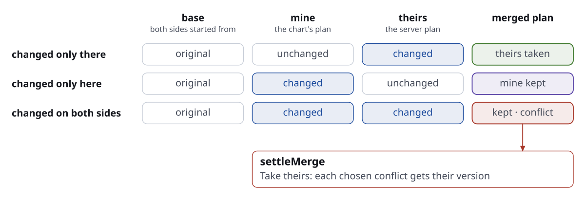

# Gantt chart guide

**English** | [한국어](guide.ko.md)

How to build a project schedule screen with `@simplix-react/gantt`, store the plan, and keep each reader's screen layout. The props and the keyboard table are in the [README](../README.md).

## Putting a chart on a screen

Import the stylesheet once, after the framework theme.

```css
@import "tailwindcss";
@import "@simplix-react/ui/theme.css";
@import "@simplix-react/gantt/styles.css";
```

Put `Gantt` in a box with a height. The chart fills the box and scrolls inside it.

```tsx
import { Gantt } from "@simplix-react/gantt";
import type { Project } from "@simplix-react/gantt-core";

export function PlanPage({ plan }: { plan: Project }) {
  return (
    <div className="h-[720px]">
      <Gantt defaultProject={plan} />
    </div>
  );
}
```

The translations are registered when the package is imported. Import `@simplix-react/gantt` before the application creates its i18n configuration.

## Storing the plan

Every time the reader commits an edit, the chart calls `onChange`. The third argument, `changes`, holds only the records that differ from the plan before it, so this list is all a server needs.

```tsx
<Gantt
  defaultProject={plan}
  onChange={(project, schedule, changes) => {
    for (const change of changes) {
      if (change.entity === "task" && change.kind === "updated") saveTask(change.id, change.value);
      if (change.entity === "task" && change.kind === "removed") deleteTask(change.id);
    }
  }}
/>
```

Dates are not stored in the plan. The start and finish dates are in `schedule`, and the engine computes the same values when the plan is opened again.

To keep a whole plan as a string, write it with `serializeProject` and read it with `parseProject`. The stored string records the form name and the version.

```ts
import { parseProject, serializeProject } from "@simplix-react/gantt-core";

const text = serializeProject(project);
const plan = parseProject(text);
```

`parseProject` raises `unsupported-plan-version` for a plan saved by a later version and `invalid-plan` for a value that is not a plan. A plan stored as a bare `Project` object without a version is read as it is.

## Taking in another user's changes

When a new plan arrives from the server, merge it with the store's `merge`. Pass as `base` the plan both sides started from (the plan last saved).

```tsx
const store = useGanttStore();
const conflicts = store.getState().merge(lastSavedPlan, planFromServer);
```



Records only the other side changed are taken as they are. Records both sides changed keep this side's value and are returned as `conflicts`. The undo history is kept.

When there are conflicts, the chart lists their records in a dialog. The reader picks "Keep mine" or "Take theirs" for each record and presses "Apply"; only the records set to "Take theirs" change to the other side's value. One undo reverses the change. To settle it from code, pass `settleMerge` the conflicts that take the other side's value.

```tsx
store.getState().settleMerge(conflicts.filter((conflict) => conflict.entity === "task"));
```

## Keeping the screen layout

Column widths and order, the zoom step, folded rows, filters and bar settings together are the screen layout. Store the value `onLayoutChange` hands over per reader, and pass it back through `layout` the next time the chart opens.

```tsx
<Gantt
  defaultProject={plan}
  layout={JSON.parse(localStorage.getItem("plan-layout") ?? "{}")}
  onLayoutChange={(layout) => localStorage.setItem("plan-layout", JSON.stringify(layout))}
/>
```

## Working with the task table

| Action | How |
| --- | --- |
| Resize a column | Drag the grip on the right edge of the heading. A double click on the grip returns the default width |
| Reorder columns | Drag the heading left or right. While dragging, the column name shows beside the pointer and a vertical line marks the edge the column drops at. Holding the heading at the table's edge scrolls the hidden columns that way |
| Choose the columns shown | Pick them from the button in the table's top left corner or the column button in the toolbar. When a newly added column lies outside the table, the table scrolls to it |
| Resize the table | Drag the grip on the boundary between the table and the timeline |
| Scroll inside the table | When the columns are wider than the table, a scroll bar shows under it. Drag the bar, turn the wheel sideways over the table, or swipe the table sideways on a touch screen |

The row number column takes only the width the longest row number and the marks beside it need. When the table scrolls sideways, the row number column and the first column stay fixed on the left. When the arrow keys move the active cell, the table scrolls until that cell is in view.

The grips work from the keyboard too. Select a grip with Tab, then press the left or right arrow key to change the width; with Shift the step is four times larger. Home on a column grip returns the default width.

## Using a touch screen

A finger that moves as soon as it touches scrolls the chart, even when it starts on a bar, a column heading, a row number or a task of the calendar. To move a bar or a heading, rest the finger for 0.3 seconds, then drag. A mouse and a pen drag at once.

## Using a narrow screen

The chart changes its layout to the width of the box it stands in.

- The view tabs take a line of their own above the command buttons, and turn into a selection list at a width where the tabs do not fit.
- When the toolbar is narrower than 560 px, it keeps undo, add task, delete task, column choice and search, and shows the other commands in the more menu.
- "Pane" in the more menu shows the table alone or the timeline alone. This choice is stored with the screen layout.
- Resource usage, task usage and the resource graph give the name column at most 40% of the width.
- The calendar draws only the task count and marker bars in a day cell. Tapping a day lists that day's task names under the calendar, and tapping a name opens the task information dialog.

## Contrast themes and screen readers

Where the browser forces colours, as the Windows contrast themes do, summary bars, milestones, progress, baseline bars, non-working time and the date markers keep a fill in the theme's colours. Since colour tells nothing apart there, a critical task has a double outline and a selected bar a highlight outline.

A screen reader is given the table's rows in the order they are shown, with the heading row counted first. A bar is read as the task name, its start and finish dates and its progress, and a milestone or a critical task is read with that added.

## Opening read-only

With `readOnly` on, the chart only shows the plan. It refuses cell edits, bar drags and deletion, and disables the fields of its dialogs.

```tsx
<Gantt defaultProject={plan} readOnly />
```

## Filter, sort and group

Choose them from the more menu of the toolbar. Typing in the search box keeps only the tasks whose name contains the text.

| Feature | Behaviour |
| --- | --- |
| Filter | Shows the tasks that match the condition and the summary tasks above them |
| Sort | Reorders the tasks under each summary task and keeps the outline |
| Group | Undoes the outline and gathers the tasks under heading rows by resource, by critical or not, or by progress status |

While a filter, a sort or a group is on, rows cannot be dragged to reorder them, because the order on screen differs from the order of the plan.

## Tracking progress

Setting a status date in the project information dialog makes these available:

- The timeline marks the status date with an orange dashed line.
- With the progress line on, a line runs down the status date and bends at each task's point of progress. A bend to the left is a late task.
- "Reschedule uncompleted work" moves tasks that have not started to after the status date, and pauses tasks in progress where their completed part ends, to resume on the status date.
- The earned value columns show planned value, earned value and actual cost, with the cost saved in the baseline as the budget. Save a baseline first.

## Other views

Choose them from the view tabs.

| View | Content |
| --- | --- |
| Network diagram | Draws tasks as boxes and their dependencies as lines. The buttons at the top right zoom in, zoom out or fit everything on the screen |
| Calendar | Splits a month into day cells and shows the tasks running on each day. Dragging a task to another day cell moves its start by that many days |
| Resource sheet | Edits each resource's rates, maximum units and calendar |
| Resource usage | Shows the hours booked per day for each resource |
| Task usage | Shows the hours per day of the resources assigned to each task |
| Resource graph | Compares each resource's booked hours with its available hours as bars |

Resource usage, task usage and the resource graph draw only the rows and columns on screen, so a long plan opens at the same speed.

## Exchanging files

Run these from the more menu.

| Command | Behaviour |
| --- | --- |
| Save as plan file | Downloads the whole plan as a `.gantt.json` file. It holds every piece of the chart's information |
| Open plan file | Reads a saved plan file and replaces the current plan |
| Export MS Project XML | Downloads the plan as a Microsoft Project XML file |
| Import MS Project XML | Reads a Microsoft Project XML file and replaces the current plan |

The Microsoft Project XML format has no place for the pauses of split tasks, the colours of single tasks or the rule of a recurring task. When the plan holds any of these, the chart lists what will not be saved in a dialog before the export, and writes the file only after the reader presses "Export anyway". The same dialog lists what an imported file held that could not be read as written. To keep everything, save a plan file.

`planFiles={false}` hides the plan file commands, and `xmlExchange={false}` the XML commands.

## Running the tests

Run the unit and component tests with `pnpm --filter @simplix-react/gantt test`. The real-browser tests run with the commands below after Storybook is started. They use the installed Google Chrome.

```bash
pnpm --filter @simplix-react/gantt build
pnpm storybook
GANTT_STORYBOOK_URL=http://localhost:6006 pnpm --filter @simplix-react/gantt test:e2e
```

At start the browser tests compare the sources Storybook serves with the files on disk. When they differ, the tests stop and print the paths of the files that differ; restart Storybook and run the tests again. Storybook reads the chart's stylesheet from the build output (`dist/styles.css`), so after changing `src/styles.css` the package has to be built again. When the two files differ, the tests stop and print the build command. On a machine where the problem keeps coming back, starting with `CHOKIDAR_USEPOLLING=1 pnpm storybook` checks for file changes by polling, and it does not come back.

The `.github/workflows/gantt.yml` workflow runs the type check, lint, unit tests and browser tests whenever the `gantt` package, the `gantt-core` package or the Gantt stories change.
