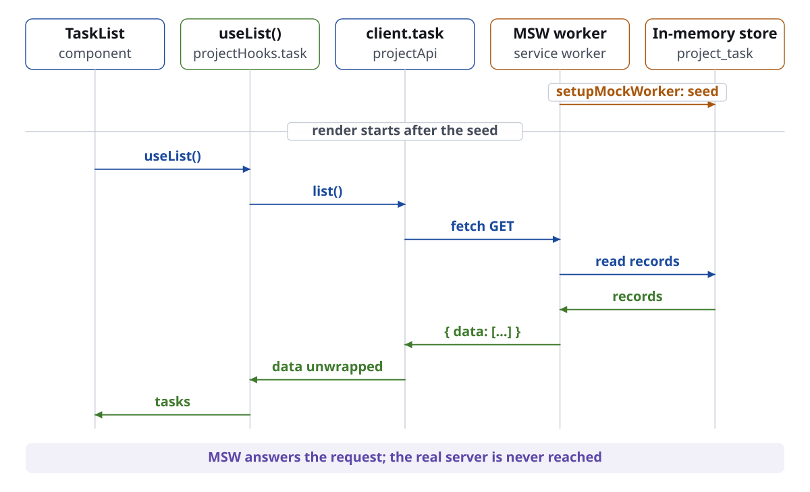

# Quick Start

**English** | [한국어](../../ko/getting-started/quick-start.md)

Build a complete contract-driven feature. This guide walks through the full simplix-react pipeline: defining a contract, deriving hooks, rendering data in React, and adding a mock backend.

## Step 1: Install Dependencies

```bash
# Runtime
pnpm add @simplix-react/contract @simplix-react/react \
  zod @tanstack/react-query @tanstack/react-query-persist-client \
  @tanstack/query-sync-storage-persister react react-dom

# Dev (mock layer)
pnpm add -D @simplix-react/mock msw
```

## Step 2: Define a Contract

Create a contract that describes a `task` entity: a Zod schema for its shape and an operation for each CRUD role, with the request schema of `create` and `update` as their `input`.

```ts
// src/contracts/project.ts
import { z } from "zod";
import { defineApi, simpleQueryBuilder } from "@simplix-react/contract";

const taskSchema = z.object({
  id: z.number(),
  title: z.string(),
  status: z.string(),
  createdAt: z.string(),
});

const taskCreateSchema = taskSchema.pick({ title: true, status: true });
const taskUpdateSchema = taskCreateSchema.partial();

export const projectApi = defineApi({
  domain: "project",
  basePath: "/api/v1",
  entities: {
    task: {
      schema: taskSchema,
      operations: {
        list: { method: "GET", path: "/tasks" },
        get: { method: "GET", path: "/tasks/:id" },
        create: { method: "POST", path: "/tasks", input: taskCreateSchema },
        update: { method: "PATCH", path: "/tasks/:id", input: taskUpdateSchema },
        delete: { method: "DELETE", path: "/tasks/:id" },
      },
    },
  },
  queryBuilder: simpleQueryBuilder,
});

// Inferred types: no manual type definitions needed
export type Task = z.infer<typeof taskSchema>;
export type TaskCreate = z.infer<typeof taskCreateSchema>;
export type TaskUpdate = z.infer<typeof taskUpdateSchema>;
```

This single definition gives you:

- A type-safe HTTP client (`projectApi.client.task`)
- Query key factories for cache management (`projectApi.queryKeys.task`)

## Step 3: Derive Hooks

Pass the contract to `deriveEntityHooks` to get a TanStack Query hook for every operation.

```ts
// src/hooks/project-hooks.ts
import { deriveEntityHooks } from "@simplix-react/react";
import { projectApi } from "../contracts/project";

export const projectHooks = deriveEntityHooks(projectApi);

// Available hooks:
// projectHooks.task.useList()          fetch all tasks
// projectHooks.task.useInfiniteList()  paginated list
// projectHooks.task.useGet(id)         fetch one task
// projectHooks.task.useCreate()        create a task
// projectHooks.task.useUpdate()        update a task: mutate({ id, dto })
// projectHooks.task.useDelete()        delete a task: mutate(id)
```

## Step 4: Use in a React Component

Use the derived hooks in your components. The hooks return standard TanStack Query results: `data`, `isLoading`, `error`, `mutate`, and the rest.

```tsx
// src/components/task-list.tsx
import { projectHooks } from "../hooks/project-hooks";

export function TaskList() {
  const { data: tasks, isLoading, error } = projectHooks.task.useList();
  const createTask = projectHooks.task.useCreate();
  const deleteTask = projectHooks.task.useDelete();

  if (isLoading) return <p>Loading tasks...</p>;
  if (error) return <p>Error: {error.message}</p>;

  return (
    <div>
      <h1>Tasks</h1>

      <button
        onClick={() =>
          createTask.mutate({
            title: "New Task",
            status: "pending",
          })
        }
      >
        Add Task
      </button>

      <ul>
        {tasks?.map((task) => (
          <li key={task.id}>
            {task.title}: {task.status}
            <button onClick={() => deleteTask.mutate(task.id)}>Delete</button>
          </li>
        ))}
      </ul>
    </div>
  );
}
```

Wrap your application with the TanStack Query provider:

```tsx
// src/app.tsx
import { QueryClient, QueryClientProvider } from "@tanstack/react-query";
import { TaskList } from "./components/task-list";

const queryClient = new QueryClient();

export function App() {
  return (
    <QueryClientProvider client={queryClient}>
      <TaskList />
    </QueryClientProvider>
  );
}
```

## Step 5: Add a Mock Data Layer

Use `@simplix-react/mock` to create an in-browser backend powered by MSW and in-memory stores. No real server required.



### 5a. Derive Handlers and Start the Worker

Seed data is keyed by store name: the domain and the entity name in snake case, `project_task` here. A record created through a handler gets the next numeric `id` and `createdAt` and `updatedAt` timestamps.

```ts
// src/mocks/setup.ts
import { deriveMockHandlers, setupMockWorker } from "@simplix-react/mock";
import { projectApi } from "../contracts/project";

export async function startMockWorker(): Promise<void> {
  await setupMockWorker({
    domains: [
      {
        name: "project",
        handlers: deriveMockHandlers(projectApi.config),
        seed: {
          project_task: [
            { id: 1, title: "Design the API contract", status: "done" },
            { id: 2, title: "Implement the frontend", status: "in-progress" },
            { id: 3, title: "Write tests", status: "pending" },
          ],
        },
      },
    ],
  });
}
```

MSW needs its service worker script in your public directory:

```bash
npx msw init public/ --save
```

### 5b. Initialize Before Rendering

```tsx
// src/main.tsx
import { createRoot } from "react-dom/client";
import { App } from "./app";

async function bootstrap() {
  if (import.meta.env.DEV) {
    const { startMockWorker } = await import("./mocks/setup");
    await startMockWorker();
  }

  createRoot(document.getElementById("root")!).render(<App />);
}

bootstrap();
```

## What You Built

With just a few files, you now have:

- ✔ A **type-safe API contract** with Zod schema validation
- ✔ An **HTTP client** with `list`, `get`, `create`, `update`, `delete` methods
- ✔ **React Query hooks** with automatic cache invalidation
- ✔ An **in-browser mock backend** with MSW and in-memory stores
- ✔ **Zero manual type definitions**: everything is inferred from the contract

## Next Steps

- [TypeScript Setup](./typescript.md): fine-tune your TypeScript configuration
- [Overview](./overview.md): learn more about the framework architecture
