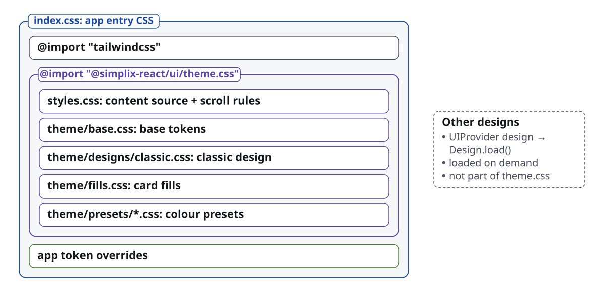

# `@simplix-react/ui` Consumer Styling / Token Setup Guide

**English** | [한국어](../../ko/guides/consumer-styling-setup.md)

This document is a reference for **what you must set up on the consumer side** when you add `@simplix-react/ui` as a dependency in another project and use its components.

> **Prerequisites:** You have a simplix-react project (or any React app) that adds `@simplix-react/ui` as a dependency, and a build that supports Tailwind CSS v4 (via `@tailwindcss/vite`).

## In One Sentence

The package ships its whole style layer, design tokens included, as one stylesheet, `@simplix-react/ui/theme.css`; the consumer imports it after Tailwind and overrides tokens only where the app differs.

---

## 1. The Style Files the Package Ships

| File | Contents | When to use |
|---|---|---|
| `@simplix-react/ui/theme.css` | The style layer in one import: `styles.css`, the base tokens (`theme/base.css`), the classic design (`theme/designs/classic.css`), the card fills (`theme/fills.css`) and every colour preset (`theme/presets/*.css`) | Always |
| `@simplix-react/ui/styles.css` | Registers the package as a Tailwind content source (`@source "./**/*.js"` and `@source "../src/**/*.{ts,tsx}"`), plus scrollbar and column-width rules for `[data-slot="table-container"]` and `[data-crud-slot="body"]` | Pulled in by `theme.css`; import it on its own only when you do not import `theme.css` |



Designs other than classic are not part of `theme.css`: `UIProvider` loads their stylesheets when you choose one (see [designs.md](./designs.md)).

Build-config evidence: `packages/ui/tsup.config.ts` → `onSuccess` copies `src/styles.css`, `src/theme.css` and `src/theme/` into `dist/`.

---

## 2. Design Tokens (CSS Variables)

The component class names use Tailwind utilities such as `bg-background`, `text-muted-foreground`, `border-input` and `bg-primary/10`. `theme/base.css` defines every token they read, in `:root` and `.dark`, and maps them to Tailwind colours in `@theme inline`. You define a token yourself only to change it; put the override after the `theme.css` import.

### 2-1. Color Tokens (Used in Pairs)

| Token | Pair | Where it is used |
|---|---|---|
| `--background` | `--foreground` | Global body, every surface |
| `--card` | `--card-foreground` | `Card`, `CrudDetail` sections |
| `--popover` | `--popover-foreground` | `Popover`, `DropdownMenu`, `Select`, `Tooltip` content |
| `--primary` | `--primary-foreground` | `Button` (default), active states, ring emphasis |
| `--secondary` | `--secondary-foreground` | `Button` (secondary), secondary emphasis |
| `--muted` | `--muted-foreground` | Disabled text, hover surface, placeholder |
| `--accent` | `--accent-foreground` | Hover/focus surface, menu items |
| `--destructive` | `--destructive-foreground` | Delete button, errors, `aria-invalid` |
| `--success` | none | Success states |
| `--warning` | none | Notifications / warnings |
| `--info` | none | Informational notifications |
| `--border` | none | All separators, input/card borders |
| `--input` | none | `Input`, `Textarea` borders |
| `--ring` | none | focus-visible ring |

### 2-2. Chart Tokens (Used by `base/charts/`)

`--chart-1` through `--chart-5`

### 2-3. Sidebar Tokens (Used by Layout / Menu Components)

`--sidebar`, `--sidebar-foreground`, `--sidebar-primary`, `--sidebar-primary-foreground`, `--sidebar-accent`, `--sidebar-accent-foreground`, `--sidebar-border`, `--sidebar-ring`

### 2-4. Corner Radius

`--radius` (base) → `--radius-sm | --radius-md | --radius-lg | --radius-xl` are derived from it via `calc()` in `theme/base.css`

### 2-5. Font Families

- `--font-sans`: Body text (Tailwind `font-sans`)
- `--font-display`: Heading emphasis (Tailwind `font-display`)
- `--font-mono`: Code (Tailwind `font-mono`)

---

## 3. Tailwind Configuration Requirements

This package assumes **Tailwind CSS v4** (catalog version `^4.2.1`). Your consumer build needs the following.

1. Add the `@tailwindcss/vite` plugin to `vite.config.ts`
2. In your consumer entry CSS:
   - `@import "tailwindcss";`
   - `@import "@simplix-react/ui/theme.css";`: its `styles.css` registers the package's compiled output as a content source, so you need no `@source` line for the package
   - Override tokens after that import, if the app needs to

The starter that the CLI generates follows this: `packages/cli/src/templates/project/app/index-css.hbs`

---

## 4. Dark Mode / Multi-Color Themes

- **Dark mode**: Toggle a `.dark` class on `<html>` → `theme/base.css` and each preset override the tokens in their `.dark` blocks
- **Color scheme swap**: Set `data-color-theme="<name>"` on `<html>`; each preset is scoped to `:root[data-color-theme='<name>']`
- **Presets shipped**: `packages/ui/src/theme/presets/{blue,clear,cobalt,forest,fresh,grape,graphite,green,krds,orange,rose,violet}.css`, listed with their labels, radius, typeface and fill by `THEMES` (type `ColorTheme`)

---

## 5. i18n Side Effect (Intentional side-effect import)

Merely importing `@simplix-react/ui` runs `src/locales/index.ts`, which registers the `simplix` namespace (en/ko/ja) in the `@simplix-react/i18n` module registry.

- The `sideEffects` field in `package.json` is configured to preserve these files
- **Import order matters**: You must import `@simplix-react/ui` **before** calling `createI18nConfig()` (see the comment in `apps/storybook/.storybook/preview.tsx:9`)

---

## 6. Minimum Consumer Setup (Practical Checklist)

```bash
pnpm add @simplix-react/ui @simplix-react/i18n @simplix-react/form @simplix-react/react \
         @tanstack/react-query react react-dom
pnpm add -D tailwindcss@^4.2 @tailwindcss/vite
```

`vite.config.ts`:

```ts
import tailwindcss from "@tailwindcss/vite";
export default defineConfig({
  plugins: [react(), tailwindcss()],
});
```

`src/index.css`:

```css
@import "tailwindcss";
@import "@simplix-react/ui/theme.css";

/* Optional: override tokens after the import */
:root {
  --radius: 0.5rem;
}

@layer base {
  body { @apply m-0 font-sans antialiased text-foreground bg-background; }
}
```

`src/main.tsx`:

```ts
import "./index.css";
import "@simplix-react/ui";              // i18n side-effect first
// then createI18nConfig(), createRoot, etc.
```

App root:

```tsx
<UIProvider>
  <CrudProvider router={createReactRouterAdapter({ useNavigate, useSearchParams, useLocation })}>
    <App />
  </CrudProvider>
</UIProvider>
```

---

## 7. File Location Index (For Troubleshooting)

| File | Role |
|---|---|
| `packages/ui/src/theme.css` | The single style import |
| `packages/ui/src/styles.css` | Tailwind content source registration and scroll-container rules |
| `packages/ui/src/theme/base.css` | Base tokens: `:root`, `.dark`, `@theme inline` |
| `packages/ui/src/theme/presets/*.css` | The `data-color-theme="..."` presets |
| `packages/ui/src/theme/fills.css` | Card fills (`data-fill`) |
| `packages/ui/tsup.config.ts` | Copies the CSS to `dist/` without processing |
| `packages/ui/src/index.ts` | Public surface (exports all components/hooks/types) |
| `packages/ui/src/locales/{en,ko,ja}.json` | Translations bundled with the package |
| `packages/ui/src/locales/index.ts` | Automatic i18n module registration (side effect) |
| `apps/storybook/src/index.css` | Reference for Tailwind import + `theme.css` + `@layer base` |
| `apps/storybook/.storybook/preview.tsx` | Import order + theme toggle demo |
| `packages/cli/src/templates/project/app/index-css.hbs` | CLI-generated starter |
| `packages/cli/src/templates/project/app/vite-config.hbs` | Vite + Tailwind v4 plugin setup |
| `packages/cli/src/templates/project/app/main-tsx.hbs` | Entry import order |

---

> **Next Step:** Once your tokens and Tailwind setup are in place, see [`consumer-design-customization.md`](./consumer-design-customization.md) to learn how to change colors, fonts, radius, per-component styles, and component structure. For the components themselves, see [`ui-components.md`](./ui-components.md).
