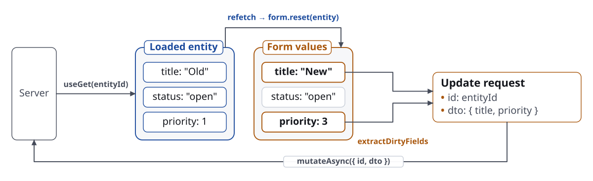

# How to Use Form Hooks with @simplix-react/form

**English** | [한국어](../../ko/guides/form-hooks.md)

> Derive TanStack Form hooks from an existing contract and use them to build create/update forms with automatic dirty-field tracking and server error mapping.

## Before You Begin

- A simplix-react project with at least one domain contract and derived React Query hooks
- Install dependencies:

```bash
pnpm add @simplix-react/form @tanstack/react-form
```

- Familiarity with [TanStack Form basics](https://tanstack.com/form/latest)
- An existing contract and hooks setup:

```ts
// contract.ts
import { defineApi } from "@simplix-react/contract";
import { z } from "zod";

const taskSchema = z.object({
  id: z.string(),
  title: z.string(),
  status: z.enum(["open", "in_progress", "done"]),
  priority: z.number(),
});

const createTaskSchema = taskSchema.omit({ id: true });
const updateTaskSchema = createTaskSchema.partial();

export const projectContract = defineApi({
  domain: "project",
  basePath: "/api",
  entities: {
    task: {
      schema: taskSchema,
      parent: { param: "projectId", path: "/projects" },
      operations: {
        list: { method: "GET", path: "/projects/:projectId/tasks" },
        get: { method: "GET", path: "/tasks/:id" },
        create: { method: "POST", path: "/projects/:projectId/tasks", input: createTaskSchema },
        update: { method: "PATCH", path: "/tasks/:id", input: updateTaskSchema },
      },
    },
  },
});

// hooks.ts
import { deriveEntityHooks } from "@simplix-react/react";
import { projectContract } from "./contract.js";

export const projectHooks = deriveEntityHooks(projectContract);
```

## Solution

### Step 1: Derive Form Hooks from an Existing Contract

Call `deriveEntityFormHooks` with your contract and the derived query hooks. This produces `useCreateForm` for every entity that has a `create`-role operation and `useUpdateForm` for every entity that has an `update`-role operation (and a `get` hook to load the entity), in a single call. An entity without those operations has no form hook.

```ts
import { deriveEntityFormHooks } from "@simplix-react/form";
import { projectContract } from "./contract.js";
import { projectHooks } from "./hooks.js";

export const projectFormHooks = deriveEntityFormHooks(projectContract, projectHooks);

// projectFormHooks.task.useCreateForm : create form hook
// projectFormHooks.task.useUpdateForm : update form hook
```

### Step 2: Use useCreateForm in a Component

`useCreateForm` returns a TanStack Form instance wired to the entity's create mutation. You pass default values through options, and the form handles submission, error state, and reset automatically. On submit the form values are passed unchanged to the create mutation.

`useCreateForm` and `useUpdateForm` are optional in the `EntityFormHooks` type, because they exist only when the entity has a `create` or an `update` operation, so the examples call them with a non-null assertion (`useCreateForm!()`).

```tsx
import { projectFormHooks } from "./form-hooks.js";

function CreateTaskForm({ projectId }: { projectId: string }) {
  const { form, isSubmitting, submitError, reset } = projectFormHooks.task.useCreateForm!(
    projectId,
    {
      defaultValues: { title: "", status: "open", priority: 0 },
      resetOnSuccess: true,
      onSuccess: (data) => {
        console.log("Task created:", data);
      },
    },
  );

  return (
    <form
      onSubmit={(e) => {
        e.preventDefault();
        form.handleSubmit();
      }}
    >
      <form.Field name="title">
        {(field) => (
          <div>
            <label htmlFor="title">Title</label>
            <input
              id="title"
              value={field.state.value}
              onChange={(e) => field.handleChange(e.target.value)}
            />
            {field.state.meta.errorMap.onSubmit && (
              <p role="alert">{field.state.meta.errorMap.onSubmit}</p>
            )}
          </div>
        )}
      </form.Field>

      <form.Field name="status">
        {(field) => (
          <div>
            <label htmlFor="status">Status</label>
            <select
              id="status"
              value={field.state.value}
              onChange={(e) => field.handleChange(e.target.value)}
            >
              <option value="open">Open</option>
              <option value="in_progress">In Progress</option>
              <option value="done">Done</option>
            </select>
          </div>
        )}
      </form.Field>

      <form.Field name="priority">
        {(field) => (
          <div>
            <label htmlFor="priority">Priority</label>
            <input
              id="priority"
              type="number"
              value={field.state.value}
              onChange={(e) => field.handleChange(Number(e.target.value))}
            />
          </div>
        )}
      </form.Field>

      {submitError && <p role="alert">{submitError.message}</p>}

      <button type="submit" disabled={isSubmitting}>
        {isSubmitting ? "Creating..." : "Create Task"}
      </button>
      <button type="button" onClick={reset}>
        Reset
      </button>
    </form>
  );
}
```

Key behaviors:

| Behavior | Default | Override |
| --- | --- | --- |
| Form resets after success | `true` | `resetOnSuccess: false` |
| Server validation errors mapped to fields | Always | none |
| Query cache invalidation | Automatic (by `useCreate`) | none |
| Error callback | none | `onError: (error) => ...` |

### Step 3: Use useUpdateForm with Dirty-Field Tracking

`useUpdateForm` fetches the existing entity, populates the form, and on submit sends only the fields that changed (`dirtyOnly` defaults to `true`). This produces minimal PATCH payloads automatically.

```tsx
import { projectFormHooks } from "./form-hooks.js";

function EditTaskForm({ taskId }: { taskId: string }) {
  const { form, isLoading, isSubmitting, submitError, entity } =
    projectFormHooks.task.useUpdateForm!(taskId, {
      dirtyOnly: true,
      onSuccess: (data) => {
        console.log("Task updated:", data);
      },
    });

  if (isLoading) return <p>Loading task...</p>;

  return (
    <form
      onSubmit={(e) => {
        e.preventDefault();
        form.handleSubmit();
      }}
    >
      <form.Field name="title">
        {(field) => (
          <div>
            <label htmlFor="title">Title</label>
            <input
              id="title"
              value={field.state.value}
              onChange={(e) => field.handleChange(e.target.value)}
            />
            {field.state.meta.errorMap.onSubmit && (
              <p role="alert">{field.state.meta.errorMap.onSubmit}</p>
            )}
          </div>
        )}
      </form.Field>

      <form.Field name="status">
        {(field) => (
          <div>
            <label htmlFor="status">Status</label>
            <select
              id="status"
              value={field.state.value}
              onChange={(e) => field.handleChange(e.target.value)}
            >
              <option value="open">Open</option>
              <option value="in_progress">In Progress</option>
              <option value="done">Done</option>
            </select>
          </div>
        )}
      </form.Field>

      <form.Field name="priority">
        {(field) => (
          <div>
            <label htmlFor="priority">Priority</label>
            <input
              id="priority"
              type="number"
              value={field.state.value}
              onChange={(e) => field.handleChange(Number(e.target.value))}
            />
          </div>
        )}
      </form.Field>

      {submitError && <p role="alert">{submitError.message}</p>}

      <button type="submit" disabled={isSubmitting}>
        {isSubmitting ? "Saving..." : "Save Changes"}
      </button>
    </form>
  );
}
```

How dirty-field tracking works:



1. The hook fetches entity data via `useGet(entityId)` and populates the form.
2. On submit, `extractDirtyFields(currentValues, originalEntity)` runs a deep comparison. A submit before the entity has loaded does nothing.
3. Only changed fields are sent in the mutation payload (`{ id, dto: dirtyFields }`).
4. When server data changes (e.g., after a background refetch), the form resets to match.

Set `dirtyOnly: false` to send all fields regardless of changes:

```ts
const { form } = projectFormHooks.task.useUpdateForm!(taskId, {
  dirtyOnly: false,
});
```

### Step 4: Handle Server Validation Errors

When a submission fails, form hooks look for field errors in the error and map them to the TanStack Form instance; the HTTP status is not checked. You can also use `mapServerErrorsToForm` directly for custom mutation flows.

**Automatic handling (built into form hooks):**

Field errors are parsed and set on each field's `errorMap.onSubmit` slot automatically, several messages for one field joined with `, `. The error also becomes `submitError`, and `onError` is called. You display the field errors in your field render functions:

```tsx
<form.Field name="title">
  {(field) => (
    <div>
      <input
        value={field.state.value}
        onChange={(e) => field.handleChange(e.target.value)}
      />
      {field.state.meta.errorMap.onSubmit && (
        <p role="alert">{field.state.meta.errorMap.onSubmit}</p>
      )}
    </div>
  )}
</form.Field>
```

**Manual handling for custom flows:**

Use `mapServerErrorsToForm` directly when you manage mutations outside of form hooks:

```ts
import type { AnyFormApi } from "@tanstack/react-form";
import { mapServerErrorsToForm } from "@simplix-react/form";

async function handleCustomSubmit(form: AnyFormApi) {
  try {
    await customMutation.mutateAsync(form.state.values);
  } catch (error) {
    const mapped = mapServerErrorsToForm(error, form);
    if (!mapped) {
      // Not a validation error: handle it another way
    }
  }
}
```

`mapServerErrorsToForm` returns `true` when it mapped field errors and `false` otherwise.

Supported server error formats (read through `getValidationErrors` from `@simplix-react/api`):

| Format | Shape | Example |
| --- | --- | --- |
| Spring Boot | `{ errorDetail: [{ field, message }] }` | `{ errorDetail: [{ field: "title", message: "must not be blank" }] }` |
| Field error array | `{ errors: [{ field, message }] }` | `{ errors: [{ field: "title", message: "can't be blank" }] }` |
| Rails | `{ errors: { [field]: string[] } }` | `{ errors: { title: ["can't be blank"] } }` |

The shape is looked up on the error object itself, then on its `data` property, then in its `body` string parsed as JSON (the `ApiError` of `@simplix-react/contract` carries the response body there). An error that matches none of these shapes maps nothing.

## Variations

### Using extractDirtyFields Standalone

You can use `extractDirtyFields` outside of form hooks for any diff-based PATCH logic. It compares each top-level key of the current object with a deep comparison (dates by time); keys missing from the current object are not reported:

```ts
import { extractDirtyFields } from "@simplix-react/form";

const original = { title: "Old", status: "open", priority: 1 };
const current = { title: "New", status: "open", priority: 3 };

const patch = extractDirtyFields(current, original);
// => { title: "New", priority: 3 }

await projectContract.client.task.update(taskId, patch);
```

### Top-Level Entity Create Form (No Parent ID)

For entities without a parent, pass `undefined` as the `parentId` argument:

```ts
const { form } = projectFormHooks.task.useCreateForm!(undefined, {
  defaultValues: { title: "", status: "open", priority: 0 },
});
```

### Disabling Form Reset on Success

Keep the form values intact after a successful create:

```ts
const { form } = projectFormHooks.task.useCreateForm!(projectId, {
  defaultValues: { title: "", status: "open", priority: 0 },
  resetOnSuccess: false,
});
```

### Turning a Zod Validation Failure into Field Errors

`zodToFieldErrors(schema, values)` validates values with a Zod schema and returns `null` on success, or a record from the dot-joined field path to the first message of that field on failure. It produces the shape that the `validator` option of `useCrudFormSubmit` in `@simplix-react/ui` expects.

```ts
import { z } from "zod";
import { zodToFieldErrors } from "@simplix-react/form";

const schema = z.object({
  profile: z.object({ phone: z.string().min(1) }),
  tags: z.array(z.object({ name: z.string().min(1) })),
});

zodToFieldErrors(schema, { profile: { phone: "" }, tags: [{ name: "" }] });
// => { "profile.phone": "...", "tags.0.name": "..." }
```

## Related

- [@simplix-react/form API Reference](../../api/@simplix-react/form/README.md): full API documentation
- [Defining Entities in a Contract](./defining-entities.md): setting up entity schemas
- [Testing with Mocks](./testing-with-mocks.md): testing components that use form hooks
