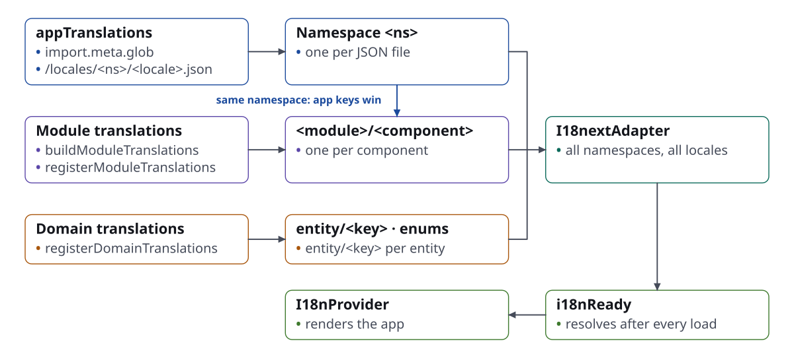

# How to Add Internationalization to Your App

**English** | [한국어](../../ko/guides/internationalization.md)

> Set up multi-language support in a simplix-react application using `@simplix-react/i18n`.

## Before You Begin

- A simplix-react project initialized with `simplix init` (i18n enabled)
- Translation JSON files organized under `src/locales/<namespace>/<locale>.json`
- Install the i18n package if not already present:

```bash
pnpm add @simplix-react/i18n
```

## Solution

### Step 1: Create Translation Files

Organize translations by namespace and locale. Each namespace gets its own directory with one JSON file per locale. `createI18nConfig` reads the namespace and the locale from the path `/locales/<namespace>/<locale>.json`, so a nested directory such as `locales/dashboard/header/ko.json` is the namespace `dashboard/header`:

```text
src/
  locales/
    common/
      en.json
      ko.json
      ja.json
    dashboard/
      en.json
      ko.json
```

```json
// src/locales/common/en.json
{
  "greeting": "Hello, {{name}}!",
  "logout": "Log out",
  "items_count_one": "{{count}} item",
  "items_count_other": "{{count}} items"
}
```

```json
// src/locales/common/ko.json
{
  "greeting": "{{name}}님, 안녕하세요!",
  "logout": "로그아웃",
  "items_count_one": "{{count}}개 항목",
  "items_count_other": "{{count}}개 항목"
}
```

### Step 2: Configure i18n

Use `createI18nConfig` to initialize the adapter. Vite's `import.meta.glob` loads all translation files eagerly at build time:

```ts
// src/app/i18n/index.ts
import { createI18nConfig } from "@simplix-react/i18n";

const appTranslations = import.meta.glob("../../locales/**/*.json", {
  eager: true,
});

export const { adapter, i18nReady } = createI18nConfig({
  defaultLocale: "ko",
  fallbackLocale: "en",
  appTranslations,
  debug: false,
});
```

`createI18nConfig` returns two values:

| Return value | Type | Description |
| --- | --- | --- |
| `adapter` | `I18nextAdapter` | The configured adapter instance |
| `i18nReady` | `Promise<void>` | Resolves when all translations (including module and domain translations) are loaded |



The other options:

| Option | Default | Purpose |
| --- | --- | --- |
| `defaultLocale` | `"en"` | The locale activated when detection finds none |
| `fallbackLocale` | `"en"` | The locale used for a missing key |
| `supportedLocales` | `DEFAULT_LOCALES` | Locale codes or `LocaleConfig` objects; a code is looked up in `DEFAULT_LOCALES` |
| `detection` | none | `{ order: ("localStorage" \| "navigator")[], storageKey? }`; with `"localStorage"` in `order`, every locale switch is saved under `storageKey` (`"i18n:locale"`) |
| `moduleTranslations` | `[]` | Descriptors from `buildModuleTranslations` |
| `debug` | `false` | i18next debug logging |

### Step 3: Wrap Your App with I18nProvider

The `I18nProvider` component exposes the adapter to all descendant components via React context and keeps `<html lang>` equal to the active locale. Wait for `i18nReady` before rendering:

```tsx
// src/main.tsx
import { StrictMode } from "react";
import { createRoot } from "react-dom/client";
import { I18nProvider } from "@simplix-react/i18n/react";
import { adapter, i18nReady } from "./app/i18n/index.js";
import { App } from "./app/index.js";

async function bootstrap() {
  await i18nReady;

  createRoot(document.getElementById("root")!).render(
    <StrictMode>
      <I18nProvider adapter={adapter}>
        <App />
      </I18nProvider>
    </StrictMode>,
  );
}

bootstrap();
```

### Step 4: Use Translation Hooks in Components

#### useTranslation: Namespace-Scoped Translations

The primary hook for translating text. It scopes all lookups to a single namespace and re-renders automatically on locale changes and when translations arrive later. Outside an `I18nProvider`, `t` returns the key:

```tsx
import { useTranslation } from "@simplix-react/i18n/react";

function Greeting() {
  const { t, locale } = useTranslation("common");

  return (
    <div>
      <p>{t("greeting", { name: "Alice" })}</p>
      <small>Current locale: {locale}</small>
    </div>
  );
}
```

The returned object contains:

| Property | Type | Description |
| --- | --- | --- |
| `t` | `(key, values?) => string` | Translates a key within the namespace |
| `locale` | `string` | Currently active locale code |
| `exists` | `(key) => boolean` | Checks whether a key exists |

#### useLocale: Reactive Locale Code

Returns only the active locale code. Re-renders on locale change:

```tsx
import { useLocale } from "@simplix-react/i18n/react";

function LocaleBadge() {
  const locale = useLocale();
  return <span>{locale.toUpperCase()}</span>;
}
```

#### useI18n: Direct Adapter Access

Returns the full `II18nAdapter` instance for advanced operations (formatting, locale info, programmatic locale switching), or `null` outside an `I18nProvider`:

```tsx
import { useI18n } from "@simplix-react/i18n/react";

function PriceDisplay({ amount }: { amount: number }) {
  const i18n = useI18n();
  if (!i18n) return null;

  return <span>{i18n.formatCurrency(amount)}</span>;
}
```

### Step 5: Switch Locales at Runtime

For a ready-made list of locales with their names written in each locale's own language, use `useLocalePicker`:

```tsx
import { useLocalePicker } from "@simplix-react/i18n/react";

function LocaleMenu() {
  const { locale, locales, setLocale } = useLocalePicker();

  return (
    <select value={locale} onChange={(e) => setLocale(e.target.value)}>
      {locales.map((option) => (
        <option key={option.value} value={option.value}>
          {option.displayName}
        </option>
      ))}
    </select>
  );
}
```

To build the control yourself, use the adapter's `setLocale` method. All hooks subscribed via `useSyncExternalStore` re-render automatically:

```tsx
import { useI18n } from "@simplix-react/i18n/react";

function LocaleSwitcher() {
  const i18n = useI18n();
  if (!i18n) return null;

  return (
    <select
      value={i18n.locale}
      onChange={(e) => i18n.setLocale(e.target.value)}
    >
      {i18n.availableLocales.map((code) => {
        const info = i18n.getLocaleInfo(code);
        return (
          <option key={code} value={code}>
            {info?.name ?? code}
          </option>
        );
      })}
    </select>
  );
}
```

### Step 6: Sync Locale to API Requests (Accept-Language Header)

When your server returns localized responses based on the `Accept-Language` header, wire the i18n adapter to `@simplix-react/api` so that every API request includes the app's active locale:

```ts
// src/app/i18n/index.ts
import { setRequestLocale } from "@simplix-react/api";
import { createI18nConfig } from "@simplix-react/i18n";
import { DEFAULT_LOCALE, SUPPORTED_LOCALES } from "../../shared/config/app";

const appTranslations = import.meta.glob("/src/locales/**/*.json", { eager: true });

export const { adapter: i18nAdapter, i18nReady } = createI18nConfig({
  defaultLocale: DEFAULT_LOCALE,
  fallbackLocale: DEFAULT_LOCALE,
  supportedLocales: [...SUPPORTED_LOCALES],
  detection: { order: ["localStorage", "navigator"] },
  appTranslations,
});

// Sync i18n locale to API request headers (Accept-Language)
i18nAdapter.onLocaleChange(setRequestLocale);
i18nReady.then(() => setRequestLocale(i18nAdapter.locale));
```

Two lines do the work:

| Line | Purpose |
| --- | --- |
| `i18nAdapter.onLocaleChange(setRequestLocale)` | Syncs locale on every language switch |
| `i18nReady.then(() => setRequestLocale(...))` | Sets the initial locale after detection completes |

After this setup, all requests through `getMutator()` automatically include the `Accept-Language` header matching the app's language. For example, if the user selects English:

```http
POST /api/v1/pets HTTP/1.1
Accept-Language: en
```

> **Why is this needed?** Without explicit header injection, the browser sends its own `Accept-Language` based on OS settings (e.g., `ko,en-US;q=0.9,...`). This does not reflect the language the user chose in the application. `setRequestLocale` overrides this with the app's active locale.

> **Note:** Projects scaffolded with `simplix init` (i18n enabled) include this wiring automatically. For existing projects, add the two lines manually.

## Variations

### Lazy-Loading Module Translations

For large apps, split translations per module using `buildModuleTranslations`. Each JSON file stays in its own chunk, and `i18nReady` loads the chunks of every locale the module lists:

```ts
// modules/dashboard/src/locales/index.ts
import { buildModuleTranslations } from "@simplix-react/i18n";

export const dashboardTranslations = buildModuleTranslations({
  namespace: "dashboard",
  locales: ["en", "ko", "ja"],
  components: {
    header: {
      en: () => import("./header/en.json"),
      ko: () => import("./header/ko.json"),
      ja: () => import("./header/ja.json"),
    },
    sidebar: {
      en: () => import("./sidebar/en.json"),
      ko: () => import("./sidebar/ko.json"),
      ja: () => import("./sidebar/ja.json"),
    },
  },
});
```

Pass module translations to `createI18nConfig`:

```ts
import { createI18nConfig } from "@simplix-react/i18n";
import { dashboardTranslations } from "@myapp/dashboard/locales";

const appTranslations = import.meta.glob("../../locales/**/*.json", {
  eager: true,
});

export const { adapter, i18nReady } = createI18nConfig({
  defaultLocale: "ko",
  appTranslations,
  moduleTranslations: [dashboardTranslations],
});
```

A module package can instead call `registerModuleTranslations(dashboardTranslations)` in its entry point; `createI18nConfig` loads every registered descriptor, including one registered after `i18nReady` resolved.

Module translations are namespaced as `dashboard/header`, `dashboard/sidebar`, etc. An application file at `locales/dashboard/header/<locale>.json` overrides the module's values key by key. Use them in components:

```tsx
const { t } = useTranslation("dashboard/header");
t("title"); // looks up "dashboard/header:title"
```

### Custom Locale Configuration

Replace the built-in `DEFAULT_LOCALES` list with your own `LocaleConfig` entries (`timeFormat` is also available):

```ts
import { createI18nConfig } from "@simplix-react/i18n";
import type { LocaleConfig } from "@simplix-react/i18n";

const customLocales: LocaleConfig[] = [
  {
    code: "en",
    name: "English",
    englishName: "English",
    direction: "ltr",
    dateFormat: "MM/dd/yyyy",
    currency: "USD",
  },
  {
    code: "ar",
    name: "العربية",
    englishName: "Arabic",
    direction: "rtl",
    dateFormat: "dd/MM/yyyy",
    currency: "SAR",
  },
];

export const { adapter, i18nReady } = createI18nConfig({
  defaultLocale: "en",
  supportedLocales: customLocales,
  appTranslations: import.meta.glob("../../locales/**/*.json", { eager: true }),
});
```

### Formatting Dates, Numbers, and Currency

The adapter provides `Intl`-based formatting that respects the active locale:

```tsx
import { useI18n } from "@simplix-react/i18n/react";

function OrderSummary({ total, date }: { total: number; date: Date }) {
  const i18n = useI18n();
  if (!i18n) return null;

  return (
    <dl>
      <dt>Date</dt>
      <dd>{i18n.formatDate(date, { dateStyle: "long" })}</dd>

      <dt>Total</dt>
      <dd>{i18n.formatCurrency(total, "KRW")}</dd>

      <dt>Quantity</dt>
      <dd>{i18n.formatNumber(1234.5, { maximumFractionDigits: 0 })}</dd>

      <dt>Placed</dt>
      <dd>{i18n.formatRelativeTime(date)}</dd>
    </dl>
  );
}
```

### Domain Translations and Entity Labels

A domain package registers its field and enum labels with `registerDomainTranslations`. Each top-level key of the JSON becomes the namespace `entity/<key>`, and the key `enums` becomes the namespace `enums`:

```ts
import { registerDomainTranslations } from "@simplix-react/i18n";

registerDomainTranslations({
  domain: "pet",
  locales: {
    en: () => import("./locales/en.json"),
    ko: () => import("./locales/ko.json"),
  },
});
```

`useEntityTranslation` reads those labels:

```tsx
import { useEntityTranslation } from "@simplix-react/i18n/react";

function PetStatus({ status }: { status: string }) {
  const { fieldLabel, enumLabel } = useEntityTranslation("pet");

  return (
    <span>
      {fieldLabel("status")}: {enumLabel("PetStatus", status)}
    </span>
  );
}
```

`fieldLabel("status")` looks up `fields.status` in `entity/pet`, and `enumLabel("PetStatus", status)` looks up `PetStatus.<status>` in `enums`.

### Type-Safe Translation Keys with i18n-codegen

Generate TypeScript types from your JSON files to catch missing keys at compile time:

```bash
simplix i18n-codegen
```

Run it from the project root. It scans every module under `modules/` for `src/locales/` directories, and in each directory that holds JSON files it writes `keys.d.ts` with a type named after the directory (`header` gives `HeaderKeys`), taking the keys from `en.json` or else the first JSON file. `--watch` regenerates on change. Use the generated type with `useTranslation`:

```tsx
import type { HeaderKeys } from "../locales/header/keys";

const { t } = useTranslation<HeaderKeys>("dashboard/header");
t("greeting"); // ✔ type-checked
t("typo");     // ✖ compile error
```

## Related

- [CLI Usage](./cli-usage.md): `simplix init` with i18n, `simplix i18n-codegen`
- [Testing with Mocks](./testing-with-mocks.md): Testing components that use i18n
- [@simplix-react/i18n API Reference](../../api/@simplix-react/i18n/README.md): Full API documentation
