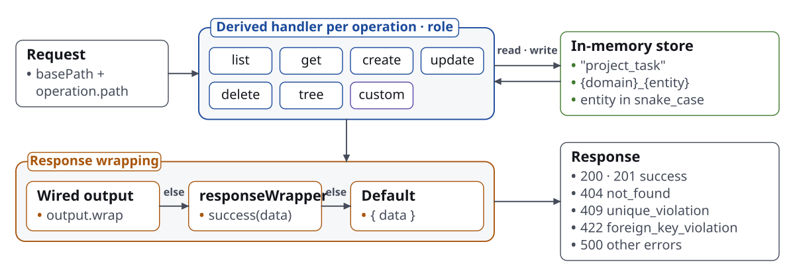

# Mock Handlers with MSW

**English** | [한국어](../../ko/guides/mock-handlers.md)

> How to set up and customize MSW mock handlers derived from your API contract.

## Before You Begin

- You have an API contract defined with `defineApi` from `@simplix-react/contract`
- Install the peer dependency `msw` (2.x)

The examples use a contract with the domain `project`, the base path `/api/v1`, and the entities `project` and `task`.

## Solution

### Derive Handlers from a Contract

`deriveMockHandlers(config, mockConfig?, options?)` generates one MSW handler for every operation of every entity in the contract:

```ts
import { deriveMockHandlers } from "@simplix-react/mock";
import { projectApi } from "./contract";

const handlers = deriveMockHandlers(projectApi.config);
```

The handler's HTTP method and path come from the operation itself (`{basePath}{operation.path}`). What the handler does depends on the operation's role, which comes from `role` or from the operation name:

| Role | Behaviour | Status |
| --- | --- | --- |
| `list` | Filters by query parameters, sorts, and paginates | `200` |
| `get` | Looks up the record by `:id` (or the last path parameter) and loads `relations` | `200`, `404` |
| `create` | Stores the body; sets a numeric `id` from `getNextId` when the body has none, and `createdAt` and `updatedAt` when missing | `201` |
| `update` | Merges the body into the record (PATCH or PUT, as the operation declares) and sets `updatedAt` | `200`, `400`, `404` |
| `delete` | Removes the record | `200`, `404` |
| `tree` | Returns nested `{ data, children }` nodes built from `parentId`; `?rootId=` limits it to one subtree | `200` |
| custom | A custom GET without a path parameter behaves like `list`, with one like `get`; a POST, PUT or PATCH like `create` or `update`; a DELETE with a path parameter like `delete`; anything else answers `{ data: null }` | `200` |

For an entity with `parent`, the `list` and `create` handlers are registered at `{basePath}{parent.path}/:{parent.param}{operation.path}`, and the parent id from the URL is used as a filter or written into the new record.



All handlers read from and write to in-memory `Map`-based stores managed by `getEntityStore`. The store name is `{domain}_{snake_case entity name}`: the entity `task` of the domain `project` uses `"project_task"`, and an entity `taskComment` would use `"project_task_comment"`.

### Query Parameters of a List Handler

| Parameter | Meaning |
| --- | --- |
| `sort` | `field:asc` or `field:desc`, defaults to `defaultSort` |
| `page` | Zero-based page number; enables pagination |
| `limit` or `size` | Rows per page, capped at `maxLimit` |
| `cursor` | Enables pagination like `page` |
| any other | Equality filter on the field of that name |

Without `page` or `cursor` the list returns every matching row. With them, the payload carries `meta: { total, page, limit, hasNextPage }` next to `data`.

### Response Shape

By default a success body is `{ data: <payload> }` and an error body is `{ code, message }`. A list payload is itself `{ data, meta? }`. An error maps to a status: `not_found` → `404`, `unique_violation` → `409`, `foreign_key_violation` → `422`, anything else → `500`.

To match a backend envelope, pass `responseWrapper` in the third argument (`MockHandlerOptions`):

```ts
import { deriveMockHandlers } from "@simplix-react/mock";
import type { MockResponseWrapper } from "@simplix-react/mock";
import { projectApi } from "./contract";

const responseWrapper: MockResponseWrapper = {
  success: (data) => ({ type: "SUCCESS", body: data, timestamp: new Date().toISOString() }),
  error: (error) => ({ type: "ERROR", message: error?.message, timestamp: new Date().toISOString() }),
};

const handlers = deriveMockHandlers(projectApi.config, undefined, { responseWrapper });
```

An operation whose `output` schema is wired to an envelope wraps its own body, and that takes precedence over `responseWrapper`.

### Configure Per-Entity Behavior

Pass a `MockEntityConfig` per entity name to customize pagination, sorting, relations, and custom resolvers:

```ts
import { deriveMockHandlers } from "@simplix-react/mock";
import type { MockEntityConfig } from "@simplix-react/mock";
import { projectApi } from "./contract";

const handlers = deriveMockHandlers(projectApi.config, {
  task: {
    defaultLimit: 20,          // rows per page (default: 50)
    maxLimit: 100,             // max rows per page (default: 100)
    defaultSort: "createdAt:desc",
    relations: {
      project: {
        entity: "project",
        localKey: "projectId",
        type: "belongsTo",
      },
    },
  },
});
```

| Field | Type | Default | Description |
| --- | --- | --- | --- |
| `defaultLimit` | `number` | `50` | Rows per page |
| `maxLimit` | `number` | `100` | Largest accepted `limit` |
| `defaultSort` | `string` | `"createdAt:desc"` | Sort applied when the request has no `sort` |
| `relations` | `Record<string, { entity, localKey, foreignKey?, type: "belongsTo" }>` | none | Records joined into a `get` response |
| `resolvers` | `Record<string, (info: { request, params }) => Response \| Promise<Response>>` | none | Replaces the handler of the named operation |

With `relations` configured, the `get` handler of `task` looks up the `project` record whose `foreignKey` (default `id`) equals the task's `projectId` and returns it under the key `project`. Relations are loaded by the `get` handler only.

A resolver takes the place of the derived handler for one operation:

```ts
import { HttpResponse } from "msw";
import { deriveMockHandlers, getEntityStore } from "@simplix-react/mock";
import { projectApi } from "./contract";

const handlers = deriveMockHandlers(projectApi.config, {
  task: {
    resolvers: {
      complete: ({ params }) => {
        const store = getEntityStore("project_task");
        const task = store.get(Number(params.id));
        if (!task) return HttpResponse.json({ code: "not_found" }, { status: 404 });
        const updated = { ...task, status: "done" };
        store.set(Number(params.id), updated);
        return HttpResponse.json({ data: updated });
      },
    },
  },
});
```

### Bootstrap with `setupMockWorker`

`setupMockWorker` handles the full lifecycle: store reset, seed data loading, and MSW worker start. Configuration is organized by domain using `MockDomainConfig`:

```ts
import { setupMockWorker, deriveMockHandlers } from "@simplix-react/mock";
import { projectApi } from "./contract";

await setupMockWorker({
  domains: [
    {
      name: "project",
      handlers: deriveMockHandlers(projectApi.config),
      seed: {
        project_task: [
          { id: 1, title: "Design API", status: "done", createdAt: "2025-01-01" },
          { id: 2, title: "Implement UI", status: "in_progress", createdAt: "2025-01-02" },
        ],
        project_project: [
          { id: 1, name: "Simplix", createdAt: "2025-01-01" },
        ],
      },
    },
  ],
});
```

The `MockServerConfig` shape:

| Field | Type | Description |
| --- | --- | --- |
| `domains` | `MockDomainConfig[]` | Domain configurations to activate |

Each `MockDomainConfig` has:

| Field | Type | Description |
| --- | --- | --- |
| `name` | `string` | Domain identifier (used for logging/debugging) |
| `enabled` | `boolean` | Toggle this domain on/off (default: `true`) |
| `handlers` | `RequestHandler[]` | MSW handlers (from `deriveMockHandlers`) |
| `seed` | `Record<string, Record<string, unknown>[]>` | Seed data keyed by store name (optional) |

Seed keys are store names (`{domain}_{snake_case entity name}`). Each value is an array of plain objects representing the initial records. After seeding, `getNextId` continues from the largest numeric `id` in the seed.

When no domain is enabled, `setupMockWorker` returns without starting a worker. Otherwise it starts the worker with `onUnhandledRequest: "bypass"` and lets every cross-origin request pass through to the network.

The browser needs `mockServiceWorker.js` at the site root. `mswPlugin` from `@simplix-react/mock/vite` serves it in development and emits it into non-production builds:

```ts
// vite.config.ts
import { defineConfig } from "vite";
import { mswPlugin } from "@simplix-react/mock/vite";

export default defineConfig({
  plugins: [mswPlugin()],
});
```

### Integrate in Your App Entry Point

Call `setupMockWorker` before rendering your app, gated by an environment check. When mocking is off, `stopMocking` unregisters a mock worker that an earlier session left behind and reloads the page if that worker controlled it; it returns `true` when it reloads:

```tsx
// src/main.tsx
import { stopMocking } from "@simplix-react/mock";

async function enableMocking(): Promise<{ reloading: boolean }> {
  if (import.meta.env.PROD || import.meta.env.VITE_ENABLE_MOCK !== "true") {
    return { reloading: await stopMocking() };
  }

  const { setupMockWorker, deriveMockHandlers } = await import("@simplix-react/mock");
  const { projectApi } = await import("./contract");
  const { seedData } = await import("./mock/seed");

  await setupMockWorker({
    domains: [
      {
        name: "project",
        handlers: deriveMockHandlers(projectApi.config),
        seed: seedData,
      },
    ],
  });
  return { reloading: false };
}

enableMocking().then(async ({ reloading }) => {
  if (reloading) return;
  const { createRoot } = await import("react-dom/client");
  const { App } = await import("./App");

  createRoot(document.getElementById("root")!).render(<App />);
});
```

`stopMocking({ storePrefix })` also removes the `localStorage` keys that start with `storePrefix`, so tokens issued by the mock layer do not reach the real server.

Where `seedData` is a plain record:

```ts
// mock/seed.ts
export const seedData: Record<string, Record<string, unknown>[]> = {
  project_task: [
    { id: 1, title: "Design API", status: "done", createdAt: "2025-01-01" },
    { id: 2, title: "Implement UI", status: "in_progress", createdAt: "2025-01-02" },
  ],
  project_project: [
    { id: 1, name: "Simplix", createdAt: "2025-01-01" },
  ],
};
```

A domain package created by the CLI exports a ready `MockDomainConfig` factory from its `/mock` entry, named `create<Domain>Mock(options?)`, which takes the same `MockHandlerOptions`.

## Variations

### Add Custom Handlers Alongside Derived Ones

Combine contract-derived handlers with hand-written handlers for custom endpoints:

```ts
import { http, HttpResponse } from "msw";
import { setupMockWorker, deriveMockHandlers } from "@simplix-react/mock";
import { projectApi } from "./contract";
import { seedData } from "./mock/seed";

const derivedHandlers = deriveMockHandlers(projectApi.config);

const customHandlers = [
  http.post("/api/v1/tasks/:taskId/assign", async ({ request, params }) => {
    const { userId } = (await request.json()) as { userId: string };
    return HttpResponse.json({
      data: { taskId: params.taskId, assigneeId: userId },
    });
  }),

  http.get("/api/v1/health", () => {
    return HttpResponse.json({ status: "ok" });
  }),
];

await setupMockWorker({
  domains: [
    {
      name: "project",
      handlers: [...customHandlers, ...derivedHandlers],
      seed: seedData,
    },
  ],
});
```

**Order matters**: MSW matches handlers in array order. Place custom handlers before derived ones to override default behavior for specific routes.

### Override a Derived Handler

To override a specific CRUD endpoint (e.g., return enriched data on list), place your custom handler first. Use `getEntityStore` to access the in-memory `Map` directly:

```ts
import { http, HttpResponse } from "msw";
import { deriveMockHandlers, getEntityStore } from "@simplix-react/mock";
import { projectApi } from "./contract";

const derivedHandlers = deriveMockHandlers(projectApi.config);

const overrides = [
  http.get("/api/v1/tasks", () => {
    const taskStore = getEntityStore("project_task");
    const projectStore = getEntityStore("project_project");

    const tasks = Array.from(taskStore.values()).map((task) => {
      const project = projectStore.get(task.projectId as string | number);
      return {
        ...task,
        projectName: project ? (project.name as string) : null,
      };
    });

    // Sort by createdAt descending
    tasks.sort((a, b) =>
      String(b.createdAt).localeCompare(String(a.createdAt)),
    );

    // Same shape as the derived list handler: { data: { data: rows } }
    return HttpResponse.json({ data: { data: tasks } });
  }),
];

const handlers = [...overrides, ...derivedHandlers];
```

The store functions `getEntityStore(storeName)`, `getNextId(storeName)`, `seedEntityStore(storeName, records)` and `resetStore()` work on the same stores the derived handlers use. `mockSuccess(data)` and `mockFailure({ code, message })` build the `MockResult` values the handlers convert to responses.

### Multiple Contracts

When the app has multiple API domains, define each contract as a separate domain:

```ts
import { setupMockWorker, deriveMockHandlers } from "@simplix-react/mock";
import { projectApi } from "./contracts/project";
import { authApi } from "./contracts/auth";

await setupMockWorker({
  domains: [
    {
      name: "project",
      handlers: deriveMockHandlers(projectApi.config),
      seed: {
        project_task: [
          { id: 1, title: "Task 1", createdAt: "2025-01-01" },
        ],
      },
    },
    {
      name: "auth",
      handlers: deriveMockHandlers(authApi.config, {
        user: { defaultSort: "email:asc" },
      }),
      seed: {
        auth_user: [
          { id: 1, email: "admin@example.com", role: "admin" },
        ],
      },
    },
  ],
});
```

Each domain can be independently toggled via `enabled: false`. All seed data across enabled domains is loaded before the MSW worker starts.

### Typed Store for Orval Models

`createMockEntityStore(seeds, idField?)` gives a typed in-memory store for code generated with Orval, where the models are plain types rather than a contract. The `MockEntityStore<T>` it returns has `list`, `listPaged(page, size, sort?)`, `filter`, `getById`, `create`, `update`, `upsert`, `remove` and `reset`; `listPaged` takes a zero-based page and a sort such as `"createdAt.desc"` and returns a `PagedResult<T>` (`content`, `totalElements`, `totalPages`, `number`, `size`, `first`, `last`, `empty`). `idField` defaults to `"id"`.

## Related

- [Custom Fetch](./custom-fetch.md): customize the HTTP client used by the API contract
- [Testing with Mocks](./testing-with-mocks.md): use the mock layer in tests
- `@simplix-react/mock` exports: `deriveMockHandlers`, `setupMockWorker`, `stopMocking`, `getEntityStore`, `getNextId`, `seedEntityStore`, `resetStore`, `createMockEntityStore`, `mockSuccess`, `mockFailure`, `buildEmbeddedTree`, `buildTreeFromFlatRows`, and the types `MockEntityConfig`, `MockHandlerOptions`, `MockResponseWrapper`, `MockServerConfig`, `MockDomainConfig`, `MockResult`, `MockEntityStore`, `PagedResult`, `StopMockingOptions`
- `@simplix-react/mock/vite` exports: `mswPlugin`
