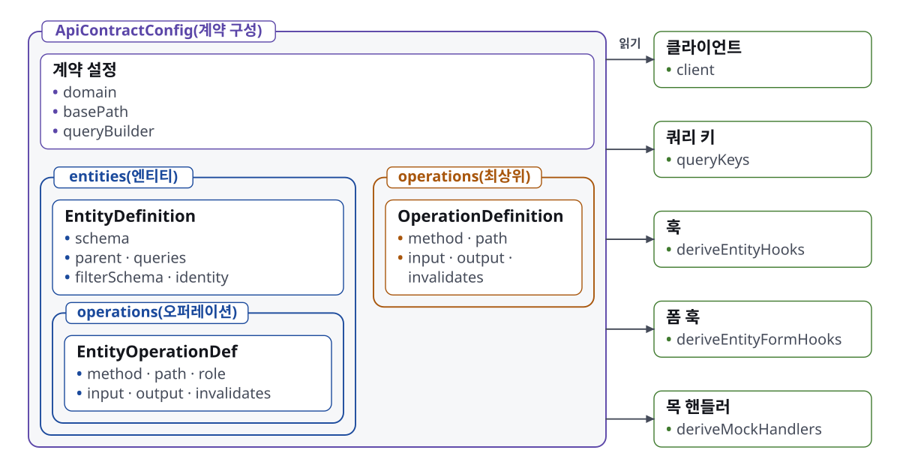

# API 계약

[English](../../en/core-concepts/api-contracts.md) | **한국어**

## 개요

simplix-react의 API 계약(contract)은 프론트엔드가 통신하는 모든 엔티티와 오퍼레이션(operation)을 선언으로 적은 것입니다. 타입 정의, 엔드포인트 URL, 검증 로직을 코드 곳곳에 흩어 두지 않고 `defineApi()` 호출 한 번에 모아 선언합니다. 프레임워크는 이 계약 하나에서 HTTP 클라이언트, React Query 훅, 폼 훅, 목(mock) 핸들러, 쿼리 키 팩토리를 파생하며, 파생한 코드에는 모두 타입이 지정됩니다.

계약의 바탕에는 API 연동 계층 코드의 대부분이 적은 수의 선언에서 기계적으로 파생할 수 있는 반복 코드라는 관찰이 있습니다. 엔티티의 스키마와 각 오퍼레이션의 메서드, 경로, 입력 스키마를 알면 나머지는 모두 파생할 수 있습니다. simplix-react는 이 관찰을 프레임워크로 구현했습니다.

계약은 프론트엔드와 API의 경계에 있습니다. API가 어떤 모양인지 알려 주는 문서이면서, 프레임워크가 모든 계층에서 선언한 형태를 강제하는 실행 가능한 명세입니다. 타입, 엔드포인트 URL, 검증 규칙을 따로 관리할 때 생기는 불일치가 이 이중 역할로 사라집니다.

## 동작 방식

계약은 엔티티 하나의 오퍼레이션을 묶는 **EntityDefinition**과 어느 엔티티에도 속하지 않는 최상위 오퍼레이션인 **OperationDefinition**으로 이루어집니다.



### EntityDefinition

`EntityDefinition`은 엔티티 하나와 그 엔티티에서 사용할 수 있는 오퍼레이션을 기술합니다. 구성 항목은 다음과 같습니다.

- **schema**: 엔티티의 응답 형태를 정의하는 Zod 스키마
- **operations**: 오퍼레이션 이름과 `EntityOperationDef` 객체의 맵. 각 객체에는 HTTP `method`와 `path`(`:paramName` 자리 표시자 사용 가능)가 있고, 선택 항목으로 `role`, `input`, `output`, `invalidates`, `contentType`, `responseType`, `transformRequest`, `transformResponse`를 지정합니다
- **parent**(선택): 중첩 URL을 구성할 때 쓰는 상위 엔티티
- **queries**(선택): 상위 엔티티 관계로 필터링하는 이름 있는 쿼리 범위
- **filterSchema**(선택): 목록 필터 매개변수를 검증하는 Zod 스키마
- **identity**(선택): 캐시 키에 쓰는 식별 필드 이름. 기본값은 `["id"]`

```ts
import { z } from "zod";
import { CRUD_OPERATIONS } from "@simplix-react/contract";

const taskSchema = z.object({ id: z.string(), title: z.string(), status: z.string() });

const taskEntity = {
  schema: taskSchema,
  parent: { param: "projectId", path: "/projects" },
  operations: {
    list: { ...CRUD_OPERATIONS.list, path: "/tasks" },
    get: { ...CRUD_OPERATIONS.get, path: "/tasks/:id" },
    create: { ...CRUD_OPERATIONS.create, path: "/tasks", input: taskSchema.omit({ id: true }) },
    update: { ...CRUD_OPERATIONS.update, path: "/tasks/:id", input: taskSchema.partial().omit({ id: true }) },
    delete: { ...CRUD_OPERATIONS.delete, path: "/tasks/:id" },
    archive: { method: "POST" as const, path: "/tasks/:id/archive" },
  },
};
```

`CRUD_OPERATIONS`에는 표준 오퍼레이션별 기본 메서드가 들어 있습니다(`list`와 `get`은 `GET`, `create`는 `POST`, `update`는 `PATCH`, `delete`는 `DELETE`). `method`를 직접 적어도 결과는 같습니다.

### 오퍼레이션의 역할

프레임워크는 오퍼레이션의 역할을 보고 무엇을 파생할지 정합니다. 이름이 `list`, `get`, `create`, `update`, `delete`, `tree`인 오퍼레이션은 그 이름이 역할입니다. 다른 이름의 오퍼레이션은 `role`을 지정했을 때만 역할을 갖고, 지정하지 않으면 위의 `archive`처럼 사용자 정의 오퍼레이션입니다. 이 규칙은 `resolveRole()`로도 제공합니다.

위 정의에서 프레임워크가 파생하는 결과는 다음과 같습니다. 오퍼레이션마다 클라이언트 함수 하나(`list`, `get`, `create`, `update`, `delete`, `archive`), 오퍼레이션마다 `use`와 오퍼레이션 이름을 이은 React Query 훅 하나(`useList`, `useGet`, `useCreate`, `useUpdate`, `useDelete`, `useArchive`)와 list 역할 오퍼레이션에서 추가로 파생하는 `useInfiniteList`, 오퍼레이션마다 MSW 핸들러 하나, 구조화된 쿼리 키 팩토리입니다. 사용자 정의 오퍼레이션은 메서드가 `GET`이면 쿼리 훅이 되고, 그 밖의 메서드이면 뮤테이션 훅이 됩니다.

### OperationDefinition

`OperationDefinition`은 파일 업로드, 일괄 처리, RPC 형태의 호출처럼 어느 엔티티에도 속하지 않는 엔드포인트를 다룹니다.

```ts
const assignTask = {
  method: "POST" as const,
  path: "/tasks/:taskId/assign",
  input: z.object({ userId: z.string() }),
  output: z.object({ id: z.string(), assigneeId: z.string() }),
  invalidates: (queryKeys) => [queryKeys.task.all],
};
```

오퍼레이션에는 경로 매개변수(`:paramName` 문법), 콘텐츠 형식 지정(`json` 또는 `multipart`), 응답 형식 지정(`json` 또는 `blob`), 요청과 응답 변환(`transformRequest`, `transformResponse`), `invalidates` 함수로 선언하는 캐시 무효화를 지정할 수 있습니다. `invalidates` 함수는 쿼리 키 팩토리와 경로 매개변수를 받습니다.

### 계약 조립

`defineApi()` 함수는 `ApiContractConfig`와 선택 항목인 `{ fetchFn }`을 받아 타입이 모두 지정된 계약 객체를 반환합니다.

```ts
import { defineApi, simpleQueryBuilder } from "@simplix-react/contract";

const projectApi = defineApi({
  domain: "project",
  basePath: "/api/v1",
  entities: { task: taskEntity },
  operations: { assignTask },
  queryBuilder: simpleQueryBuilder,
});
```

반환된 객체에는 속성이 다음과 같이 있습니다.

| 속성 | 설명 |
| --- | --- |
| `config` | 원래 구성. 이후 단계에서 쓰도록 그대로 전달합니다 |
| `client` | 엔티티와 오퍼레이션마다 메서드가 있는 타입 안전 HTTP 클라이언트 |
| `queryKeys` | TanStack Query 캐시 관리용 쿼리 키 팩토리 |

### 계약 수정

`customizeApi(base, patch, options?)`는 엔티티의 오퍼레이션을 추가, 교체, 삭제한 새 계약을 반환합니다(`null`을 지정하면 삭제합니다). 원래 계약은 바뀌지 않고, `client`와 `queryKeys`는 수정한 구성에서 다시 파생합니다. OpenAPI 명세에서 생성한 계약을 생성된 파일을 고치지 않고 조정할 때 사용하세요.

```ts
import { customizeApi } from "@simplix-react/contract";

export const api = customizeApi(projectApi, {
  entities: {
    task: {
      operations: {
        list: { method: "GET", path: "/tasks/search", role: "list" },
        archive: null,
      },
    },
  },
});
```

## 설계 결정

### Zod 스키마를 쓰는 이유

Zod는 선언 하나로 런타임 검증과 정적 타입 추론을 함께 제공하므로 스키마 언어로 선택했습니다. `z.infer<typeof schema>`가 TypeScript 타입을 자동으로 만들어 주므로 검증 로직 옆에 타입 정의를 따로 유지하지 않아도 됩니다. 모든 타입을 Zod 스키마 하나에서 얻으므로, 정의는 한 번만 작성하고 나머지 계층은 모두 파생합니다.

다른 스키마 라이브러리(Yup, io-ts, ArkType)도 검토했지만, 쓰기 편한 API, 넓은 생태계, 매끄러운 TypeScript 추론을 모두 갖춘 것은 Zod뿐이었습니다.

### 계약을 도메인 단위로 나누는 이유

계약마다 `domain`(예: `"project"`, `"billing"`, `"auth"`)이 있습니다. 이렇게 나누면 다음과 같은 결과가 생깁니다.

- **쿼리 키 격리**: 모든 쿼리 키가 `[domain, ...]`으로 시작하므로 서로 관계없는 데이터의 캐시가 충돌하지 않습니다
- **명확한 구성**: 도메인 하나가 논리적인 API 경계 하나에 대응합니다
- **독립적인 파생**: 계약은 프레임워크가 아니라 애플리케이션 수준에서 조합합니다

### EntityDefinition과 OperationDefinition을 나누는 이유

엔티티는 한 종류의 데이터를 다루는 오퍼레이션을 사용자 정의 오퍼레이션까지 모두 묶습니다. 그래서 프레임워크는 역할에 따라 표준 CRUD 계층을 파생하고, 사용자 정의 오퍼레이션도 같은 엔티티에 포함할 수 있습니다. 최상위 오퍼레이션은 어느 엔티티에도 속하지 않는 동작이며, 엔티티 밖에 두면 나머지 모든 경우를 유연하게 처리할 수 있습니다.

### 계약에 동작이 아닌 선언만 담는 이유

`ApiContractConfig`는 스키마, 메서드, 경로로 이루어진 데이터 구조입니다. 요청을 보내지 않고, 상태를 갖지 않고, 런타임 의존성도 없습니다. 그래서 순환 의존성 없이 여러 패키지(`@simplix-react/react`, `@simplix-react/form`, `@simplix-react/mock`)가 계약을 공유하고, 도구가 계약을 검사하거나 변환할 수 있습니다.

오퍼레이션에 넣을 수 있는 함수는 순수한 매핑 함수입니다. `invalidates`는 쿼리 키를 무효화 대상으로 매핑하고, `transformRequest`와 `transformResponse`는 페이로드를 다른 형태로 매핑합니다.

## 영향

### 애플리케이션 개발자에게

- API 범위를 한곳에서 한 번만 정의합니다
- 타입 안전성이 Zod 스키마에서 파생하는 모든 계층으로 자동으로 이어집니다
- 엔티티를 추가하려면 `EntityDefinition` 하나만 추가하면 됩니다. 클라이언트, 훅, 목 핸들러, 쿼리 키는 그 정의에서 파생합니다
- 스키마를 바꾸면 코드베이스 전체에 TypeScript 오류로 즉시 드러납니다

### 프레임워크에게

- 계약은 모든 파생 함수(`deriveClient`, `deriveQueryKeys`, `deriveEntityHooks`, `deriveEntityFormHooks`, `deriveMockHandlers`)의 입력입니다
- 계약이 모든 것을 명시하므로 프레임워크가 타입을 추측하거나 구조를 추론할 필요가 없습니다
- 기존 계약을 고치지 않고 새로운 파생 대상을 추가할 수 있습니다
