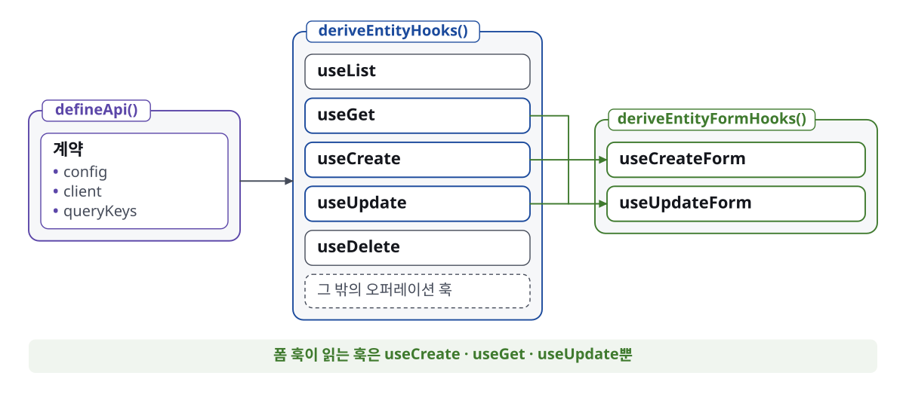

# 폼 파생

[English](../../en/core-concepts/form-derivation.md) | **한국어**

## 개요

simplix-react에서 폼 파생은 `@simplix-react/form` 패키지가 담당합니다. 이 패키지는 API 계약(contract)과 그 계약에서 파생한 React Query 훅으로 TanStack Form 훅을 파생합니다. 폼 상태와 뮤테이션 연결, 변경된 필드 추적, 서버 검증 오류 매핑을 직접 작성하지 않고 `deriveEntityFormHooks`를 한 번 호출하면, 계약에서 `create`나 `update` 오퍼레이션(operation)이 있는 모든 엔티티에 바로 쓸 수 있는 `useCreateForm`과 `useUpdateForm` 훅을 받습니다.

바탕이 되는 관찰은 CRUD 오퍼레이션의 폼이 일정한 패턴을 따른다는 것입니다. 생성 폼에는 기본값, 뮤테이션, 성공과 오류 처리가 필요합니다. 수정 폼은 기존 엔티티를 가져오고, 어느 필드가 바뀌었는지 추적하고, 바뀐 필드만 전송해야 합니다. 이 패턴은 계약에서 파생할 수 있을 만큼 기계적이므로, 폼이 많은 애플리케이션에서 반복되는 코드를 없앨 수 있습니다.

폼 파생은 파생 과정의 마지막 단계입니다. 계약에서 클라이언트와 쿼리 키를, 클라이언트에서 React Query 훅을, React Query 훅에서 폼 훅을 얻습니다. 각 계층은 아래 계층을 바탕으로 만들어지며, Zod 스키마부터 폼 필드 바인딩까지 타입 안전성이 유지됩니다.

## 동작 방식

### 파생 과정



`deriveEntityFormHooks`는 계약과 그 계약에서 파생한 훅을 받아 엔티티를 하나씩 처리합니다. 엔티티마다 오퍼레이션을 살펴 어떤 CRUD 역할(`create`, `update`)이 있는지 확인합니다. `create` 역할이 있는 엔티티만 `useCreateForm` 훅을, `update` 역할이 있는 엔티티만 `useUpdateForm` 훅을 받습니다. 역할은 다른 파생과 마찬가지로 오퍼레이션 이름이나 `role` 필드로 정합니다.

```ts
import { deriveEntityFormHooks } from "@simplix-react/form";
import { inventoryApi } from "./contract";
import { inventoryHooks } from "./hooks";

export const inventoryFormHooks = deriveEntityFormHooks(inventoryApi, inventoryHooks);
```

`useCreateForm`과 `useUpdateForm`은 엔티티에 `create`나 `update` 오퍼레이션이 있을 때만 생기므로 `EntityFormHooks` 타입에서 선택 속성입니다. 그래서 예제에서는 null 아님 단언(`useCreateForm!()`)을 붙여 호출합니다.

결과는 엔티티 이름을 키로 하는 객체이며, 각 값은 사용할 수 있는 폼 훅이 들어 있는 `EntityFormHooks`입니다.

```ts
inventoryFormHooks.product.useCreateForm!(parentId?, options?)
inventoryFormHooks.product.useUpdateForm!(entityId, options?)
```

### 생성 폼

`useCreateForm` 훅은 엔티티의 `useCreate` 뮤테이션에 연결한 TanStack Form 인스턴스를 만듭니다.

```ts
const { form, isSubmitting, submitError, reset } = inventoryFormHooks.product.useCreateForm!(
  parentId,
  {
    defaultValues: { title: "", status: "active" },
    resetOnSuccess: true,
    onSuccess: (data) => console.log("Created:", data),
    onError: (error) => console.error(error),
  },
);
```

| 반환 값 | 설명 |
| --- | --- |
| `form` | 필드 바인딩과 제출에 쓰는 TanStack Form API 인스턴스 |
| `isSubmitting` | 생성 뮤테이션이 진행 중인지 여부 |
| `submitError` | 가장 최근의 제출 오류. 없으면 `null` |
| `reset` | 폼 필드를 초기화하고 제출 오류를 지웁니다 |

제출하면 훅은 폼 값을 모아 `useCreate` 뮤테이션을 호출하고(중첩 엔티티이면 `parentId`와 함께) 응답을 처리합니다. 뮤테이션에는 `meta: { handledByForm: true }`가 지정되므로, 전역 뮤테이션 오류 처리기는 폼이 이미 오류를 표시한다는 것을 알 수 있습니다.

- **성공**: 폼을 초기화하고(`resetOnSuccess`로 지정하며 기본값은 `true`) `onSuccess`를 호출합니다
- **실패**: `mapServerErrorsToForm`으로 서버 검증 오류를 필드별 오류로 매핑하고 `onError`를 호출합니다

### 수정 폼

`useUpdateForm` 훅은 `useGet`으로 기존 엔티티를 가져와 그 데이터로 폼을 초기화하고, 제출을 `useUpdate` 뮤테이션에 연결합니다. 엔티티를 다시 가져오면 폼을 새 데이터로 초기화합니다.

```ts
const { form, isLoading, isSubmitting, submitError, entity } =
  inventoryFormHooks.product.useUpdateForm!(productId, {
    dirtyOnly: true,
    onSuccess: (data) => console.log("Updated:", data),
  });
```

| 반환 값 | 설명 |
| --- | --- |
| `form` | TanStack Form API 인스턴스 |
| `isLoading` | 엔티티 데이터를 서버에서 아직 불러오는 중인지 여부 |
| `isSubmitting` | 수정 뮤테이션이 진행 중인지 여부 |
| `submitError` | 가장 최근의 제출 오류. 없으면 `null` |
| `entity` | 불러온 엔티티 데이터. 불러오는 동안에는 `undefined` |

생성 폼과 가장 크게 다른 점은 **변경된 필드 추적**입니다. `dirtyOnly`가 `true`(기본값)이면 원래 엔티티와 값이 다른 필드만 수정 요청에 담아 보냅니다. 그래서 PATCH 페이로드가 최소한으로 줄고, 다른 사용자가 동시에 바꾼 필드 중 이 폼에서 고치지 않은 필드를 덮어쓰지 않습니다. 이 모드에서는 엔티티를 불러오기 전에 제출해도 아무 일도 일어나지 않습니다.

### 변경된 필드 추적

`extractDirtyFields` 함수는 현재 폼 값과 원래 엔티티 데이터를 깊이 비교합니다.

```ts
import { extractDirtyFields } from "@simplix-react/form";

const dirty = extractDirtyFields(
  { name: "Updated", status: "active", priority: 1 },
  { name: "Original", status: "active", priority: 1 },
);
// => { name: "Updated" }
```

비교에는 다음 값을 처리하는 자체 `deepEqual` 구현을 사용합니다.

- 원시 값(`Object.is`로 엄격하게 비교)
- `null`과 `undefined`
- `Date` 객체(타임스탬프로 비교)
- 배열(요소별 재귀 비교)
- 일반 객체(키별 재귀 비교)

현재 값에 있는 최상위 키만 확인하며, 삭제된 키는 추적하지 않습니다. 의도한 설계입니다. 폼 필드는 편집할 수 있는 속성의 집합이고, 변경 확인은 그 속성 중 어느 것이 바뀌었는지를 찾습니다.

### 서버 오류 매핑

뮤테이션이 검증 오류로 실패하면 `mapServerErrorsToForm`이 서버 응답에서 필드별 오류 메시지를 꺼내 해당 TanStack Form 필드에 설정합니다.

```ts
import { mapServerErrorsToForm } from "@simplix-react/form";

try {
  await mutation.mutateAsync(data);
} catch (error) {
  const mapped = mapServerErrorsToForm(error, form);
  if (!mapped) {
    // Not a validation error: handle differently
  }
}
```

오류 추출은 `@simplix-react/api`의 `getValidationErrors()`가 맡으며, 덕 타이핑으로 여러 서버 오류 형식을 지원합니다.

| 형식 | 구조 |
| --- | --- |
| Spring Boot | `{ errorDetail: [{ field, message }] }` |
| JSON:API 유사 형식 | `{ errors: [{ field, message }] }` |
| Rails | `{ errors: { [field]: string[] } }` |

추출한 오류는 필드 이름별로 묶어 각 필드의 `errorMap.onSubmit`에 설정하므로, 폼 화면에 검증 오류로 표시됩니다. 한 필드에 메시지가 여러 개이면 쉼표로 이어서 연결합니다.

### Zod를 사용한 클라이언트 검증

`zodToFieldErrors(schema, values)`는 Zod `safeParse`를 실행해 값이 통과하면 `null`을, 통과하지 못하면 점으로 이은 필드 경로와 필드별 첫 번째 메시지의 레코드를 반환합니다. `@simplix-react/ui`의 `useCrudFormSubmit`에 있는 `validator` 옵션이 받는 형태입니다.

```ts
import { zodToFieldErrors } from "@simplix-react/form";

const errors = zodToFieldErrors(createUserSchema, values);
// => null, or { email: "Invalid email", "profile.phone": "Required" }
```

## 설계 결정

### TanStack Form을 쓰는 이유

TanStack Form은 화면 요소에 의존하지 않고 프레임워크에도 종속되지 않는 폼 API를 제공하며, 필드 단위로 상태를 세밀하게 관리합니다. 비제어 입력이나 숨은 상태에 의존하는 폼 라이브러리와 달리, 필드 값을 언제 어떻게 읽고 쓰고 검증할지 프레임워크가 모두 제어할 수 있습니다. 파생 모델에는 이 제어가 꼭 필요합니다. 폼 훅은 제출을 가로채고, 변경된 필드 로직을 넣고, 서버 오류를 매핑해야 하며, 이 작업에는 모두 폼 API에 직접 접근해야 합니다.

### 코드를 생성하지 않고 파생하는 이유

폼 훅은 정적 코드로 생성하지 않고, 실행 시점에 계약과 훅에서 파생합니다. 그래서 계약을 바꾸면(필드 추가, 스키마 이름 변경) 코드 생성 단계 없이 폼 훅에 자동으로 반영됩니다. 파생에 드는 실행 비용이 조금 있지만, 모듈을 초기화할 때 한 번만 발생하고 무시할 만한 수준입니다.

### 기본값으로 바뀐 필드만 전송하는 이유

수정 요청에 바뀐 필드만 담으면 다음 이점이 있습니다.

- **작은 페이로드**: 수정한 데이터만 네트워크로 전송합니다
- **동시 편집 안전성**: 고치지 않은 필드를 덮어쓰지 않으므로, 여러 사용자가 같은 엔티티를 편집할 때 충돌이 줄어듭니다
- **서버 처리 효율**: 백엔드가 바뀌지 않은 필드의 처리를 건너뛸 수 있습니다

`dirtyOnly` 옵션의 기본값은 `true`이며, 수정할 때마다 엔티티 전체를 받는 백엔드에서는 `false`로 지정하세요.

### 서버 오류 매핑에 덕 타이핑을 쓰는 이유

백엔드 프레임워크마다 검증 오류 형식이 다릅니다. 매퍼는 특정 오류 형식을 요구하지 않고, 실행 시점에 덕 타이핑으로 형식을 판별합니다. 그래서 `@simplix-react/form`은 설정 없이도 Spring Boot, Rails를 비롯해 위 형식 중 하나를 쓰는 백엔드와 함께 동작합니다.

## 영향

### 애플리케이션 개발자에게

- 계약에 엔티티를 추가하면 `useCreateForm`과 `useUpdateForm` 훅이 자동으로 만들어집니다
- 폼이 변경된 필드를 자동으로 추적하므로 비교 로직을 직접 작성하지 않아도 됩니다
- 서버 검증 오류가 별도 오류 처리 없이 폼 화면에 필드별 오류로 표시됩니다
- 훅이 반환하는 `form` 객체는 표준 TanStack Form API이므로 검증기, 필드 배열, 비동기 검증 같은 TanStack Form 기능을 모두 쓸 수 있습니다

### 테스트

- 목(mock) 엔티티 훅을 전달해 폼 훅을 테스트할 수 있습니다
- `extractDirtyFields`, `mapServerErrorsToForm`, `zodToFieldErrors`는 단위 테스트에 쓸 수 있도록 독립 유틸리티로 내보냅니다
- 생성 폼의 `reset` 함수로 제출 후 초기화 흐름을 테스트할 수 있습니다

## 관련 문서

- [API 계약](./api-contracts.md): 폼 훅이 파생의 바탕으로 삼는 엔티티 스키마를 계약에서 정의하는 방법
- [목 데이터 계층](./mock-data-layer.md): 목 핸들러로 백엔드 없이 폼을 테스트하는 방법
