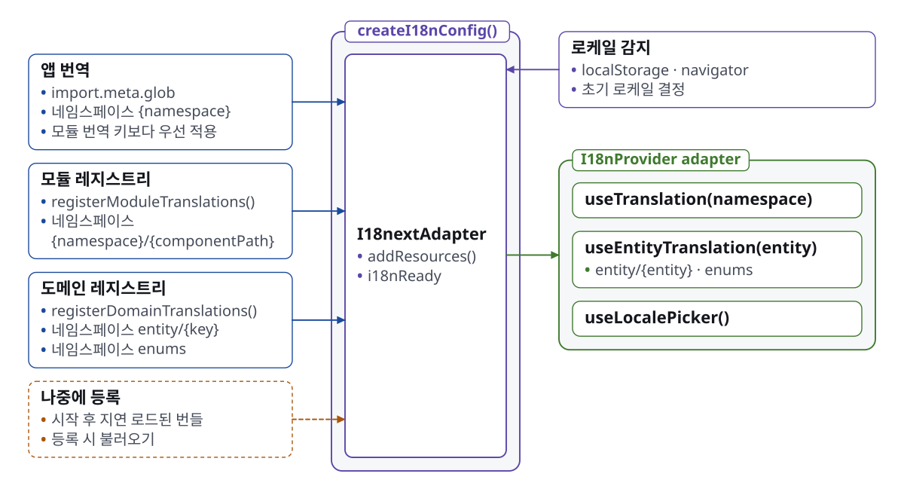

# 국제화

[English](../../en/core-concepts/internationalization.md) | **한국어**

## 개요

simplix-react의 국제화는 `@simplix-react/i18n` 패키지가 담당합니다. 이 패키지는 어댑터(adapter) 기반으로 번역과 서식을 처리하는 체계를 제공합니다. 애플리케이션을 특정 i18n 라이브러리에 직접 묶지 않도록, 번역 조회, 로케일(locale) 관리, 날짜 · 시간 · 숫자 서식, 네임스페이스 단위 리소스 불러오기를 추상화한 `II18nAdapter` 인터페이스를 정의합니다. 기본 제공되는 `I18nextAdapter`는 i18next를 엔진으로 써서 이 인터페이스를 구현합니다.

도메인 중심 애플리케이션의 국제화는 **애플리케이션 수준 번역**(내비게이션 레이블, 공통 UI 문자열)과 **도메인 수준 번역**(엔티티 필드 레이블, 열거형 표시값)을 따로 다룹니다. 둘은 소유자가 다릅니다. 애플리케이션 번역은 앱에 있고, 도메인 번역은 도메인 패키지와 함께 배포됩니다. i18n 패키지는 레지스트리 기반 구조로 애플리케이션 번역과 도메인 번역을 실행 시점에 합치며, 패키지 사이에 의존 관계를 만들지 않습니다.

## 동작 방식

### 어댑터 인터페이스

`II18nAdapter` 인터페이스는 i18n 어댑터가 갖춰야 할 기능 전체를 정의합니다.

| 기능 | 멤버 |
| --- | --- |
| 식별 | `id`, `name` |
| 번역 | `t(key, values?)`, `tn(namespace, key, values?)`, `tp(key, count, values?)`, `exists(key, namespace?)` |
| 로케일 관리 | `locale`, `fallbackLocale`, `availableLocales`, `setLocale(locale)`, `getLocaleInfo(locale)` |
| 날짜 · 시간 서식 | `formatDate(date, options?)`, `formatTime(date, options?)`, `formatDateTime(date, options?)`, `formatRelativeTime(date)` |
| 숫자 서식 | `formatNumber(value, options?)`, `formatCurrency(value, currency?)` |
| 수명 주기 | `initialize(defaultLocale?)`, `dispose()` |
| 리소스 불러오기 | `loadTranslations(locale, namespace, translations)`, `getLoadState(locale, namespace?)` |
| 변경 알림 | `onLocaleChange(handler)`, 선택 항목 `resourcesVersion`과 `onResourcesChange(handler)` |

다른 구현(i18next가 아닌 백엔드를 쓰는 자체 어댑터)으로 바꿔도 애플리케이션 코드와 컴포넌트 코드를 고칠 필요가 없도록 설계했습니다.

### I18nextAdapter

`I18nextAdapter` 클래스는 번역 조회에 i18next를, 날짜 · 시간 · 숫자 · 통화 서식에 브라우저 `Intl` API를 써서 `II18nAdapter`를 구현합니다.

```ts
import { I18nextAdapter } from "@simplix-react/i18n";

const adapter = new I18nextAdapter({
  defaultLocale: "ko",
  resources: {
    ko: { common: { greeting: "{{name}}!" } },
    en: { common: { greeting: "Hello, {{name}}!" } },
  },
});

await adapter.initialize();
adapter.tn("common", "greeting", { name: "Alice" }); // "Alice!"
```

주요 특징은 다음과 같습니다.

- 옵션은 `defaultLocale`과 `fallbackLocale`(둘 다 기본값 `"en"`), `locales`, `resources`, `i18nextInstance`, `debug`입니다
- 기본으로 `i18next.createInstance()`를 써서 전역에 영향을 주지 않는 독립 인스턴스를 만들며, `react-i18next`와 연동할 때는 기존 `i18nextInstance`를 받습니다
- React가 이스케이프를 처리하므로 HTML 이스케이프를 끕니다(`escapeValue: false`)
- 모든 서식은 활성 로케일로 `Intl` API에 맡깁니다
- `tp(key, count)`로 복수형을 지원하며, i18next에 내장된 CLDR 복수 규칙을 씁니다
- `josa` 포매터를 등록하므로, 한국어 메시지에 `{{plan, josa(을/를)}}`라고 쓰면 값의 끝소리에 맞는 조사 형태를 출력합니다

### 도메인 번역 구조

도메인 패키지는 `registerDomainTranslations` 함수로 자체 번역을 제공합니다. 도메인마다 로케일별 로더를 선언합니다.

```ts
import { registerDomainTranslations } from "@simplix-react/i18n";

registerDomainTranslations({
  domain: "pet",
  locales: {
    en: () => import("./locales/en.json"),
    ko: () => import("./locales/ko.json"),
  },
});
```

이 호출은 `Map` 기반 전역 레지스트리에 도메인을 등록합니다. 등록은 도메인 패키지를 불러올 때 부수 효과 import로 일어나므로, 따로 연결하지 않아도 번역을 쓸 수 있습니다.

초기화할 때 `createI18nConfig`가 레지스트리를 읽어 등록된 도메인 번역을 모두 불러옵니다. 초기화 뒤에 등록된 도메인은 등록되는 시점에 불러옵니다. JSON 구조는 다음 관례를 따릅니다.

```json
{
  "pet": {
    "fields": { "name": "Pet Name", "status": "Status" }
  },
  "enums": {
    "petStatus": { "available": "Available", "sold": "Sold" }
  }
}
```

최상위 키는 엔티티 이름으로 보고 `entity/{key}` 네임스페이스에 등록합니다. 특수 키 `"enums"`는 `enums` 네임스페이스에 등록합니다. 이 관례 덕분에 `useEntityTranslation` 훅이 엔티티 이름으로 필드 레이블과 열거형 표시값을 찾습니다.

### 모듈 번역 구조

도메인 패키지가 아닌 애플리케이션 모듈의 번역은 `buildModuleTranslations`로 컴포넌트 단위로 구성합니다.

```ts
import { buildModuleTranslations, registerModuleTranslations } from "@simplix-react/i18n";

const translations = buildModuleTranslations({
  namespace: "dashboard",
  locales: ["en", "ko"],
  components: {
    header: {
      en: () => import("./header/locales/en.json"),
      ko: () => import("./header/locales/ko.json"),
    },
  },
});

registerModuleTranslations(translations);
```

모듈 번역은 `{namespace}/{componentPath}` 네임스페이스에 포함되며, 로케일과 컴포넌트마다 로더 하나를 두고 동적 `import()`로 불러옵니다. `createI18nConfig`는 초기화할 때 모듈에 나열된 모든 로케일을 불러오고, 나중에 등록된 모듈은 등록되는 시점에 불러옵니다. 애플리케이션 번역에 같은 네임스페이스가 있으면 그 키를 모듈 번역 위에 병합합니다.

### createI18nConfig로 초기화

`createI18nConfig` 팩토리가 i18n 설정 전체를 조율합니다.

```ts
import { createI18nConfig } from "@simplix-react/i18n";

const appTranslations = import.meta.glob("./locales/**/*.json", { eager: true });

const { adapter, i18nReady } = createI18nConfig({
  defaultLocale: "ko",
  supportedLocales: ["en", "ko", "ja"],
  appTranslations,
  detection: {
    order: ["localStorage", "navigator"],
    storageKey: "i18n:locale",
  },
});

await i18nReady;
```

다른 옵션으로 `fallbackLocale`(기본값 `"en"`), `moduleTranslations`(등록하지 않고 직접 전달하는 모듈 번역), `debug`이 있습니다. `defaultLocale`의 기본값은 `"en"`, `supportedLocales`의 기본값은 `DEFAULT_LOCALES`입니다.



초기화 순서는 다음과 같습니다.

1. **로케일 설정 확정**: 문자열 로케일 코드를 `DEFAULT_LOCALES`(고유 이름, 날짜 · 시간 형식, 통화 코드를 담은 기본 로케일 설정)에서 찾습니다. 목록에 없는 코드는 코드 자체를 이름으로 쓰는 설정을 받습니다
2. **앱 번역 해석**: `/locales/{namespace}/{locale}.json`에 맞는 Vite glob import를 i18next 리소스 번들로 바꿉니다
3. **어댑터 생성**: 확정한 설정으로 새 `I18nextAdapter` 인스턴스를 만듭니다
4. **로케일 감지**: 설정한 순서대로 `localStorage`와 `navigator.languages`에서 지원 목록에 있는 선호 로케일을 찾습니다. `navigator` 언어는 접두사로도 맞춥니다(`ko-KR` → `ko`)
5. **초기화**: 감지한 로케일이나 기본 로케일로 어댑터를 초기화합니다
6. **로케일 저장**: localStorage 감지를 켜면 로케일이 바뀔 때마다 자동으로 저장합니다
7. **모듈 번역과 도메인 번역 불러오기**: 직접 전달하거나 등록한 모듈 번역과 등록된 도메인 번역을 한꺼번에 불러오고, 나중에 등록되는 번역은 등록될 때 불러옵니다

이 함수는 `adapter`와 `i18nReady` 프로미스를 함께 반환합니다. 어댑터는 프로바이더 설정에 바로 쓸 수 있고, 프로미스는 그때까지 등록된 번역을 모두 불러오면 완료됩니다.

### API 요청 로케일 동기화

서버가 `Accept-Language` 헤더에 따라 지역화된 응답을 반환한다면, i18n 어댑터를 `@simplix-react/api`에 연결해 모든 API 요청에 이 헤더를 자동으로 넣을 수 있습니다.

```ts
import { setRequestLocale } from "@simplix-react/api";

i18nAdapter.onLocaleChange(setRequestLocale);
i18nReady.then(() => setRequestLocale(i18nAdapter.locale));
```

브라우저는 운영 체제나 브라우저의 언어 설정으로 `Accept-Language`를 정하므로, 애플리케이션에서 고른 언어와 다를 수 있습니다. 예를 들어 한국어 운영 체제를 쓰는 사용자가 앱에서 영어를 고르면, 이 기능 없이는 `Accept-Language: ko`를 보냅니다. `setRequestLocale`를 쓰면 `getMutator()`가 올바른 로케일을 넣습니다.

`@simplix-react/api`와 `@simplix-react/i18n`은 서로 직접 의존하지 않습니다. 연결은 애플리케이션 수준에서 어댑터의 `onLocaleChange` 콜백으로 하며, `localStorage`에 로케일을 저장하는 방식과 같습니다.

### 로케일 설정

로케일마다 `LocaleConfig`로 설명합니다.

```ts
interface LocaleConfig {
  code: string;        // BCP 47 code (e.g., "ko", "en-GB")
  name: string;        // Native name (e.g., "한국어")
  englishName: string;  // English name (e.g., "Korean")
  direction?: "ltr" | "rtl";
  dateFormat?: string;
  timeFormat?: string;
  currency?: string;    // ISO 4217 code
}
```

`DEFAULT_LOCALES` 상수는 동아시아, 동남아시아, 남아시아, 유럽, 중동, 아프리카 언어의 기본 설정을 제공하며, 지역 변형(예: `en-GB`, `pt-BR`, `es-MX`)도 포함합니다. `SUPPORTED_LOCALES`는 그 코드 목록입니다.

### 로케일에 맞춘 서식과 텍스트 도우미

번역 문자열 밖에서 활성 로케일을 적용하는 도우미도 내보냅니다.

| 내보내는 이름 | 용도 |
| --- | --- |
| `formatDate`, `formatTime`, `formatDateTime`, `formatRelative` | 지정한 로케일과 IANA 시간대로 `Intl` 서식 적용(`formatDate(date, locale, timeZone, options?)`) |
| `DateTimeProvider`, `useDateTime` | 이 서식 함수를 어댑터의 로케일과 `timeZone`(생략하면 브라우저 시간대)에 묶는 컨텍스트 |
| `useFormattedDate`, `useFormattedTime`, `useFormattedDateTime`, `useFormattedRelative` | 활성 로케일과 시간대에 묶어 메모이즈한 서식 |
| `configureFallbackLocale`, `useFallbackLocale`, `getFallbackLocale` | 다국어 값이 대체할 언어(`DEFAULT_FALLBACK_LOCALE`은 `"en"`) |
| `useLocalizedText` | 로케일별 값 맵에서 활성 로케일 항목을 고르고, 없으면 처음 채워진 항목을 반환 |
| `useOptionalTranslation` | `useTranslation`에 카탈로그에 없을 수 있는 키를 위한 `tOr(key, fallback, values?)`를 더한 훅 |
| `koreanParticle`, `localeParticle`, `formatKoreanParticle` | 낱말 뒤에 오는 한국어 조사 형태 결정, `josa` 포매터도 이 함수를 사용 |

이 도우미는 `@simplix-react/i18n`에서, 프로바이더와 훅은 `@simplix-react/i18n/react`에서 가져옵니다.

### React 연동

React 바인딩은 별도 진입점(`@simplix-react/i18n/react`)으로 제공합니다.

**I18nProvider**: 컴포넌트 트리를 어댑터 컨텍스트로 감쌉니다.

```tsx
import { I18nProvider } from "@simplix-react/i18n/react";

<I18nProvider adapter={adapter}>
  <App />
</I18nProvider>
```

**useTranslation(namespace)**: 네임스페이스로 범위를 정한 `t` 함수, 현재 `locale`, `exists` 함수를 반환합니다. `useSyncExternalStore`로 로케일이 바뀔 때와 첫 렌더링 뒤에 리소스가 도착할 때 다시 렌더링합니다.

```tsx
const { t, locale, exists } = useTranslation("common");
t("greeting", { name: "Alice" }); // "Hello, Alice!"
```

**useLocale()**: 현재 로케일 코드만 반환하며, 바뀌면 다시 렌더링합니다.

```tsx
const locale = useLocale(); // "ko"
```

**useI18n()**: 컨텍스트의 `II18nAdapter` 전체를 반환합니다(`I18nProvider` 밖에서는 `null`). 서식 메서드와 다른 어댑터 API를 직접 쓸 때 사용합니다.

**useEntityTranslation(entity)**: `entity/{name}`와 `enums` 네임스페이스를 써서 특정 엔티티로 범위를 정한 `fieldLabel`, `enumLabel` 함수를 제공합니다.

```tsx
const { fieldLabel, enumLabel } = useEntityTranslation("pet");
fieldLabel("name");                    // "Pet Name"
enumLabel("petStatus", "available");   // "Available"
```

**useLocalePicker()**: 로케일 전환 UI를 만드는 헤드리스 훅입니다. 현재 로케일, 표시 이름(`Intl.DisplayNames`로 구함)을 포함한 사용 가능 로케일 목록, `setLocale` 함수를 반환합니다.

```tsx
const { locale, locales, setLocale } = useLocalePicker();
// locales = [{ value: "en", displayName: "English" }, { value: "ko", displayName: "한국어" }]
```

## 설계 결정

### 어댑터 인터페이스를 두는 이유

어댑터 인터페이스는 i18n 계약과 구현을 분리합니다. 기본 엔진은 i18next이지만, 애플리케이션은 어떤 번역 백엔드로도 `II18nAdapter`를 구현할 수 있습니다. 기존 i18n 시스템과 연동해야 하거나 더 가벼운 번역 라이브러리를 쓰려는 프로젝트에 특히 중요합니다.

### 도메인 수준 번역을 두는 이유

도메인 중심 구조에서 엔티티 필드 레이블과 열거형 값은 애플리케이션이 아닌 도메인에 속하는 지식입니다. 번역을 도메인 패키지와 함께 배포하고 레지스트리로 불러오면, 번역이 그 번역이 설명하는 스키마와 같은 곳에 있게 됩니다. 새 도메인 패키지를 추가하면 그 번역도 애플리케이션에 함께 들어옵니다.

### 네임스페이스로 범위를 나누는 이유

네임스페이스는 서로 관계없는 번역 집합끼리 키가 충돌하지 않게 합니다. 도메인 번역의 `entity/{name}` 관례와 모듈 번역의 임의 네임스페이스 덕분에 `pet` 엔티티의 `"name"` 키와 `user` 엔티티의 `"name"` 키가 충돌하지 않습니다.

### 서식에 Intl API를 쓰는 이유

날짜, 시간, 숫자, 통화 서식에는 i18next의 서식 플러그인 대신 브라우저의 `Intl` API를 씁니다. `Intl` API는 별도 설정 없이 CLDR 표준을 따르는 로케일별 서식을 제공하고, 추가 의존성이 필요 없으며, 브라우저 플랫폼의 다른 부분과 같은 결과를 냅니다.

### 모듈 · 도메인 번역에 로더를 쓰는 이유

번역 파일은 클 수 있고, 애플리케이션이 지원하는 로케일도 많을 수 있습니다. 로케일마다 로더(동적 `import()`)를 두므로 번역 파일이 메인 번들에 포함되지 않습니다. Vite의 코드 분할로 로케일마다 번역이 별도 청크가 되며, 나열된 모든 로케일의 로더는 초기화할 때 함께 실행합니다.

## 영향

### 애플리케이션 개발자

- 번역 설정은 `createI18nConfig`에 모입니다. 함수 호출 한 번으로 i18n 시스템 전체를 설정합니다
- 애플리케이션 번역은 Vite glob import를 써서 설정 없이 네임스페이스를 찾습니다
- 로케일 감지와 저장은 자동으로 처리합니다
- 컴포넌트는 범위를 정한 조회에 `useTranslation`을, 엔티티 필드와 열거형 레이블에 `useEntityTranslation`을 씁니다

### 도메인 패키지 작성자

- 패키지 진입점에서 `registerDomainTranslations`를 호출해 부수 효과로 번역을 등록하세요
- `{ entityName: { fields: {...} }, enums: {...} }` JSON 관례를 따르세요
- 번역은 애플리케이션이 초기화될 때 자동으로 불러옵니다

### 테스트

- 테스트에서는 인라인 리소스로 `I18nextAdapter` 인스턴스를 만들 수 있습니다
- 어댑터 인터페이스가 있으므로 스냅샷 테스트용으로 키를 그대로 반환하는 목(mock) 어댑터를 만들 수 있습니다
- `I18nProvider`가 없으면 `useTranslation`이 키를 그대로 반환하므로, i18n 설정 없이도 컴포넌트를 테스트할 수 있습니다

## 관련 문서

- [API 계약](./api-contracts.md): 엔티티 스키마와 번역 네임스페이스의 관계
- [폼 파생](./form-derivation.md): 폼 레이블에 엔티티 번역을 쓰는 방법
