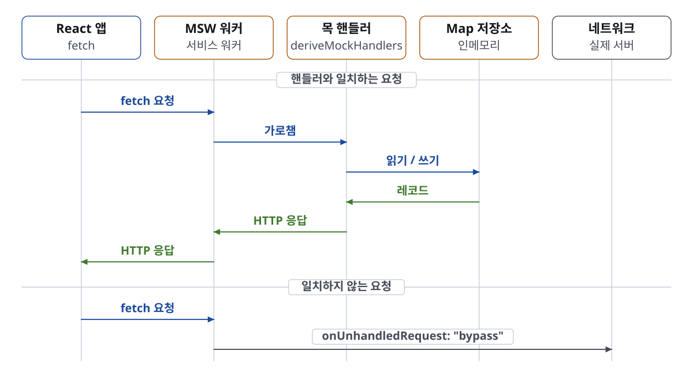

# 목 데이터 계층

[English](../../en/core-concepts/mock-data-layer.md) | **한국어**

## 개요

simplix-react의 목(mock) 데이터 계층은 HTTP 요청을 가로채는 MSW(Mock Service Worker)와 `Map` 기반의 인메모리 저장소(in-memory store)를 결합해, 브라우저 안에서만 실행되는 완전한 API 시뮬레이션을 만듭니다. 고정된 픽스처를 돌려주는 방식과 달리 생성, 조회, 수정, 삭제와 필터링, 정렬, 페이지네이션, 관계 데이터 로딩을 실제로 수행하며, 데이터는 모두 JavaScript `Map` 인스턴스에 저장합니다.

목적은 프론트엔드를 개발하는 동안 실행 중인 백엔드가 없어도 되게 하는 것입니다. 하드코딩한 JSON 픽스처나 단순한 요청-응답 맵 같은 기존 모킹 방식은 프론트엔드가 데이터를 생성, 수정, 삭제하고 그 결과를 다음 조회에서 확인해야 할 때 쓸 수 없습니다. 정적 목은 프론트엔드가 무엇을 보내든 같은 응답을 반환하기 때문입니다. simplix-react의 목 계층은 모든 목 핸들러가 인메모리 저장소를 읽고 쓰게 해서 요청 사이에 상태를 유지합니다.

이 구조로 백엔드 인프라 없이도 운영 환경과 똑같이 동작하는 테스트 시나리오, 오프라인 개발 환경, 시연 환경을 만들 수 있습니다.

## 동작 방식

### 구조

목 데이터 계층의 구성 요소는 다음과 같습니다.



1. **MSW 서비스 워커**: 계약의 URL 패턴과 일치하는 HTTP 요청을 모두 가로챕니다
2. **파생한 목 핸들러**: API 계약에서 파생하며, HTTP 요청을 저장소 작업으로 바꿉니다
3. **인메모리 `Map` 저장소**: 엔티티마다 하나씩 있는 JavaScript `Map` 인스턴스로, 레코드를 ID를 키로 저장합니다

React 애플리케이션이 파생 클라이언트나 다른 HTTP 호출로 fetch 요청을 보내면 MSW가 서비스 워커 수준에서 가로챕니다. 요청은 해당 목 핸들러로 전달되고, 목 핸들러는 인메모리 저장소를 읽거나 씁니다. 결과는 다시 HTTP 응답으로 바뀌어 애플리케이션에 반환되며, 애플리케이션은 실제 서버의 응답과 구별할 수 없습니다.

### 목 핸들러 파생

`deriveMockHandlers(config, mockConfig?, options?)`는 계약 구성을 읽어 엔티티의 오퍼레이션(operation)마다 MSW 핸들러를 하나씩 파생합니다. `deriveClient()`와 같은 방식이지만, 클라이언트 메서드 대신 서버 쪽 핸들러를 파생합니다. 두 번째 인자에는 엔티티 이름별 `MockEntityConfig`를 지정합니다(기본값은 `defaultLimit` 50, `maxLimit` 100, `defaultSort` `"createdAt:desc"`).

```ts
import { deriveMockHandlers } from "@simplix-react/mock";

const handlers = deriveMockHandlers(projectApi.config, {
  task: {
    defaultLimit: 20,
    maxLimit: 100,
    defaultSort: "createdAt:desc",
    relations: {
      project: {
        entity: "project",
        localKey: "projectId",
        type: "belongsTo",
      },
    },
  },
});
```

엔티티마다 오퍼레이션의 CRUD 역할에 따라 다음 핸들러를 파생합니다.

| 핸들러 | 저장소 작업 | 기능 |
| --- | --- | --- |
| **list** (GET) | `Map` 값을 순회하고 필터링 | 쿼리 매개변수 필터링, 정렬, 오프셋 페이지네이션, 상위 엔티티 범위 제한 |
| **get** (GET) | `Map.get(id)` | 관련 저장소에서 `belongsTo` 관계 데이터 로딩(선택) |
| **create** (POST) | `Map.set(id, record)` | 요청에 ID가 없으면 `getNextId()`로 숫자 ID 부여, `createdAt`/`updatedAt` 자동 설정, 중첩 엔티티는 URL에서 상위 엔티티 ID를 가져옴 |
| **update** (PATCH/PUT) | 기존 레코드에 병합 | 부분 수정, `updatedAt` 타임스탬프 자동 설정 |
| **delete** (DELETE) | `Map.delete(id)` | ID로 행 삭제 |
| **tree** (GET) | 순회 후 `buildTreeFromFlatRows` 호출 | `parentId` 기준으로 중첩한 계층 데이터 |
| **custom** | 사용자 정의 리졸버 | `MockEntityConfig.resolvers`로 동작을 모두 지정. 리졸버가 없으면 `GET`은 경로 매개변수 유무에 따라 list 또는 get으로, `POST`, `PUT`, `PATCH`는 create 또는 update로, 경로 매개변수가 있는 `DELETE`는 delete로 동작하고, 그 밖에는 빈 성공 응답을 반환 |

저장소 이름은 `{domain}_{snake_case_entity}` 규칙으로 정합니다. 예를 들어 `project` 도메인의 `task` 엔티티는 `project_task`, `taskComment` 엔티티는 `project_task_comment`가 됩니다.

세 번째 인자인 `MockHandlerOptions`에는 `success`와 `error` 함수가 있는 `responseWrapper`를 지정합니다. 기본 성공 응답 본문은 `{ data: <payload> }`이고 오류 응답 본문은 `{ code, message }`입니다. 다른 백엔드의 응답 봉투(envelope)에 맞추려면 래퍼를 지정하세요. `output`이 `WiredSchema`인 오퍼레이션은 그 스키마의 `wrap()` 결과로 응답합니다.

### 부트스트랩 흐름

`setupMockWorker()` 함수는 도메인 단위 구성으로 부트스트랩 과정 전체를 처리합니다. 핸들러와 초기 데이터는 도메인마다 지정합니다.

```ts
import { setupMockWorker, deriveMockHandlers } from "@simplix-react/mock";

await setupMockWorker({
  domains: [
    {
      name: "project",
      handlers: deriveMockHandlers(projectApi.config),
      seed: {
        project_task: [
          { id: 1, title: "Task 1", status: "open", createdAt: "2025-01-01" },
          { id: 2, title: "Task 2", status: "done", createdAt: "2025-01-02" },
        ],
        project_project: [
          { id: 1, name: "My Project", createdAt: "2025-01-01" },
        ],
      },
    },
    {
      name: "auth",
      enabled: false, // temporarily disable this domain
      handlers: deriveMockHandlers(authApi.config),
    },
  ],
});
```

진행 순서는 다음과 같습니다.

1. `enabled !== false`인 도메인만 남기고, 남은 도메인이 없으면 워커를 시작하지 않고 반환합니다
2. 모든 인메모리 저장소를 초기화합니다(모든 `Map` 인스턴스와 자동 증가 카운터 초기화)
3. `seedEntityStore()`로 도메인의 초기 데이터를 각 엔티티 저장소에 넣습니다
4. 활성 도메인의 핸들러를 합치고, 다른 출처(origin)로 가는 요청을 그대로 통과시키는 핸들러를 추가한 뒤 MSW 서비스 워커를 시작합니다

초기 데이터는 저장소 이름을 키로, 레코드 배열을 값으로 하는 일반 객체로 지정합니다. `seedEntityStore` 함수는 레코드를 저장소에 넣고, 자동 증가 카운터를 초기 데이터에서 가장 큰 숫자 ID 다음 값으로 맞춥니다.

도메인마다 `enabled` 플래그(기본값 `true`)로 켜고 끌 수 있으므로, 개발 중에 구성을 지우지 않고도 특정 도메인을 비활성화할 수 있습니다.

어느 핸들러와도 일치하지 않는 요청은 네트워크로 그대로 보내므로, 목 계층과 실제 API 호출을 함께 쓸 수 있습니다.

### 오류 처리

목 핸들러는 성공과 실패 결과를 감싸는 `MockResult<T>` 패턴을 사용합니다.

```ts
// Success
mockSuccess({ id: 1, title: "My Task" })
// { success: true, data: { ... } }

// Failure
mockFailure({ code: "not_found", message: "project_task not found" })
// { success: false, error: { code: "not_found", message: "..." } }
```

오류 코드는 다음 HTTP 상태 코드로 바뀝니다.

| 오류 코드 | HTTP 상태 |
| --- | --- |
| `not_found` | 404 |
| `unique_violation` | 409 |
| `foreign_key_violation` | 422 |
| (그 밖) | 500 |

수정 요청의 본문이 올바른 JSON이 아니면 코드 `bad_request`와 함께 400으로 응답합니다.

### 워커 스크립트 제공과 목 모드 해제

`@simplix-react/mock/vite`의 Vite 플러그인 `mswPlugin()`은 개발 중에는 `mockServiceWorker.js`를 직접 제공하고 빌드할 때는 결과물에 포함하므로, 앱의 `public/`에 이 파일을 두지 않아도 됩니다. 워커 스크립트는 앱이 설치한 msw 버전의 것을 사용합니다.

서비스 워커는 자신을 설치한 개발 서버가 종료된 뒤에도 남아 있습니다. `stopMocking({ storePrefix? })`은 이전 목 모드 실행에서 남은 워커의 등록을 해제하고, 그 워커가 아직 제어하는 페이지를 다시 불러오며, `storePrefix` 아래에 저장된 인증 토큰을 삭제합니다. 워커를 시작하지 않기로 정한 분기에서 호출하세요. 페이지를 다시 불러왔으면 `true`로 이행됩니다.

```ts
import { setupMockWorker, stopMocking } from "@simplix-react/mock";

if (import.meta.env.VITE_ENABLE_MOCK === "true") {
  await setupMockWorker({ domains });
} else {
  await stopMocking({ storePrefix: "app" });
}
```

Orval이 생성한 타입으로 핸들러를 직접 작성할 때는 `createMockEntityStore<T>()`로 페이지 단위 조회를 지원하는 타입 지정 인메모리 CRUD 저장소(`MockEntityStore`, `PagedResult`)를 만듭니다.

## 설계 결정

### HTTP 요청을 MSW로 가로채는 이유

MSW는 서비스 워커 수준에서 요청을 가로채므로 애플리케이션의 fetch 호출이 운영 환경과 똑같이 동작합니다. 별도의 목 클라이언트, 의존성 주입, 테스트 전용 코드 경로가 필요 없습니다. 애플리케이션은 개발 환경(목 사용)과 운영 환경(실제 API 사용) 모두에서 `deriveClient`로 파생한 같은 HTTP 클라이언트를 사용합니다.

검토한 대안은 다음과 같습니다.

- **fetch 폴리필 교체**: 쉽게 깨지고, 라이브러리를 업데이트하면 동작하지 않으며, 네이티브 `fetch`에는 적용되지 않습니다
- **프록시 서버**: 별도 프로세스를 실행해야 하고, 지연 시간이 늘며, CI 구성이 복잡해집니다
- **인메모리 인터셉터**: 헤더, 상태 코드, 콘텐츠 형식을 포함한 HTTP 처리 과정 전체를 거치지 않습니다

### 인메모리 `Map` 저장소를 쓰는 이유

JavaScript `Map` 인스턴스는 상태가 있는 데이터 계층 중 가장 단순하므로 저장소로 선택했습니다. 바로 만들 수 있고, DevTools에서 쉽게 살펴볼 수 있으며, 설정이 필요 없습니다. 초기 데이터는 일반 JavaScript 객체이므로 SQL, 마이그레이션, 스키마 정의가 필요 없습니다.

대신 페이지를 새로 고치면 데이터가 유지되지 않습니다. `setupMockWorker()`가 부트스트랩할 때마다 초기 데이터를 다시 넣고 시작 시간이 매우 짧으므로 실제로는 문제가 되지 않습니다.

### 핸들러를 직접 등록하지 않고 파생하는 이유

목 핸들러는 클라이언트, 훅과 같은 방식으로 파생합니다. 그래서 계약에 엔티티를 추가하면 그 목 핸들러도 자동으로 파생하므로, 직접 등록할 필요가 없고 빠뜨리는 엔드포인트도 없습니다. 클라이언트 쪽 동작과 목 서버 쪽 동작 모두 계약이 유일한 기준입니다.

## 영향

### 개발 흐름

개발자는 백엔드를 실행하지 않고도 프론트엔드 전체를 만들고 고칠 수 있습니다. 목 계층은 실제와 같이 동작합니다. 작업을 만들고 다른 페이지로 이동했다가 돌아오면 만든 작업이 표시됩니다. 시작 시간이 매우 짧으므로 목 부트스트랩이 개발 서버의 시작 시간을 거의 늘리지 않습니다.

### 테스트

계약에서 파생한 목 핸들러는 통합 테스트에 바로 쓸 수 있습니다. 모든 오퍼레이션이 상태가 있는 인메모리 저장소를 사용하므로, 테스트 서버 없이도 생성, 조회, 수정, 확인으로 이어지는 복잡한 시나리오를 검증할 수 있습니다. `resetStore()` 함수로 테스트 실행 사이에 상태를 초기화합니다.

### 시연 환경

목 계층으로 브라우저에서만 실행되는 독립 시연 애플리케이션을 만들 수 있습니다. `seed` 구성으로 저장소에 예시 데이터를 넣으면 인프라 없이도 실제처럼 조작할 수 있는 시연 환경이 됩니다.

### 목만 쓸 때와 실제 백엔드를 쓸 때

| 상황 | 권장 |
| --- | --- |
| 초기 프로토타이핑, 화면 디자인 반복 | 목만 사용 |
| 백엔드가 준비되기 전의 프론트엔드 개발 | 목만 사용 |
| 통합 테스트, CI 파이프라인 | 목만 사용 |
| 시연, 소개용 애플리케이션 | 목만 사용 |
| 실제 API 동작을 대상으로 하는 E2E 테스트 | 실제 백엔드 |
| 성능 테스트, 부하 테스트 | 실제 백엔드 |
| 운영 환경 | 실제 백엔드 |
