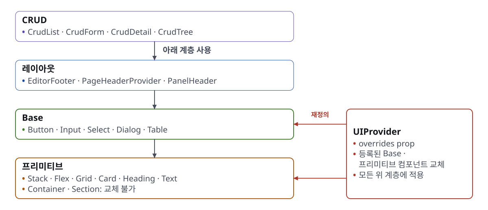

# UI 컴포넌트

[English](../../en/core-concepts/ui-components.md) | **한국어**

## 개요

simplix-react의 UI 계층은 `@simplix-react/ui`가 제공합니다. Tailwind CSS와 Radix UI 프리미티브 위에 만든 컴포넌트 라이브러리로, 저수준 레이아웃 프리미티브부터 완전한 CRUD 화면 구성까지 제공합니다. 서로 관계없는 컴포넌트를 나열하지 않고 **primitives**, **base**, **layout**, **crud** 계층으로 구성하며, 각 계층은 바로 아래 계층 위에 만들어집니다. 컴포넌트는 "No Magic" 원칙을 따릅니다. `value`/`onChange` props를 명시적으로 받고, 숨은 상태가 없으며, 모든 수준에서 직접 제어할 수 있습니다.

대부분의 업무 애플리케이션은 같은 구조를 공유하는 CRUD 화면으로 이루어집니다. 검색, 필터, 정렬, 페이지 이동이 있는 목록, 레이블이 있는 필드와 검증이 있는 폼, 읽기 전용 필드를 보여 주는 상세 화면이 그 구조입니다. `@simplix-react/ui`는 이 구조를 데이터 흐름이 명시적인 복합 컴포넌트로 제공하므로, 반복되는 스캐폴드 코드를 작성하지 않으면서도 레이아웃, 스타일, 동작을 모두 직접 제어할 수 있습니다.

## 동작 방식

### 컴포넌트 구조

라이브러리는 추상화 수준이 낮은 것부터 높은 것까지 다음 계층으로 구성합니다.



**Primitives**(`Stack`, `Flex`, `Grid`, `Container`, `Card`, `Section`, `Heading`, `Text`): CVA 기반 변형을 갖춘 레이아웃 구성 요소입니다. 도메인을 모르는 범용 레이아웃 컴포넌트입니다.

**Base**(`Button`, `Input`, `Select`, `Dialog`, `Table`, `Checkbox`, `Tabs` 등): Radix UI 위에 만든 상호작용 UI 컴포넌트입니다. 표준 폼 컨트롤, 오버레이, 데이터 표시 컴포넌트가 여기에 속합니다. `Dialog`, `Select`, `Table` 같은 복합 컴포넌트는 여러 하위 컴포넌트로 이루어집니다.

**Layout**(`EditorFooter`, `PageHeaderProvider`, `PanelHeader`): 화면마다 같은 레이아웃 구조를 제공하는 페이지 수준 컴포넌트입니다.

**CRUD**(`CrudList`, `CrudForm`, `CrudDetail`, `CrudTree`): base 컴포넌트를 조합해 완전한 CRUD 화면 구조를 만드는 고수준 복합 컴포넌트입니다. 필터, 테이블, 폼, 상세 표시를 표준 데이터 흐름으로 묶습니다.

### CRUD 패턴 컴포넌트

#### CrudList

`CrudList`는 검색, 필터, 정렬, 페이지 이동, 행 액션, 일괄 액션, 키보드 탐색을 갖춘 목록 화면을 제공합니다. 복합 컴포넌트 패턴을 쓰므로 필요한 부분만 조립하면 됩니다.

```tsx
<CrudList>
  <CrudList.Toolbar>
    <CrudList.Search value={search} onChange={setSearch} />
  </CrudList.Toolbar>
  <CrudList.Table data={items} sort={sort} onSortChange={setSort}>
    <CrudList.Column field="name" header="Name" sortable />
    <CrudList.Column field="status" header="Status" />
  </CrudList.Table>
  <CrudList.Pagination
    page={1} pageSize={10} total={100}
    totalPages={10} onPageChange={setPage}
  />
</CrudList>
```

`Toolbar`, `Search`, `Table`, `Column`, `Pagination` 외에도 `TableCard`, `BulkActions`, `BulkAction`, `Empty`, `ViewToggle`, `FilterBar`, `FilterActions`, 그리고 [필터 시스템](#필터-시스템)의 각 필터 컴포넌트를 멤버로 제공합니다.

`useCrudList` 훅은 목록 상태(검색, 필터, 정렬, 페이지 이동, 선택)를 관리하고 컴포넌트 트리에 연결합니다. URL 동기화는 `useUrlSync`로, 대량 데이터의 가상 스크롤은 `useVirtualList`로 처리합니다.

#### CrudForm

`CrudForm`은 섹션, 액션, 변경 추적, 자동 저장, 저장하지 않은 변경 보호를 갖춘 폼 컨테이너를 제공합니다. 루트는 `onSubmit`과 `isSubmitting`(그리고 `warnOnUnsavedChanges`, `variant`, `fieldVariant`)을 받고, `CrudForm.Actions`는 하위 요소로 전달한 버튼을 배치합니다.

```tsx
<CrudForm onSubmit={handleSubmit} isSubmitting={isSubmitting}>
  <CrudForm.Section title="Basic Info">
    <FormFields.TextField label="Name" value={name} onChange={setName} required />
    <FormFields.SelectField label="Status" value={status} onChange={setStatus} options={statusOptions} />
  </CrudForm.Section>
  <CrudForm.Actions>
    <Button variant="outline" onClick={handleCancel}>Cancel</Button>
    <Button type="submit">Save</Button>
  </CrudForm.Actions>
</CrudForm>
```

보조 훅으로 저장하지 않은 변경을 추적하는 `useIsDirty`, 일정 시간마다 자동 제출하는 `useAutosave`, 브라우저 이동을 경고하는 `useBeforeUnload`, 앱 안의 이동을 막는 `useUnsavedChanges`가 있습니다. 라우터 어댑터가 `useBlocker`를 제공하면(TanStack 어댑터는 라우터에 history가 있을 때, React Router 어댑터는 데이터 라우터에서 React Router의 `useBlocker`를 받았을 때 제공합니다) 이 가드는 브라우저의 뒤로 가기와 앞으로 가기, 페이지가 감싸지 않은 링크도 막습니다.

#### CrudDetail

`CrudDetail`은 섹션, 액션 버튼, 변형(`"default"` 또는 `"dialog"`)을 지원하는 읽기 전용 상세 화면을 제공합니다. `Section`과 `Actions` 외에도 `DefaultActions`, `ActionFooter`, `AuditFooter`, `List`, `Table`을 멤버로 제공합니다.

```tsx
<CrudDetail>
  <CrudDetail.Section title="Pet Information">
    <DetailFields.DetailTextField label="Name" value={pet.name} />
    <DetailFields.DetailBadgeField
      label="Status"
      value={pet.status}
      variants={{ available: "success", sold: "secondary" }}
    />
    <DetailFields.DetailDateField label="Created" value={pet.createdAt} />
  </CrudDetail.Section>
  <CrudDetail.Actions>
    <Button onClick={handleEdit}>Edit</Button>
  </CrudDetail.Actions>
</CrudDetail>
```

`usePreviousData` 훅은 화면 전환 중에 이전 데이터를 유지해 내용이 깜박이지 않게 합니다.

#### CrudTree

`CrudTree`는 펼치기와 접기, 끌어서 놓기로 순서 바꾸기, 트리 이동을 지원하며 계층 데이터를 다룹니다.

```tsx
<CrudTree>
  <CrudTree.Toolbar>
    <CrudTree.Search value={search} onChange={setSearch} />
  </CrudTree.Toolbar>
  <CrudTree.Table data={treeData}>
    <CrudTree.Column field="name" header="Name" />
  </CrudTree.Table>
</CrudTree>
```

`CrudTree.Table`은 노드를 `data`로 받으며, 다른 멤버로 `ExpandToggle`, `HeaderActions`, `TableCard`, `Empty`가 있습니다. `useTreeExpansion`은 노드의 펼침 상태를 관리합니다. `TreeReorderDialog`와 `TreeMoveDialog`는 트리 계층을 재구성하는 UI를 제공합니다.

### 필드 변형 시스템

필드는 편집용과 읽기 전용으로 나뉘며, 편집 필드와 읽기 전용 필드가 같은 레이아웃 체계를 공유합니다.

**FormFields**(편집용): `TextField`, `TextareaField`, `NumberField`, `CurrencyField`, `PasswordField`, `PhoneField`, `SelectField`, `ComboboxField`, `MultiSelectField`, `TreeMultiSelectField`, `RadioGroupField`, `CheckboxField`, `SwitchField`, `GroupedToggleField`, `SliderField`, `DateField`, `DateRangeField`, `DateTimeField`, `TimeField`, `ColorField`, `IconField`, `CountryField`, `TimezoneField`, `LocationPickerField`, `I18nTextField`, `I18nTextareaField`, `PlateEditorField`, `PlateEditorI18nField`, `FileField`, `ImageField`, `StaticField`, `Field`. `TreeSelectField`는 네임스페이스 밖에서 따로 내보냅니다.

**DetailFields**(읽기 전용): `DetailTextField`, `DetailTextareaField`, `DetailNumberField`, `DetailCurrencyField`, `DetailPhoneField`, `DetailBadgeField`, `DetailStatusField`, `DetailBooleanField`, `DetailDateField`, `DetailLinkField`, `DetailImageField`, `DetailListField`, `DetailNoteField`, `DetailBlockField`, `DetailLocationField`, `DetailCountryField`, `DetailTimezoneField`, `DetailI18nTextField`, `DetailI18nTextareaField`, `I18nText`, `DetailField`

편집 필드와 읽기 전용 필드는 `CommonFieldProps` / `CommonDetailFieldProps` 인터페이스를 공유하며, 여기에는 `label`, `labelKey`, `layout`, `size`, `className`이 있습니다. `CommonFieldProps`에는 `error`, `warning`, `description`, `required`, `disabled`와 앞뒤 컨트롤이 더 있습니다. 공통 `FieldVariant` 체계가 레이블의 위치와 크기를 정합니다.

| 속성 | 값 | 효과 |
| --- | --- | --- |
| `layout` | `"top"`(기본값), `"left"`, `"inline"`, `"trailing"`, `"hidden"` | 필드 기준 레이블 위치. `"trailing"`은 컨트롤을 오른쪽 끝에 배치하고 레이블과 점선으로 연결하고, `"hidden"`은 레이블을 화면 낭독기에만 남김 |
| `size` | `"sm"`(기본값), `"md"`, `"lg"` | 필드 크기 |

`FieldVariantContext`가 이 설정을 하위 필드에 전달하므로, 섹션에 변형을 한 번 지정하면 모든 필드가 물려받습니다.

```tsx
<FieldVariantContext.Provider value={{ layout: "left", size: "md" }}>
  <FormFields.TextField label="Name" value={name} onChange={setName} />
  <FormFields.TextField label="Email" value={email} onChange={setEmail} />
</FieldVariantContext.Provider>
```

필드마다 자신의 `layout`과 `size` props로 컨텍스트 값을 재정의(override)할 수 있습니다. `useFieldVariant` 훅은 현재 변형에 선택 항목인 재정의 값을 병합해 반환합니다.

### 헤드리스 설계 원칙

모든 CRUD 컴포넌트와 필드 컴포넌트는 "No Magic" 원칙을 따릅니다.

- 모든 필드는 `value`와 `onChange` props를 명시적으로 받습니다. 폼에 자동으로 바인딩하지 않습니다
- CRUD 컴포넌트는 데이터, 콜백, 상태를 props로 받으며, 데이터를 직접 가져오거나 내부에서 상태를 관리하지 않습니다
- 레이아웃과 스타일은 불투명한 설정 객체가 아닌 `className`과 CVA 변형으로 제어합니다

그래서 컴포넌트를 예측하고 테스트하고 조합하기 쉽습니다. `FormFields.TextField`는 `CrudForm` 안에 있든, 대화 상자 안에 있든, 독립된 폼 안에 있든 똑같이 동작합니다.

### UI 프로바이더와 컴포넌트 재정의

`UIProvider`는 컨텍스트 기반 어댑터(adapter) 패턴으로 컴포넌트를 전역에서 교체합니다. `Button`, `Input` 같은 단일 컴포넌트와 프리미티브는 내보내는 시점에 재정의를 직접 찾으므로, 정적으로 가져와도 교체한 컴포넌트를 렌더링합니다. 프레임워크는 복합 컴포넌트의 하위 컴포넌트를 `useFlatUIComponents()`로 읽고, `useUIComponents()`는 병합된 레지스트리를 반환합니다. 레지스트리에는 기본 컴포넌트와 프리미티브 외에 `SectionShell`, `QueryFallback`, `CrudDelete`, `FieldWrapper`, `DetailFieldWrapper`도 있습니다. 프로바이더는 중첩할 수 있으며, 안쪽 프로바이더가 그 하위 트리에서 바깥 프로바이더를 재정의합니다.

```tsx
<UIProvider overrides={{ Input: MyCustomInput, Button: MyCustomButton }}>
  <App />
</UIProvider>
```

복합 컴포넌트(`Select`, `Dialog`, `Sheet`, `Table` 등)는 깊은 병합을 지원합니다. 복합 컴포넌트 전체를 바꾸지 않고 하위 컴포넌트 하나만 재정의할 수 있습니다.

```tsx
<UIProvider overrides={{ Select: { Trigger: MySelectTrigger } }}>
  {/* Only the trigger is replaced; Root, Content, Item remain default */}
</UIProvider>
```

`withOverride(Base, { ...defaultProps, className })`는 기본 props나 클래스만 바꾸는 재정의를 만들고, `createOverrides`는 팩토리에 기본 구현을 전달합니다. `UIProvider`는 `overrides` 외에도 `statusTones`(상태 색상의 클래스 재정의), `defaults`(앱 전체의 props 기본값), `design`(모든 슬롯을 그리는 디자인)을 받습니다.

재정의 체계는 다음 수준의 사용자 지정을 지원합니다.

| 수준 | 방법 | 범위 |
| --- | --- | --- |
| 1 | `className` prop | 인스턴스 하나 |
| 2 | CVA 변형(`variant`, `size`) | 변형 단위 |
| 3 | `FieldVariantContext` | 섹션 · 페이지 전체의 필드 스타일 |
| 4 | `UIProvider` 재정의 | 앱 전체의 컴포넌트 교체 |
| 5 | 자체 컴포넌트 | 완전 교체 |

### 라우터 어댑터

라우팅이 필요한 CRUD 컴포넌트(화면 이동, URL과 동기화한 검색 매개변수)는 `RouterAdapter` 인터페이스를 씁니다.

```ts
interface RouterAdapter {
  navigate: (to: string, options?) => void;
  getSearchParams: () => URLSearchParams;
  setSearchParams: (params, options?) => void;
  useCurrentPath: () => string;
  useBlocker?: (request: RouterBlockRequest) => void;
}
```

`createReactRouterAdapter` 함수는 React Router의 훅(`useNavigate`, `useSearchParams`, `useLocation`, 선택 항목 `useBlocker`)으로 어댑터를 만들므로 렌더링 중에 호출합니다. `createTanstackRouterAdapter(router)`는 TanStack Router 인스턴스로 어댑터를 만듭니다. 어댑터는 `RouterContext`를 감싸는 `CrudProvider`로 제공합니다.

```tsx
import { CrudProvider, createReactRouterAdapter } from "@simplix-react/ui";

<CrudProvider router={createReactRouterAdapter(reactRouterHooks)}>
  <App />
</CrudProvider>
```

이 추상화 덕분에 CRUD 컴포넌트는 특정 라우터에 묶이지 않습니다. React Router, TanStack Router, 그리고 `RouterAdapter` 인터페이스를 구현한 어떤 라우터와도 동작합니다.

### 필터 시스템

필터 시스템은 목록 화면용 필터 컴포넌트를 제공합니다.

| 컴포넌트 | 용도 |
| --- | --- |
| `TextFilter` | 텍스트 입력 하나로 거르는 필터 |
| `MultiTextFilter` | 연산자를 고를 수 있는 여러 텍스트 필드 |
| `AdvancedTextFilter` | 검색 연산자(포함, 시작 문자 등)를 지원하는 텍스트 필터 |
| `UnifiedTextFilter` | 연산자를 지원하는 여러 필드 통합 검색 |
| `NumberFilter` | 숫자 범위 필터 |
| `DateFilter` | 날짜 하나로 거르는 필터 |
| `DateRangeFilter` | 달력 선택기가 있는 날짜 범위 필터 |
| `FacetedFilter` | 옵션별 개수를 보여 주는 다중 선택 패싯 필터 |
| `AdvancedSelectFilter` | 검색과 고급 옵션이 있는 선택 필터 |
| `ToggleFilter` | 불리언 토글 필터 |
| `ChipFilter` | 클릭해 켜고 끄는 옵션 칩 |
| `FilterBar` | 필터 정의를 선언적으로 렌더링하는 컨테이너 |
| `FilterActions` | 필터 상태의 초기화 버튼과 적용 버튼 |

필터는 URL 직렬화에 구조화된 키 형식(`makeFilterKey`, `parseFilterKey`)을, 연산자 기반 필터링에 `SearchOperator` 열거형을 씁니다. `FilterBar` 컴포넌트는 `FilterDef` 정의 배열을 받아 알맞은 필터 컴포넌트를 자동으로 렌더링합니다. `state`는 `useCrudList`에서 받고, 목록과 연결되지 않은 필터 바라면 `useFilterBarState`에서 받습니다.

패싯 필터는 옵션을 미리 전부 받거나 서버에서 받습니다. 기본은 미리 전부 받는 방식입니다. `options`에 전체 집합을 넣고 팝오버의 입력란이 그 안에서 거르므로, 열거형처럼 범위가 정해진 집합에 맞습니다. `onSearch`를 지정하면 서버 검색으로 바뀝니다. 이때 `options`에는 현재 결과 페이지를 넣고, 입력한 텍스트는 디바운스(`searchDebounceMs`, 기본값 300ms)를 거쳐 콜백으로 전달되며, `loading`이면 대기 행을 표시하고, 서버가 준 결과를 그대로 보여 주도록 로컬 필터링을 끕니다. `selectedOptions`에는 이전 페이지에서 고른 값을 넣습니다. 이 값은 옵션 목록 맨 위에 오고 활성 필터 배지에도 쓰이므로, 검색어가 바뀌어도 선택 항목의 레이블이 유지됩니다. 행 수가 한 페이지를 넘을 수 있는 목록에는 서버 검색을 쓰세요. 미리 받는 옵션 목록은 가져올 때의 페이지 크기에서 아무 표시 없이 잘립니다.

```tsx
const [query, setQuery] = useState("");
const { rows, isLoading } = useCustomerSearch(query);      // your own paged search
const selected = useCustomerLabels(list.filters);          // labels for the picked ids

<CrudList.FilterBar
  maxBadges={3}
  filters={[
    {
      type: "faceted",
      field: "customerId",
      label: "Customer",
      display: "dropdown",
      options: rows,
      onSearch: setQuery,
      loading: isLoading,
      selectedOptions: selected,
    },
  ]}
  state={list.filters}
/>
```

## 설계 결정

### 복합 컴포넌트를 쓰는 이유

복합 컴포넌트(예: `CrudList.Toolbar`, `CrudList.Table`, `CrudList.Pagination`)는 조합을 명시적으로 드러내므로, 거대한 설정 객체 대신 이 방식을 택했습니다. 무엇이 어떤 순서로 렌더링되는지 그대로 보입니다. 섹션을 추가하거나 제거하거나 순서를 바꾸려면 설정 맵을 고치지 않고 JSX 요소를 이동하면 됩니다. 찾아보기 쉽고, props가 맞지 않을 때 TypeScript 오류도 더 정확합니다.

### 데이터 흐름을 명시하는 이유

모든 값은 props로 전달합니다. 컴포넌트는 데이터를 컨텍스트에서 꺼내지 않고, API에서 가져오지 않으며, 호버나 포커스 같은 일시적인 UI 상태 외에는 내부 상태를 관리하지 않습니다. 그래서 컴포넌트 하나만 떼어 놓고도 동작을 예측할 수 있고, 컨텍스트 프로바이더나 API 엔드포인트를 모킹하지 않고도 테스트할 수 있습니다.

### CSS 테마 대신 UIProvider를 쓰는 이유

CSS 테마(사용자 정의 속성, 테마 토큰)는 겉모양을 제어할 뿐 컴포넌트의 구조나 동작은 바꾸지 못합니다. `UIProvider`는 컴포넌트 수준에서 동작합니다. `Button`을 전혀 다른 구현으로 바꾸거나, `Dialog`를 자체 모달로 교체하거나, 모든 `Table`에 분석 코드를 넣을 수 있습니다. 겉모양만이 아닌 구조를 바꾸는 사용자 지정입니다.

### 라우터를 추상화하는 이유

CRUD 컴포넌트에는 화면 이동(상세 페이지, 편집 페이지)과 URL 동기화(필터, 정렬, 페이지 이동의 검색 매개변수)를 위한 라우팅이 필요합니다. 특정 라우터 라이브러리에 직접 묶으면 쓸 수 있는 곳이 줄어듭니다. `RouterAdapter` 인터페이스는 CRUD 컴포넌트에 필요한 최소한의 기능만 정의하고, 어댑터 팩토리(`createReactRouterAdapter`)가 라우터별 연결을 처리합니다.

## 영향

### 애플리케이션 개발자

- CRUD 화면은 복합 컴포넌트로 조립합니다. 필요한 것만 조합하세요
- 필드 컴포넌트는 명시적(value/onChange)이며 숨은 폼 바인딩이 없습니다
- `UIProvider`로 컴포넌트를 전역에서 사용자 지정합니다. 어떤 base 컴포넌트든 앱 전체에서 바꿀 수 있습니다
- CRUD 패턴은 라우터에 묶이지 않으므로, CRUD 컴포넌트를 다시 작성하지 않고 라우터를 바꿀 수 있습니다

### 컴포넌트 작성자

- 새 필드 유형은 레이아웃을 맞추기 위해 `CommonFieldProps`나 `CommonDetailFieldProps`를 확장합니다
- 새 CRUD 컴포넌트는 재정의할 수 있는 복합 컴포넌트의 하위 컴포넌트를 `useFlatUIComponents()`로 찾습니다. 단일 컴포넌트와 프리미티브는 재정의를 직접 찾습니다
- CVA 변형은 스타일을 맞추기 위해 기존 패턴을 따릅니다

### 도메인 패키지 작성자

- 도메인 패키지에는 UI 컴포넌트가 없습니다. 모든 UI는 애플리케이션 모듈에 있습니다
- 도메인 패키지는 계약(contract), 훅, 번역을 제공하고, 모듈이 이를 `@simplix-react/ui` 컴포넌트와 조합합니다

## 관련 문서

- [API 계약](./api-contracts.md): CRUD 컴포넌트가 렌더링하는 엔티티를 계약이 정의하는 방법
- [폼 파생](./form-derivation.md): 폼 훅을 FormFields에 연결하는 방법
- [국제화](./internationalization.md): 필드 레이블과 열거형 값을 번역하는 방법
