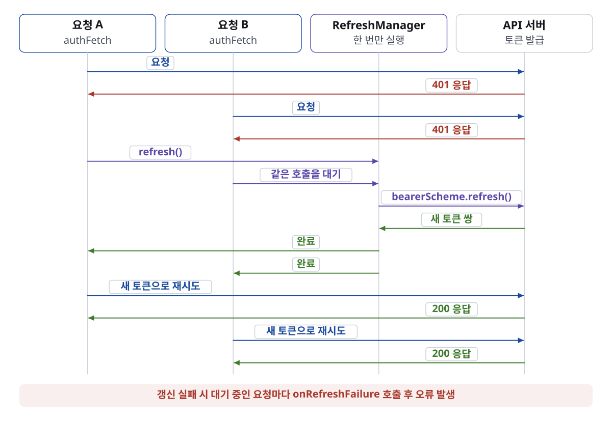

# 인증 추가하기

[English](../../en/guides/authentication.md) | **한국어**

> `@simplix-react/auth`로 인증된 API 요청을 설정합니다. 토큰 갱신(token refresh), 401 응답 뒤 재시도, React 연동을 함께 다룹니다.

## 시작하기 전에

- `@simplix-react/contract`의 `defineApi`로 계약(contract)을 정의해 두었습니다.
- `FetchFn` 타입 시그니처 `<T>(path: string, options?: RequestInit) => Promise<T>`를 알고 있습니다.
- 인증 패키지를 설치하세요.

```bash
pnpm add @simplix-react/auth
```

## 해결 방법

### Bearer 토큰 인증

가장 흔한 구성입니다. 모든 요청에 Bearer 토큰을 포함하고, 토큰이 만료되면 자동으로 갱신합니다.

```ts
import { defineApi } from "@simplix-react/contract";
import { createAuth, bearerScheme, localStorageStore } from "@simplix-react/auth";
import { projectConfig } from "./contract";

const store = localStorageStore("myapp:");

const auth = createAuth({
  schemes: [
    bearerScheme({
      store,
      token: () => store.get("access_token"),
      refresh: {
        refreshFn: async () => {
          const res = await fetch("/api/auth/refresh", {
            method: "POST",
            headers: { "Content-Type": "application/json" },
            body: JSON.stringify({
              refreshToken: store.get("refresh_token"),
            }),
          });
          if (!res.ok) throw new Error("Refresh failed");
          return res.json(); // must return a TokenPair: { accessToken, refreshToken?, expiresIn?, expiresAt?, refreshTokenExpiresAt? }
        },
        refreshBeforeExpiry: 60, // proactively refresh 60 seconds before expiry
      },
    }),
  ],
  store,
  onRefreshFailure: () => {
    auth.clear();
    window.location.href = "/login";
  },
});

const projectApi = defineApi(projectConfig, { fetchFn: auth.fetchFn });
```

자동으로 처리하는 동작은 다음과 같습니다.

- 모든 요청에 `Authorization: Bearer <token>` 헤더를 추가합니다.
- 저장된 만료 시각까지 60초가 남지 않은 상태에서 요청하면 요청을 보내기 전에 토큰을 갱신합니다. 다음 요청을 기다리지 않고 백그라운드에서 갱신하려면 `autoSchedule: true`를 지정하세요([백그라운드 갱신](#백그라운드-갱신) 참고).
- 401 응답을 받으면 토큰을 갱신하고 요청을 한 번 다시 보냅니다. 횟수는 `maxRetries`로 바꿉니다.
- 401 응답이 동시에 여러 개 와도 갱신 호출은 하나만 실행하고 모든 요청이 그 결과를 함께 사용합니다.
- 갱신에 실패하면 `onRefreshFailure`를 호출하고 오류를 발생시킵니다.



만료 시각은 반환한 `TokenPair`의 `expiresIn`(지금부터의 초) 또는 `expiresAt`(ISO 8601 문자열이나 epoch 밀리초)으로 정합니다. 둘 다 없으면 401 응답을 받은 뒤에만 토큰을 갱신합니다.

### API 키 인증

헤더에 고정 API 키를 담아 인증하는 서비스에 사용합니다.

```ts
import { createAuth, apiKeyScheme } from "@simplix-react/auth";

const auth = createAuth({
  schemes: [
    apiKeyScheme({
      in: "header",
      name: "X-API-Key",
      key: "sk-your-api-key",
    }),
  ],
});

const api = defineApi(config, { fetchFn: auth.fetchFn });
// Every request includes: X-API-Key: sk-your-api-key
```

API 키를 쿼리 매개변수로 보내는 경우:

```ts
apiKeyScheme({
  in: "query",
  name: "api_key",
  key: "sk-your-api-key",
});
// Appends ?api_key=sk-your-api-key to every request URL
```

### OAuth2 갱신 토큰 그랜트

액세스 토큰과 갱신 토큰을 발급하는 OAuth2 제공자에 사용합니다.

```ts
import { createAuth, oauth2Scheme, localStorageStore } from "@simplix-react/auth";

const store = localStorageStore("oauth:");

const auth = createAuth({
  schemes: [
    oauth2Scheme({
      store,
      tokenEndpoint: "https://auth.example.com/oauth/token",
      clientId: "my-spa-client",
      scopes: ["openid", "profile", "api"],
      tokenEndpointHeaders: { "X-Custom-Header": "value" },
      tokenEndpointBody: { audience: "https://api.example.com" },
    }),
  ],
  store,
  onRefreshFailure: () => {
    auth.clear();
    window.location.href = "/login";
  },
});

// After the OAuth callback, store the initial tokens:
auth.setTokens({
  accessToken: callbackResponse.access_token,
  refreshToken: callbackResponse.refresh_token,
  expiresIn: callbackResponse.expires_in,
});

const api = defineApi(config, { fetchFn: auth.fetchFn });
```

`oauth2Scheme`은 토큰 엔드포인트에 표준 `refresh_token` 그랜트를 `application/x-www-form-urlencoded` 형식으로 보냅니다. 본문에는 `client_id`를 담고, `clientSecret`을 지정하면 `client_secret`을, `scopes`를 지정하면 `scope`를 함께 담습니다. 저장된 만료 시각을 읽지 않으므로 401 응답을 받은 뒤에만 갱신합니다. 새 토큰은 지정한 저장소에 저장하며, 응답에 갱신 토큰이 없으면 기존 갱신 토큰을 유지합니다.

### 사용자 정의 인증(JWE, HMAC, 폼 기반)

표준이 아닌 인증 흐름에는 `customScheme`을 사용하세요. 헤더를 만드는 함수와 갱신 로직을 직접 작성합니다.

```ts
import { createAuth, customScheme, localStorageStore } from "@simplix-react/auth";

const store = localStorageStore("jwe:");

const auth = createAuth({
  schemes: [
    customScheme({
      name: "jwe",
      getHeaders: async () => {
        const jwe = store.get("access_token");
        if (!jwe) return {};
        const decrypted = await decryptJwe(jwe, encryptionKey);
        return { Authorization: `Bearer ${decrypted}` };
      },
      refresh: async () => {
        const form = new URLSearchParams({
          grant_type: "refresh_token",
          token: store.get("refresh_token") ?? "",
        });
        const res = await fetch("/auth/token", { method: "POST", body: form });
        if (!res.ok) throw new Error("JWE refresh failed");
        const { accessToken, refreshToken } = await res.json();
        store.set("access_token", accessToken);
        store.set("refresh_token", refreshToken);
      },
      isAuthenticated: () => store.get("access_token") !== null,
      clear: () => store.clear(),
    }),
  ],
  store,
});
```

### 여러 방식 조합

Bearer 인증과 API 키를 모두 요구하는 API도 있습니다. `composeSchemes`로 Bearer 인증과 API 키 방식을 합치세요.

```ts
import {
  createAuth,
  composeSchemes,
  bearerScheme,
  apiKeyScheme,
  localStorageStore,
} from "@simplix-react/auth";

const store = localStorageStore("myapp:");

const auth = createAuth({
  schemes: [
    composeSchemes(
      bearerScheme({
        store,
        token: () => store.get("access_token"),
        refresh: { refreshFn: myRefreshFn },
      }),
      apiKeyScheme({ in: "header", name: "X-API-Key", key: "sk-abc123" }),
    ),
  ],
  store,
});

// Every request carries both Authorization and X-API-Key headers
```

헤더 이름이 겹치면 뒤에 있는 방식의 헤더가 앞의 헤더를 덮어씁니다. 갱신할 때는 `refresh` 함수가 있는 첫 번째 방식만 호출합니다.

## 변형

### 토큰 저장소 선택

| 저장소 | 토큰을 보관하는 곳과 기간 |
| --- | --- |
| `memoryStore()` | 메모리, 페이지를 다시 불러올 때까지 |
| `localStorageStore(prefix?)` | `localStorage`, 브라우저를 다시 시작해도 유지 |
| `sessionStorageStore(prefix?)` | `sessionStorage`, 탭을 닫을 때까지 |
| `createRememberMe(namespace).rememberMeStore(prefix)` | 사용자의 로그인 유지 선택에 따라 `localStorage` 또는 `sessionStorage` |

웹 스토리지 저장소는 모든 키 앞에 접두사(기본값 `"auth:"`)를 추가하고, `clear()`는 그 접두사로 시작하는 키만 지웁니다. 각 방식이 읽고 쓰는 키는 `access_token`, `refresh_token`, `expires_at`, `refresh_expires_at`입니다.

`createRememberMe`는 로그인 유지 설정을 토큰 접두사 밖에 저장하므로 로그아웃해도 설정이 지워지지 않습니다.

```ts
import { createAuth, bearerScheme, createRememberMe } from "@simplix-react/auth";

const { rememberMeStore, isRemembered, setRemembered } = createRememberMe("myapp");
const store = rememberMeStore("myapp:");

// On the sign-in form, before the credentials are exchanged:
setRemembered(rememberCheckbox.checked);
```

### 인증 설정 옵션

`createAuth`와 `createAuthFetch`는 같은 `AuthConfig`를 받습니다.

| 옵션 | 기본값 | 용도 |
| --- | --- | --- |
| `schemes` | 필수 | 모든 요청에 헤더를 추가할 인증 방식 |
| `store` | 없음 | `getAccessToken`, `setTokens`, `clear`, `rehydrate`가 사용하는 저장소 |
| `onRefreshFailure` | 없음 | 401 응답 뒤 갱신에 실패하면 오류와 함께 호출 |
| `maxRetries` | `1` | 401 응답 뒤 재시도 횟수 |
| `is401` | `status === 401` | 오류가 401인지 판정 |
| `onRehydrate` | 없음 | `rehydrate()`에서 저장된 액세스 토큰을 검증하고, `false`를 반환하면 토큰을 지움 |
| `globalHeaders` | 없음 | 인증 방식의 헤더보다 먼저 모든 요청에 합치는 헤더 |
| `fetchFn` | `defaultFetch` | 인증 헤더를 추가하도록 감쌀 fetch 함수 |

요청 옵션에 지정한 헤더는 전역 헤더와 인증 방식의 헤더보다 우선합니다.

### 백그라운드 갱신

`autoSchedule: true`를 지정하면 `bearerScheme`이 토큰 만료 전에 타이머로 갱신합니다. 요청을 보내지 않는 페이지도 로그인 상태를 유지합니다.

```ts
import { bearerScheme, createActivityTracker, localStorageStore } from "@simplix-react/auth";

const store = localStorageStore("myapp:");
const activity = createActivityTracker();

const scheme = bearerScheme({
  store,
  token: () => store.get("access_token"),
  refresh: {
    refreshFn: myRefreshFn,
    refreshBeforeExpiry: 60,
    autoSchedule: true,
    minIntervalSeconds: 30,
    activity,
    lockName: "myapp:refresh",
    onScheduledRefreshFailed: () => redirectToLogin(),
  },
});
```

- `activity`를 지정하면 토큰을 마지막으로 저장한 뒤 사용자 활동이 있었을 때만 예약된 갱신을 실행합니다. 사용자가 아무것도 하지 않는 페이지는 발급자의 유휴 시간 제한에 따라 세션이 끝납니다.
- `lockName`을 지정하면 같은 저장소를 쓰는 모든 탭이 Web Locks API로 갱신을 하나씩 실행합니다. `lock`으로 다른 잠금을 지정할 수 있습니다. 다른 탭이 이미 갱신한 토큰이 저장소에 있으면 그 토큰을 사용합니다.
- 예약된 갱신이 네트워크 `TypeError`로 실패하면 `minIntervalSeconds` 뒤에 다시 시도하고, 그 밖의 실패에는 `onScheduledRefreshFailed`를 호출합니다.
- `auth.setTokens`를 호출하면 새 만료 시각을 기준으로 다음 갱신 시각을 다시 계산합니다.

### OpenID Connect 로그인

`createOidcClient`는 OpenID Connect 발급자를 상대로 PKCE를 사용하는 인가 코드 흐름을 실행하고, `setTokens`에 전달할 `TokenPair`를 반환합니다.

```ts
import { createOidcClient } from "@simplix-react/auth";

const oidc = createOidcClient({
  issuer: "https://id.example.com/realms/staff",
  clientId: "backoffice",
  redirectUri: `${location.origin}/login/complete`,
  postLogoutRedirectUri: location.origin,
});

// On the sign-in page:
await oidc.signIn({ returnTo: "/users" });

// On /login/complete:
const { tokens, returnTo } = await oidc.completeSignIn(location.href);
auth.setTokens(tokens);

// As the bearer refreshFn:
const refreshFn = () => oidc.refresh(store.get("refresh_token") ?? "");

// On sign-out:
const url = await oidc.signOutUrl();
auth.clear();
if (url) location.assign(url);
```

`completeSignIn`이 실패하면 코드가 `SIGN_IN_FAILED`인 `AuthError`를 발생시킵니다. 실패 이유는 `signInFailure`에 `issuer-error`, `not-pending`, `malformed-response`, `token-refused` 중 하나로 담깁니다. 리디렉션 대신 팝업으로 인가하려면 `openOAuth2Popup({ url, expectedOrigin })`을 사용하세요. 인가 URL을 팝업으로 열고, 콜백 페이지가 보낸 메시지를 결과로 반환합니다.

### React 연동

컴포넌트에서 인증 상태를 사용하려면 앱을 `AuthProvider`로 감싸세요.

```tsx
import { AuthProvider, useAuth, useAuthFetch } from "@simplix-react/auth/react";

// In your app root
function App() {
  return (
    <AuthProvider auth={auth}>
      <Router />
    </AuthProvider>
  );
}

// In any component
function UserMenu() {
  const { isAuthenticated, isLoading, user, login, logout } = useAuth();

  if (isLoading) return null;

  if (!isAuthenticated) {
    return <LoginButton onSuccess={(tokens) => login(tokens)} />;
  }

  return <button onClick={logout}>Logout</button>;
}

// For ad-hoc authenticated requests
function FileUploader() {
  const fetchFn = useAuthFetch();

  async function upload(file: File) {
    const formData = new FormData();
    formData.append("file", file);
    await fetchFn("/api/upload", { method: "POST", body: formData });
  }

  return <input type="file" onChange={(e) => upload(e.target.files![0])} />;
}
```

`useAuth` 훅은 `isAuthenticated`나 `user`가 바뀌면 다시 렌더링하며, 내부에서 `useSyncExternalStore`를 사용합니다. `getAccessToken()`도 함께 반환합니다.

현재 사용자를 불러오려면 `AuthProvider`에 `userLoader`를 지정하세요. 마운트할 때 `auth.rehydrate()`를 호출하고, 이어서 `userLoader(accessToken)`의 결과를 `auth.setUser`로 저장합니다. 이 과정이 끝날 때까지 `isLoading`은 `true`이고, 사용자를 불러오지 못하면 토큰을 지웁니다. 나중에 다시 로그인하면 사용자를 다시 불러옵니다.

```tsx
<AuthProvider auth={auth} userLoader={(token) => fetchCurrentUser(token)}>
  <Router />
</AuthProvider>
```

### 인증 상태 구독(React 없이)

React 없이 인증 상태 변경에 대응하려면 `auth.subscribe`를 사용하세요.

```ts
const unsubscribe = auth.subscribe(() => {
  console.log("Auth state changed:", auth.isAuthenticated());

  if (!auth.isAuthenticated()) {
    router.navigate("/login");
  }
});

// Clean up when done
unsubscribe();
```

### 저수준 API: fetchFn만 사용

상태 관리 없이 인증된 fetch 함수만 필요하면 `createAuthFetch`를 직접 사용하세요.

```ts
import { createAuthFetch, bearerScheme, memoryStore } from "@simplix-react/auth";

const store = memoryStore();
store.set("access_token", "my-token");

const fetchFn = createAuthFetch({
  schemes: [bearerScheme({ store, token: () => store.get("access_token") })],
});

const api = defineApi(config, { fetchFn });
```

### 오류 처리

인증 오류에는 코드가 지정되어 있어 프로그램에서 구분할 수 있습니다.

```ts
import { AuthError } from "@simplix-react/auth";

try {
  await auth.fetchFn("/api/protected");
} catch (error) {
  if (error instanceof AuthError) {
    switch (error.code) {
      case "REFRESH_FAILED":
        // All refresh attempts failed: redirect to login
        // error.issuerError holds the issuer's { error, description } when it refused
        break;
      case "SCHEME_ERROR":
        // Scheme-level failure, such as a failed OIDC discovery
        break;
      case "SIGN_IN_FAILED":
        // OIDC sign-in could not be finished; error.signInFailure says why
        break;
    }
  }
}
```

갱신으로 해결되지 않은 401 응답은 fetch 함수가 발생시킨 원래 오류를 그대로 다시 발생시킵니다. `TOKEN_EXPIRED`와 `UNAUTHENTICATED`도 `AuthErrorCode`에 속하지만, 직접 작성한 `customScheme`에서 발생시키기 위한 코드이며 기본 제공 방식은 발생시키지 않습니다.

### 인증된 요청 테스트

테스트마다 독립된 결과를 얻으려면 `memoryStore`를 사용하세요.

```ts
import { createAuthFetch, bearerScheme, memoryStore } from "@simplix-react/auth";
import { defineApi } from "@simplix-react/contract";

const store = memoryStore();
store.set("access_token", "test-token-123");

const fetchFn = createAuthFetch({
  schemes: [bearerScheme({ store, token: () => store.get("access_token") })],
});

const api = defineApi(testConfig, { fetchFn });
// All requests in tests carry: Authorization: Bearer test-token-123
```

## 관련 문서

- [인증 구조](../core-concepts/authentication.md): 설계 결정과 내부 동작
- [보호된 앱 만들기](../tutorials/auth-protected-app.md): 단계별 튜토리얼
- [사용자 정의 fetch 함수](./custom-fetch.md): 인증 패키지 없이 fetch를 직접 조정하는 방법
- [목 핸들러](./mock-handlers.md): 개발용 MSW 핸들러 설정
