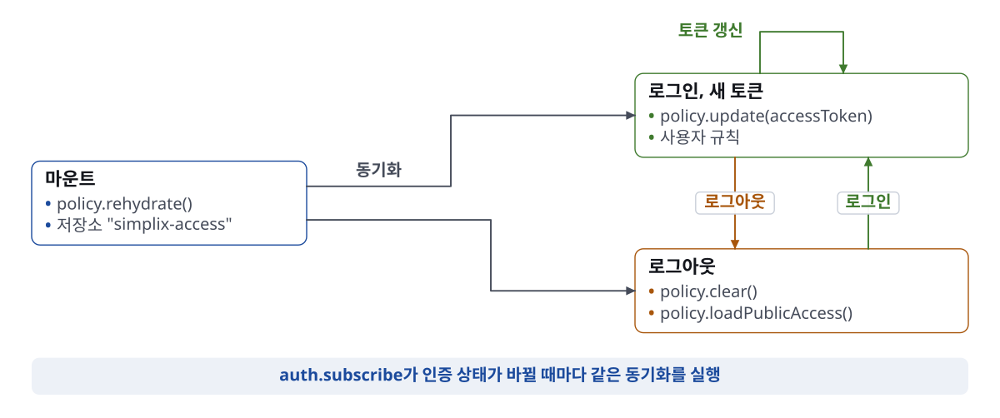

# 인가 추가하기

[English](../../en/guides/authorization.md) | **한국어**

> `@simplix-react/access`로 역할 기반 접근 제어를 설정합니다. CASL로 권한을 검사하고, 어댑터(adapter)로 규칙을 추출하고, React와 연동합니다.

## 시작하기 전에

- 인증을 설정한 simplix-react 애플리케이션이 실행되고 있습니다.
- 접근 제어 패키지와 피어 의존성을 설치하세요.

```bash
pnpm add @simplix-react/access @casl/ability
```

- 액션(`view`, `edit` 같은 동사)과 대상(`Pet`, `Order` 같은 리소스 이름)의 개념을 알고 있습니다.

## 해결 방법

### 1단계: 어댑터로 AccessPolicy 만들기

`createAccessPolicy` 함수는 CASL을 기반으로 하는 정책 인스턴스를 만듭니다. 권한 데이터가 있는 곳에 맞춰 어댑터를 고르세요.

**JWT 어댑터**: 서버에 다시 요청하지 않고 JWT 클레임에서 권한을 추출합니다.

```ts
import { createAccessPolicy, createJwtAdapter } from "@simplix-react/access";

const policy = createAccessPolicy({
  adapter: createJwtAdapter({
    permissionFormat: "map",
    permissionsKey: "permissions",
    rolesKey: "roles",
    userIdKey: "sub",
    usernameKey: "username",
    superAdminKey: "isSuperAdmin",
  }),
  persist: { storage: localStorage },
});
```

JWT 어댑터가 지원하는 권한 형식은 다음과 같습니다.

| 형식 | JWT 클레임 구조 | 예 |
| --- | --- | --- |
| `"map"` | `{ "Pet": ["list", "view"] }` | Spring Security `PermissionMap` |
| `"flat"` | `["PET:list", "PET:view"]` | Spring Security 권한 목록 |
| `"scopes"` | `"pet:read pet:write"` | OAuth2 스코프 |

`"flat"`과 `"scopes"` 형식은 구분자 앞의 문자열을 대상으로, 뒤의 문자열을 액션으로 그대로 사용합니다. `"PET:list"`의 대상은 `Pet`이 아니라 `PET`입니다. 구분자가 없는 문자열은 그 대상에 대한 `manage` 액션이 됩니다. `"scopes"` 형식은 `permissionsKey`를 먼저 읽고, 값이 없으면 표준 `scope` 클레임을 읽습니다. 구분자는 `flatSeparator`로 지정하세요(기본값 `":"`).

```ts
const adapter = createJwtAdapter({
  permissionFormat: "flat",
  flatSeparator: ":",
  rolesKey: "authorities",
});
```

키의 기본값은 `rolesKey: "roles"`, `permissionsKey: "permissions"`, `superAdminKey: "isSuperAdmin"`, `userIdKey: "sub"`, `usernameKey: "username"`입니다. 어댑터는 서명을 검증하지 않고 토큰의 페이로드만 디코딩합니다. 디코더를 바꾸려면 `decode`를 지정하세요. JWT 구조가 완전히 다르면 `transform` 옵션으로 기본 추출을 건너뛰세요.

```ts
const adapter = createJwtAdapter({
  transform: (claims) => ({
    rules: Object.entries(claims.perms as Record<string, string[]>).flatMap(
      ([subject, actions]) =>
        actions.map((action) => ({ action, subject })),
    ),
    user: {
      userId: String(claims.sub),
      username: String(claims.name),
      roles: claims.roles as string[],
    },
    roles: claims.roles as string[],
  }),
});
```

**API 어댑터**: REST 엔드포인트에서 권한을 가져옵니다.

```ts
import { createAccessPolicy, createApiAdapter } from "@simplix-react/access";

const policy = createAccessPolicy({
  adapter: createApiAdapter({
    endpoint: "/api/v1/user/me/permissions",
    fetchFn: auth.fetchFn, // injects auth headers automatically
  }),
  persist: { storage: localStorage },
});
```

엔드포인트의 기본값은 `"/api/me/permissions"`이고 `fetchFn`의 기본값은 전역 `fetch`입니다. 기본 응답 형식은 `{ permissions: PermissionMap, roles?: string[] }`이며 `{ body: { permissions } }`처럼 한 단계 감싼 응답도 읽습니다. 기본 처리에서는 사용자 정보를 설정하지 않으므로, 슈퍼 관리자 여부는 `transformResponse`가 `user`를 함께 반환할 때만 반영합니다.

```ts
const adapter = createApiAdapter({
  endpoint: "/api/v1/user/me/permissions",
  fetchFn: auth.fetchFn,
  transformResponse: (res) => {
    const data = res as {
      permissions: Record<string, string[]>;
      roles: string[];
      userId: string;
      username: string;
      isSuperAdmin: boolean;
    };
    return {
      permissions: data.permissions,
      roles: data.roles,
      user: { userId: data.userId, username: data.username },
      isSuperAdmin: data.isSuperAdmin,
    };
  },
});
```

**정적 어댑터**: 고정된 규칙을 반환합니다. 테스트와 개발에 사용합니다.

```ts
import { createAccessPolicy, createStaticAdapter } from "@simplix-react/access";

const policy = createAccessPolicy({
  adapter: createStaticAdapter(
    [
      { action: "list", subject: "Pet" },
      { action: "view", subject: "Pet" },
      { action: "create", subject: "Pet" },
    ],
    { userId: "test-user", username: "tester", roles: ["ROLE_USER"] },
  ),
});

// Load the static rules
await policy.update(null);

policy.can("view", "Pet");    // true
policy.can("delete", "Pet");  // false
```

### 2단계: 슈퍼 관리자 우회와 상태 저장 설정

슈퍼 관리자는 `manage:all`(모든 대상에 대한 모든 액션)을 받아 모든 권한 검사를 통과합니다.

직접 판정하려면 `isSuperAdmin`을 지정하세요.

```ts
const policy = createAccessPolicy({
  adapter,

  // Option 1: Custom checker function
  isSuperAdmin: (user) => user.roles.includes("ROLE_SYSTEM_ADMIN"),

  // Persistence: restore state across page reloads
  persist: {
    storage: localStorage,  // default
    key: "simplix-access",  // default
  },
});
```

`isSuperAdmin`을 지정하지 않으면 정책은 `AccessUser.isSuperAdmin` 값(`true` 또는 `"true"`)을 읽습니다. JWT 어댑터는 이 값을 `superAdminKey` 클레임에서 읽고, API 어댑터는 `transformResponse`가 `user`와 함께 반환한 `isSuperAdmin`에서 읽습니다.

`persist`를 지정하면 규칙이 바뀔 때마다 저장소 키에 `{ rules, user, roles }`를 기록합니다. `policy.clear()`는 이 키를 지우고, `policy.rehydrate()`는 이 키에서 상태를 복원합니다.

### 3단계: React에 AccessProvider 설정

모든 컴포넌트가 정책을 사용하도록 앱을 `AccessProvider`로 감싸세요. 선택 항목인 `auth` prop을 전달하면 인증 상태와 자동으로 동기화합니다.

```tsx
import { createAuth, bearerScheme, localStorageStore } from "@simplix-react/auth";
import { AuthProvider } from "@simplix-react/auth/react";
import { createAccessPolicy, createApiAdapter } from "@simplix-react/access";
import { AccessProvider } from "@simplix-react/access/react";

// Auth setup
const store = localStorageStore("myapp:");
const auth = createAuth({
  schemes: [bearerScheme({ store, token: () => store.get("access_token") })],
  store,
});

// Access policy setup
const policy = createAccessPolicy({
  adapter: createApiAdapter({
    endpoint: "/api/v1/user/me/permissions",
    fetchFn: auth.fetchFn,
  }),
  persist: { storage: localStorage },
});

function App() {
  return (
    <AuthProvider auth={auth}>
      <AccessProvider policy={policy} auth={auth}>
        <Router />
      </AccessProvider>
    </AuthProvider>
  );
}
```

자동 동기화 동작은 다음과 같습니다.

| 인증 이벤트 | 정책 동작 |
| --- | --- |
| 로그인(인증됨) | `policy.update(accessToken)` |
| 로그아웃(인증 해제) | `policy.clear()` 다음 `policy.loadPublicAccess()` |
| 마운트 | `policy.rehydrate()` 다음 첫 동기화 |



Provider는 액세스 토큰이 바뀔 때만 정책을 다시 갱신하므로, 토큰을 갱신하면 규칙도 다시 불러옵니다.

`auth` prop에는 `AuthLike`를 구현한 객체라면 무엇이든 전달할 수 있습니다.

```ts
interface AuthLike {
  isAuthenticated(): boolean;
  getAccessToken(): string | null;
  subscribe(listener: () => void): () => void;
}
```

### 4단계: useCan과 Can으로 권한 검사

**`useCan` 훅**: 권한 하나를 검사해 불리언을 반환합니다.

```tsx
import { useCan } from "@simplix-react/access/react";

function PetToolbar() {
  const canCreate = useCan("create", "Pet");
  const canExport = useCan("export", "Pet");

  return (
    <div>
      {canCreate && <button>Add Pet</button>}
      {canExport && <button>Export CSV</button>}
    </div>
  );
}
```

트리에 `AccessProvider`가 없으면 `useCan`은 `true`를 반환합니다. 그래서 접근 제어는 연결한 곳에만 적용됩니다.

**`useCanWith` 훅**: 훅을 한 번만 호출해 여러 검사 결과를 불리언 하나로 합칩니다.

```tsx
import { useCanWith } from "@simplix-react/access/react";

const canReview = useCanWith((can) => can("approve", "Order") || can("edit", "Order"));
```

`AccessProvider` 밖에서는 함수가 받는 `can`이 항상 `true`를 반환합니다.

**`Can` 컴포넌트**: 권한을 선언적으로 검사합니다.

```tsx
import { Can } from "@simplix-react/access/react";

function PetActions() {
  return (
    <div>
      <Can I="edit" a="Pet">
        <button>Edit</button>
      </Can>

      <Can I="delete" a="Pet" fallback={<span>No permission</span>}>
        <button>Delete</button>
      </Can>

      {/* Invert: render when permission is ABSENT */}
      <Can I="manage" a="all" not>
        <span>Limited access mode</span>
      </Can>
    </div>
  );
}
```

`Can` 컴포넌트의 props는 다음과 같습니다.

| Prop | 타입 | 설명 |
| --- | --- | --- |
| `I` | `string` | 검사할 액션 |
| `a` | `string` | 검사할 대상 |
| `not` | `boolean` | 검사 결과 반전 |
| `fallback` | `ReactNode` | 검사에 실패하면 렌더링 |
| `children` | `ReactNode` | 검사를 통과하면 렌더링 |

### 5단계: useAccess로 정책 전체 사용

권한 검사 하나보다 많은 정보(사용자 정보, 역할 등)가 필요하면 `useAccess`를 사용하세요.

```tsx
import { useAccess } from "@simplix-react/access/react";

function UserBadge() {
  const access = useAccess();

  return (
    <span>
      {access.user?.displayName} ({access.roles.join(", ")})
    </span>
  );
}
```

`useCan`과 달리 `useAccess`는 `AccessProvider` 밖에서 호출하면 오류를 발생시킵니다.

### 6단계: requireAccess로 라우트 보호

TanStack Router의 `beforeLoad` 가드에서 `requireAccess`를 사용하세요. 검사에 실패하면 `AccessDeniedError`를 발생시킵니다.

```ts
import { requireAccess } from "@simplix-react/access/react";

export const Route = createFileRoute("/admin")({
  beforeLoad: () => {
    requireAccess(policy, {
      action: "view",
      subject: "BACKOFFICE_ACCESS",
    });
  },
});
```

TanStack Router의 `beforeLoad`는 React가 마운트되기 전에 실행되므로 `AccessProvider`가 아직 `rehydrate()`를 호출하지 않은 상태입니다. 저장된 상태를 직접 검사하려면 `storageFallback`을 사용하세요.

```ts
requireAccess(policy, {
  action: "view",
  subject: "BACKOFFICE_ACCESS",
  storageFallback: {
    key: "simplix-access",
    check: (stored) => {
      const data = stored as { rules?: Array<{ action: string; subject: string }> };
      return data.rules?.some(
        (r) => r.action === "view" && r.subject === "BACKOFFICE_ACCESS",
      ) ?? false;
    },
  },
});
```

이 대체 검사는 `persist`가 어떤 저장소를 쓰든 `localStorage`에서 키를 읽습니다.

라우트의 `onError`나 전역 오류 경계에서 오류를 처리하세요.

```ts
import { AccessDeniedError } from "@simplix-react/access";

// In TanStack Router error handler
if (error instanceof AccessDeniedError) {
  console.log(error.action);  // "view"
  console.log(error.subject); // "BACKOFFICE_ACCESS"
  console.log(error.message); // 'Access denied: cannot "view" on "BACKOFFICE_ACCESS"'
  navigate({ to: "/unauthorized" });
}
```

### 7단계: useMenuFilter로 메뉴 필터링

`useMenuFilter`는 현재 사용자의 권한에 따라 메뉴 트리를 재귀적으로 필터링합니다. `permission` 필드가 없는 항목은 항상 표시합니다. 하위 항목이 모두 걸러지면 상위 항목도 제거합니다.

```tsx
import { useMenuFilter } from "@simplix-react/access/react";
import type { FilterableMenuItem } from "@simplix-react/access/react";

const menu: FilterableMenuItem[] = [
  { label: "Dashboard" },
  {
    label: "Management",
    children: [
      { label: "Pets", permission: { action: "list", subject: "Pet" } },
      { label: "Orders", permission: { action: "list", subject: "Order" } },
      { label: "Users", permission: { action: "list", subject: "User" } },
    ],
  },
  { label: "Settings", permission: { action: "view", subject: "Settings" } },
];

function Sidebar() {
  const filtered = useMenuFilter(menu);

  return (
    <nav>
      {filtered.map((item) => (
        <MenuItem key={item.label} {...item} />
      ))}
    </nav>
  );
}
```

`FilterableMenuItem` 인터페이스는 다음과 같습니다.

```ts
interface FilterableMenuItem {
  permission?: { action: string; subject: string };
  children?: FilterableMenuItem[];
  [key: string]: unknown;
}
```

`AccessProvider` 밖에서 사용하면 모든 항목을 필터링하지 않고 그대로 반환합니다.

## 변형

### 역할 검사

역할 유틸리티는 `ROLE_` 접두사를 자동으로 정규화합니다. `"ADMIN"`은 `"ROLE_ADMIN"`과 일치합니다.

```ts
// On the policy instance
policy.hasRole("ADMIN");                     // checks against "ROLE_ADMIN"
policy.hasRole("ROLE_ADMIN");                // same check

policy.hasAnyRole(["ADMIN", "MANAGER"]);     // true if user has either

// Standalone helpers
import { hasRole, hasAnyRole, normalizeRole } from "@simplix-react/access";

normalizeRole("ADMIN");                      // "ROLE_ADMIN"
normalizeRole("ROLE_ADMIN");                 // "ROLE_ADMIN"

hasRole(["ROLE_ADMIN", "ROLE_USER"], "ADMIN");         // true
hasAnyRole(["ROLE_USER"], ["ADMIN", "USER"]);          // true
```

### 공개 접근 규칙

인증하지 않은 사용자에게 특정 리소스의 접근을 허용합니다.

```ts
// Static public rules
const policy = createAccessPolicy({
  adapter,
  publicAccess: [
    { action: "list", subject: "Pet" },
    { action: "view", subject: "Pet" },
  ],
});

// Or fetch from server
const policy = createAccessPolicy({
  adapter,
  publicAccess: createApiAdapter({
    endpoint: "/api/v1/public/user/permissions",
  }),
});

// Load on app init (before login)
await policy.loadPublicAccess();
```

### 타입 안전한 권한

제네릭으로 액션과 대상의 타입을 좁힙니다.

```ts
type MyActions = "list" | "view" | "create" | "edit" | "delete";
type MySubjects = "Pet" | "Order" | "User";

const policy = createAccessPolicy<MyActions, MySubjects>({
  adapter: createJwtAdapter(),
});

policy.can("view", "Pet");       // OK
policy.can("view", "all");       // OK (wildcard always allowed)
// policy.can("fly", "Pet");     // Type error: "fly" is not in MyActions
// policy.can("view", "Rocket"); // Type error: "Rocket" is not in MySubjects
```

### 규칙 직접 설정(어댑터 없이)

어댑터를 거치지 않고 코드에서 규칙을 적용하려면 `setRules`를 사용하세요.

```ts
policy.setRules(
  [
    { action: "view", subject: "Pet" },
    { action: "edit", subject: "Pet" },
  ],
  { userId: "1", username: "john", roles: ["ROLE_EDITOR"] },
  ["ROLE_EDITOR"],
);
```

### 접근 상태 구독(React 없이)

```ts
const unsubscribe = policy.subscribe(() => {
  console.log("Access state changed");
  console.log("User:", policy.user);
  console.log("Roles:", policy.roles);
});

// Clean up when done
unsubscribe();
```

### 권한 데이터 변환

어댑터가 권한 데이터를 변환할 때 쓰는 함수를 직접 호출할 수 있습니다. JWT의 `transform`이나 직접 작성한 `AccessAdapter` 안에서 사용하세요.

```ts
import {
  normalizePermissionMap,
  normalizeFlatPermissions,
  normalizeScopePermissions,
} from "@simplix-react/access";

normalizePermissionMap({ Pet: ["list", "view"] });
// [{ action: "list", subject: "Pet" }, { action: "view", subject: "Pet" }]

normalizeFlatPermissions(["PET:list", "ROLE_ADMIN"]);
// [{ action: "list", subject: "PET" }, { action: "manage", subject: "ROLE_ADMIN" }]

normalizeScopePermissions("pet:read pet:write");
// [{ action: "read", subject: "pet" }, { action: "write", subject: "pet" }]
```

직접 작성하는 어댑터는 `{ rules, user?, roles? }`를 반환하는 `extract(authData)` 메서드가 있는 객체입니다. `policy.update(authData)`는 `authData`를 그대로 어댑터에 전달합니다.

### 테스트

`createStaticAdapter`나 `@simplix-react/testing`의 유틸리티를 사용하세요.

```tsx
import { createMockPolicy, createAccessTestWrapper } from "@simplix-react/testing";

// Default: allows everything (manage:all)
const policy = createMockPolicy();

// Restricted rules
const policy = createMockPolicy({
  allowAll: false,
  rules: [{ action: "view", subject: "Pet" }],
  user: { userId: "1", username: "test", roles: ["ROLE_USER"] },
});

// Wrap components for testing
const wrapper = createAccessTestWrapper({ policy });
render(<MyComponent />, { wrapper });
```

## 관련 문서

- [인증 가이드](./authentication.md): 인증된 API 요청 설정
- [@simplix-react/access API 레퍼런스](../../api/@simplix-react/access/README.md): 전체 API 문서
- [목으로 테스트하기](./testing-with-mocks.md): 목 데이터로 컴포넌트 테스트
