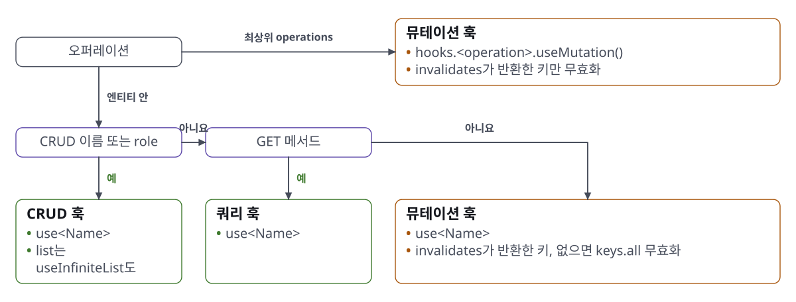

# CRUD 밖의 사용자 정의 오퍼레이션 정의하기

[English](../../en/guides/custom-operations.md) | **한국어**

> 일괄 작업, RPC 호출, 파일 업로드처럼 CRUD에 속하지 않는 엔드포인트를 계약(contract)에 추가합니다. 엔티티(entity) 안에 정의하거나 최상위 `OperationDefinition`으로 정의합니다.

## 시작하기 전에

- [계약에 엔티티를 정의하는 방법](./defining-entities.md)을 알아 두세요.
- CRUD 엔티티 메서드와 사용자 정의 오퍼레이션(operation)의 차이를 이해해 두세요.

엔티티의 오퍼레이션 가운데 이름이 `list`, `get`, `create`, `update`, `delete`, `tree`이거나 `role`을 지정한 것은 CRUD 오퍼레이션입니다. 작업 배정, 프로젝트 보관, 보고서 내보내기처럼 이 형태에 맞지 않는 호출은 다음 위치 중 하나에 정의합니다.

- 엔티티의 `operations`에 다른 이름으로 정의하면 그 엔티티에 속합니다([엔티티 안의 사용자 정의 오퍼레이션](#엔티티-안의-사용자-정의-오퍼레이션) 참고).
- 계약의 최상위 `operations`에 `OperationDefinition`으로 정의하면 어느 엔티티에도 속하지 않습니다(아래 단계).



## 해결 방법

### 1단계: 오퍼레이션 정의

`OperationDefinition`에는 HTTP 메서드, 경로, 입력 스키마, 출력 스키마를 적습니다. `input`과 `output`은 둘 다 필수입니다.

```ts
import { z } from "zod";
import type { OperationDefinition } from "@simplix-react/contract";

const assignTask = {
  method: "POST",
  path: "/tasks/:taskId/assign",
  input: z.object({
    userId: z.string().uuid(),
  }),
  output: z.object({
    id: z.string().uuid(),
    title: z.string(),
    assigneeId: z.string().uuid(),
  }),
} satisfies OperationDefinition;
```

경로 매개변수는 `:paramName` 형식으로 적습니다. 파생된 클라이언트를 호출할 때 인자 순서대로 매개변수에 대응합니다.

### 2단계: 계약에 등록

엔티티와 함께 `operations` 필드에 오퍼레이션을 추가하세요.

```ts
import { defineApi, simpleQueryBuilder } from "@simplix-react/contract";

const projectApi = defineApi({
  domain: "project",
  basePath: "/api/v1",
  entities: {
    project: projectEntity,
    task: taskEntity,
  },
  operations: {
    assignTask,
  },
  queryBuilder: simpleQueryBuilder,
});
```

### 3단계: 파생된 클라이언트 호출

오퍼레이션 클라이언트는 경로 매개변수를 순서대로 받고, 그다음에 입력 데이터를 받습니다.

```ts
// POST /api/v1/tasks/task-1/assign
// Body: { "userId": "user-42" }
const result = await projectApi.client.assignTask("task-1", {
  userId: "user-42",
});
// result: { id: "task-1", title: "...", assigneeId: "user-42" }
```

경로 매개변수가 여럿이면 순서대로 전달하세요.

```ts
const transferTask = {
  method: "POST",
  path: "/projects/:projectId/tasks/:taskId/transfer",
  input: z.object({ targetProjectId: z.string() }),
  output: z.object({ id: z.string(), projectId: z.string() }),
} satisfies OperationDefinition;

// Path params are positional: projectId, taskId, then the input body
await projectApi.client.transferTask("proj-1", "task-1", {
  targetProjectId: "proj-2",
});
```

### 4단계: 파생된 훅 사용

`deriveEntityHooks`는 최상위 오퍼레이션마다 HTTP 메서드와 관계없이 `hooks.<operation>.useMutation()`을 파생합니다. 이 훅은 뮤테이션 변수 하나만 클라이언트의 인자로 전달하므로 경로 매개변수가 없는 오퍼레이션에 맞습니다.

```tsx
import { z } from "zod";
import type { OperationDefinition } from "@simplix-react/contract";
import { deriveEntityHooks } from "@simplix-react/react";

const importTasks = {
  method: "POST",
  path: "/tasks/import",
  input: z.object({ source: z.string() }),
  output: z.object({ importedCount: z.number() }),
} satisfies OperationDefinition;

// Registered under `operations: { assignTask, importTasks }` in the contract
const hooks = deriveEntityHooks(projectApi);

function ImportButton() {
  const { mutate, isPending } = hooks.importTasks.useMutation();

  return (
    <button disabled={isPending} onClick={() => mutate({ source: "jira" })}>
      {isPending ? "Importing..." : "Import"}
    </button>
  );
}
```

`assignTask`처럼 경로 매개변수가 있는 오퍼레이션은 직접 작성한 `useMutation` 안에서 클라이언트를 호출하세요.

```tsx
import { useMutation, useQueryClient } from "@tanstack/react-query";

function AssignButton({ taskId }: { taskId: string }) {
  const queryClient = useQueryClient();
  const { mutate, isPending } = useMutation({
    mutationFn: (userId: string) =>
      projectApi.client.assignTask(taskId, { userId }),
    onSuccess: () =>
      queryClient.invalidateQueries({ queryKey: projectApi.queryKeys.task.all }),
  });

  return (
    <button disabled={isPending} onClick={() => mutate("user-42")}>
      {isPending ? "Assigning..." : "Assign"}
    </button>
  );
}
```

### 5단계: 캐시 무효화 추가

`invalidates` 콜백을 지정하면 파생된 `useMutation`이 성공한 뒤 관련 쿼리를 무효화합니다. `invalidates`가 없는 최상위 오퍼레이션은 아무 쿼리도 무효화하지 않습니다.

```ts
const assignTask = {
  method: "POST",
  path: "/tasks/:taskId/assign",
  input: z.object({
    userId: z.string().uuid(),
  }),
  output: z.object({
    id: z.string().uuid(),
    title: z.string(),
    assigneeId: z.string().uuid(),
  }),
  invalidates: (queryKeys, _params) => [
    queryKeys.task.all,  // Invalidate all task queries
  ],
} satisfies OperationDefinition;
```

`invalidates` 함수가 받는 인자는 다음과 같습니다.
- `queryKeys`: 계약에 있는 모든 엔티티의 쿼리 키 팩토리
- `params`: 경로 매개변수. 파생된 훅은 빈 객체를 전달합니다.

뮤테이션이 성공하면 훅이 반환된 키 배열마다 `queryClient.invalidateQueries`를 호출합니다.

## 변형

### 엔티티 안의 사용자 정의 오퍼레이션

이름이 CRUD 이름이 아니고 `role`도 없는 엔티티 오퍼레이션은 그 엔티티의 사용자 정의 오퍼레이션입니다. `output`은 선택 항목이며, 생략하면 엔티티의 `schema`를 사용합니다. 훅 이름은 `use`와 오퍼레이션 이름을 이은 것입니다. `GET` 오퍼레이션에는 쿼리 훅이, 다른 메서드에는 뮤테이션 훅이 파생됩니다. 뮤테이션이 성공하면 오퍼레이션의 `invalidates`가 반환한 키를 무효화하고, `invalidates`가 없으면 그 엔티티의 모든 쿼리를 무효화합니다. 뮤테이션 변수가 클라이언트 함수의 첫 번째 인수가 되므로 오퍼레이션의 첫 번째 경로 매개변수를 채우며, 훅은 그와 함께 입력을 보낼 수 없습니다. 경로 매개변수와 입력이 모두 필요한 오퍼레이션은 직접 만든 `useMutation` 안에서 클라이언트를 호출하세요.

```ts
const projectEntity = {
  schema: projectSchema,
  operations: {
    list:    { method: "GET",  path: "/projects" },
    get:     { method: "GET",  path: "/projects/:id" },
    archive: { method: "POST", path: "/projects/:id/archive", input: z.object({ reason: z.string() }) },
    stats:   { method: "GET",  path: "/projects/stats", output: z.object({ total: z.number() }) },
  },
} satisfies EntityDefinition;

// Client: path parameters first, then the input
await projectApi.client.project.archive("proj-1", { reason: "done" });

// Hooks: a custom GET is a query, any other method a mutation
const { data: stats } = hooks.project.useStats();
const archive = hooks.project.useArchive();
```

### GET 오퍼레이션(뮤테이션 대신 쿼리)

`method: "GET"`인 최상위 오퍼레이션에도 `useMutation` 훅이 파생됩니다. 쿼리 형태의 훅이 필요하면 오퍼레이션을 엔티티 안에 정의하거나, 클라이언트를 `useQuery`와 함께 직접 사용하세요.

```ts
import { useQuery } from "@tanstack/react-query";

const exportReport = {
  method: "GET",
  path: "/projects/:projectId/report",
  input: z.object({}),
  output: z.object({
    summary: z.string(),
    totalTasks: z.number(),
  }),
} satisfies OperationDefinition;

// Manual query hook usage
function useProjectReport(projectId: string) {
  return useQuery({
    queryKey: ["project", "report", projectId],
    queryFn: () => projectApi.client.exportReport(projectId),
  });
}
```

### multipart 파일 업로드

`contentType: "multipart"`를 지정하면 JSON 대신 `FormData`를 보냅니다.

```ts
const uploadAttachment = {
  method: "POST",
  path: "/tasks/:taskId/attachments",
  input: z.object({
    file: z.instanceof(File),
    description: z.string().optional(),
  }),
  output: z.object({
    id: z.string(),
    url: z.string().url(),
    filename: z.string(),
  }),
  contentType: "multipart",
} satisfies OperationDefinition;
```

프레임워크가 입력 객체를 `FormData`로 바꿉니다. `File`과 `Blob` 값은 그대로 추가하고 원시 값은 문자열로 바꿉니다. 이 요청은 계약의 fetch 함수를 거치지 않고 전역 `fetch`로 보냅니다([사용자 정의 fetch](./custom-fetch.md) 참고).

```tsx
function FileUploadButton({ taskId }: { taskId: string }) {
  const handleFileChange = async (e: React.ChangeEvent<HTMLInputElement>) => {
    const file = e.target.files?.[0];
    if (file) {
      await projectApi.client.uploadAttachment(taskId, { file, description: "Screenshot" });
    }
  };

  return <input type="file" onChange={handleFileChange} />;
}
```

### Blob 응답(파일 다운로드)

`responseType: "blob"`을 지정하면 바이너리 데이터를 받습니다. 이 요청도 전역 `fetch`를 사용합니다.

```ts
const downloadReport = {
  method: "GET",
  path: "/projects/:projectId/export",
  input: z.object({}),
  output: z.instanceof(Blob),
  responseType: "blob",
} satisfies OperationDefinition;

// Usage
const blob = await projectApi.client.downloadReport("proj-1");
const url = URL.createObjectURL(blob);
```

### 범위를 좁힌 캐시 무효화

쿼리 키 팩토리 메서드로 무효화할 쿼리의 범위를 지정하세요.

```ts
const archiveProject = {
  method: "POST",
  path: "/projects/:projectId/archive",
  input: z.object({}),
  output: z.object({ id: z.string(), status: z.literal("archived") }),
  invalidates: (queryKeys, _params) => [
    queryKeys.project.lists(),   // Invalidate all project list queries
    queryKeys.task.all,          // Invalidate all task queries (children too)
  ],
} satisfies OperationDefinition;
```

쿼리 키 팩토리가 제공하는 범위는 다음과 같습니다.

| 메서드 | 키 | 범위 |
| --- | --- | --- |
| `.all` | `[domain, entity]` | 이 엔티티의 모든 쿼리 |
| `.lists()` | `[domain, entity, "list"]` | 모든 목록 쿼리 |
| `.list(params)` | `[domain, entity, "list", params]` | 조건을 지정한 목록 하나 |
| `.details()` | `[domain, entity, "detail"]` | 모든 상세 쿼리 |
| `.detail(id)` | `[domain, entity, "detail", id]` | 상세 쿼리 하나 |
| `.trees()` | `[domain, entity, "tree"]` | 모든 트리 쿼리 |
| `.tree(params)` | `[domain, entity, "tree", params]` | 트리 쿼리 하나 |

### 지원하는 HTTP 메서드

`method` 필드에는 `"GET"`, `"POST"`, `"PUT"`, `"PATCH"`, `"DELETE"`를 지정할 수 있습니다. `GET`을 제외한 모든 메서드는 본문을 보냅니다.

```ts
// PUT -- full replacement
const replaceConfig = {
  method: "PUT",
  path: "/projects/:projectId/config",
  input: z.object({ theme: z.string(), locale: z.string() }),
  output: z.object({ theme: z.string(), locale: z.string() }),
} satisfies OperationDefinition;

// DELETE -- custom delete with body
const bulkDelete = {
  method: "DELETE",
  path: "/tasks/bulk",
  input: z.object({ ids: z.array(z.string()) }),
  output: z.object({ deletedCount: z.number() }),
} satisfies OperationDefinition;

// PATCH -- partial update on a sub-resource
const updateSettings = {
  method: "PATCH",
  path: "/projects/:projectId/settings",
  input: z.object({ notifications: z.boolean().optional() }),
  output: z.object({ notifications: z.boolean() }),
} satisfies OperationDefinition;
```

## 관련 문서

- [계약에 엔티티 정의하기](./defining-entities.md): 표준 CRUD 엔티티 설정
- [상위-하위 엔티티 관계](./parent-child.md): `EntityParent`로 중첩 URL 구성
