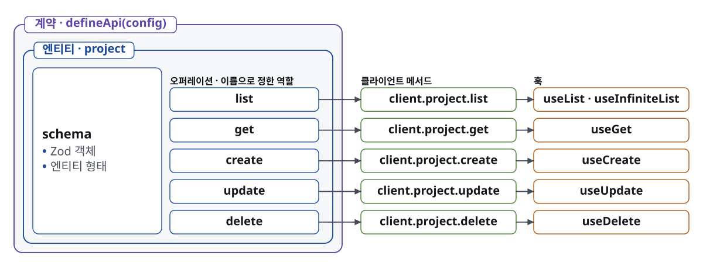

# 계약에 엔티티 정의하기

[English](../../en/guides/defining-entities.md) | **한국어**

> Zod 스키마로 타입이 안전한 CRUD 엔티티(entity)를 정의하면 프레임워크가 클라이언트, 훅, 목(mock) 핸들러를 자동으로 파생합니다.

## 시작하기 전에

- 의존성 `@simplix-react/contract`와 `zod`를 설치하세요.
- [Zod 스키마 기초](https://zod.dev)를 먼저 익혀 두세요.

## 해결 방법

### 1단계: Zod 스키마 정의

엔티티에는 엔티티 전체 형태를 나타내는 스키마가 하나 있습니다. 본문을 보내는 오퍼레이션(operation)인 생성과 수정은 각자 입력 스키마를 받습니다.

```ts
import { z } from "zod";

// Full entity shape returned by the API
const projectSchema = z.object({
  id: z.string().uuid(),
  name: z.string().min(1),
  description: z.string(),
  status: z.enum(["active", "archived"]),
  createdAt: z.string().datetime(),
  updatedAt: z.string().datetime(),
});

// Payload for creating a new project
const createProjectSchema = z.object({
  name: z.string().min(1),
  description: z.string().default(""),
});

// Payload for updating an existing project (all fields optional)
const updateProjectSchema = z.object({
  name: z.string().min(1).optional(),
  description: z.string().optional(),
  status: z.enum(["active", "archived"]).optional(),
});
```

### 2단계: EntityDefinition 작성

엔티티는 스키마와 오퍼레이션 맵으로 구성합니다. 오퍼레이션마다 HTTP 메서드와 경로를 적고, 경로의 `:paramName` 매개변수는 클라이언트 메서드의 인자로 채웁니다.

```ts
import type { EntityDefinition } from "@simplix-react/contract";

const projectEntity = {
  schema: projectSchema,
  operations: {
    list:   { method: "GET",    path: "/projects" },
    get:    { method: "GET",    path: "/projects/:id" },
    create: { method: "POST",   path: "/projects", input: createProjectSchema },
    update: { method: "PATCH",  path: "/projects/:id", input: updateProjectSchema },
    delete: { method: "DELETE", path: "/projects/:id" },
  },
} satisfies EntityDefinition;
```



오퍼레이션의 역할은 이름으로 정합니다. `list`, `get`, `create`, `update`, `delete`, `tree`는 이름이 그대로 역할이고, 다른 이름은 `role`을 지정하지 않으면 사용자 정의 오퍼레이션입니다([사용자 정의 오퍼레이션](./custom-operations.md) 참고). 요청할 때 각 경로 앞에 계약의 `basePath`를 추가합니다(`basePath + "/projects"` → `/api/v1/projects`).

`CRUD_OPERATIONS`에는 CRUD 오퍼레이션마다 기본 메서드가 들어 있습니다(`update`는 `PATCH`). 이 값을 전개 구문으로 넣고 경로만 추가하면 됩니다.

```ts
import { CRUD_OPERATIONS } from "@simplix-react/contract";

const projectEntity = {
  schema: projectSchema,
  operations: {
    list:   { ...CRUD_OPERATIONS.list,   path: "/projects" },
    get:    { ...CRUD_OPERATIONS.get,    path: "/projects/:id" },
    create: { ...CRUD_OPERATIONS.create, path: "/projects", input: createProjectSchema },
    update: { ...CRUD_OPERATIONS.update, path: "/projects/:id", input: updateProjectSchema },
    delete: { ...CRUD_OPERATIONS.delete, path: "/projects/:id" },
  },
} satisfies EntityDefinition;
```

### 3단계: API 계약에 등록

엔티티 정의를 `defineApi`에 전달하면 타입이 지정된 클라이언트와 쿼리 키를 얻습니다. 이 결과가 계약(contract)입니다.

```ts
import { defineApi, simpleQueryBuilder } from "@simplix-react/contract";

const projectApi = defineApi({
  domain: "project",
  basePath: "/api/v1",
  entities: {
    project: projectEntity,
  },
  queryBuilder: simpleQueryBuilder,
});
```

### 4단계: 파생된 클라이언트 사용

반환된 계약에는 등록한 엔티티의 오퍼레이션마다 클라이언트 메서드가 하나씩 있습니다.

```ts
// GET /api/v1/projects
const projects = await projectApi.client.project.list();

// GET /api/v1/projects?... (serialized by the queryBuilder)
const active = await projectApi.client.project.list({
  filters: { status: "active" },
});

// GET /api/v1/projects/proj-1
const project = await projectApi.client.project.get("proj-1");

// POST /api/v1/projects
const created = await projectApi.client.project.create({
  name: "My Project",
  description: "A new project",
});

// PATCH /api/v1/projects/proj-1
const updated = await projectApi.client.project.update("proj-1", {
  status: "archived",
});

// DELETE /api/v1/projects/proj-1
await projectApi.client.project.delete("proj-1");
```

### 5단계: 쿼리 키로 캐시 관리

계약은 TanStack Query 쿼리 키 팩토리도 만듭니다. 모든 키는 계약의 `domain`과 엔티티 이름으로 시작합니다.

```ts
projectApi.queryKeys.project.all;
// → ["project", "project"]

projectApi.queryKeys.project.lists();
// → ["project", "project", "list"]

projectApi.queryKeys.project.list({ status: "active" });
// → ["project", "project", "list", { status: "active" }]

projectApi.queryKeys.project.details();
// → ["project", "project", "detail"]

projectApi.queryKeys.project.detail("proj-1");
// → ["project", "project", "detail", "proj-1"]

projectApi.queryKeys.project.trees();
// → ["project", "project", "tree"]
```

## 변형

### 필터 스키마 추가

`filterSchema`에 목록이 받는 필터를 정의하세요.

```ts
const projectEntity = {
  schema: projectSchema,
  operations: {
    list: { method: "GET", path: "/projects" },
    get:  { method: "GET", path: "/projects/:id" },
  },
  filterSchema: z.object({
    status: z.enum(["active", "archived"]).optional(),
    search: z.string().optional(),
  }),
} satisfies EntityDefinition;
```

### 다른 이름의 오퍼레이션에 CRUD 역할 지정

이름이 CRUD 이름이 아닌 오퍼레이션은 `role`로 역할을 지정합니다.

```ts
const projectEntity = {
  schema: projectSchema,
  operations: {
    search: { method: "GET", path: "/projects/search", role: "list" },
    detail: { method: "GET", path: "/projects/:id", role: "get" },
  },
} satisfies EntityDefinition;

// The client method keeps the operation name; the role decides its shape
await projectApi.client.project.search({ filters: { status: "active" } });
await projectApi.client.project.detail("proj-1");
```

### 복합 식별자

`identity`에는 레코드 하나를 식별하는 필드를 적습니다(기본값 `["id"]`). 식별자로 객체를 전달하면 여러 경로 매개변수를 한 번에 채웁니다.

```ts
const memberEntity = {
  schema: memberSchema,
  identity: ["projectId", "userId"],
  operations: {
    get:    { method: "GET",    path: "/projects/:projectId/members/:userId" },
    delete: { method: "DELETE", path: "/projects/:projectId/members/:userId" },
  },
} satisfies EntityDefinition;

// A composite id fills every path parameter by name
await projectApi.client.member.get({ projectId: "proj-1", userId: "user-42" });
```

### 계약 하나에 여러 엔티티 등록

계약 하나에 엔티티를 필요한 만큼 등록할 수 있습니다.

```ts
const projectApi = defineApi({
  domain: "project",
  basePath: "/api/v1",
  entities: {
    project: projectEntity,
    task: {
      schema: taskSchema,
      operations: {
        list:   { method: "GET",    path: "/tasks" },
        get:    { method: "GET",    path: "/tasks/:id" },
        create: { method: "POST",   path: "/tasks", input: createTaskSchema },
        update: { method: "PATCH",  path: "/tasks/:id", input: updateTaskSchema },
        delete: { method: "DELETE", path: "/tasks/:id" },
      },
    },
  },
  queryBuilder: simpleQueryBuilder,
});

// Both entities are available on the client
await projectApi.client.project.list();
await projectApi.client.task.list();
```

### 사용자 정의 fetch 함수 사용

`defineApi`의 두 번째 인자로 직접 만든 `FetchFn`을 전달하면 기본 HTTP 클라이언트를 대체합니다([사용자 정의 fetch](./custom-fetch.md) 참고).

```ts
import { createFetch, defineApi, simpleQueryBuilder } from "@simplix-react/contract";

const projectApi = defineApi(
  {
    domain: "project",
    basePath: "/api/v1",
    entities: { project: projectEntity },
    queryBuilder: simpleQueryBuilder,
  },
  {
    fetchFn: createFetch({
      getToken: () => localStorage.getItem("access_token"),
      transformResponse: (json) => (json as { data?: unknown }).data ?? json,
    }),
  },
);
```

## 관련 문서

- [상위-하위 엔티티 관계](./parent-child.md): `EntityParent`로 중첩 URL 구성
- [CRUD 밖의 사용자 정의 오퍼레이션](./custom-operations.md): 엔티티 안의 오퍼레이션과 `OperationDefinition`으로 정의하는 CRUD 밖의 엔드포인트
- [사용자 정의 fetch 함수](./custom-fetch.md): 헤더, 오류 처리, 응답 풀기
