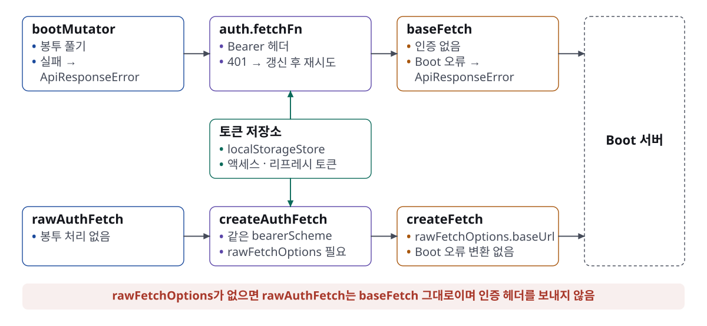

# Boot 확장 사용 방법

[English](../../en/guides/extensions.md) | **한국어**

> simplix-boot 확장(extension) 패키지로 Spring Boot 인증, 인가, CLI 코드 생성을 구성합니다.

## 시작하기 전에

- `simplix init`으로 생성한 simplix-react 프로젝트가 있어야 합니다.
- 백엔드는 Spring Security 엔드포인트가 있는 SimpliX(Spring Boot) 서버여야 합니다.
- `@simplix-react/auth`와 `@simplix-react/access`의 기본 개념을 알고 있어야 합니다.
- 확장 패키지를 설치하세요.

```bash
pnpm add @simplix-react-ext/simplix-boot-auth @simplix-react-ext/simplix-boot-access
```

CLI 코드 생성을 지원하려면 다음 패키지를 설치하고, `simplix.config.ts`의 `plugins`에 선언하세요. 자세한 내용은 [CLI 플러그인 사용](#cli-플러그인-사용)을 참고하세요.

```bash
pnpm add -D @simplix-react-ext/simplix-boot-cli-plugin
```

Boot 전용 유틸리티는 다음 패키지에 있습니다.

```bash
pnpm add @simplix-react-ext/simplix-boot-utils
```

서버 전송 이벤트(SSE)로 실시간 갱신을 받으려면 다음 패키지를 설치하세요([스트리밍 갱신](#스트리밍-갱신) 참고).

```bash
pnpm add @simplix-react-ext/simplix-boot-stream
```

## 해결 방법

### Boot 인증 구성

`createBootAuth()`는 상위 수준 팩토리입니다. 호출 한 번으로 자동 토큰 갱신(token refresh), 탭 간 동기화, Boot 오류 처리를 갖춘 Bearer 토큰 인증(authentication)을 구성합니다.

```ts
import { createBootAuth } from "@simplix-react-ext/simplix-boot-auth";

const { auth, authClient, store, bootMutator, rawAuthFetch, getToken } =
  createBootAuth({
    basePath: "/api/v1",
    storePrefix: "myapp:",
    refreshBeforeExpiry: 60,
    onRefreshFailure: (error) => {
      window.location.href = "/login";
    },
  });
```

자동으로 구성되는 항목은 다음과 같습니다.

- `localStorageStore`를 사용하는 Bearer 토큰 방식(접두사는 `storePrefix`로 지정)
- 만료 60초 전 선제 갱신(`refreshBeforeExpiry`로 지정)
- 백그라운드 자동 갱신 예약(`autoSchedule: false`로 끔)
- `BroadcastChannel`을 통한 탭 간 로그아웃과 토큰 동기화(`crossTabSync: false`로 끔)
- Boot 응답 봉투(envelope)의 오류를 `ApiResponseError`로 변환
- 갱신 요청 하나로 합치기(동시에 발생한 401이 갱신 호출 하나를 공유)
- 사용자가 페이지에서 활동하는 동안에만 백그라운드 갱신(`activityAware: false`로 끔)



#### `BootAuthOptions`

| 속성 | 타입 | 기본값 | 설명 |
| --- | --- | --- | --- |
| `storePrefix` | `string` | `"simplix:"` | `localStorageStore`의 키 접두사 |
| `store` | `TokenStore` | `localStorageStore(storePrefix)` | 직접 지정하는 토큰 저장소(`storePrefix`보다 우선) |
| `basePath` | `string` | `"/api/v1"` | 인증 엔드포인트의 기본 경로 |
| `fetchFn` | `FetchFn` | `createBootHttpFetch()` | 직접 지정하는 기본 fetch 함수 |
| `fetchOptions` | `BootFetchOptions` | - | 기본 `createBootHttpFetch`의 옵션 |
| `refreshBeforeExpiry` | `number` | `60` | 만료 몇 초 전에 선제 갱신할지 |
| `onRefreshFailure` | `(error: Error) => void` | `/login`으로 이동 | 토큰 갱신에 실패했을 때 호출 |
| `maxRetries` | `number` | - | 401 재시도 최대 횟수 |
| `rawFetchOptions` | `{ baseUrl?: string }` | - | `rawAuthFetch`의 옵션(Boot가 아닌 명세용) |
| `autoSchedule` | `boolean` | `true` | 백그라운드 토큰 자동 갱신 사용 |
| `crossTabSync` | `boolean` | `true` | 탭 간 로그아웃과 토큰 동기화, 탭 간 갱신 합치기 사용 |
| `activityAware` | `boolean` | 브라우저에서 `true` | 사용자가 활동하는 동안에만 백그라운드 갱신. 유휴 페이지는 발급 서버의 유휴 시간 제한에 도달 |
| `onExternalLogout` | `() => void` | - | 다른 탭에서 로그아웃해 이 탭의 토큰을 지운 뒤 호출. 여기서 로그인 화면으로 보내세요 |
| `tokenClient` | `ExternalTokenClient` | - | 외부 발급 서버(예: OpenID Connect 제공자)의 토큰 사용. 갱신과 폐기는 이 클라이언트로 처리하고 `authClient.loginFn`은 거부 |

#### `BootAuthResult`

| 속성 | 타입 | 설명 |
| --- | --- | --- |
| `auth` | `AuthInstance` | 핵심 인증 인스턴스(반응형 상태, `subscribe`, `clear` 등) |
| `authClient` | `BootAuthClient` | 로그인, 갱신, 폐기, 사용자 정보 함수 |
| `store` | `TokenStore` | 토큰 저장소 인스턴스 |
| `baseFetch` | `FetchFn` | Boot 오류를 변환하는 기본 fetch(인증 헤더 없음) |
| `rawAuthFetch` | `FetchFn` | `rawFetchOptions`를 지정하면 Boot 봉투를 처리하지 않는 인증 fetch이고, 지정하지 않으면 `baseFetch`입니다 |
| `bootMutator` | `FetchFn` | Boot 봉투를 푸는 인증 fetch |
| `getToken` | `() => string \| null` | 현재 액세스 토큰 반환 |
| `uploadWithProgress` | `(url, formData, opts?) => Promise<T>` | XHR 멀티파트 업로드. 진행률(`opts.onProgress`, `opts.signal`), 인증 헤더, 401 갱신 후 재시도, 봉투 풀기 포함 |
| `fetchAttachmentBlob` | `(url: string) => Promise<Blob>` | 인증된 blob 요청(첨부 파일 내려받기, 썸네일). 401 갱신 후 재시도 포함 |

#### `BootAuthClient`

`authClient` 객체로 Boot 인증 작업을 직접 호출합니다.

```ts
// Login with username/password (Basic Auth)
const tokens = await authClient.loginFn("admin", "password");
// Returns: { accessToken, refreshToken, expiresAt, refreshTokenExpiresAt }

// Store tokens in auth
auth.setTokens(tokens);

// Refresh token manually
const newTokens = await authClient.refreshFn();

// Revoke current token
await authClient.revokeFn();

// Get current user profile (envelope auto-unwrapped)
const user = await authClient.userInfoFn();
```

#### Boot 토큰 엔드포인트

`createBootAuth`는 다음 SimpliX 엔드포인트를 사용합니다.

| 메서드 | 기본 경로 | 설명 |
| --- | --- | --- |
| POST | `/api/v1/auth/token/issue` | 토큰 발급(Basic Auth 헤더) |
| POST | `/api/v1/auth/token/refresh` | 토큰 갱신(`X-Refresh-Token` 헤더) |
| POST | `/api/v1/auth/token/revoke` | 현재 토큰 폐기(`X-Refresh-Token` 헤더) |
| GET | `/api/v1/user/me` | 현재 사용자 프로필 조회 |

모든 경로는 설정한 `basePath`를 기준으로 합니다.

### Boot 접근 제어 구성

#### `createBootAccessPolicy()` 사용

Boot 인가(authorization)를 구성하는 가장 간단한 방법은 `createBootAccessPolicy()`입니다. Spring Security에 맞게 연결된 `AccessPolicy`를 만듭니다.

```ts
import { createBootAccessPolicy } from "@simplix-react-ext/simplix-boot-access";

const accessPolicy = createBootAccessPolicy({
  fetchFn: auth.fetchFn,
  isSuperAdmin: (user) => user.isSuperAdmin === true,
  persist: { key: "myapp-access" },
});
```

자동으로 처리하는 내용은 다음과 같습니다.

- 권한을 `/api/v1/user/me/permissions`(인증 사용자) 또는 `/api/v1/public/user/permissions`(비인증 사용자)에서 가져옵니다.
- Boot 봉투가 있으면 풉니다.
- Spring Security 권한 형식을 CASL 규칙으로 변환합니다.
- 슈퍼 관리자에게 `{ action: "manage", subject: "all" }` 규칙을 추가합니다.

#### `BootAccessPolicyOptions`

| 속성 | 타입 | 기본값 | 설명 |
| --- | --- | --- | --- |
| `fetchFn` | `OrvalMutator` | (필수) | fetch 함수(보통 `auth.fetchFn`) |
| `adapterOptions` | `Omit<SpringAccessAdapterOptions, "fetchFn">` | - | 어댑터 기본값 재정의 |
| `isSuperAdmin` | `(user: AccessUser) => boolean` | `user.isSuperAdmin === true` | 슈퍼 관리자 판정 함수 |
| `persist` | `AccessPersistConfig` | - | 저장 설정 |
| `enablePublicAccess` | `boolean` | `true` | 비인증 사용자 권한 조회 사용 |

#### `createSpringAccessAdapter()` 직접 사용

더 세밀하게 제어하려면 하위 수준 함수 `createSpringAccessAdapter()`로 `AccessAdapter`를 만들어 직접 조합하세요.

```ts
import { createAccessPolicy } from "@simplix-react/access";
import { createSpringAccessAdapter } from "@simplix-react-ext/simplix-boot-access";

const adapter = createSpringAccessAdapter({
  permissionsEndpoint: "/api/v1/user/me/permissions",
  publicPermissionsEndpoint: "/api/v1/public/user/permissions",
  systemAdminRole: "ROLE_SYSTEM_ADMIN",
  fetchFn: auth.fetchFn,
});

const access = createAccessPolicy({ adapter });
```

#### `SpringAccessAdapterOptions`

| 속성 | 타입 | 기본값 | 설명 |
| --- | --- | --- | --- |
| `permissionsEndpoint` | `string` | `"/api/v1/user/me/permissions"` | 인증 사용자 권한 엔드포인트 |
| `publicPermissionsEndpoint` | `string` | `"/api/v1/public/user/permissions"` | 비인증 사용자 권한 엔드포인트 |
| `systemAdminRole` | `string` | `"ROLE_SYSTEM_ADMIN"` | 시스템 관리자를 나타내는 역할 코드 |
| `fetchFn` | `OrvalMutator` | - | 직접 지정하는 fetch 함수 |

#### Spring Security 권한 형식

어댑터는 권한 엔드포인트가 다음 형태로 응답한다고 가정합니다.

```ts
interface SpringPermissionsResponse {
  permissions: Record<string, string[]>;
  roles: Array<string | { roleCode: string; roleName: string }>;
  isSuperAdmin: boolean | string;
}
```

응답 예시는 다음과 같습니다.

```json
{
  "permissions": {
    "Pet": ["list", "view", "create"],
    "Order": ["list", "view"]
  },
  "roles": ["ROLE_USER", { "roleCode": "ROLE_ADMIN", "roleName": "Admin" }],
  "isSuperAdmin": false
}
```

이 응답은 다음 CASL 규칙으로 변환됩니다.

```ts
[
  { action: "list", subject: "Pet" },
  { action: "view", subject: "Pet" },
  { action: "create", subject: "Pet" },
  { action: "list", subject: "Order" },
  { action: "view", subject: "Order" },
]
```

`isSuperAdmin`이 `true`(또는 문자열 `"true"`)이면 `{ action: "manage", subject: "all" }` 규칙을 맨 앞에 추가합니다. 사용자 역할에 `systemAdminRole`(기본값 `"ROLE_SYSTEM_ADMIN"`)이 있을 때도 같습니다.

#### 권한 직접 변환

권한 응답이 이미 있고 CASL 규칙만 필요하면 다음 함수를 사용하세요.

```ts
import { convertSpringPermissionsToCasl } from "@simplix-react-ext/simplix-boot-access";

const result = convertSpringPermissionsToCasl({
  permissions: { Pet: ["list", "view"], Order: ["list", "create"] },
  roles: ["ROLE_USER", { roleCode: "ROLE_ADMIN", roleName: "Admin" }],
  isSuperAdmin: false,
});

// result.rules: [{ action: "list", subject: "Pet" }, ...]
// result.roles: ["ROLE_USER", "ROLE_ADMIN"]
// result.isSuperAdmin: false
```

#### 백오피스 접근 확인

CASL 규칙으로 백오피스 접근 권한을 확인하는 유틸리티입니다.

```ts
import { hasBackofficeAccess } from "@simplix-react-ext/simplix-boot-access";

hasBackofficeAccess(rules, true);              // true (super admin bypass)
hasBackofficeAccess(rules, false);             // checks for BACKOFFICE_ACCESS resource
hasBackofficeAccess(rules, false, "MY_PANEL"); // checks for custom resource
```

#### 기타 접근 제어 export

| export | 설명 |
| --- | --- |
| `normalizeRoles(roles)` | 역할 문자열과 `{ roleCode, roleName }` 객체가 섞인 목록을 역할 코드 목록으로 변환 |
| `createSelfAccessPolicy(config)` | 사용자가 자기 계정에만 작업하는 앱의 `AccessPolicy`. 실제 경계는 서버가 판정 |
| `useSelfAccessRefusal()`, `currentSelfAccessRefusal()` | 자기 계정 접근 정책이 지정한 거부 사유. 셸이 거부 화면을 직접 그릴 때 사용 |

### CLI 플러그인 사용

`@simplix-react-ext/simplix-boot-cli-plugin`을 설치한 뒤 `simplix.config.ts`의 `plugins` 필드에 선언하세요. CLI가 플러그인을 불러와 `simplix-boot` 명세 프로필을 등록합니다.

```ts
// simplix.config.ts
import { defineConfig } from "@simplix-react/cli";

export default defineConfig({
  plugins: ["@simplix-react-ext/simplix-boot-cli-plugin"],
  // ...
});
```

#### 명세 프로필 등록

플러그인이 등록하는 항목은 다음과 같습니다.

- **명명 전략**(`simplixBootNaming`): `scope.crud.EntityName` 형식의 태그, 자동 생성된 operation ID, CRUD 경로 패턴(`/search`, `/create`, `/{id}`, `/{id}/edit`, `/batch`) 같은 Boot 방식의 OpenAPI 규칙을 처리합니다.
- **응답 어댑터**(`boot`): 생성 코드의 Boot 봉투 처리를 구성합니다. 오류 변환용 `bootResponseAdapter`와 목 응답용 `wrapEnvelope`가 여기에 포함됩니다.
- **스키마 어댑터**(`bootSchemaAdapter`): Boot 봉투 스키마를 풉니다(`type`, `message`, `timestamp`, `errorCode`, `errorDetail` 래퍼 제거). 그래서 생성된 타입은 봉투가 아니라 실제 `body` 내용을 나타냅니다.
- **서버 엔드포인트**: 생성 과정에서 엔티티 레이블을 내려받는 i18n 메시지 엔드포인트(`/api/v1/dev/i18n/messages`)와 SimpliX Meta 엔드포인트(`/api/v1/dev/meta/dto`)입니다.
- **레이블 enum**: Boot `LabeledEnum`을 담는 응답 필드는 `@simplix-react-ext/simplix-boot-utils`의 `LabeledEnumValue` 타입이 됩니다.

`openapi` 설정의 명세마다 `simplix-boot` 프로필을 지정하고 코드 생성을 실행하세요.

```ts
// simplix.config.ts
export default defineConfig({
  plugins: ["@simplix-react-ext/simplix-boot-cli-plugin"],
  openapi: [
    {
      spec: "my-api-spec.json",
      profile: "simplix-boot",
      domains: {
        // domainName: [tagPatterns]
      },
    },
  ],
});
```

```bash
simplix openapi my-api-spec.json
```

#### Boot 봉투 형식

SimpliX API는 모든 응답을 표준 봉투로 감쌉니다.

```ts
interface BootEnvelope<T = unknown> {
  type: string;        // "SUCCESS" or error type
  message: string;     // Human-readable message
  body: T;             // Actual response payload
  timestamp: string;   // ISO 8601 timestamp
  errorCode?: string | null;  // Application-specific error code
  errorDetail?: ErrorDetail | null; // Validation errors or additional info
}
```

성공 응답 예시는 다음과 같습니다.

```json
{
  "type": "SUCCESS",
  "message": "OK",
  "body": { "id": 1, "name": "Buddy", "status": "available" },
  "timestamp": "2025-01-15T10:30:00.000Z",
  "errorCode": null,
  "errorDetail": null
}
```

오류 응답 예시는 다음과 같습니다.

```json
{
  "type": "ERROR",
  "message": "Validation failed",
  "body": null,
  "timestamp": "2025-01-15T10:30:00.000Z",
  "errorCode": "VALIDATION_ERROR",
  "errorDetail": [
    { "field": "name", "message": "must not be blank" }
  ]
}
```

`createBootAuth()`가 반환하는 `bootMutator`는 봉투를 자동으로 풀어 `body` 값만 반환합니다. 오류 응답은 코드에 도달하기 전에 `ApiResponseError` 인스턴스로 변환됩니다.

#### 봉투 유틸리티

인증 패키지는 봉투 보조 함수를 export합니다.

```ts
import {
  wrapEnvelope,
  unwrapEnvelope,
  envelopeSchema,
} from "@simplix-react-ext/simplix-boot-auth";

// Wrap a value in a success envelope (useful for mocking)
const envelope = wrapEnvelope({ id: 1, name: "Buddy" });
// { type: "SUCCESS", message: "OK", body: { id: 1, name: "Buddy" }, ... }

// Unwrap an envelope to get the body
const body = unwrapEnvelope(envelope); // { id: 1, name: "Buddy" }

// Create a Zod schema for a typed envelope
const petEnvelopeSchema = envelopeSchema(petSchema);
```

### `ApiResponseError`로 오류 처리

Boot 오류 응답은 자동으로 `ApiResponseError` 인스턴스로 변환됩니다.

```ts
import { ApiResponseError } from "@simplix-react-ext/simplix-boot-auth";

try {
  await bootMutator("/api/v1/pets", {
    method: "POST",
    body: JSON.stringify({ name: "" }),
  });
} catch (error) {
  if (error instanceof ApiResponseError) {
    console.log(error.status);       // 400
    console.log(error.type);         // "ERROR"
    console.log(error.errorMessage); // "Validation failed"
    console.log(error.errorCode);    // "VALIDATION_ERROR"
    console.log(error.errorDetail);  // [{ field: "name", message: "must not be blank" }]
    console.log(error.timestamp);    // "2025-01-15T10:30:00.000Z"
  }
}
```

`ApiResponseError`는 `Error`를 확장하며 다음 속성이 있습니다.

| 속성 | 타입 | 설명 |
| --- | --- | --- |
| `status` | `number` | HTTP 상태 코드 |
| `type` | `string` | 봉투의 응답 유형 |
| `errorMessage` | `string` | 사람이 읽는 오류 메시지 |
| `timestamp` | `string` | ISO 8601 타임스탬프 |
| `errorCode` | `string \| undefined` | 애플리케이션 오류 코드 |
| `errorDetail` | `ErrorDetail \| undefined` | 검증 오류 또는 추가 정보 |

`ErrorDetail`의 타입은 `Array<{ field: string; message: string }> | Record<string, unknown>`입니다.

### Boot 유틸리티 함수

#### `resolveBootEnum()`

Boot API는 enum 값을 일반 문자열이나 `value`와 `label`이 있는 `LabeledEnumValue` 객체로 반환합니다. 이 유틸리티는 일반 문자열과 `LabeledEnumValue` 객체를 모두 문자열로 정규화하고, 그 밖의 값은 문자열로 변환합니다.

```ts
import { resolveBootEnum } from "@simplix-react-ext/simplix-boot-utils";

resolveBootEnum("ACTIVE");                           // "ACTIVE"
resolveBootEnum({ type: "Status", value: "ACTIVE", label: "Active" }); // "ACTIVE"
resolveBootEnum(null);                               // ""
```

#### 기타 유틸리티

| export | 패키지 | 설명 |
| --- | --- | --- |
| `toLabeledEnum(value)` | `simplix-boot-utils` | 요청 본문용으로 값을 레이블로 쓰는 `LabeledEnumValue` 생성 |
| `transformSearchableFilters(filters)` | `simplix-boot-utils` | 일반 CRUD 필터 값을 searchable-jpa 형식으로 변환 |
| `bootBody(data)`, `bootPage(data)` | `simplix-boot-utils` | 생성된 훅(hook)의 응답을 실행 시점의 DTO나 페이지로 읽음 |
| `updateBody(loaded)` | `simplix-boot-utils` | 불러온 레코드에서 감사 필드를 뺀 수정 요청 본문 생성 |
| `serverMessage` | `simplix-boot-utils` | `@simplix-react/api`에서 다시 export |
| `pageOf(itemSchema)`, `springPageSchema` | `simplix-boot-auth` | Spring 페이지의 Zod 스키마 |
| `createBootHttpFetch(options?)`, `bootResponseAdapter` | `simplix-boot-auth` | Boot 오류를 변환하는 기본 fetch와, 생성된 mutator가 사용하는 오류 어댑터 |

### 목 구성

인증 패키지는 개발과 테스트용 목(mock) 진입점을 제공합니다.

```ts
import { createAuthMock } from "@simplix-react-ext/simplix-boot-auth/mock";

const authMock = createAuthMock({
  basePath: "/api/v1",
  users: {
    admin: {
      user: {
        userId: "1",
        username: "admin",
        displayName: "Admin",
        email: "admin@example.com",
        roles: [{ roleCode: "ROLE_ADMIN", roleName: "Admin" }],
        isSuperAdmin: true,
      },
      permissions: {
        permissions: { Pet: ["list", "view", "create", "update", "delete"] },
        roles: [{ roleCode: "ROLE_ADMIN", roleName: "Admin" }],
        isSuperAdmin: true,
      },
      password: "admin",
    },
  },
});

// authMock is a MockDomainConfig with MSW handlers for all auth endpoints
```

토큰 발급, 토큰 갱신, 토큰 폐기, 사용자 프로필, 권한 엔드포인트의 MSW 핸들러를 만듭니다.

### 스트리밍 갱신

`@simplix-react-ext/simplix-boot-stream`은 SimpliX Boot SSE 백엔드에 `EventSource` 연결 하나를 열고, 실시간 리소스 갱신을 React 훅에 전달합니다. 루트 가까이에 `StreamProvider`를 배치하고 `useStreamSubscription`으로 구독하세요.

```tsx
import { StreamProvider } from "@simplix-react-ext/simplix-boot-stream";

function App() {
  return (
    <StreamProvider url="/api/stream/connect">
      <Dashboard />
    </StreamProvider>
  );
}
```

이 패키지는 `useStreamStatus`, `useStaleDetection`, `useTimestampFreshness`, `useStreamLogs`도 export합니다. 모든 속성과 훅은 [README](../../../extensions/simplix-boot/packages/stream/README.md)에 설명되어 있습니다.

## 전체 연동 예제

Boot 인증과 접근 제어를 함께 연결하는 운영 환경 구성입니다.

```ts
// shared/config/auth.ts
import { createBootAuth } from "@simplix-react-ext/simplix-boot-auth";

export const { auth, authClient, store, bootMutator, getToken } =
  createBootAuth({
    basePath: "/api/v1",
    storePrefix: "myapp:",
    onRefreshFailure: () => {
      auth.clear();
      window.location.href = "/login";
    },
  });
```

```ts
// shared/config/access.ts
import { createBootAccessPolicy } from "@simplix-react-ext/simplix-boot-access";
import { auth } from "./auth";

export const accessPolicy = createBootAccessPolicy({
  fetchFn: auth.fetchFn,
  isSuperAdmin: (user) => user.isSuperAdmin === true,
  persist: { key: "myapp-access" },
});
```

```tsx
// app.tsx
import { AuthProvider } from "@simplix-react/auth/react";
import { AccessProvider } from "@simplix-react/access/react";
import { auth } from "./shared/config/auth";
import { accessPolicy } from "./shared/config/access";

function App() {
  return (
    <AuthProvider auth={auth}>
      <AccessProvider policy={accessPolicy}>
        <Router />
      </AccessProvider>
    </AuthProvider>
  );
}
```

```tsx
// pages/login.tsx
import { authClient, auth } from "../shared/config/auth";

function LoginPage() {
  async function handleLogin(username: string, password: string) {
    const tokens = await authClient.loginFn(username, password);
    auth.setTokens(tokens);
  }

  return <LoginForm onSubmit={handleLogin} />;
}
```

## 관련 문서

- [확장 구조](../core-concepts/extensions.md): 설계 결정과 확장의 동작 방식
- [인증 가이드](./authentication.md): Boot를 사용하지 않는 핵심 인증 구성
- [인증 구조](../core-concepts/authentication.md): 핵심 인증 설계
- [목 핸들러](./mock-handlers.md): 개발용 MSW 핸들러 구성
