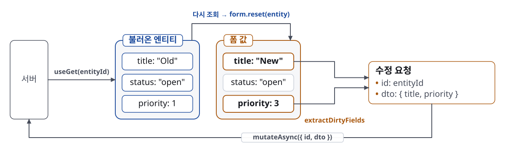

# @simplix-react/form으로 폼 훅 사용하기

[English](../../en/guides/form-hooks.md) | **한국어**

> 이미 정의한 계약(contract)에서 TanStack Form 훅을 파생하고, 변경한 필드만 추적하고 서버 오류를 필드에 표시하는 생성 · 수정 폼을 만듭니다.

## 시작하기 전에

- 도메인 계약과 그 계약에서 파생한 React Query 훅(hook)이 하나 이상 있는 simplix-react 프로젝트
- 의존성 설치:

```bash
pnpm add @simplix-react/form @tanstack/react-form
```

- [TanStack Form 기본 사용법](https://tanstack.com/form/latest)에 대한 이해
- 이미 정의한 계약과 훅:

```ts
// contract.ts
import { defineApi } from "@simplix-react/contract";
import { z } from "zod";

const taskSchema = z.object({
  id: z.string(),
  title: z.string(),
  status: z.enum(["open", "in_progress", "done"]),
  priority: z.number(),
});

const createTaskSchema = taskSchema.omit({ id: true });
const updateTaskSchema = createTaskSchema.partial();

export const projectContract = defineApi({
  domain: "project",
  basePath: "/api",
  entities: {
    task: {
      schema: taskSchema,
      parent: { param: "projectId", path: "/projects" },
      operations: {
        list: { method: "GET", path: "/projects/:projectId/tasks" },
        get: { method: "GET", path: "/tasks/:id" },
        create: { method: "POST", path: "/projects/:projectId/tasks", input: createTaskSchema },
        update: { method: "PATCH", path: "/tasks/:id", input: updateTaskSchema },
      },
    },
  },
});

// hooks.ts
import { deriveEntityHooks } from "@simplix-react/react";
import { projectContract } from "./contract.js";

export const projectHooks = deriveEntityHooks(projectContract);
```

## 해결 방법

### 1단계: 계약에서 폼 훅 파생하기

계약과 파생한 쿼리 훅을 전달해 `deriveEntityFormHooks`를 호출하세요. 호출 한 번으로 `create` 역할의 오퍼레이션(operation)이 있는 엔티티(entity)에는 `useCreateForm`을, `update` 역할의 오퍼레이션(과 엔티티를 불러올 `get` 훅)이 있는 엔티티에는 `useUpdateForm`을 만듭니다. 이 오퍼레이션이 없는 엔티티에는 폼 훅이 없습니다.

```ts
import { deriveEntityFormHooks } from "@simplix-react/form";
import { projectContract } from "./contract.js";
import { projectHooks } from "./hooks.js";

export const projectFormHooks = deriveEntityFormHooks(projectContract, projectHooks);

// projectFormHooks.task.useCreateForm : create form hook
// projectFormHooks.task.useUpdateForm : update form hook
```

### 2단계: 컴포넌트에서 useCreateForm 사용하기

`useCreateForm`은 엔티티의 생성 뮤테이션(mutation)과 연결한 TanStack Form 인스턴스를 반환합니다. 기본값은 옵션으로 전달하고, 제출 · 오류 상태 · 초기화는 폼이 자동으로 처리합니다. 제출하면 폼 값을 그대로 생성 뮤테이션에 전달합니다.

`useCreateForm`과 `useUpdateForm`은 엔티티에 `create`나 `update` 오퍼레이션이 있을 때만 생기므로 `EntityFormHooks` 타입에서 선택 속성입니다. 그래서 예제에서는 null 아님 단언(`useCreateForm!()`)을 붙여 호출합니다.

```tsx
import { projectFormHooks } from "./form-hooks.js";

function CreateTaskForm({ projectId }: { projectId: string }) {
  const { form, isSubmitting, submitError, reset } = projectFormHooks.task.useCreateForm!(
    projectId,
    {
      defaultValues: { title: "", status: "open", priority: 0 },
      resetOnSuccess: true,
      onSuccess: (data) => {
        console.log("Task created:", data);
      },
    },
  );

  return (
    <form
      onSubmit={(e) => {
        e.preventDefault();
        form.handleSubmit();
      }}
    >
      <form.Field name="title">
        {(field) => (
          <div>
            <label htmlFor="title">Title</label>
            <input
              id="title"
              value={field.state.value}
              onChange={(e) => field.handleChange(e.target.value)}
            />
            {field.state.meta.errorMap.onSubmit && (
              <p role="alert">{field.state.meta.errorMap.onSubmit}</p>
            )}
          </div>
        )}
      </form.Field>

      <form.Field name="status">
        {(field) => (
          <div>
            <label htmlFor="status">Status</label>
            <select
              id="status"
              value={field.state.value}
              onChange={(e) => field.handleChange(e.target.value)}
            >
              <option value="open">Open</option>
              <option value="in_progress">In Progress</option>
              <option value="done">Done</option>
            </select>
          </div>
        )}
      </form.Field>

      <form.Field name="priority">
        {(field) => (
          <div>
            <label htmlFor="priority">Priority</label>
            <input
              id="priority"
              type="number"
              value={field.state.value}
              onChange={(e) => field.handleChange(Number(e.target.value))}
            />
          </div>
        )}
      </form.Field>

      {submitError && <p role="alert">{submitError.message}</p>}

      <button type="submit" disabled={isSubmitting}>
        {isSubmitting ? "Creating..." : "Create Task"}
      </button>
      <button type="button" onClick={reset}>
        Reset
      </button>
    </form>
  );
}
```

주요 동작:

| 동작 | 기본값 | 재정의 |
| --- | --- | --- |
| 성공 후 폼 초기화 | `true` | `resetOnSuccess: false` |
| 서버 검증 오류를 필드에 표시 | 항상 | 없음 |
| 쿼리 캐시 무효화 | 자동(`useCreate`가 처리) | 없음 |
| 오류 콜백 | 없음 | `onError: (error) => ...` |

### 3단계: 변경 필드를 추적하는 useUpdateForm 사용하기

`useUpdateForm`은 기존 엔티티를 조회해 폼에 채우고, 제출할 때 바뀐 필드만 보냅니다(`dirtyOnly` 기본값 `true`). 그래서 PATCH 요청 본문에 필요한 필드만 담깁니다.

```tsx
import { projectFormHooks } from "./form-hooks.js";

function EditTaskForm({ taskId }: { taskId: string }) {
  const { form, isLoading, isSubmitting, submitError, entity } =
    projectFormHooks.task.useUpdateForm!(taskId, {
      dirtyOnly: true,
      onSuccess: (data) => {
        console.log("Task updated:", data);
      },
    });

  if (isLoading) return <p>Loading task...</p>;

  return (
    <form
      onSubmit={(e) => {
        e.preventDefault();
        form.handleSubmit();
      }}
    >
      <form.Field name="title">
        {(field) => (
          <div>
            <label htmlFor="title">Title</label>
            <input
              id="title"
              value={field.state.value}
              onChange={(e) => field.handleChange(e.target.value)}
            />
            {field.state.meta.errorMap.onSubmit && (
              <p role="alert">{field.state.meta.errorMap.onSubmit}</p>
            )}
          </div>
        )}
      </form.Field>

      <form.Field name="status">
        {(field) => (
          <div>
            <label htmlFor="status">Status</label>
            <select
              id="status"
              value={field.state.value}
              onChange={(e) => field.handleChange(e.target.value)}
            >
              <option value="open">Open</option>
              <option value="in_progress">In Progress</option>
              <option value="done">Done</option>
            </select>
          </div>
        )}
      </form.Field>

      <form.Field name="priority">
        {(field) => (
          <div>
            <label htmlFor="priority">Priority</label>
            <input
              id="priority"
              type="number"
              value={field.state.value}
              onChange={(e) => field.handleChange(Number(e.target.value))}
            />
          </div>
        )}
      </form.Field>

      {submitError && <p role="alert">{submitError.message}</p>}

      <button type="submit" disabled={isSubmitting}>
        {isSubmitting ? "Saving..." : "Save Changes"}
      </button>
    </form>
  );
}
```

변경 필드 추적 방식:



1. 훅이 `useGet(entityId)`로 엔티티를 조회해 폼에 채웁니다.
2. 제출하면 `extractDirtyFields(currentValues, originalEntity)`로 깊은 비교를 합니다. 엔티티를 불러오기 전에 제출하면 아무 동작도 하지 않습니다.
3. 바뀐 필드만 뮤테이션 변수(`{ id, dto: dirtyFields }`)에 담아 보냅니다.
4. 서버 데이터가 바뀌면(예: 백그라운드에서 다시 조회한 뒤) 폼을 그 데이터로 초기화합니다.

바뀌었는지와 관계없이 모든 필드를 보내려면 `dirtyOnly: false`를 지정하세요.

```ts
const { form } = projectFormHooks.task.useUpdateForm!(taskId, {
  dirtyOnly: false,
});
```

### 4단계: 서버 검증 오류 처리하기

제출에 실패하면 폼 훅이 오류에서 필드 오류를 찾아 TanStack Form 인스턴스에 표시합니다. HTTP 상태 코드는 확인하지 않습니다. 뮤테이션을 직접 다루는 흐름에서는 `mapServerErrorsToForm`을 직접 호출할 수도 있습니다.

**폼 훅에 내장된 자동 처리:**

필드 오류는 각 필드의 `errorMap.onSubmit` 슬롯에 자동으로 기록하고, 한 필드에 메시지가 여러 개이면 `, `로 이어서 연결합니다. 오류는 `submitError`에도 담기고 `onError`도 호출합니다. 필드 오류는 필드 렌더 함수에서 표시하세요.

```tsx
<form.Field name="title">
  {(field) => (
    <div>
      <input
        value={field.state.value}
        onChange={(e) => field.handleChange(e.target.value)}
      />
      {field.state.meta.errorMap.onSubmit && (
        <p role="alert">{field.state.meta.errorMap.onSubmit}</p>
      )}
    </div>
  )}
</form.Field>
```

**직접 처리하는 흐름:**

폼 훅 밖에서 뮤테이션을 다룰 때는 `mapServerErrorsToForm`을 직접 사용하세요.

```ts
import type { AnyFormApi } from "@tanstack/react-form";
import { mapServerErrorsToForm } from "@simplix-react/form";

async function handleCustomSubmit(form: AnyFormApi) {
  try {
    await customMutation.mutateAsync(form.state.values);
  } catch (error) {
    const mapped = mapServerErrorsToForm(error, form);
    if (!mapped) {
      // Not a validation error: handle it another way
    }
  }
}
```

지원하는 서버 오류 형식(`@simplix-react/api`의 `getValidationErrors`로 읽음):

| 형식 | 형태 | 예 |
| --- | --- | --- |
| Spring Boot | `{ errorDetail: [{ field, message }] }` | `{ errorDetail: [{ field: "title", message: "must not be blank" }] }` |
| 필드 오류 배열 | `{ errors: [{ field, message }] }` | `{ errors: [{ field: "title", message: "can't be blank" }] }` |
| Rails | `{ errors: { [field]: string[] } }` | `{ errors: { title: ["can't be blank"] } }` |

형태는 오류 객체 자체, `data` 속성, JSON으로 파싱한 `body` 문자열 순서로 찾습니다(`@simplix-react/contract`의 `ApiError`는 응답 본문을 `body`에 담습니다). 어느 형태와도 맞지 않는 오류는 필드에 표시하지 않습니다.

## 변형

### extractDirtyFields 단독 사용

`extractDirtyFields`는 폼 훅 밖에서도 변경분만 보내는 PATCH 로직에 사용할 수 있습니다. 현재 객체의 최상위 키마다 깊은 비교(날짜는 시각 값으로 비교)를 하고, 현재 객체에 없는 키는 결과에 넣지 않습니다.

```ts
import { extractDirtyFields } from "@simplix-react/form";

const original = { title: "Old", status: "open", priority: 1 };
const current = { title: "New", status: "open", priority: 3 };

const patch = extractDirtyFields(current, original);
// => { title: "New", priority: 3 }

await projectContract.client.task.update(taskId, patch);
```

### 최상위 엔티티 생성 폼(상위 엔티티 ID 없음)

상위 엔티티가 없는 엔티티는 `parentId` 인수에 `undefined`를 전달하세요.

```ts
const { form } = projectFormHooks.task.useCreateForm!(undefined, {
  defaultValues: { title: "", status: "open", priority: 0 },
});
```

### 성공 후 폼 초기화 끄기

생성에 성공한 뒤에도 폼 값을 유지합니다.

```ts
const { form } = projectFormHooks.task.useCreateForm!(projectId, {
  defaultValues: { title: "", status: "open", priority: 0 },
  resetOnSuccess: false,
});
```

### Zod 검증 실패를 필드 오류로 바꾸기

`zodToFieldErrors(schema, values)`는 Zod 스키마로 값을 검증해, 성공하면 `null`을, 실패하면 점으로 이은 필드 경로와 그 필드의 첫 메시지를 짝지은 객체를 반환합니다. `@simplix-react/ui`의 `useCrudFormSubmit`이 `validator` 옵션으로 받는 형태입니다.

```ts
import { z } from "zod";
import { zodToFieldErrors } from "@simplix-react/form";

const schema = z.object({
  profile: z.object({ phone: z.string().min(1) }),
  tags: z.array(z.object({ name: z.string().min(1) })),
});

zodToFieldErrors(schema, { profile: { phone: "" }, tags: [{ name: "" }] });
// => { "profile.phone": "...", "tags.0.name": "..." }
```

## 관련 문서

- [@simplix-react/form API 레퍼런스](../../api/@simplix-react/form/README.md): 전체 API 문서
- [계약에 엔티티 정의하기](../../ko/guides/defining-entities.md): 엔티티 스키마 설정
- [목으로 테스트하기](../../ko/guides/testing-with-mocks.md): 폼 훅을 사용하는 컴포넌트 테스트
