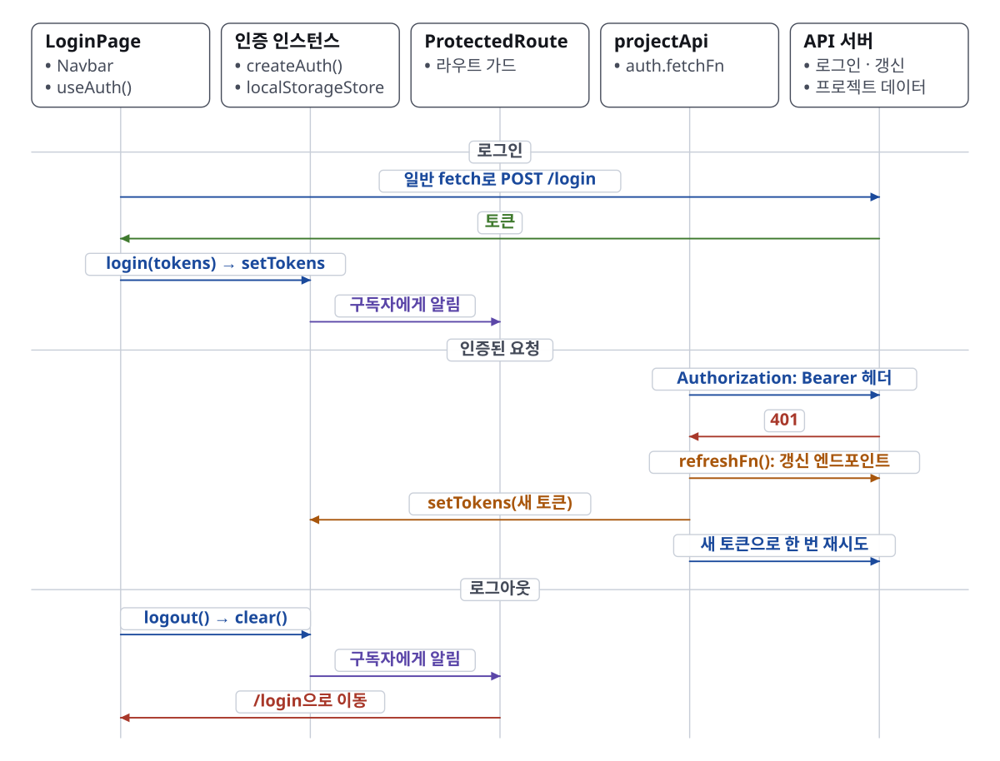

# 인증으로 보호되는 앱 만들기

[English](../../en/tutorials/auth-protected-app.md) | **한국어**

> 이 튜토리얼을 마치면 로그인과 로그아웃, 자동 토큰 갱신(token refresh), 보호된 라우트, 인증된 API 요청을 갖춘 React 애플리케이션이 완성됩니다. 모두 `@simplix-react/auth`와 `@simplix-react/contract`로 만듭니다.

## 사전 준비

- Node.js 20 이상
- 전역으로 설치한 pnpm
- [프로젝트 관리 앱 튜토리얼](./project-app.md)을 마쳤거나 `defineApi`와 `deriveEntityHooks`를 그만큼 다뤄 본 경험

## 1단계: 인증 패키지 설치

기존 simplix-react 프로젝트에서 시작합니다. 인증 패키지를 추가하세요.

```bash
pnpm add @simplix-react/auth
```

설치되었는지 확인하세요.

```bash
pnpm list @simplix-react/auth
```

**예상 결과:** 의존성 목록에 `@simplix-react/auth`가 표시됩니다.

## 2단계: 인증 인스턴스 생성

자동 갱신을 포함한 Bearer 토큰 인증(authentication)을 설정하는 인증 모듈을 따로 만듭니다.

`src/auth.ts`를 만드세요.

```ts
import { createAuth, bearerScheme, localStorageStore } from "@simplix-react/auth";

const store = localStorageStore("myapp:");

export const auth = createAuth({
  schemes: [
    bearerScheme({
      store,
      token: () => store.get("access_token"),
      refresh: {
        refreshFn: async () => {
          const refreshToken = store.get("refresh_token");
          if (!refreshToken) {
            throw new Error("No refresh token available");
          }

          const res = await fetch("/api/auth/refresh", {
            method: "POST",
            headers: { "Content-Type": "application/json" },
            body: JSON.stringify({ refreshToken }),
          });

          if (!res.ok) {
            throw new Error(`Refresh failed: ${res.status}`);
          }

          return res.json();
        },
        refreshBeforeExpiry: 60,
      },
    }),
  ],
  store,
  onRefreshFailure: () => {
    auth.clear();
    window.location.href = "/login";
  },
});
```

이 설정의 내용은 다음과 같습니다.

- `localStorage`에 토큰을 저장하는 Bearer 토큰 인증
- 액세스 토큰 만료까지 60초가 남지 않았을 때 보내는 요청 앞에서 토큰을 갱신하고, 401 응답을 받으면 갱신한 뒤 요청을 다시 보냄
- 갱신에 실패하면 `/login`으로 이동

**예상 결과:** 파일이 오류 없이 컴파일됩니다. `auth` 객체에는 `fetchFn`, `isAuthenticated`, `getAccessToken`, `setTokens`, `clear`, `subscribe`, `rehydrate`, `getUser`, `setUser`가 있습니다.

## 3단계: API 계약에 인증 연결

인증된 fetch 함수를 쓰도록 계약(contract)을 수정합니다.

`src/contract.ts`를 수정하세요.

```ts
import { z } from "zod";
import { defineApi, simpleQueryBuilder } from "@simplix-react/contract";
import { auth } from "./auth";

const projectSchema = z.object({
  id: z.string(),
  name: z.string(),
  description: z.string(),
  status: z.enum(["active", "archived"]),
  createdAt: z.string(),
  updatedAt: z.string(),
});

const createProjectSchema = z.object({
  name: z.string(),
  description: z.string(),
  status: z.enum(["active", "archived"]).default("active"),
});

const updateProjectSchema = z.object({
  name: z.string().optional(),
  description: z.string().optional(),
  status: z.enum(["active", "archived"]).optional(),
});

export const projectApi = defineApi(
  {
    domain: "project",
    basePath: "/api/v1",
    entities: {
      project: {
        schema: projectSchema,
        operations: {
          list: { method: "GET", path: "/projects" },
          get: { method: "GET", path: "/projects/:id" },
          create: { method: "POST", path: "/projects", input: createProjectSchema },
          update: { method: "PATCH", path: "/projects/:id", input: updateProjectSchema },
          delete: { method: "DELETE", path: "/projects/:id" },
        },
      },
    },
    queryBuilder: simpleQueryBuilder,
  },
  { fetchFn: auth.fetchFn },
);
```

바뀐 곳은 `auth.fetchFn`을 `defineApi`의 두 번째 인수로 전달한 부분뿐입니다. 그 결과 모든 API 요청에 Bearer 토큰이 포함되고, 401 응답을 받으면 토큰을 갱신한 뒤 한 번 다시 요청합니다(`maxRetries` 기본값은 `1`).

**예상 결과:** 파일이 컴파일됩니다. `projectApi`에서 파생한 기존 훅(hook)은 코드를 고치지 않아도 인증된 요청을 보냅니다.

## 4단계: 로그인 페이지 작성

인증 엔드포인트로 자격 증명을 보내고 돌려받은 토큰을 저장하는 로그인 페이지를 만듭니다.

`src/pages/LoginPage.tsx`를 만드세요.

```tsx
import { useState } from "react";
import { useAuth } from "@simplix-react/auth/react";

export function LoginPage() {
  const { login } = useAuth();
  const [email, setEmail] = useState("");
  const [password, setPassword] = useState("");
  const [error, setError] = useState<string | null>(null);
  const [loading, setLoading] = useState(false);

  async function handleSubmit(e: React.FormEvent) {
    e.preventDefault();
    setError(null);
    setLoading(true);

    try {
      const res = await fetch("/api/auth/login", {
        method: "POST",
        headers: { "Content-Type": "application/json" },
        body: JSON.stringify({ email, password }),
      });

      if (!res.ok) {
        const body = await res.text();
        throw new Error(body || `Login failed: ${res.status}`);
      }

      const tokens = await res.json();
      // tokens = { accessToken: "...", refreshToken: "...", expiresIn: 3600 }

      login(tokens);
      window.location.href = "/";
    } catch (err) {
      setError(err instanceof Error ? err.message : "Login failed");
    } finally {
      setLoading(false);
    }
  }

  return (
    <div>
      <h1>Login</h1>
      <form onSubmit={handleSubmit}>
        <div>
          <label htmlFor="email">Email</label>
          <input
            id="email"
            type="email"
            value={email}
            onChange={(e) => setEmail(e.target.value)}
            required
          />
        </div>
        <div>
          <label htmlFor="password">Password</label>
          <input
            id="password"
            type="password"
            value={password}
            onChange={(e) => setPassword(e.target.value)}
            required
          />
        </div>
        {error && <p role="alert">{error}</p>}
        <button type="submit" disabled={loading}>
          {loading ? "Signing in..." : "Sign in"}
        </button>
      </form>
    </div>
  );
}
```

핵심은 다음과 같습니다.

- 로그인은 인증 전에 일어나므로 로그인 엔드포인트는 `auth.fetchFn`이 아니라 일반 `fetch`로 호출합니다
- `login(tokens)`는 설정한 저장소에 토큰을 저장하고 모든 구독자에게 알립니다
- 로그인한 뒤에는 홈 라우트로 이동합니다

**예상 결과:** 로그인 폼이 자격 증명을 보내고, 토큰을 받아 저장한 뒤 페이지를 이동합니다.

## 5단계: 보호된 라우트 가드 작성

인증되지 않은 사용자를 로그인 페이지로 보내는 컴포넌트를 만듭니다.

`src/components/ProtectedRoute.tsx`를 만드세요.

```tsx
import type { ReactNode } from "react";
import { useAuth } from "@simplix-react/auth/react";

export function ProtectedRoute({ children }: { children: ReactNode }) {
  const { isAuthenticated } = useAuth();

  if (!isAuthenticated) {
    window.location.href = "/login";
    return null;
  }

  return <>{children}</>;
}
```

이 컴포넌트는 렌더링할 때마다 `isAuthenticated`를 확인합니다. `useAuth`가 인증 인스턴스를 구독하므로 로그아웃하거나 토큰이 만료되어 인증 상태가 바뀌면 컴포넌트를 다시 렌더링합니다.

**예상 결과:** 인증되지 않은 사용자는 `/login`으로 이동하고, 인증된 사용자에게는 children이 표시됩니다.

## 6단계: 로그아웃 버튼이 있는 내비게이션 바 추가

인증 상태를 표시하고 로그아웃 버튼을 제공하는 내비게이션 바를 만듭니다.

`src/components/Navbar.tsx`를 만드세요.

```tsx
import { useAuth } from "@simplix-react/auth/react";

export function Navbar() {
  const { isAuthenticated, logout, getAccessToken } = useAuth();

  return (
    <nav>
      <a href="/">Project Manager</a>

      <div>
        {isAuthenticated ? (
          <>
            <span>Authenticated</span>
            <button onClick={logout}>Logout</button>
          </>
        ) : (
          <a href="/login">Login</a>
        )}
      </div>
    </nav>
  );
}
```

사용자가 「Logout」을 누르면 다음 순서로 처리합니다.

1. `logout()`이 `auth.clear()`를 호출해 모든 인증 방식과 토큰 저장소를 비웁니다
2. 인증 인스턴스가 모든 구독자에게 알립니다
3. `useAuth`가 `isAuthenticated: false`로 다시 렌더링합니다
4. `ProtectedRoute` 컴포넌트가 변화를 감지하고 `/login`으로 이동합니다

**예상 결과:** 로그인한 상태에서는 내비게이션 바에 「Authenticated」와 로그아웃 버튼이 표시됩니다. 로그아웃하면 로그인 링크가 표시됩니다.

## 7단계: 전체 연결

`AuthProvider`로 컴포넌트를 메인 앱에 조립합니다.



`src/App.tsx`를 수정하세요.

```tsx
import { QueryClient, QueryClientProvider } from "@tanstack/react-query";
import { AuthProvider } from "@simplix-react/auth/react";
import { auth } from "./auth";
import { Navbar } from "./components/Navbar";
import { ProtectedRoute } from "./components/ProtectedRoute";
import { LoginPage } from "./pages/LoginPage";
import { ProjectList } from "./components/ProjectList";
import { CreateProject } from "./components/CreateProject";

const queryClient = new QueryClient();

function AppContent() {
  // Simple routing based on pathname
  const isLoginPage = window.location.pathname === "/login";

  if (isLoginPage) {
    return <LoginPage />;
  }

  return (
    <ProtectedRoute>
      <Navbar />
      <main>
        <h1>Project Manager</h1>
        <CreateProject />
        <ProjectList onSelect={(id) => console.log("Selected:", id)} />
      </main>
    </ProtectedRoute>
  );
}

export default function App() {
  return (
    <QueryClientProvider client={queryClient}>
      <AuthProvider auth={auth}>
        <AppContent />
      </AuthProvider>
    </QueryClientProvider>
  );
}
```

주의: `AuthProvider`는 로그인 페이지를 포함해 `useAuth`나 `useAuthFetch`를 쓰는 모든 컴포넌트를 감싸야 합니다.

**예상 결과:** 인증되지 않은 사용자에게는 로그인 페이지가 표시됩니다. 로그인하면 프로젝트 관리 화면을 쓸 수 있고, 로그아웃하면 로그인 페이지로 돌아갑니다. 모든 API 요청에 Bearer 토큰이 자동으로 포함됩니다.

## 8단계: 인증 흐름 테스트

인증 흐름 전체가 처음부터 끝까지 동작하는지 확인합니다.

### 수동 테스트 점검 목록

1. 브라우저에서 앱을 여세요. `/login`으로 이동합니다
2. 자격 증명을 입력하고 제출하세요. 프로젝트 목록으로 이동합니다
3. DevTools의 Network 탭을 여세요. 모든 API 요청에 `Authorization: Bearer ...` 헤더가 있습니다
4. 액세스 토큰 만료 60초 전이 지나면 API 요청을 보내는 동작을 하세요. 그 요청보다 먼저 `/api/auth/refresh` 요청을 보냅니다
5. 「Logout」을 누르세요. `/login`으로 이동합니다
6. 새 탭을 여세요. 토큰이 `localStorage`에 있으므로 인증 상태가 유지됩니다

### 인증 상태 단위 테스트

인증 인스턴스의 동작을 확인하는 테스트를 작성하세요.

```ts
import { describe, it, expect } from "vitest";
import { createAuth, bearerScheme, memoryStore } from "@simplix-react/auth";

describe("auth flow", () => {
  it("transitions from unauthenticated to authenticated on login", () => {
    const store = memoryStore();
    const auth = createAuth({
      schemes: [bearerScheme({ store, token: () => store.get("access_token") })],
      store,
    });

    expect(auth.isAuthenticated()).toBe(false);
    expect(auth.getAccessToken()).toBeNull();

    auth.setTokens({ accessToken: "abc", refreshToken: "xyz", expiresIn: 3600 });

    expect(auth.isAuthenticated()).toBe(true);
    expect(auth.getAccessToken()).toBe("abc");
  });

  it("clears all state on logout", () => {
    const store = memoryStore();
    store.set("access_token", "abc");
    const auth = createAuth({
      schemes: [bearerScheme({ store, token: () => store.get("access_token") })],
      store,
    });

    expect(auth.isAuthenticated()).toBe(true);

    auth.clear();

    expect(auth.isAuthenticated()).toBe(false);
    expect(auth.getAccessToken()).toBeNull();
  });

  it("notifies subscribers on state change", () => {
    const store = memoryStore();
    const auth = createAuth({
      schemes: [bearerScheme({ store, token: () => store.get("access_token") })],
      store,
    });

    let notified = false;
    auth.subscribe(() => { notified = true; });

    auth.setTokens({ accessToken: "abc" });
    expect(notified).toBe(true);
  });
});
```

**예상 결과:** 테스트가 통과하며, 인증 인스턴스가 상태를 올바르게 전환함을 확인할 수 있습니다.

## 정리

이 튜토리얼에서 수행한 작업은 다음과 같습니다.

1. `@simplix-react/auth`를 설치하고 Bearer 토큰을 지원하는 인증 인스턴스를 만들었습니다
2. `fetchFn`으로 인증 인스턴스를 `defineApi`에 연결해 기존 훅이 코드 변경 없이 인증을 사용하게 했습니다
3. `useAuth().login()`으로 토큰을 저장하는 로그인 페이지를 만들었습니다
4. 인증되지 않은 사용자를 로그인 페이지로 보내는 라우트 가드를 만들었습니다
5. `useSyncExternalStore`로 상태 변화가 자동으로 전달되는 로그아웃 기능을 추가했습니다
6. 수동 테스트와 단위 테스트로 인증 흐름 전체를 확인했습니다

인증 계층은 API 계약과 완전히 분리되어 있습니다. 컴포넌트 코드를 고치지 않고 `bearerScheme`을 `oauth2Scheme`으로 바꾸거나 `apiKeyScheme`을 추가할 수 있습니다.

**다음 단계:**

- 백엔드 없이 개발하도록 인증 엔드포인트에 [목 핸들러](./full-stack-mock.md)를 추가하세요
- 운영 환경을 위해 [OAuth2 인증](../guides/authentication.md#oauth2-갱신-토큰-그랜트)을 설정하세요
- 표준이 아닌 인증 흐름에는 [사용자 정의 방식](../guides/authentication.md#사용자-정의-인증jwe-hmac-폼-기반)을 추가하세요
