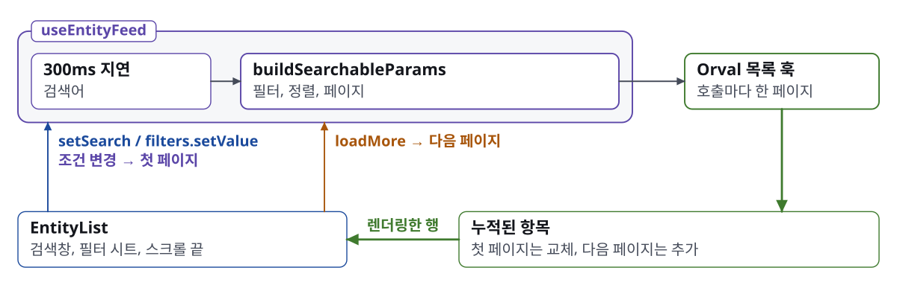

# @simplix-react-native/ui

[English](./README.md) | **한국어**

React Native용 simplix-react 표준 모바일 UI 키트입니다. 테마 토큰, 레이아웃 프리미티브, 컨트롤, 시트 우선 오버레이, 입력 컴포넌트, 페이지 골격, `useEntityFeed` 훅과 함께 쓰는 `EntityList` 목록 문법, `FormFields` / `DetailFields` 네임스페이스를 제공합니다. 컴포넌트는 웹 테마와 같은 토큰 이름을 쓰는 NativeWind 유틸리티로 스타일을 지정하며, 패키지를 가져오면 내장 en/ko/ja 문구를 등록합니다.

## 설치

```bash
pnpm add @simplix-react-native/ui
```

> **사전 요구 사항:** 피어 의존성은 `@simplix-react/headless`, `@simplix-react/i18n`, `nativewind`(>=4), `react`(>=18), `react-native`(>=0.76), `react-native-safe-area-context`(>=5), `@react-native-community/datetimepicker`(>=8), `expo-document-picker`(>=13), `expo-image-picker`(>=16)입니다.

NativeWind 프리셋 뒤에 Tailwind 프리셋을 추가하고, NativeWind가 클래스를 추출할 수 있도록 `content`에 패키지 소스를 넣으세요.

```js
// tailwind.config.js
module.exports = {
  content: [
    "./app/**/*.{ts,tsx}",
    "./node_modules/@simplix-react-native/ui/src/**/*.{ts,tsx}",
  ],
  presets: [
    require("nativewind/preset"),
    require("@simplix-react-native/ui/tailwind-preset"),
  ],
};
```

`simplix add-app --native`는 이와 같은 역할의 설정을 생성합니다. `@simplix-react-native/runtime`의 `SimplixNativeProvider`가 `SimplixThemeProvider`, `ToastHost`, `OverlayPortalHost`를 배치합니다. 루트를 직접 구성하는 앱은 `SimplixThemeProvider`, `ToastHost`, `OverlayPortalHost`를 직접 배치하고, `OverlayPortalHost`를 마지막에 두세요.

## 사용법

목록 화면은 Orval로 생성한 목록 훅을 `useEntityFeed`에 전달하고, 그 결과를 `EntityList`로 표시합니다.

```tsx
import { EntityList, useEntityFeed } from "@simplix-react-native/ui";
import { router } from "expo-router";

import { useSearchVisits, type VisitListDTO } from "../domain";

export default function VisitListScreen() {
  const feed = useEntityFeed<VisitListDTO>(useSearchVisits, {
    searchField: "visitorName",
    sort: { field: "scheduledAt", direction: "desc" },
  });

  return (
    <EntityList
      feed={feed}
      keyExtractor={(visit) => String(visit.id)}
      filters={[
        {
          type: "faceted",
          key: "status.in",
          label: "Status",
          multiple: true,
          options: [
            { value: "SCHEDULED", label: "Scheduled" },
            { value: "DONE", label: "Done" },
          ],
        },
      ]}
      renderItem={(visit) => (
        <EntityList.Row
          title={visit.visitorName}
          subtitle={visit.hostName}
          onPress={() => router.push(`/visits/${visit.id}`)}
        />
      )}
      onCreate={() => router.push("/visits/new")}
    />
  );
}
```

`simplix scaffold <entity> --native`는 목록, 상세, 폼 화면을 이 형태로 생성합니다.

## API 레퍼런스

### 목록 문법



`useEntityFeed<T>(useListHook, options?)`는 `@simplix-react/headless`의 검색 직렬화(`buildSearchableParams`)로 Orval이 생성한 목록 훅을 호출합니다. 웹의 `useCrudList`와 같은 직렬화입니다. 무한 스크롤을 위해 페이지를 누적하고, 검색어는 300ms 지연 후 반영하며, 검색어 · 필터 · 정렬이 바뀌면 첫 페이지로 돌아갑니다.

| 옵션 | 타입 | 기본값 | 설명 |
| --- | --- | --- | --- |
| `pageSize` | `number` | `20` | 한 번에 가져오는 행 수 |
| `defaultFilters` | `Record<string, unknown>` | 없음 | `field.operator` 키로 지정하는 초기 필터 값 |
| `searchField` | `string` | 없음 | 검색어를 `contains` 연산자로 적용할 필드 |
| `sort` | `SortState` | 없음 | 백엔드에 보내는 고정 정렬 |
| `transformFilters` | `(filters) => Record<string, unknown>` | 없음 | 직렬화 전에 필터를 바꿉니다(백엔드별 형식) |

결과(`UseEntityFeedResult<T>`)에는 `items`, `total`, `isLoading`, `isLoadingMore`, `isRefreshing`, `error`, `hasMore`, `loadMore()`, `refresh()`, `search`, `setSearch()`, `filters`(`EntityFeedFilters`: `values`, `setValue`, `setValues`, `clear`, `activeCount`), `emptyReason`이 있습니다.

`EntityList<T>`는 이 상태를 표시합니다. 무한 스크롤 목록의 카드 행, 상단에 고정된 검색창, 적용한 필터를 칩으로 보여 주는 필터 시트, 당겨서 새로 고침, 행 밀기 작업, 떠 있는 생성 버튼, `emptyReason`에 따른 빈 상태 · 오류 상태로 구성합니다.

| prop | 타입 | 기본값 | 설명 |
| --- | --- | --- | --- |
| `feed` | `UseEntityFeedResult<T>` | 필수 | `useEntityFeed`의 상태 |
| `renderItem` | `(item: T, index: number) => ReactNode` | 필수 | 행 렌더러. 표준 카드 행은 `EntityList.Row`로 구성합니다 |
| `keyExtractor` | `(item: T, index: number) => string` | 필수 | 행 키 |
| `filters` | `EntityFilterDef[]` | `[]` | 필터 시트 정의. 비어 있으면 필터 버튼을 숨깁니다 |
| `searchPlaceholder` | `string` | 로케일 문구 | 검색창 자리 표시자 |
| `hideSearch` | `boolean` | `false` | 검색창을 숨깁니다 |
| `itemActions` | `(item: T, index: number) => SwipeAction[]` | 없음 | 행을 왼쪽으로 밀면 나타나는 작업 |
| `onCreate` | `() => void` | 없음 | 떠 있는 생성 버튼을 표시합니다 |
| `createLabel` | `string` | 로케일 문구 | 생성 버튼 레이블 |
| `header` | `ReactNode` | 없음 | 목록 위 콘텐츠(분류 탭, 요약 줄) |
| `showTotal` | `boolean` | `true` | 전체 건수 줄을 표시합니다 |
| `className` | `string` | 없음 | 루트 클래스 이름 |

`EntityRow`(`EntityList.Row`로도 사용)는 `title`, `subtitle`, `meta`, `status`(`{ tone, label }`), `leading`, `trailing`, `onPress`, `className`을 받습니다. `SwipeableRow`는 행을 왼쪽으로 밀면 `SwipeAction` 항목(`{ key, label, tone?, onPress(close) }`)을 표시합니다.

`EntityFilterDef`는 다음 중 하나입니다.

| 타입 | 필드 | 적용 값 |
| --- | --- | --- |
| `FacetedFilterDef` | `type: "faceted"`, `key`, `label`, `options`, `multiple?` | 값 하나, `multiple`이면 배열 |
| `ToggleFilterDef` | `type: "toggle"`, `key`, `label` | 켜면 `true`, 끄면 값 없음 |
| `TextFilterDef` | `type: "text"`, `key`, `label`, `placeholder?` | 입력한 텍스트 |
| `DateRangeFilterDef` | `type: "date-range"`, `fromKey`, `toKey`, `label` | 시작 · 끝 경계 값 두 개 |

### 페이지 골격

| 내보내는 항목 | 설명 |
| --- | --- |
| `Screen` | 페이지 루트. 배경, 하단 안전 영역 여백, 스크롤과 키보드 동작을 담당합니다. props는 `scroll`(기본값 `true`), `padded`(기본값 `true`), `keyboardAvoiding`(기본값 `false`), `className`, `contentClassName`입니다. 제목과 작업 버튼은 expo-router 스택 헤더에 둡니다 |
| `StepFlow`, `StepFlow.Step`, `useStepFlow()` | 한 화면에 한 단계씩 표시하고, 진행 표시줄과 이전 · 다음 하단 버튼을 둡니다. `StepFlow` props는 `onFinish`, `onCancel`, `hideFooter`, `hideProgress`, `finishLabel`, `className`입니다. `StepFlow.Step` props는 `title`, `nextDisabled`입니다. `useStepFlow()`는 `{ index, count, isFirst, isLast, next, back, goTo }`를 반환합니다 |
| `MasterDetail`, `useIsWideLayout(breakpoint?)`, `MASTER_DETAIL_BREAKPOINT` | 태블릿 가로 모드용 두 칸 레이아웃. props는 `master`, `detail`, `placeholder`, `masterWidth`(기본값 `360`), `breakpoint`(기본값 `900`), `className`입니다. 너비가 기준보다 좁으면 목록 칸만 표시하므로, 상세 화면을 별도 라우트로 열기 전에 `useIsWideLayout()`으로 확인하세요 |

### 오버레이

| 내보내는 항목 | 설명 |
| --- | --- |
| `BottomSheet` | 기본 상호작용 화면(선택기, 필터, 메뉴). props는 `open`, `onClose`, `title`, `maxHeightFraction`(기본값 `0.85`), `children`, `className`입니다 |
| `Dialog`, `DialogClose` | 간단한 확인이나 입력 하나를 받는 가운데 모달. props는 `open`, `onOpenChange`, `title`, `description`, `footer`, `children`, `className`입니다 |
| `AlertDialog` | 파괴적이거나 되돌릴 수 없는 작업의 확인 대화상자. props는 `open`, `onOpenChange`, `title`, `description`, `confirmLabel`, `cancelLabel`, `destructive`, `onConfirm`, `className`입니다 |
| `Popover` | 태블릿에서 간단한 내용을 표시하는 고정 위치 팝오버. 휴대폰 흐름에서는 `BottomSheet`를 사용합니다. props는 `trigger`, `children`, `className`입니다 |
| `OverlayPortalHost` | `Dialog`, `AlertDialog`, `Popover`가 쓰는 포털 호스트(`@rn-primitives/portal`의 `PortalHost`) |

### 입력

`Input`, `usePlaceholderColor`, `Textarea`, `NumberInput`, `Checkbox`, `RadioGroup`(`RadioOption`), `Switch`, `SelectSheet`, `SelectTrigger`, `OptionRows`(`SelectOption`), `ComboboxSheet`, `NativeDateTimePicker`(`DateTimePickerMode`), `Tabs`(`TabItem`), `ActionSheetMenu`(`ActionSheetItem`)를 제공합니다. `SelectSheet`, `ComboboxSheet`, `ActionSheetMenu`는 드롭다운 대신 `BottomSheet`를 엽니다.

### 필드

`FormFields`와 `DetailFields`는 웹 키트와 같은 방식으로 사용하는 네임스페이스입니다.

- `FormFields`: `FieldWrapper`, `TextField`, `TextareaField`, `NumberField`, `OtpField`, `PasswordField`, `PhoneField`, `CountryField`, `SelectField`, `MultiSelectField`, `ComboboxField`, `CheckboxField`, `SwitchField`, `DateField`, `DateRangeField`, `DateTimeField`, `TimeField`, `ImageField`(`PickedImage`), `FileField`(`PickedFile`)와 국가 도우미 `COUNTRIES`, `countryDisplayName`, `countryFlagEmoji`, `countryFromDeviceZone`, `countryFromTimezone`(`CountryEntry`). 모든 필드는 `CommonFieldProps`(`label`, `labelKey`, `error`, `warning`, `description`, `required`, `disabled`, `className`)를 받습니다. 레이블은 항상 입력란 위에 표시합니다.
- `DetailFields`: `DetailField`, `TextField`, `StatusField`, `BadgeField`, `BooleanField`, `DateField`, `NumberField`, `PhoneField`, `NoteField`, `ListField`, `LinkField`. 모든 필드는 `CommonDetailFieldProps`(`label`, `labelKey`, `className`)를 받고, 값이 비어 있으면 `EmptyValue`를 표시합니다.

```tsx
import { DetailFields, FormFields } from "@simplix-react-native/ui";

<FormFields.TextField label="Name" value={name} onChange={setName} required />
<DetailFields.TextField label="Name" value={visit.visitorName} />
```

### 컨트롤

`Button`(`buttonVariants`, `buttonTextVariants`. 변형 `default`, `secondary`, `outline`, `ghost`, `destructive`. 크기 `sm`, `default`, `lg`, `icon`, 키오스크용 큰 터치 영역인 `touch`), `Label`, `Badge`(`badgeVariants`, `badgeTextVariants`), `StatusBadge`, `StatusDot`, `BooleanBadge`, `EmptyValue`, `Separator`, `Skeleton`, `AlertBanner`, `ToastHost`, 상태 색조 표 `STATUS_TONES`(`StatusTone`, `StatusToneToken`)를 제공합니다. `ToastHost`는 `@simplix-react/headless`의 공용 토스트 저장소(`addToast`)를 화면 아래쪽 카드로 표시하며, 카드를 누르면 닫습니다.

### 레이아웃 프리미티브

`Card`, `Container`, `Flex`, `Grid`, `Heading`, `Section`, `Stack`, `Text`와 `cardVariants`, `headingVariants`, `stackVariants`, `textVariants`, 각각의 props 타입을 제공합니다.

### 테마

`SimplixThemeProvider`는 색상 토큰을 CSS 변수(NativeWind `vars()`)로 주입합니다. 그래서 `bg-background`, `text-foreground` 같은 유틸리티가 현재 프리셋과 색상 모드에 맞는 값을 사용합니다.

| prop | 타입 | 기본값 | 설명 |
| --- | --- | --- | --- |
| `preset` | `ThemePresetName` | `"default"` | `"default"`, `"blue"`, `"green"`, `"krds"`, `"orange"`, `"rose"`, `"violet"` 중 하나 |
| `overrides` | `ThemeTokenOverrides` | 없음 | 프리셋 위에 덮어쓰는 `{ light?, dark? }` 토큰 맵 |
| `fonts` | `ThemeFonts` | 없음 | 앱이 등록한 글꼴 `{ sans?, display?, mono? }`. `Text`와 `Heading`에 적용합니다 |

`useSimplixTheme()`은 `{ preset, setPreset, colorScheme, setColorScheme, fonts, tokens }`를 반환하며, `setColorScheme`은 `"light"`, `"dark"`, `"system"`을 받습니다. `useThemeFonts()`는 글꼴을 반환합니다(프로바이더 밖에서는 빈 객체). `BASE_TOKENS`, `PRESET_TOKENS`, `resolveThemeTokens(preset, scheme)`로 토큰 시트(`ThemeTokenSheet`, `ColorTokenMap`)를 조회할 수 있습니다.

### 유틸리티

`cn(...inputs)`는 Tailwind 규칙에 따라 충돌을 정리하며 클래스 이름을 합칩니다. `toTestId(label)`는 레이블을 kebab-case `testID` 조각으로 바꿉니다.

### 타입

모든 컴포넌트와 훅은 자기 이름에 `Props`나 `Options`를 붙인 props · 옵션 타입을 함께 내보냅니다(예: `EntityListProps`, `EntityRowProps`, `SwipeableRowProps`, `UseEntityFeedOptions`, `ScreenProps`, `StepFlowProps`, `StepProps`, `MasterDetailProps`, `ButtonProps`, `DialogProps`, `TextFieldProps`, `DetailFieldProps`). 컨텍스트 값 타입은 `StepFlowContextValue`, `SimplixThemeContextValue`이고, 변형 · 크기 타입은 `ButtonVariants`, `BadgeVariants`, `CardVariants`, `HeadingVariants`, `StackVariants`, `TextVariants`, `ContainerSize`, `GridColumns`, `GridGap`입니다. `FormFields.TextField`와 `DetailFields.TextField`는 각각 자기 `TextFieldProps`를 내보내며, 두 네임스페이스에 함께 있는 다른 이름도 마찬가지입니다.

## 플랫폼 참고 사항

- 이 패키지는 TypeScript 소스를 배포합니다. Metro가 소스를 변환하므로 빌드 단계가 없습니다.
- 이 패키지를 가져오면 en/ko/ja 문구를 `simplix/native` 네임스페이스에 등록합니다.
- `SwipeableRow`는 `PanResponder`와 `Animated`로 구현했으므로 제스처 처리 패키지가 필요 없습니다.
