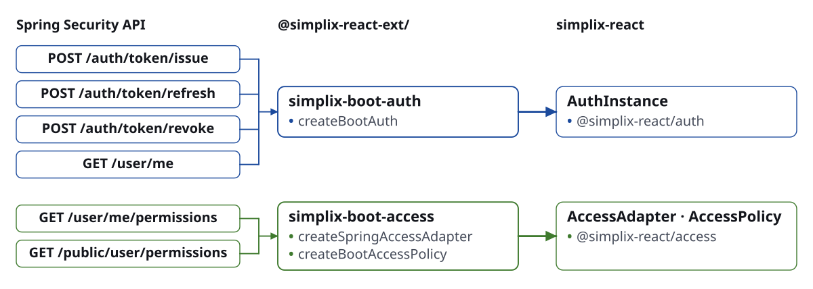

# simplix-boot

**English** | [한국어](README.ko.md)

Extension for SimpliX, a Spring Boot-based backend framework by SimpleCORE Inc. Provides adapter packages that implement simplix-react core interfaces for SimpliX's Spring Security APIs.

> **What is an Extension?** Core packages (`packages/`) define environment-agnostic abstract interfaces. Extensions (`extensions/`) provide concrete implementations for specific backend platforms, keeping consumer code portable. See [extensions/README.md](../README.md) for details.

## Packages

| Package | Description |
| --- | --- |
| [@simplix-react-ext/simplix-boot-access](./packages/access/) | Spring Security authorization for `@simplix-react/access` (permissions adapter, Boot access policy, self access policy) |
| [@simplix-react-ext/simplix-boot-auth](./packages/auth/) | Spring Security authentication contract (token, user profile, permissions) |
| [@simplix-react-ext/simplix-boot-cli-plugin](./packages/cli-plugin/) | CLI spec profile: Boot naming strategy, response adapter (envelope), schema adapter, i18n downloader |
| [@simplix-react-ext/simplix-boot-stream](./packages/stream/) | SimpliX Boot SSE streaming (EventSource management, subscriptions, staleness detection) |
| [@simplix-react-ext/simplix-boot-utils](./packages/utils/) | Boot-specific utilities (`resolveBootEnum`, `toLabeledEnum`, `transformSearchableFilters`, `bootBody`, `bootPage`, `updateBody`) |

## How It Works

SimpliX backends expose Spring Security-based token and permission endpoints with their own response formats. This extension translates those formats into the abstract interfaces defined by `@simplix-react/auth` and `@simplix-react/access`, keeping your React application portable.



## Quick Start

### Authentication

```ts
import { createBootAuth } from "@simplix-react-ext/simplix-boot-auth";

// High-level factory: Bearer auth with automatic refresh, cross-tab sync,
// and Boot envelope handling. Default basePath: "/api/v1".
const { auth, authClient, getToken } = createBootAuth({
  basePath: "/api/v1",
  storePrefix: "myapp:",
});
```

For mock setup:

```ts
import { createAuthMock } from "@simplix-react-ext/simplix-boot-auth/mock";

// Default basePath: "/api/v1"
const authMock = createAuthMock({
  users: {
    admin: {
      user: { userId: "1", username: "admin", displayName: "Admin", email: "admin@example.com", roles: [], isSuperAdmin: true },
      permissions: { permissions: {}, roles: [], isSuperAdmin: true },
      password: "admin",
    },
  },
});
```

### Authorization

```ts
import { createAccessPolicy } from "@simplix-react/access";
import { createSpringAccessAdapter } from "@simplix-react-ext/simplix-boot-access";

const adapter = createSpringAccessAdapter({
  permissionsEndpoint: "/api/v1/user/me/permissions",
  fetchFn: bootMutator,
});

const accessPolicy = createAccessPolicy({ adapter });
```

### Full Integration

A production pattern that wires Auth and Access together. `createBootAccessPolicy()` builds the Spring adapter, unwraps the Boot envelope when the fetch function returns one, and uses the same adapter for public (signed-out) access. By passing `auth.fetchFn` to it, auth tokens are automatically included in permission requests.

```ts
// shared/config/access.ts
import { createBootAccessPolicy } from "@simplix-react-ext/simplix-boot-access";
import { auth } from "./auth";

export const accessPolicy = createBootAccessPolicy({
  fetchFn: auth.fetchFn,
  isSuperAdmin: (user) => user.isSuperAdmin === true,
  persist: { key: "myapp-access" },
});
```

## Expected SimpliX Endpoints

### Authentication Endpoints

| Method | Default Path | Description |
| --- | --- | --- |
| POST | `/api/v1/auth/token/issue` | Issue access/refresh tokens (Basic Auth) |
| POST | `/api/v1/auth/token/refresh` | Refresh access token |
| POST | `/api/v1/auth/token/revoke` | Revoke current token |
| GET | `/api/v1/user/me` | Get current user profile |

### Permission Endpoints

| Method | Default Path | Description |
| --- | --- | --- |
| GET | `/api/v1/user/me/permissions` | Authenticated user permissions |
| GET | `/api/v1/public/user/permissions` | Public (unauthenticated) permissions |

All endpoint paths are configurable via options.

## Development

```bash
# Build
pnpm --filter "@simplix-react-ext/simplix-boot-*" build

# Test
pnpm --filter "@simplix-react-ext/simplix-boot-*" test

# Typecheck
pnpm --filter "@simplix-react-ext/simplix-boot-*" typecheck
```

## Error Handling

The access adapter requires a `fetchFn` and throws when none is given. It has no retry or error transformation of its own: errors thrown by `fetchFn` propagate directly to the caller. The auth package converts Boot error responses into `ApiResponseError` (see [its Error Handling section](./packages/auth/README.md#error-handling)).

- **Network errors / other HTTP errors:** Handle errors thrown by `fetchFn` with `try/catch` at the call site.
- **Custom error handling:** Pass a custom fetch function with error interceptors via the `fetchFn` option.

## Prerequisites

> Each package declares its own peer dependencies: `simplix-boot-auth` needs `@simplix-react/api`, `@simplix-react/auth`, `@simplix-react/contract`, `@simplix-react/i18n` and `zod`; `simplix-boot-access` needs `@simplix-react/access`, `@simplix-react/api` and `react`; `simplix-boot-cli-plugin` needs `@simplix-react/cli`; `simplix-boot-stream` needs `react`; `simplix-boot-utils` needs `@simplix-react/api`.
