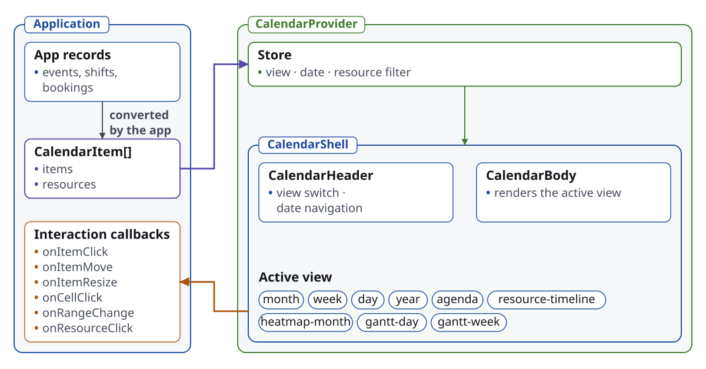

# @simplix-react/calendar

**English** | [한국어](README.ko.md)

Domain-agnostic calendar components: month, week, day, year, agenda, resource timeline, heatmap and gantt views, with pluggable rendering and interaction callbacks.

## Overview

`@simplix-react/calendar` draws items that the application hands it as `CalendarItem` objects. It does not fetch data and knows nothing about the domain: the application converts its records into items, and the calendar reports item, cell and resource clicks, moves, resizes and range changes back through callbacks. View, selected date, resource filter and display preferences live in a per-provider store, so several calendars on one page stay independent.



## Installation

```bash
pnpm add @simplix-react/calendar @simplix-react/ui @simplix-react/i18n
```

`react` (18 or later), `@simplix-react/ui` and `@simplix-react/i18n` are peer dependencies.

## Usage

Wrap the calendar in `CalendarProvider` and render `CalendarShell`, which draws the header (navigation, today button, resource select, view switcher) above the active view.

```tsx
import { CalendarProvider, CalendarShell, type CalendarItem } from "@simplix-react/calendar";

interface Meeting {
  id: string;
  subject: string;
  startsAt: string;
  endsAt: string;
}

function toItem(meeting: Meeting): CalendarItem<Meeting> {
  return {
    id: meeting.id,
    title: meeting.subject,
    start: new Date(meeting.startsAt),
    end: new Date(meeting.endsAt),
    color: "blue",
    payload: meeting,
  };
}

export function MeetingCalendar({ meetings }: { meetings: Meeting[] }) {
  return (
    <CalendarProvider
      items={meetings.map(toItem)}
      defaultView="week"
      onItemClick={(item) => console.log(item.payload)}
      onRangeChange={({ start, end, view }) => console.log(view, start, end)}
    >
      <CalendarShell views={["day", "week", "month", "agenda"]} />
    </CalendarProvider>
  );
}
```

`CalendarItem.start` and `end` are `Date` values whose local fields are the displayed wall-clock time. `payload` carries the original record back to every callback.

### Composing your own layout

`CalendarShell` is `CalendarHeader` plus `CalendarBody`, with an optional `sidePanel` column (`sidePanelClassName` defaults to `w-72`). Use the parts directly for a different layout:

```tsx
import { CalendarBody, CalendarHeader, CalendarProvider } from "@simplix-react/calendar";

<CalendarProvider items={items} resources={resources} defaultView="resource-timeline" dndEnabled onItemMove={moveItem}>
  <CalendarHeader views={["resource-timeline", "gantt-day"]} trailing={<AddButton />} />
  <CalendarBody />
</CalendarProvider>
```

### Controlling the calendar from outside

`CalendarApiBridge` hands a `CalendarApi` (`setView`, `setDate`, `goTo`) to a ref while it is mounted inside the provider, and resets the ref to `null` on unmount.

```tsx
import { useRef } from "react";
import { CalendarApiBridge, type CalendarApi } from "@simplix-react/calendar";

const apiRef = useRef<CalendarApi | null>(null);

<CalendarProvider items={items}>
  <CalendarApiBridge apiRef={apiRef} />
  <CalendarShell />
</CalendarProvider>

// Elsewhere, outside the provider:
apiRef.current?.goTo(new Date(2026, 6, 15), "day");
```

## API Reference

### Provider and hooks

| Export | Description |
| --- | --- |
| `CalendarProvider` | Creates the store and holds items, resources, callbacks and plugins |
| `useCalendarData` | Items, resources, callbacks and plugins from the nearest provider |
| `useCalendarView` | `{ currentView, setCurrentView }` |
| `useCalendarDate` | `{ selectedDate, setSelectedDate }` |
| `useCalendarPreferences` | `badgeVariant`, `workingHours`, `visibleHours` and their setters |
| `useCalendarResourceFilter` | `{ selectedResourceId, setSelectedResourceId, resources }` |
| `useCalendarSelector` | Reads a slice of `CalendarStoreState` |
| `useCalendarStoreApi` | The provider's `CalendarStore` |
| `CalendarApiBridge` | Exposes `CalendarApi` through `apiRef` |

### `CalendarProvider` props

| Prop | Type | Description |
| --- | --- | --- |
| `items` | `CalendarItem[]` | Items to render (required) |
| `resources` | `CalendarResource[]` | Directory that resolves `item.resourceId` |
| `dndEnabled` | `boolean` | Enables drag-and-drop of items across cells and time slots (default `false`) |
| `defaultView` | `CalendarView` | Initial view (default `"month"`) |
| `defaultDate` | `Date` | Initial selected date (default today) |
| `defaultResourceId` | `string \| "all"` | Initial resource filter |
| `agendaScope` | `"month" \| "year"` | Span of the agenda view (default `"month"`) |
| `badgeVariant` | `"dot" \| "colored" \| "mixed"` | How items are drawn as badges |
| `workingHours` | `WorkingHours` | Working-hour window per weekday (default `DEFAULT_WORKING_HOURS`) |
| `visibleHours` | `VisibleHours` | Hours shown in the time grids (default `DEFAULT_VISIBLE_HOURS`, 7 to 18) |
| `hourHeight` | `number \| "fit"` | Pixels per hour in the time grids (default 96); `"fit"` fills the body height |

Callbacks (`CalendarCallbacks`), all optional:

| Callback | Called when |
| --- | --- |
| `onItemClick(item)` | An item is activated by click or keyboard |
| `onCellClick(date)` | An empty cell or time slot is activated |
| `onItemMove(item, start, end)` | An item is dropped at a new place (needs `dndEnabled`) |
| `onItemResize(item, start, end)` | A `resizable` item's edge is dragged in the week or day grid |
| `onRangeChange({ start, end, view })` | View or date navigation changes the visible range |
| `onResourceClick(resource, date?)` | A resource label is activated in the timeline or gantt view |

Plugins (`CalendarPlugins`), all optional:

| Plugin | Description |
| --- | --- |
| `timeBands` | `TimeBand[]` drawn as background bands on the resource timeline |
| `heatmap`, `heatmapMax` | `HeatmapCell[]` buckets for the heatmap month view, and the scale maximum |
| `dayHighlights` | `DayHighlight[]` per-day emphasis (holidays) across month, day, week and timeline |
| `renderDayBadge` | Extra summary badges in a heatmap day cell |
| `renderDayContent` | Replaces the item badges of a month-view day cell |
| `renderYearDayContent` | Replaces the indicator dots of a year-view day cell |
| `renderWeekDayHeader` | Summary block under a week-view day header |
| `renderItemOverlay` | Action overlay on a time-grid item |
| `renderGanttRowExtra` | Metadata after the resource name on a gantt row |
| `timelineEmptyState` | Replaces the empty state of the gantt and resource-timeline views |
| `showItemCountBadge` | Shows the item count next to the header title (default `true`) |

### Components

| Component | Description |
| --- | --- |
| `CalendarShell` | Header and active view, with an optional side panel (`views`, `trailing`, `sidePanel`, `sidePanelClassName`) |
| `CalendarHeader` | Navigation and view switcher; `views` restricts and orders the switcher (one entry hides it), `trailing` adds actions |
| `CalendarBody` | Renders the active view for the visible range and selected resource |
| `CalendarMonthView`, `CalendarWeekView`, `CalendarDayView`, `CalendarYearView`, `CalendarAgendaView` | Individual views, for a shell of your own |
| `ResourceTimelineView`, `HeatmapMonthView` | Data-driven views |
| `CalendarColorLegend` | Legend of `CalendarLegendItem` (`{ color, label }`) entries |
| `ResourceAvatar` | Avatar image with fallback image and initials |
| `DayHighlightBadge` | Badge of a day highlight (`color`, `label`) |

The `CalendarView` values are `"day"`, `"week"`, `"month"`, `"year"`, `"agenda"`, `"resource-timeline"`, `"heatmap-month"`, `"gantt-day"` and `"gantt-week"`. Without `views`, the header offers the base views; the data-driven views appear only when listed.

### Store

`createCalendarStore(options)` creates the zustand store a provider uses, from `CreateCalendarStoreOptions`. `DEFAULT_WORKING_HOURS` and `DEFAULT_VISIBLE_HOURS` are its defaults. Types: `CalendarStore`, `CalendarStoreState`, `AgendaScope`.

### Model types

`CalendarItem`, `CalendarResource`, `CalendarView`, `CalendarColor` (`blue`, `green`, `red`, `yellow`, `purple`, `orange`, `gray`, `teal`), `EventPattern` (`solid`, `hatched`, `translucent`), `BadgeVariant`, `WorkingHours`, `VisibleHours`, `TimeBand`, `HeatmapCell`, `DayHighlight`, `CalendarCell`.

### Helpers

| Function | Description |
| --- | --- |
| `getViewDateRange(view, date, locale?)` | `{ start, end }` of a view around a date |
| `navigateDate(date, view, direction)` | The date one step `"previous"` or `"next"` in a view |
| `toDateString(date)` | A `Date` as `"yyyy-MM-dd"` |
| `datePart(value)` | The `"yyyy-MM-dd"` part of a date-time string |
| `patternClass(pattern?)` | Class names of an `EventPattern` |
| `dotBgClass(color)`, `timelineBarClass(color)` | Class names of a `CalendarColor` |

## Styling

The components are styled with Tailwind CSS utilities and `@simplix-react/ui` design tokens. Import the package stylesheet after the UI stylesheet and theme; it registers the package's compiled output (and its `src`, for a linked checkout) as a Tailwind content source, so no `node_modules` path is needed:

```css
@import "tailwindcss";
@import "@simplix-react/ui/styles.css";
@import "@simplix-react/ui/theme.css";
@import "@simplix-react/calendar/styles.css";
```

## Localization

Importing the package registers its translations with `@simplix-react/i18n` for the `en`, `ko` and `ja` locales. Components read the `simplix-calendar/calendar` namespace, exported as `PACKAGE_NAMESPACE`; date formats follow the active locale.

## License

MIT
