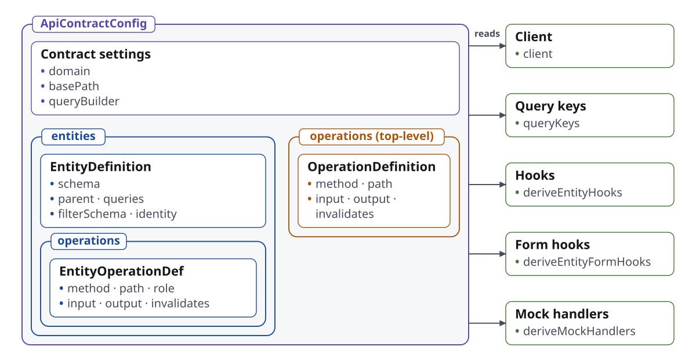

# API Contracts

**English** | [한국어](/ko/core-concepts/api-contracts.md)

## Overview

An API contract in simplix-react is a declarative description of every entity and operation your frontend needs to communicate with. Rather than scattering type definitions, endpoint URLs, and validation logic across your codebase, you declare them once in a single `defineApi()` call. The contract then becomes the single source of truth from which the framework derives HTTP clients, React Query hooks, form hooks, mock handlers, and query key factories, all fully typed.

The core insight behind contracts is that most of the code in a typical API integration layer is boilerplate that can be mechanically derived from a small set of declarations. If you know an entity's schema and the method, path, and input schema of each of its operations, you have enough information to derive everything else. simplix-react formalizes this observation into a framework.

Contracts exist at the boundary between your frontend and your API. They serve both as documentation (what does this API look like?) and as executable specifications (the framework enforces the declared shapes at every layer). This dual role eliminates the drift that normally occurs when types, endpoint URLs, and validation rules are maintained separately.

## How It Works

A contract is built from **EntityDefinition**, which groups the operations of one entity, and **OperationDefinition**, a top-level operation that belongs to no entity.



### EntityDefinition

An `EntityDefinition` describes one entity and the operations available on it. It contains:

- **schema**: a Zod schema defining the entity's response shape
- **operations**: a map of operation names to `EntityOperationDef` objects, each with an HTTP `method` and a `path` (`:paramName` placeholders allowed), and optionally `role`, `input`, `output`, `invalidates`, `contentType`, `responseType`, `transformRequest`, and `transformResponse`
- **parent** (optional): describes the parent entity for nested URL construction
- **queries** (optional): named query scopes for filtering by parent relationships
- **filterSchema** (optional): a Zod schema for validating list filter parameters
- **identity** (optional): the identity field names used for cache keys, `["id"]` by default

```ts
import { z } from "zod";
import { CRUD_OPERATIONS } from "@simplix-react/contract";

const taskSchema = z.object({ id: z.string(), title: z.string(), status: z.string() });

const taskEntity = {
  schema: taskSchema,
  parent: { param: "projectId", path: "/projects" },
  operations: {
    list: { ...CRUD_OPERATIONS.list, path: "/tasks" },
    get: { ...CRUD_OPERATIONS.get, path: "/tasks/:id" },
    create: { ...CRUD_OPERATIONS.create, path: "/tasks", input: taskSchema.omit({ id: true }) },
    update: { ...CRUD_OPERATIONS.update, path: "/tasks/:id", input: taskSchema.partial().omit({ id: true }) },
    delete: { ...CRUD_OPERATIONS.delete, path: "/tasks/:id" },
    archive: { method: "POST" as const, path: "/tasks/:id/archive" },
  },
};
```

`CRUD_OPERATIONS` holds the default method of each standard operation (`GET` for `list` and `get`, `POST` for `create`, `PATCH` for `update`, `DELETE` for `delete`); writing `method` by hand works the same.

### Operation Roles

The role of an operation decides what the framework derives for it. An operation named `list`, `get`, `create`, `update`, `delete`, or `tree` takes that name as its role. An operation with another name takes a role only when it sets `role`; otherwise it is a custom operation, like `archive` above. `resolveRole()` exposes this rule.

From the definition above, the framework derives one client function per operation (`list`, `get`, `create`, `update`, `delete`, `archive`), one React Query hook per operation named `use` + the operation name (`useList`, `useGet`, `useCreate`, `useUpdate`, `useDelete`, `useArchive`) plus `useInfiniteList` for the list role, one MSW handler per operation, and a structured query key factory. A custom `GET` operation becomes a query hook and a custom operation with any other method becomes a mutation hook.

### OperationDefinition

An `OperationDefinition` covers endpoints that belong to no entity, such as file uploads, batch operations, and RPC-style calls:

```ts
const assignTask = {
  method: "POST" as const,
  path: "/tasks/:taskId/assign",
  input: z.object({ userId: z.string() }),
  output: z.object({ id: z.string(), assigneeId: z.string() }),
  invalidates: (queryKeys) => [queryKeys.task.all],
};
```

Operations support path parameters (`:paramName` syntax), content type control (`json` or `multipart`), response type control (`json` or `blob`), request and response transforms (`transformRequest`, `transformResponse`), and declarative cache invalidation via the `invalidates` function, which receives the query key factories and the path parameters.

### Assembling the Contract

The `defineApi()` function takes an `ApiContractConfig` and an optional `{ fetchFn }`, and returns a fully-typed contract object:

```ts
import { defineApi, simpleQueryBuilder } from "@simplix-react/contract";

const projectApi = defineApi({
  domain: "project",
  basePath: "/api/v1",
  entities: { task: taskEntity },
  operations: { assignTask },
  queryBuilder: simpleQueryBuilder,
});
```

The returned object contains three properties:

| Property | Description |
| --- | --- |
| `config` | The original configuration, passed through for downstream consumers |
| `client` | A type-safe HTTP client with methods for each entity and operation |
| `queryKeys` | Query key factories for TanStack Query cache management |

### Customizing a Contract

`customizeApi(base, patch, options?)` returns a new contract in which the operations of an entity are added, replaced, or removed (`null` removes one). The base contract is not changed, and `client` and `queryKeys` are derived again from the patched configuration. Use it to adjust a contract generated from an OpenAPI spec without editing the generated file:

```ts
import { customizeApi } from "@simplix-react/contract";

export const api = customizeApi(projectApi, {
  entities: {
    task: {
      operations: {
        list: { method: "GET", path: "/tasks/search", role: "list" },
        archive: null,
      },
    },
  },
});
```

## Design Decisions

### Why Zod Schemas?

Zod was chosen as the schema language because it provides runtime validation and static type inference from a single declaration. With Zod, `z.infer<typeof schema>` produces the TypeScript type automatically, eliminating the need to maintain separate type definitions alongside validation logic. This is critical for the "define once, derive everything" philosophy: the Zod schema is the sole definition from which all types flow.

Alternative schema libraries (Yup, io-ts, ArkType) were considered but lack Zod's combination of ergonomic API, broad ecosystem adoption, and seamless TypeScript inference.

### Why Domain-Scoped Contracts?

Each contract is scoped to a `domain` (e.g. `"project"`, `"billing"`, `"auth"`). This scoping decision has several consequences:

- **Query key isolation**: all query keys start with `[domain, ...]`, preventing cache collisions between unrelated data
- **Organizational clarity**: each domain maps to a logical API boundary
- **Independent derivation**: contracts are composed at the application level, not at the framework level

### Why EntityDefinition and OperationDefinition Are Separate

An entity groups every operation that acts on one kind of data, its custom operations included, so the framework can derive the standard CRUD layers from the roles and attach the custom operations to the same entity. A top-level operation is an action that belongs to no entity; keeping it outside the entities gives a flexible escape hatch for everything else.

### Why Contracts Hold Declarations, Not Behaviour

The `ApiContractConfig` is a data structure of schemas, methods, and paths. It performs no requests, holds no state, and has no runtime dependencies. This means contracts can be shared between packages (`@simplix-react/react`, `@simplix-react/form`, `@simplix-react/mock`) without creating circular dependencies, and they can be inspected or transformed by tooling.

The functions an operation may carry are pure mappings: `invalidates` maps query keys to invalidation targets, and `transformRequest` and `transformResponse` map a payload to another shape.

## Implications

### For Application Developers

- You define your API surface once, in one place
- Type safety flows automatically from Zod schemas to every derived layer
- Adding a new entity means adding one `EntityDefinition`: the client, hooks, mock handlers, and query keys are derived from it
- Schema changes propagate instantly as TypeScript errors across the entire codebase

### For the Framework

- Contracts are the input to every derivation function (`deriveClient`, `deriveQueryKeys`, `deriveEntityHooks`, `deriveEntityFormHooks`, `deriveMockHandlers`)
- The framework never needs to guess types or infer structure: the contract declares everything explicitly
- New derivation targets can be added without modifying existing contracts

---

<p class="page-source"><a href="https://github.com/simplix-framework/simplix-react/blob/main/docs/en/core-concepts/api-contracts.md" target="_blank" rel="noopener noreferrer">Edit on GitHub</a></p>
