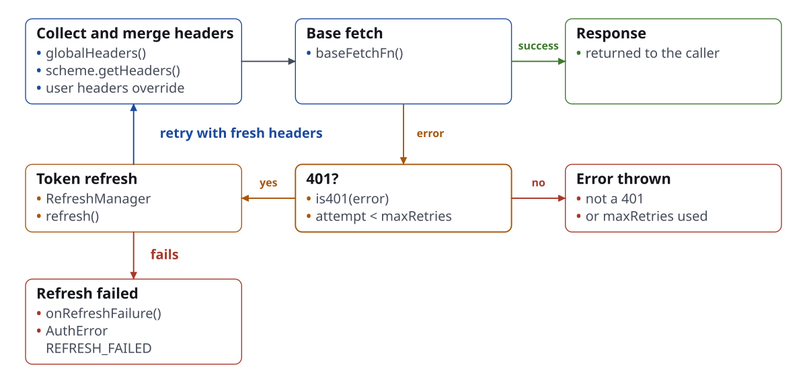
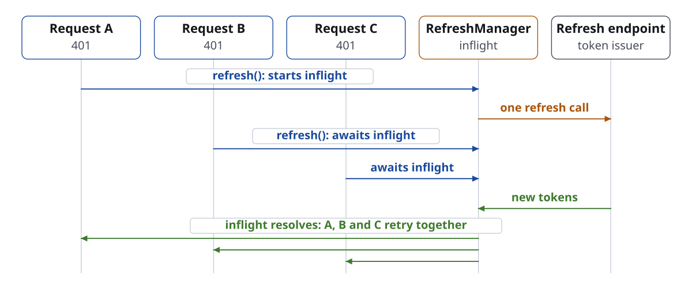

# Authentication

**English** | [한국어](/ko/core-concepts/authentication.md)

## Overview

Authentication in simplix-react is handled by `@simplix-react/auth`, a middleware package that sits between your API contracts and the HTTP layer. Rather than requiring you to manually inject tokens into every request, the auth package provides a strategy-based system where you declare your authentication schemes once and receive an authenticated `fetchFn` that plugs directly into `defineApi`.

The core insight is that authentication is orthogonal to your API contract. Your entity definitions and operations should not know or care about how requests are authenticated. By separating auth into its own layer, the same contract can be used with different auth strategies in different environments: Bearer tokens in production, API keys in staging, no auth in tests.

## How It Works

The auth package follows the Strategy pattern. Each authentication method is encapsulated in an `AuthScheme`, an object that knows how to produce HTTP headers, refresh credentials, and report its authentication state.

| Factory | What it produces |
| --- | --- |
| `bearerScheme()` | `Authorization: Bearer <token>`, with an optional refresh |
| `apiKeyScheme()` | An API key in a header or in a query parameter |
| `oauth2Scheme()` | Bearer headers with the OAuth2 `refresh_token` grant |
| `customScheme()` | User-defined headers and refresh |

An `AuthScheme` has a `name`, `getHeaders()`, `isAuthenticated()`, and `clear()`, and optionally `refresh()` and `tokensChanged()`.

Multiple schemes can be composed, either by listing them in `schemes` or with `composeSchemes(...schemes)`. Their headers are merged in order, so a later scheme wins on the same header name. On refresh, `createAuthFetch` tries each scheme that has `refresh()` in order until one succeeds, while `composeSchemes` calls only the first scheme that has `refresh()`.

### The Fetch Wrapper

The `createAuthFetch(config, baseFetchFn?)` function wraps a base `FetchFn` (`defaultFetch` by default) with authentication logic. `createAuth(config)` calls it and returns an `AuthInstance` whose `fetchFn` you pass to `defineApi`:



On every request, the wrapper:

1. Collects headers from `globalHeaders()` when it is set, then from all configured schemes
2. Merges auth headers **before** user-supplied headers (so you can override for impersonation)
3. Calls the base fetch function
4. On a 401 response (detected by `is401`, which checks `error.status === 401` by default), triggers token refresh through the `RefreshManager`
5. Retries the original request with fresh credentials, up to `maxRetries` times (`1` by default)
6. On refresh failure, calls `onRefreshFailure` and throws an `AuthError` with the code `REFRESH_FAILED`

### Single-Flight Refresh Deduplication

When multiple requests fail with 401 simultaneously, the `RefreshManager` ensures only one refresh operation executes. Subsequent callers await the same in-flight promise. This prevents the thundering herd problem where dozens of concurrent refresh requests overwhelm the auth server.



### Token Storage

Tokens are stored in a `TokenStore`, an abstraction over key-value storage. The package provides three implementations:

| Store | Persistence | Use case |
| --- | --- | --- |
| `memoryStore()` | None (process lifetime) | Testing, SSR |
| `localStorageStore(prefix?)` | Across sessions | Most web apps |
| `sessionStorageStore(prefix?)` | Current tab only | Sensitive apps |

The web storage stores use a configurable key prefix (default: `"auth:"`) to avoid collisions with other data in the same storage backend. `createRememberMe(namespace)` keeps a stay-signed-in preference and gives the token store that matches it.

### Session Helpers

The package also exports helpers that keep a session alive or move it between tabs:

| Export | Role |
| --- | --- |
| `AutoRefreshScheduler` | Refreshes the access token on a timer before it expires |
| `createActivityTracker()` | Records the user's last interaction, for a refresh that depends on activity |
| `createCrossTabSync()` | Follows sign-out and token refresh in other tabs through the `storage` event |
| `openOAuth2Popup()` | Runs an OAuth2 authorization flow in a popup window |
| `createOidcClient()` | A public OpenID Connect client with the authorization code flow and PKCE |

## Design Decisions

### Why Strategy Pattern?

The strategy pattern was chosen for consistency with simplix-react's derivation model. Just as contracts derive clients and hooks, auth configs derive authenticated fetch functions. Strategies are composable: you can combine Bearer + API Key without changing the contract layer.

Alternatives considered:

- **Middleware chain** (Express-style): More flexible but harder to type and compose for client-side use
- **Decorator pattern**: Similar outcome but less explicit about composition order
- **Monolithic auth class**: Would not support mixing auth methods or swapping strategies per environment

### Why Async Headers?

`AuthScheme.getHeaders()` is async even though most implementations return synchronous values. This is intentional: token refresh, JWE decryption, and other credential operations are inherently asynchronous. Making the interface async from the start avoids breaking changes when async operations are needed.

### Why Auth Headers Before User Headers?

When merging headers, auth headers are applied first and user-supplied headers (from `RequestInit.headers`) override them:

```ts
{
  ...authHeaders,      // auth provides defaults
  ...options?.headers, // user can override
}
```

This ordering enables advanced patterns like request-level impersonation (`Authorization: Bearer <admin-token>`) without modifying the auth configuration.

### Why React Is Optional?

The core auth package (`@simplix-react/auth`) works without React. The `AuthInstance` returned by `createAuth` is a plain object with a `subscribe` method, usable with any framework or no framework at all. React bindings are provided as a separate entry point (`@simplix-react/auth/react`): `AuthProvider` puts the core instance in context and subscribes to it with `useSyncExternalStore`, and `useAuth`, `useAuthContext`, and `useAuthFetch` read it from there.

This separation means:

- Server-side code can use `createAuthFetch` directly
- Non-React frameworks (Vue, Svelte) can consume the core auth instance
- React apps get ergonomic hooks without sacrificing portability

### Why No Built-in Cookie Auth?

Cookie-based authentication (session cookies, CSRF tokens) is intentionally omitted because it typically requires server-side coordination (HttpOnly flags, SameSite policy, CSRF token endpoints) that varies significantly between backends. The `customScheme` function provides a clean escape hatch for cookie-based flows.

## Implications

### For Application Developers

- Authentication is configured once and injected into `defineApi` via `fetchFn`
- Token refresh, retry, and deduplication are handled automatically
- React components access auth state through hooks without prop drilling
- Switching auth strategies (e.g., from Bearer to OAuth2) requires changing the scheme configuration, not the application code

### For Testing

- Use `memoryStore()` with pre-set tokens to test authenticated requests
- Mock the `refreshFn` to test refresh flows
- The auth instance's `subscribe` method enables testing reactive state changes

## Related

- [Authentication Guide](/en/guides/authentication.md): how to set up auth in your app
- [Build a Protected App](/en/tutorials/auth-protected-app.md): step-by-step tutorial
- [Custom Fetch Functions](/en/guides/custom-fetch.md): lower-level fetch customization
- [API Contracts](/en/core-concepts/api-contracts.md): how contracts and `fetchFn` interact

---

<p class="page-source"><a href="https://github.com/simplix-framework/simplix-react/blob/main/docs/en/core-concepts/authentication.md" target="_blank" rel="noopener noreferrer">Edit on GitHub</a></p>
