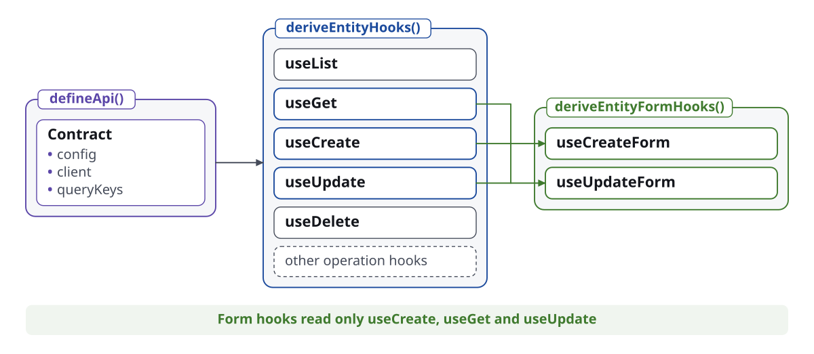

# Form Derivation

**English** | [한국어](/ko/core-concepts/form-derivation.md)

## Overview

Form derivation in simplix-react is handled by `@simplix-react/form`, a package that derives TanStack Form hooks from your API contract and its derived React Query hooks. Rather than manually wiring form state to mutations, managing dirty field tracking, and mapping server validation errors, you call `deriveEntityFormHooks` once and receive ready-to-use `useCreateForm` and `useUpdateForm` hooks for every entity in your contract that has a `create` or `update` operation.

The core insight is that forms for CRUD operations follow predictable patterns. A create form needs default values, a mutation, and success/error handling. An update form needs to fetch the existing entity, track which fields changed, and submit only the dirty fields. These patterns are mechanical enough to derive from the contract, eliminating the boilerplate that normally accompanies form-heavy applications.

Form derivation sits at the top of the derivation chain: contracts produce clients and query keys, clients produce React Query hooks, and React Query hooks produce form hooks. Each layer builds on the one below it, maintaining type safety from the Zod schema all the way to the form field binding.

## How It Works

### The Derivation Chain



`deriveEntityFormHooks` takes the contract and its derived hooks, then iterates over each entity. For each entity, it inspects the operations to determine which CRUD roles exist (`create`, `update`). Only entities with a `create` role get a `useCreateForm` hook; only those with an `update` role get a `useUpdateForm` hook. The role comes from the operation name or its `role` field, as in every other derivation.

```ts
import { deriveEntityFormHooks } from "@simplix-react/form";
import { inventoryApi } from "./contract";
import { inventoryHooks } from "./hooks";

export const inventoryFormHooks = deriveEntityFormHooks(inventoryApi, inventoryHooks);
```

`useCreateForm` and `useUpdateForm` are optional in the `EntityFormHooks` type, because they exist only when the entity has a `create` or an `update` operation, so the examples call them with a non-null assertion (`useCreateForm!()`).

The result is an object keyed by entity name, where each value is an `EntityFormHooks` containing the available form hooks:

```ts
inventoryFormHooks.product.useCreateForm!(parentId?, options?)
inventoryFormHooks.product.useUpdateForm!(entityId, options?)
```

### Create Form

The `useCreateForm` hook creates a TanStack Form instance wired to the entity's `useCreate` mutation:

```ts
const { form, isSubmitting, submitError, reset } = inventoryFormHooks.product.useCreateForm!(
  parentId,
  {
    defaultValues: { title: "", status: "active" },
    resetOnSuccess: true,
    onSuccess: (data) => console.log("Created:", data),
    onError: (error) => console.error(error),
  },
);
```

| Return value | Description |
| --- | --- |
| `form` | TanStack Form API instance for field binding and submission |
| `isSubmitting` | Whether the create mutation is in flight |
| `submitError` | The most recent submission error, or `null` |
| `reset` | Resets form fields and clears the submission error |

On submit, the hook collects the form values, calls the `useCreate` mutation (with `parentId` for a nested entity), and handles the response. The mutation carries `meta: { handledByForm: true }`, so a global mutation error handler can tell that the form already shows the error:

- **Success**: optionally resets the form (controlled by `resetOnSuccess`, defaults to `true`), calls `onSuccess`
- **Failure**: maps server validation errors to per-field errors via `mapServerErrorsToForm`, calls `onError`

### Update Form

The `useUpdateForm` hook fetches the existing entity via `useGet`, initializes the form with its data, and wires submission to the `useUpdate` mutation. When the entity is fetched again, the form is reset to the new data:

```ts
const { form, isLoading, isSubmitting, submitError, entity } =
  inventoryFormHooks.product.useUpdateForm!(productId, {
    dirtyOnly: true,
    onSuccess: (data) => console.log("Updated:", data),
  });
```

| Return value | Description |
| --- | --- |
| `form` | TanStack Form API instance |
| `isLoading` | Whether the entity data is still loading from the server |
| `isSubmitting` | Whether the update mutation is in flight |
| `submitError` | The most recent submission error, or `null` |
| `entity` | The loaded entity data, or `undefined` while loading |

The key difference from the create form is **dirty field tracking**. When `dirtyOnly` is `true` (the default), only fields that differ from the original entity are sent in the update request. This produces minimal PATCH payloads and avoids overwriting concurrent changes to unmodified fields. In this mode a submit before the entity has loaded does nothing.

### Dirty Field Tracking

The `extractDirtyFields` function performs a deep comparison between current form values and the original entity data:

```ts
import { extractDirtyFields } from "@simplix-react/form";

const dirty = extractDirtyFields(
  { name: "Updated", status: "active", priority: 1 },
  { name: "Original", status: "active", priority: 1 },
);
// => { name: "Updated" }
```

The comparison uses a custom `deepEqual` implementation that handles:

- Primitives (strict equality via `Object.is`)
- `null` and `undefined`
- `Date` objects (by timestamp)
- Arrays (element-wise recursive comparison)
- Plain objects (key-wise recursive comparison)

Only top-level keys present in the current values are checked; removed keys are not tracked. This design is intentional: form fields represent the set of editable properties, and the dirty check identifies which of those properties changed.

### Server Error Mapping

When a mutation fails with validation errors, `mapServerErrorsToForm` extracts per-field error messages from the server response and sets them on the corresponding TanStack Form fields:

```ts
import { mapServerErrorsToForm } from "@simplix-react/form";

try {
  await mutation.mutateAsync(data);
} catch (error) {
  const mapped = mapServerErrorsToForm(error, form);
  if (!mapped) {
    // Not a validation error: handle differently
  }
}
```

The function delegates to `getValidationErrors()` from `@simplix-react/api` for extraction, which supports multiple server error formats via duck typing:

| Format | Structure |
| --- | --- |
| Spring Boot | `{ errorDetail: [{ field, message }] }` |
| JSON:API-like | `{ errors: [{ field, message }] }` |
| Rails | `{ errors: { [field]: string[] } }` |

Extracted errors are grouped by field name and set into each field's `errorMap.onSubmit` slot, making them appear as validation errors in the form UI. Several messages for one field are joined with a comma.

### Client-Side Validation with Zod

`zodToFieldErrors(schema, values)` runs a Zod `safeParse` and returns `null` when the values pass, or a record of dot-joined field paths to the first message of each field. It is the shape the `validator` option of `useCrudFormSubmit` in `@simplix-react/ui` expects:

```ts
import { zodToFieldErrors } from "@simplix-react/form";

const errors = zodToFieldErrors(createUserSchema, values);
// => null, or { email: "Invalid email", "profile.phone": "Required" }
```

## Design Decisions

### Why TanStack Form?

TanStack Form was chosen because it provides a headless, framework-agnostic form API with fine-grained field-level state management. Unlike form libraries that rely on uncontrolled inputs or hidden state, TanStack Form gives the framework full control over when and how field values are read, written, and validated. This control is essential for the derivation model: the form hooks need to intercept submission, inject dirty field logic, and map server errors, all of which require explicit access to the form API.

### Why Derive Instead of Generate?

Form hooks are derived at runtime from the contract and its hooks, not generated as static code. This means changes to the contract (new fields, renamed schemas) automatically propagate to the form hooks without a code generation step. The tradeoff is a small runtime cost for the derivation, but this cost is incurred once during module initialization and is negligible.

### Why Dirty-Only Updates by Default?

Sending only changed fields in update requests has several benefits:

- **Smaller payloads**: only modified data crosses the network
- **Concurrent edit safety**: unmodified fields are not overwritten, reducing conflicts when multiple users edit the same entity
- **Server-side efficiency**: backends can skip processing unchanged fields

The `dirtyOnly` option defaults to `true` but can be set to `false` for backends that expect full entity payloads on every update.

### Why Server Error Mapping Is Duck-Typed?

Backend frameworks express validation errors in different formats. Rather than requiring a specific error contract, the mapper uses duck typing to detect the format at runtime. This makes `@simplix-react/form` compatible with Spring Boot, Rails, and other backends that use one of the formats above, without any configuration.

## Implications

### For Application Developers

- Adding a new entity to the contract automatically produces `useCreateForm` and `useUpdateForm` hooks
- Forms track dirty fields automatically, with no manual comparison logic needed
- Server validation errors appear as per-field errors in the form UI without custom error handling
- The `form` object returned by hooks is a standard TanStack Form API, so all TanStack Form features (validators, field arrays, async validation) remain available

### For Testing

- Form hooks can be tested by providing mock entity hooks
- `extractDirtyFields`, `mapServerErrorsToForm`, and `zodToFieldErrors` are exported as standalone utilities for unit testing
- The `reset` function on create forms enables testing submission-then-reset flows

## Related

- [API Contracts](/en/core-concepts/api-contracts.md): how contracts define entity schemas that form hooks derive from
- [Mock Data Layer](/en/core-concepts/mock-data-layer.md): how mock handlers enable form testing without a backend

---

<p class="page-source"><a href="https://github.com/simplix-framework/simplix-react/blob/main/docs/en/core-concepts/form-derivation.md" target="_blank" rel="noopener noreferrer">Edit on GitHub</a></p>
