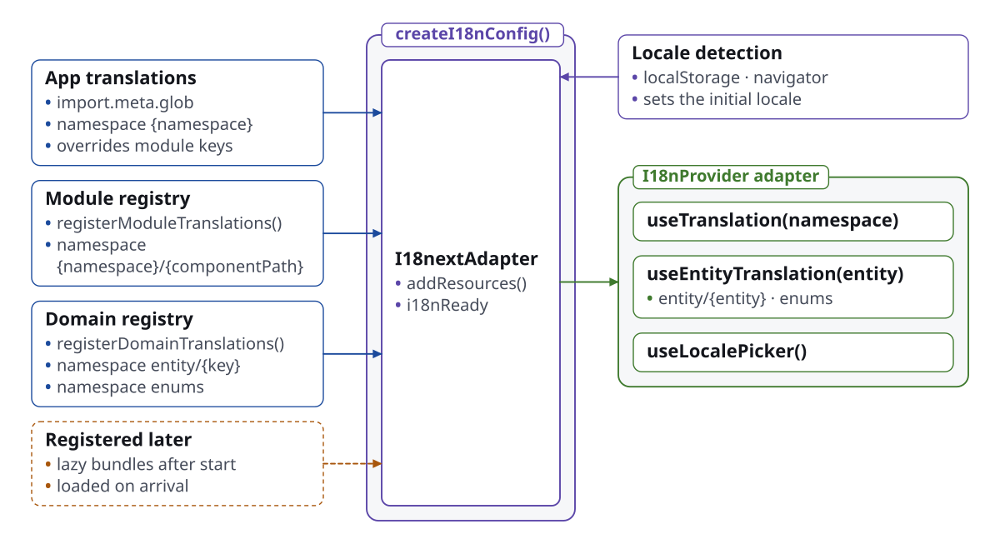

# Internationalization

**English** | [한국어](/ko/core-concepts/internationalization.md)

## Overview

Internationalization in simplix-react is handled by `@simplix-react/i18n`, a package that provides a structured, adapter-based translation and formatting system. Rather than coupling your application directly to a specific i18n library, the package defines an `II18nAdapter` interface that abstracts translation lookup, locale management, date/time/number formatting, and namespace-scoped resource loading. The built-in `I18nextAdapter` implements this interface using i18next as the underlying engine.

The core insight is that internationalization in a domain-driven application has two distinct concerns: **application-level translations** (navigation labels, common UI strings) and **domain-level translations** (entity field labels, enum display values). These concerns have different ownership: application translations live in the app, domain translations ship with domain packages. The i18n package provides a registry-based architecture that unifies both sources at runtime without creating cross-package dependencies.

## How It Works

### The Adapter Interface

The `II18nAdapter` interface defines the full surface area of an i18n adapter:

| Capability | Members |
| --- | --- |
| Identity | `id`, `name` |
| Translation | `t(key, values?)`, `tn(namespace, key, values?)`, `tp(key, count, values?)`, `exists(key, namespace?)` |
| Locale management | `locale`, `fallbackLocale`, `availableLocales`, `setLocale(locale)`, `getLocaleInfo(locale)` |
| Date/time formatting | `formatDate(date, options?)`, `formatTime(date, options?)`, `formatDateTime(date, options?)`, `formatRelativeTime(date)` |
| Number formatting | `formatNumber(value, options?)`, `formatCurrency(value, currency?)` |
| Lifecycle | `initialize(defaultLocale?)`, `dispose()` |
| Resource loading | `loadTranslations(locale, namespace, translations)`, `getLoadState(locale, namespace?)` |
| Reactivity | `onLocaleChange(handler)`, optional `resourcesVersion` and `onResourcesChange(handler)` |

The interface is designed so that alternative implementations (custom adapters for non-i18next backends) can be swapped in without changing any application or component code.

### I18nextAdapter

The `I18nextAdapter` class implements `II18nAdapter` using i18next for translation resolution and the browser `Intl` API for date, time, number, and currency formatting:

```ts
import { I18nextAdapter } from "@simplix-react/i18n";

const adapter = new I18nextAdapter({
  defaultLocale: "ko",
  resources: {
    ko: { common: { greeting: "{{name}}!" } },
    en: { common: { greeting: "Hello, {{name}}!" } },
  },
});

await adapter.initialize();
adapter.tn("common", "greeting", { name: "Alice" }); // "Alice!"
```

Key characteristics:

- Options are `defaultLocale` and `fallbackLocale` (both default `"en"`), `locales`, `resources`, `i18nextInstance` and `debug`
- Uses `i18next.createInstance()` by default (isolated instance, no global side effects), or accepts an existing `i18nextInstance` for integration with `react-i18next`
- Disables HTML escaping (`escapeValue: false`) since React handles escaping
- Delegates all formatting to the `Intl` API using the active locale
- Supports plural forms via `tp(key, count)` using i18next's built-in CLDR plural rules
- Registers the `josa` formatter, so a Korean message can write `{{plan, josa(을/를)}}` and get the particle form that the value's last sound calls for

### Domain Translation Architecture

Domain packages ship their own translations via the `registerDomainTranslations` function. Each domain declares a set of locale-to-loader mappings:

```ts
import { registerDomainTranslations } from "@simplix-react/i18n";

registerDomainTranslations({
  domain: "pet",
  locales: {
    en: () => import("./locales/en.json"),
    ko: () => import("./locales/ko.json"),
  },
});
```

This call registers the domain into a global `Map`-based registry. Registrations happen as side-effect imports when the domain package is loaded, so translations are available automatically without explicit wiring.

During initialization, `createI18nConfig` reads the registry and loads all registered domain translations; a domain registered after initialization is loaded when it registers. The JSON structure follows a convention:

```json
{
  "pet": {
    "fields": { "name": "Pet Name", "status": "Status" }
  },
  "enums": {
    "petStatus": { "available": "Available", "sold": "Sold" }
  }
}
```

Top-level keys are treated as entity names and registered under the `entity/{key}` namespace. The special `"enums"` key is registered under the `enums` namespace. This convention enables the `useEntityTranslation` hook to resolve field labels and enum display values by entity name.

### Module Translation Architecture

For application modules (as opposed to domain packages), translations are organized per-component using `buildModuleTranslations`:

```ts
import { buildModuleTranslations, registerModuleTranslations } from "@simplix-react/i18n";

const translations = buildModuleTranslations({
  namespace: "dashboard",
  locales: ["en", "ko"],
  components: {
    header: {
      en: () => import("./header/locales/en.json"),
      ko: () => import("./header/locales/ko.json"),
    },
  },
});

registerModuleTranslations(translations);
```

Module translations are scoped under `{namespace}/{componentPath}` namespaces and loaded through dynamic `import()`, one loader per locale and component. `createI18nConfig` loads every locale the module lists when it initializes, and a module registered later is loaded when it registers. When the application's own translations hold the same namespace, their keys are merged over the module's.

### Initialization with createI18nConfig

The `createI18nConfig` factory orchestrates the full i18n setup:

```ts
import { createI18nConfig } from "@simplix-react/i18n";

const appTranslations = import.meta.glob("./locales/**/*.json", { eager: true });

const { adapter, i18nReady } = createI18nConfig({
  defaultLocale: "ko",
  supportedLocales: ["en", "ko", "ja"],
  appTranslations,
  detection: {
    order: ["localStorage", "navigator"],
    storageKey: "i18n:locale",
  },
});

await i18nReady;
```

The other options are `fallbackLocale` (default `"en"`), `moduleTranslations` (module translations passed directly instead of registered) and `debug`. `defaultLocale` defaults to `"en"` and `supportedLocales` to `DEFAULT_LOCALES`.



The initialization sequence:

1. **Resolve locale configs**: string locale codes are resolved against `DEFAULT_LOCALES` (built-in locale configurations with native names, date/time formats, and currency codes); an unknown code gets a configuration whose names are the code itself
2. **Parse app translations**: Vite glob imports matching `/locales/{namespace}/{locale}.json` are parsed into i18next resource bundles
3. **Create adapter**: a new `I18nextAdapter` is instantiated with the resolved configuration
4. **Detect locale**: checks `localStorage` and `navigator.languages` (in configured order) for a preferred locale that is in the supported list; a `navigator` language also matches by its prefix (`ko-KR` → `ko`)
5. **Initialize**: the adapter is initialized with the detected or default locale
6. **Persist locale**: if localStorage detection is enabled, locale changes are automatically persisted
7. **Load module and domain translations**: every module translation (passed or registered) and every registered domain translation is loaded at once, and later registrations are loaded as they arrive

The function returns both the `adapter` and an `i18nReady` promise. The adapter is available immediately for provider setup; the promise resolves when the translations registered so far have loaded.

### API Request Locale Synchronization

When the server returns localized responses based on the `Accept-Language` header, the i18n adapter can be wired to `@simplix-react/api` to automatically inject the header on every API request:

```ts
import { setRequestLocale } from "@simplix-react/api";

i18nAdapter.onLocaleChange(setRequestLocale);
i18nReady.then(() => setRequestLocale(i18nAdapter.locale));
```

This is necessary because browsers set `Accept-Language` from OS/browser language preferences, which may differ from the application's selected language. For example, a user with a Korean OS who selects English in the app would send `Accept-Language: ko` without this feature. `setRequestLocale` ensures `getMutator()` injects the correct locale.

The design keeps `@simplix-react/api` and `@simplix-react/i18n` fully decoupled: there is no direct dependency between them. The wiring happens at the application level through the adapter's `onLocaleChange` callback, following the same pattern as locale persistence to `localStorage`.

### Locale Configuration

Each locale is described by a `LocaleConfig`:

```ts
interface LocaleConfig {
  code: string;        // BCP 47 code (e.g., "ko", "en-GB")
  name: string;        // Native name (e.g., "한국어")
  englishName: string;  // English name (e.g., "Korean")
  direction?: "ltr" | "rtl";
  dateFormat?: string;
  timeFormat?: string;
  currency?: string;    // ISO 4217 code
}
```

The `DEFAULT_LOCALES` constant provides built-in configurations for East Asian, Southeast Asian, South Asian, European, Middle Eastern, and African languages, including regional variants (e.g., `en-GB`, `pt-BR`, `es-MX`). `SUPPORTED_LOCALES` lists their codes.

### Locale-Bound Formatting and Text Helpers

The package also exports helpers that apply the active locale outside a translation string:

| Export | Purpose |
| --- | --- |
| `formatDate`, `formatTime`, `formatDateTime`, `formatRelative` | `Intl` formatting for a given locale and IANA time zone (`formatDate(date, locale, timeZone, options?)`) |
| `DateTimeProvider`, `useDateTime` | A context that binds those formatters to the adapter's locale and a `timeZone` (the browser zone when omitted) |
| `useFormattedDate`, `useFormattedTime`, `useFormattedDateTime`, `useFormattedRelative` | Memoized formatting bound to the active locale and time zone |
| `configureFallbackLocale`, `useFallbackLocale`, `getFallbackLocale` | The language a multilingual value falls back to (`DEFAULT_FALLBACK_LOCALE` is `"en"`) |
| `useLocalizedText` | Picks the active locale's entry from a per-locale value map, or the first filled entry |
| `useOptionalTranslation` | `useTranslation` plus `tOr(key, fallback, values?)` for a key the catalogue may lack |
| `koreanParticle`, `localeParticle`, `formatKoreanParticle` | The Korean particle form that follows a word, also behind the `josa` formatter |

These are imported from `@simplix-react/i18n`, or from `@simplix-react/i18n/react` for the providers and hooks.

### React Integration

React bindings are provided via a separate entry point (`@simplix-react/i18n/react`):

**I18nProvider**: Wraps the component tree with the adapter context:

```tsx
import { I18nProvider } from "@simplix-react/i18n/react";

<I18nProvider adapter={adapter}>
  <App />
</I18nProvider>
```

**useTranslation(namespace)**: Returns a namespace-scoped `t` function, the current `locale`, and an `exists` function. Re-renders on locale changes, and on resources that arrive after the first render, via `useSyncExternalStore`:

```tsx
const { t, locale, exists } = useTranslation("common");
t("greeting", { name: "Alice" }); // "Hello, Alice!"
```

**useLocale()**: Returns just the current locale code, re-rendering on changes:

```tsx
const locale = useLocale(); // "ko"
```

**useI18n()**: Returns the full `II18nAdapter` from context (or `null` outside an `I18nProvider`) for direct access to formatting methods and other adapter APIs.

**useEntityTranslation(entity)**: Provides `fieldLabel` and `enumLabel` functions scoped to a specific entity, using the `entity/{name}` and `enums` namespaces:

```tsx
const { fieldLabel, enumLabel } = useEntityTranslation("pet");
fieldLabel("name");                    // "Pet Name"
enumLabel("petStatus", "available");   // "Available"
```

**useLocalePicker()**: Headless hook for building locale switcher UIs. Returns the current locale, available locales with display names (derived via `Intl.DisplayNames`), and a `setLocale` function:

```tsx
const { locale, locales, setLocale } = useLocalePicker();
// locales = [{ value: "en", displayName: "English" }, { value: "ko", displayName: "한국어" }]
```

## Design Decisions

### Why an Adapter Interface?

The adapter interface decouples the i18n contract from the implementation. While i18next is the built-in engine, applications can implement `II18nAdapter` with any translation backend. This is particularly relevant for projects that need to integrate with an existing i18n system or use a lighter-weight translation library.

### Why Domain-Level Translations?

In a domain-driven architecture, entity field labels and enum values are domain knowledge, not application knowledge. By shipping translations with domain packages and loading them via a registry, the translations stay colocated with the schemas they describe. Adding a new domain package automatically brings its translations into the application.

### Why Namespace Scoping?

Namespaces prevent key collisions between unrelated translation sets. The `entity/{name}` convention for domain translations and arbitrary namespaces for module translations ensure that a `"name"` key in the `pet` entity does not collide with a `"name"` key in the `user` entity.

### Why the Intl API for Formatting?

Date, time, number, and currency formatting use the browser's `Intl` API rather than i18next's formatting plugins. The `Intl` API provides locale-aware formatting that follows CLDR standards out of the box, requires no additional dependencies, and produces results consistent with the rest of the browser platform.

### Why Loaders for Module/Domain Translations?

Translation files can be large, and applications may support many locales. Because each locale is a loader (a dynamic `import()`), the translation files stay out of the main bundle: Vite's code splitting makes each locale's translations a separate chunk, and the loaders of all listed locales run together during initialization.

## Implications

### For Application Developers

- Translation setup is centralized in `createI18nConfig`: one function call configures the entire i18n system
- Application translations use Vite glob imports for zero-configuration namespace discovery
- Locale detection and persistence are handled automatically
- Components use `useTranslation` for scoped lookups and `useEntityTranslation` for entity field/enum labels

### For Domain Package Authors

- Call `registerDomainTranslations` in the package entry point to register translations as a side effect
- Follow the `{ entityName: { fields: {...} }, enums: {...} }` JSON convention
- Translations are loaded automatically when the application initializes

### For Testing

- The `I18nextAdapter` can be instantiated with inline resources for testing
- The adapter interface allows creating a mock adapter that returns keys as-is for snapshot testing
- `useTranslation` returns the key unchanged when no `I18nProvider` is present, making components testable without i18n setup

## Related

- [API Contracts](/en/core-concepts/api-contracts.md): how entity schemas relate to translation namespaces
- [Form Derivation](/en/core-concepts/form-derivation.md): how form labels can use entity translations

---

<p class="page-source"><a href="https://github.com/simplix-framework/simplix-react/blob/main/docs/en/core-concepts/internationalization.md" target="_blank" rel="noopener noreferrer">Edit on GitHub</a></p>
