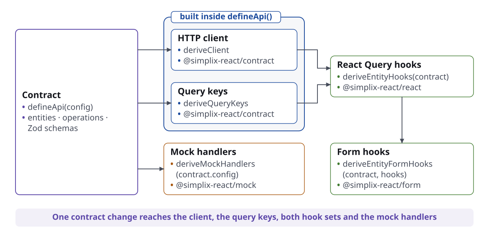

# Schema Derivation

**English** | [한국어](/ko/core-concepts/schema-derivation.md)

## Overview

Schema derivation turns one declarative API contract into the code that talks to the API: an HTTP client, query key factories, React Query hooks, form hooks, and MSW mock handlers. You call `defineApi()` once, and each layer is derived from the Zod schemas and the operation paths of that contract.

Every layer therefore agrees on the same types, the same URLs, and the same validation rules. When you change a Zod schema, the client, the hooks, and the mock handlers change with it, because each of them reads the same definition.

This removes a class of defects that hand-written layers collect: a hook whose type no longer matches the response, a query key left behind after an entity was renamed, a mock handler that answers for an endpoint the API no longer has.

## How It Works



The contract is the only input. `defineApi()` derives the client and the query keys while it assembles the contract, and each of the other packages derives its own layer from that contract.

| Stage | Function | Package | Derives |
| --- | --- | --- | --- |
| 1 | `defineApi` | `@simplix-react/contract` | The contract: `config`, `client`, `queryKeys` |
| 2 | `deriveClient` | `@simplix-react/contract` | A typed function for each operation |
| 3 | `deriveQueryKeys` | `@simplix-react/contract` | A query key factory for each entity |
| 4 | `deriveEntityHooks` | `@simplix-react/react` | A React Query hook for each operation |
| 5 | `deriveEntityFormHooks` | `@simplix-react/form` | TanStack Form hooks for the create and update operations |
| 6 | `deriveMockHandlers` | `@simplix-react/mock` | An MSW handler for each operation |

### Stage 1: defineApi (Contract Assembly)

`defineApi()` is the entry point. It takes an `ApiContractConfig` with a domain name, a base path, the entities, optional top-level operations, and an optional query builder. It calls `deriveClient()` and `deriveQueryKeys()` and returns a contract with three properties: `config`, `client`, and `queryKeys`.

```ts
// packages/contract/src/define-api.ts
export function defineApi(config, options?) {
  return {
    config,
    client: deriveClient(config, options?.fetchFn),
    queryKeys: deriveQueryKeys(config),
  };
}
```

An entity is a Zod schema and a map of operations. Each operation states its HTTP method and its path:

```ts
import { z } from "zod";
import { defineApi, simpleQueryBuilder } from "@simplix-react/contract";

const taskSchema = z.object({ id: z.string(), title: z.string(), status: z.enum(["open", "done"]) });

export const api = defineApi({
  domain: "project",
  basePath: "/api",
  entities: {
    task: {
      schema: taskSchema,
      operations: {
        list: { method: "GET", path: "/tasks" },
        get: { method: "GET", path: "/tasks/:id" },
        create: { method: "POST", path: "/tasks", input: taskSchema.omit({ id: true }) },
        update: { method: "PATCH", path: "/tasks/:id", input: taskSchema.partial().omit({ id: true }) },
        delete: { method: "DELETE", path: "/tasks/:id" },
        archive: { method: "POST", path: "/tasks/:id/archive" },
      },
    },
  },
  queryBuilder: simpleQueryBuilder,
});
```

### The Role of an Operation

Every later stage decides what to derive from the role of an operation. An operation named `list`, `get`, `create`, `update`, `delete`, or `tree` has the role of its name. An operation with another name takes a role only when it states one with `role`, and is a custom operation otherwise. In the contract above, `archive` is a custom operation.

### Stage 2: deriveClient (HTTP Client Derivation)

`deriveClient()` derives one function for each operation of each entity, and one for each top-level operation. The role decides the shape of the function:

```ts
api.client.task.list({ filters: { status: "open" } }); // GET /api/tasks with the filters as query parameters
api.client.task.get(id);                               // GET /api/tasks/:id
api.client.task.create(dto);                           // POST /api/tasks
api.client.task.update(id, dto);                       // PATCH /api/tasks/:id
api.client.task.delete(id);                            // DELETE /api/tasks/:id

// A custom operation takes its path parameters in order, then its input.
api.client.task.archive(id);                           // POST /api/tasks/:id/archive
```

- **Parent-aware URLs**: when an entity has a `parent`, `list` and `create` take the parent ID first and prepend the parent path (`/projects/:projectId/tasks`).
- **Query parameters**: `list` hands its filters, sort, and pagination to the `buildSearchParams()` of the contract's query builder.
- **Request and response formats**: a custom operation with `contentType: "multipart"` sends its input as `FormData`, and one with `responseType: "blob"` returns binary data. `transformRequest` and `transformResponse` replace the default serialization.
- **Pluggable fetch**: the `fetchFn` option of `defineApi()` replaces the HTTP function, for example to add authentication headers.

### Stage 3: deriveQueryKeys (Query Key Factory Derivation)

`deriveQueryKeys()` creates a `QueryKeyFactory` for each entity. The keys are hierarchical, as TanStack Query recommends:

```ts
api.queryKeys.task.all;              // ["project", "task"]
api.queryKeys.task.lists();          // ["project", "task", "list"]
api.queryKeys.task.list({ status }); // ["project", "task", "list", { status }]
api.queryKeys.task.details();        // ["project", "task", "detail"]
api.queryKeys.task.detail(id);       // ["project", "task", "detail", id]
api.queryKeys.task.trees();          // ["project", "task", "tree"]
api.queryKeys.task.tree(params);     // ["project", "task", "tree", params]
```

Invalidating `queryKeys.task.all` clears every query of the entity, and invalidating `queryKeys.task.lists()` clears the list queries and leaves the detail queries alone.

### Stage 4: deriveEntityHooks (React Query Hook Derivation)

`deriveEntityHooks()` from `@simplix-react/react` takes the contract and derives one hook for each operation, named `use` followed by the operation name.

| Role | Hook | TanStack primitive | Behavior |
| --- | --- | --- | --- |
| `list` | `useList` | `useQuery` | Fetches a list with an optional parent ID, filters, sort, and pagination |
| `list` | `useInfiniteList` | `useInfiniteQuery` | Derived with `useList` for infinite scrolling |
| `get` | `useGet` | `useQuery` | Fetches one entity by ID |
| `create` | `useCreate` | `useMutation` | Creates an entity and invalidates `queryKeys.<entity>.all` |
| `update` | `useUpdate` | `useMutation` | Updates an entity (optimistically when given `optimistic: true`, an option missing from the hook's type) and invalidates `queryKeys.<entity>.all` |
| `delete` | `useDelete` | `useMutation` | Deletes an entity and invalidates `queryKeys.<entity>.all` |
| `tree` | `useTree` | `useQuery` | Fetches the entity as a hierarchy |
| custom, `GET` | `use<Operation>` | `useQuery` | Runs the operation as a query |
| custom, other methods | `use<Operation>` | `useMutation` | Runs the operation and invalidates the keys its `invalidates` returns, or `queryKeys.<entity>.all` without one |

A top-level operation gets `hooks.<operation>.useMutation()`, which invalidates the keys its `invalidates` returns.

Each hook accepts TanStack Query options. The derivation owns `queryKey` and `queryFn` for a query and `mutationFn` for a mutation.

### Stage 5: deriveEntityFormHooks (Form Hook Derivation)

`deriveEntityFormHooks()` from `@simplix-react/form` takes the contract and the hooks of stage 4. An entity with a `create` operation gets `useCreateForm`, and one with an `update` operation gets `useUpdateForm`. Each form hook connects TanStack Form to the mutation, sends only the fields that changed on an update, and maps server validation errors to the fields.

### Stage 6: deriveMockHandlers (MSW Handler Derivation)

`deriveMockHandlers()` from `@simplix-react/mock` reads `contract.config` and derives an MSW handler for each operation. The handlers read from and write to an in-memory store.

| Role | Handler |
| --- | --- |
| `list` | Filters, sorts, and paginates by offset from the query parameters |
| `get` | Returns one record, with its `belongsTo` relations when the mock configuration declares them |
| `create` | Stores the record, with a numeric `id` when the request gives none, and sets `createdAt` and `updatedAt` |
| `update` | Merges the request into the record and sets `updatedAt` |
| `delete` | Removes the record by `id` |
| `tree` | Returns the records as a hierarchy |
| custom | Answers 200, or runs the resolver the mock configuration gives for the operation |

## Design Decisions

### Why Derivation Over Manual Wiring

Manual wiring means writing the HTTP call, the query key, the React hook, and the mock handler separately for each endpoint. Three defects follow:

- **Type drift**: the return type of a hook diverges from the actual response.
- **Stale keys**: query keys are copied, then forgotten when an endpoint changes.
- **Incomplete mocks**: mock handlers lag behind the API.

Derivation removes all three. Every layer reads the same Zod schema and the same paths, so the layers cannot disagree. The cost is one more level of abstraction between your component and the HTTP call.

### Why Each Stage Is a Separate Function

The pipeline is a set of independent functions:

- **Package separation**: `deriveClient` and `deriveQueryKeys` live in `@simplix-react/contract`, `deriveEntityHooks` in `@simplix-react/react`, `deriveEntityFormHooks` in `@simplix-react/form`, and `deriveMockHandlers` in `@simplix-react/mock`. You install only the packages you use.
- **Tree-shaking**: an application that does not use mocks in production never bundles `@simplix-react/mock`.
- **Extensibility**: a new derivation target is a new package that reads the contract, and the existing packages stay as they are.

### Why the Contract Object Bundles Config, Client, and QueryKeys

Each consumer needs a different part of the contract. `deriveEntityHooks()` needs all three: `config` for the operations, `client` for the query and mutation functions, and `queryKeys` for the cache. `deriveEntityFormHooks()` needs `config` and the derived hooks. `deriveMockHandlers()` needs `config` alone. You pass one object, and TypeScript carries the types through.

## Implications

### Adding a New Entity

To add an entity, add one entry to `entities` with its schema and its operations. The client functions, the query keys, the hooks, the form hooks, and the mock handlers follow from that entry. Nothing is registered by hand, and no code generation step runs.

### Changing a Schema

A changed Zod schema reaches every component as a TypeScript error where the component no longer fits. When you add a required field to the input of `update`, the compiler points at each call of `useUpdate` that does not send it.

### Adding Custom Behavior

When an endpoint is not one of the standard roles, add it to the `operations` of its entity under its own name, or to the top-level `operations` of the contract when it belongs to no entity. State its input and output schemas and an `invalidates` function. It is derived with the rest: a client function, a hook, and a mock handler.

---

<p class="page-source"><a href="https://github.com/simplix-framework/simplix-react/blob/main/docs/en/core-concepts/schema-derivation.md" target="_blank" rel="noopener noreferrer">View source</a></p>
