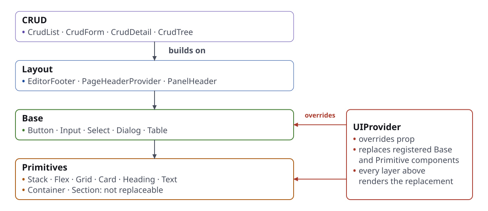

# UI Components

**English** | [한국어](/ko/core-concepts/ui-components.md)

## Overview

The UI layer in simplix-react is provided by `@simplix-react/ui`, a component library built on Tailwind CSS and Radix UI primitives that provides everything from low-level layout primitives to full CRUD scaffolding. Rather than a flat collection of unrelated components, the library is organized into architectural layers (**primitives**, **base**, **layout**, and **crud**), each building on the one below it. Components follow a "No Magic" principle: explicit `value`/`onChange` props, no hidden state, and full control at every level.

The core insight is that most business applications consist of CRUD screens that share the same structural patterns: a list with search, filters, sorting, and pagination; a form with labeled fields and validation; a detail view with read-only field display. By providing these patterns as composable compound components with explicit data flow, `@simplix-react/ui` eliminates the scaffolding boilerplate while giving developers full control over layout, styling, and behavior.

## How It Works

### Component Architecture

The library is organized into layers, from lowest to highest abstraction:



**Primitives** (`Stack`, `Flex`, `Grid`, `Container`, `Card`, `Section`, `Heading`, `Text`): Layout building blocks with CVA-based variants. These are generic layout components with no domain awareness.

**Base** (`Button`, `Input`, `Select`, `Dialog`, `Table`, `Checkbox`, `Tabs`, etc.): Interactive UI primitives built on Radix UI. These are the standard form controls, overlays, and data display components. Compound components like `Dialog`, `Select`, and `Table` are composed from multiple sub-components.

**Layout** (`EditorFooter`, `PageHeaderProvider`, `PanelHeader`): Page-level structural components that provide consistent layout patterns across screens.

**CRUD** (`CrudList`, `CrudForm`, `CrudDetail`, `CrudTree`): High-level compound components that assemble base components into complete CRUD screen patterns. These compose filters, tables, forms, and detail displays with standardized data flow.

### CRUD Pattern Components

#### CrudList

`CrudList` provides a complete list view with search, filters, sorting, pagination, row actions, bulk actions, and keyboard navigation. It uses the compound component pattern: you assemble only the pieces you need:

```tsx
<CrudList>
  <CrudList.Toolbar>
    <CrudList.Search value={search} onChange={setSearch} />
  </CrudList.Toolbar>
  <CrudList.Table data={items} sort={sort} onSortChange={setSort}>
    <CrudList.Column field="name" header="Name" sortable />
    <CrudList.Column field="status" header="Status" />
  </CrudList.Table>
  <CrudList.Pagination
    page={1} pageSize={10} total={100}
    totalPages={10} onPageChange={setPage}
  />
</CrudList>
```

Besides `Toolbar`, `Search`, `Table`, `Column` and `Pagination`, it offers `TableCard`, `BulkActions`, `BulkAction`, `Empty`, `ViewToggle`, `FilterBar`, `FilterActions` and each filter component of the [Filter System](#filter-system) as members.

The `useCrudList` hook manages list state (search, filters, sort, pagination, selection) and wires it to the component tree. URL synchronization is available via `useUrlSync`, and virtual scrolling for large datasets via `useVirtualList`.

#### CrudForm

`CrudForm` provides a form container with sections, actions, dirty tracking, autosave, and unsaved-changes protection. The root takes `onSubmit` and `isSubmitting` (and `warnOnUnsavedChanges`, `variant`, `fieldVariant`); `CrudForm.Actions` lays out the buttons you pass as children:

```tsx
<CrudForm onSubmit={handleSubmit} isSubmitting={isSubmitting}>
  <CrudForm.Section title="Basic Info">
    <FormFields.TextField label="Name" value={name} onChange={setName} required />
    <FormFields.SelectField label="Status" value={status} onChange={setStatus} options={statusOptions} />
  </CrudForm.Section>
  <CrudForm.Actions>
    <Button variant="outline" onClick={handleCancel}>Cancel</Button>
    <Button type="submit">Save</Button>
  </CrudForm.Actions>
</CrudForm>
```

Supporting hooks include `useIsDirty` for tracking unsaved changes, `useAutosave` for timed auto-submission, `useBeforeUnload` for browser navigation warnings, and `useUnsavedChanges` for in-app navigation guards. With a router adapter that offers `useBlocker` (the TanStack adapter does when the router has a history; the React Router adapter does when given React Router's `useBlocker` on a data router), the guard also holds the browser's Back and Forward and any link the page does not wrap.

#### CrudDetail

`CrudDetail` provides a read-only detail view with sections, action buttons, and variant support (`"default"` or `"dialog"`). Besides `Section` and `Actions`, it offers `DefaultActions`, `ActionFooter`, `AuditFooter`, `List` and `Table` as members:

```tsx
<CrudDetail>
  <CrudDetail.Section title="Pet Information">
    <DetailFields.DetailTextField label="Name" value={pet.name} />
    <DetailFields.DetailBadgeField
      label="Status"
      value={pet.status}
      variants={{ available: "success", sold: "secondary" }}
    />
    <DetailFields.DetailDateField label="Created" value={pet.createdAt} />
  </CrudDetail.Section>
  <CrudDetail.Actions>
    <Button onClick={handleEdit}>Edit</Button>
  </CrudDetail.Actions>
</CrudDetail>
```

The `usePreviousData` hook preserves stale data during navigation transitions, preventing content flashing.

#### CrudTree

`CrudTree` handles hierarchical data with expand/collapse, drag-and-drop reordering, and tree move operations:

```tsx
<CrudTree>
  <CrudTree.Toolbar>
    <CrudTree.Search value={search} onChange={setSearch} />
  </CrudTree.Toolbar>
  <CrudTree.Table data={treeData}>
    <CrudTree.Column field="name" header="Name" />
  </CrudTree.Table>
</CrudTree>
```

`CrudTree.Table` takes the nodes as `data`; `ExpandToggle`, `HeaderActions`, `TableCard` and `Empty` are the other members. `useTreeExpansion` manages node expand/collapse state. `TreeReorderDialog` and `TreeMoveDialog` provide UI for restructuring the tree hierarchy.

### Field Variant System

Fields come in an editable family and a read-only family that share a consistent layout system:

**FormFields** (editable): `TextField`, `TextareaField`, `NumberField`, `CurrencyField`, `PasswordField`, `PhoneField`, `SelectField`, `ComboboxField`, `MultiSelectField`, `TreeMultiSelectField`, `RadioGroupField`, `CheckboxField`, `SwitchField`, `GroupedToggleField`, `SliderField`, `DateField`, `DateRangeField`, `DateTimeField`, `TimeField`, `ColorField`, `IconField`, `CountryField`, `TimezoneField`, `LocationPickerField`, `I18nTextField`, `I18nTextareaField`, `PlateEditorField`, `PlateEditorI18nField`, `FileField`, `ImageField`, `StaticField`, `Field`. `TreeSelectField` is exported on its own, outside the namespace.

**DetailFields** (read-only): `DetailTextField`, `DetailTextareaField`, `DetailNumberField`, `DetailCurrencyField`, `DetailPhoneField`, `DetailBadgeField`, `DetailStatusField`, `DetailBooleanField`, `DetailDateField`, `DetailLinkField`, `DetailImageField`, `DetailListField`, `DetailNoteField`, `DetailBlockField`, `DetailLocationField`, `DetailCountryField`, `DetailTimezoneField`, `DetailI18nTextField`, `DetailI18nTextareaField`, `I18nText`, `DetailField`

Both families share the `CommonFieldProps` / `CommonDetailFieldProps` interfaces, which include `label`, `labelKey`, `layout`, `size`, and `className`; `CommonFieldProps` adds `error`, `warning`, `description`, `required`, `disabled` and prefix and suffix controls. The shared `FieldVariant` system controls how labels are positioned and sized:

| Property | Values | Effect |
| --- | --- | --- |
| `layout` | `"top"` (default), `"left"`, `"inline"`, `"trailing"`, `"hidden"` | Label position relative to the field; `"trailing"` right-aligns the control with a leader line, `"hidden"` keeps the label for screen readers only |
| `size` | `"sm"` (default), `"md"`, `"lg"` | Field dimensions |

`FieldVariantContext` propagates these settings to descendant fields, so you can set the variant once on a section and have all fields inherit it:

```tsx
<FieldVariantContext.Provider value={{ layout: "left", size: "md" }}>
  <FormFields.TextField label="Name" value={name} onChange={setName} />
  <FormFields.TextField label="Email" value={email} onChange={setEmail} />
</FieldVariantContext.Provider>
```

Individual fields can override the context via their own `layout` and `size` props. The `useFieldVariant` hook retrieves the current variant merged with optional overrides.

### Headless Design Philosophy

All CRUD and field components follow the "No Magic" principle:

- Every field requires explicit `value` and `onChange` props: there is no automatic form binding
- CRUD components receive data, callbacks, and state as props; they do not fetch data or manage state internally
- Layout and styling are controlled via `className` and CVA variants, not through opaque configuration objects

This design makes components predictable, testable, and composable. A `FormFields.TextField` works the same whether it is inside a `CrudForm`, a dialog, or a standalone form.

### UI Provider and Component Overrides

`UIProvider` enables global component replacement via the context-based adapter pattern. A leaf or primitive export such as `Button` or `Input` resolves the override itself, so even a static import renders the replacement; the framework reads compound sub-components through `useFlatUIComponents()`, and `useUIComponents()` returns the merged registry. Beside the base and primitive components, the registry covers `SectionShell`, `QueryFallback`, `CrudDelete`, `FieldWrapper` and `DetailFieldWrapper`. Providers nest, and an inner one overrides the outer for its subtree:

```tsx
<UIProvider overrides={{ Input: MyCustomInput, Button: MyCustomButton }}>
  <App />
</UIProvider>
```

Compound components (`Select`, `Dialog`, `Sheet`, `Table`, etc.) support deep merging: you can override individual sub-components without replacing the entire compound:

```tsx
<UIProvider overrides={{ Select: { Trigger: MySelectTrigger } }}>
  {/* Only the trigger is replaced; Root, Content, Item remain default */}
</UIProvider>
```

`withOverride(Base, { ...defaultProps, className })` builds an override that only changes default props or classes, and `createOverrides` hands a factory the base implementations. Besides `overrides`, `UIProvider` takes `statusTones` (class overrides for the status palette), `defaults` (prop defaults for the whole app) and `design` (the design every slot is drawn in).

The override system supports these levels of customization:

| Level | Method | Scope |
| --- | --- | --- |
| 1 | `className` prop | Single instance |
| 2 | CVA variants (`variant`, `size`) | Variant-level |
| 3 | `FieldVariantContext` | Section/page-wide field styling |
| 4 | `UIProvider` overrides | App-wide component replacement |
| 5 | Custom component | Full replacement |

### Router Adapter

CRUD components that need routing (navigation, URL-synced search params) use a `RouterAdapter` interface:

```ts
interface RouterAdapter {
  navigate: (to: string, options?) => void;
  getSearchParams: () => URLSearchParams;
  setSearchParams: (params, options?) => void;
  useCurrentPath: () => string;
  useBlocker?: (request: RouterBlockRequest) => void;
}
```

The `createReactRouterAdapter` function creates an adapter for React Router from its hooks (`useNavigate`, `useSearchParams`, `useLocation`, and optionally `useBlocker`), so it is called during render. `createTanstackRouterAdapter(router)` creates one from a TanStack Router instance. The adapter is provided via `CrudProvider`, which wraps `RouterContext`:

```tsx
import { CrudProvider, createReactRouterAdapter } from "@simplix-react/ui";

<CrudProvider router={createReactRouterAdapter(reactRouterHooks)}>
  <App />
</CrudProvider>
```

This abstraction keeps CRUD components router-agnostic: they work with React Router, TanStack Router, or any router that implements the `RouterAdapter` interface.

### Filter System

The filter system provides a collection of specialized filter components for list views:

| Component | Purpose |
| --- | --- |
| `TextFilter` | Single text input filter |
| `MultiTextFilter` | Multiple text fields with operator selection |
| `AdvancedTextFilter` | Text filter with search operators (contains, starts with, etc.) |
| `UnifiedTextFilter` | Combined multi-field search with operator support |
| `NumberFilter` | Numeric range filter |
| `DateFilter` | Single date filter |
| `DateRangeFilter` | Date range filter with calendar picker |
| `FacetedFilter` | Multi-select faceted filter with option counts |
| `AdvancedSelectFilter` | Select filter with search and advanced options |
| `ToggleFilter` | Boolean toggle filter |
| `ChipFilter` | Option chips toggled in place |
| `FilterBar` | Container that renders filter definitions declaratively |
| `FilterActions` | Reset and apply buttons for filter state |

Filters use a structured key format (`makeFilterKey`, `parseFilterKey`) for URL serialization and the `SearchOperator` enum for operator-based filtering. The `FilterBar` component accepts an array of `FilterDef` definitions and renders the appropriate filter components automatically. Its `state` comes from `useCrudList`, or from `useFilterBarState` for a filter bar that no list backs.

A faceted filter sources its options either eagerly or from the server. Eagerly is the default: `options` holds the whole set and the popover's input filters it locally, which suits enums and other bounded sets. Setting `onSearch` switches the filter to server search: `options` then carries the current result page, the typed text is debounced (`searchDebounceMs`, default 300 ms) and handed to the callback, `loading` renders a pending row, and local filtering is switched off so the server's answer renders as given. `selectedOptions` names values that were picked from an earlier page: they head the option list and back the active-filter badge, so a selection keeps its label as the search text moves on. Use server search for any directory whose row count grows past a page, because an eager option list silently truncates at whatever page size fetched it.

```tsx
const [query, setQuery] = useState("");
const { rows, isLoading } = useCustomerSearch(query);      // your own paged search
const selected = useCustomerLabels(list.filters);          // labels for the picked ids

<CrudList.FilterBar
  maxBadges={3}
  filters={[
    {
      type: "faceted",
      field: "customerId",
      label: "Customer",
      display: "dropdown",
      options: rows,
      onSearch: setQuery,
      loading: isLoading,
      selectedOptions: selected,
    },
  ]}
  state={list.filters}
/>
```

## Design Decisions

### Why Compound Components?

Compound components (e.g., `CrudList.Toolbar`, `CrudList.Table`, `CrudList.Pagination`) were chosen over monolithic configuration objects because they provide explicit composition. You see exactly what is rendered and in what order. Adding, removing, or reordering sections requires moving JSX elements, not modifying configuration maps. This is more discoverable and produces better TypeScript errors when props are mismatched.

### Why Explicit Data Flow?

Every value flows through props. Components never reach into context for data, never fetch from APIs, and never manage state internally (beyond transient UI state like hover or focus). This makes components predictable in isolation and testable without mocking context providers or API endpoints.

### Why a UIProvider Instead of CSS Theming?

CSS theming (custom properties, theme tokens) controls visual appearance but cannot replace component structure or behavior. `UIProvider` operates at the component level: you can replace a `Button` with a completely different implementation, swap `Dialog` for a custom modal, or inject analytics into every `Table`. This is structural customization, not just visual.

### Why Router Abstraction?

CRUD components need routing for navigation (detail pages, edit pages) and URL synchronization (search params for filters, sort, pagination). Coupling directly to a specific router library would limit adoption. The `RouterAdapter` interface provides the minimal surface area needed by CRUD components, and adapter factories (`createReactRouterAdapter`) handle the wiring for specific routers.

## Implications

### For Application Developers

- CRUD screens are assembled from compound components: compose only what you need
- Field components are explicit (value/onChange), with no hidden form binding
- Global component customization via `UIProvider`: replace any base component app-wide
- Router-agnostic CRUD patterns: switch routers without rewriting CRUD components

### For Component Authors

- New field types extend `CommonFieldProps` or `CommonDetailFieldProps` for consistent layout
- New CRUD components use `useFlatUIComponents()` to resolve overridable compound sub-components; leaves and primitives resolve their overrides themselves
- CVA variants follow the established pattern for consistent styling

### For Domain Package Authors

- Domain packages do not contain UI components: all UI lives in application modules
- Domain packages provide contracts, hooks, and translations; modules compose them with `@simplix-react/ui` components

## Related

- [API Contracts](/en/core-concepts/api-contracts.md): how contracts define the entity surface that CRUD components render
- [Form Derivation](/en/core-concepts/form-derivation.md): how form hooks wire to FormFields
- [Internationalization](/en/core-concepts/internationalization.md): how field labels and enum values are translated

---

<p class="page-source"><a href="https://github.com/simplix-framework/simplix-react/blob/main/docs/en/core-concepts/ui-components.md" target="_blank" rel="noopener noreferrer">View source</a></p>
