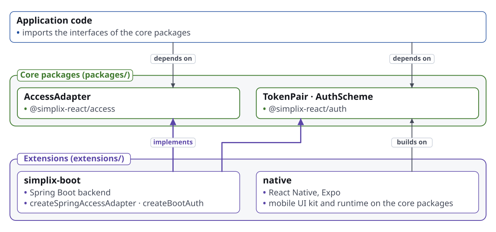

# Extensions

**English** | [한국어](/ko/extensions/README.md)

Extensions provide environment-specific implementations that the core `simplix-react` framework cannot cover generically. While core packages (`packages/`) are designed to be universally applicable, extensions address the needs of particular platforms, server frameworks, or infrastructure setups.

Each extension lives in its own workspace under `extensions/` and serves one environment: simplix-boot implements core interfaces for Spring Boot (its CLI plugin registers with the CLI instead), and native reuses the core packages for React Native without implementing core interfaces.

## Architecture

```text
simplix-react/
  packages/           # Core packages (universal, environment-agnostic)
    auth/             #   Abstract auth interfaces
    access/           #   Abstract access control interfaces
    ...
  extensions/         # Environment-specific implementations
    simplix-boot/     #   Spring Boot / Spring Security adapters
```



Core packages define abstract contracts (e.g., `AccessAdapter`, `TokenPair`). simplix-boot implements these contracts for Spring Boot, so components and hooks stay portable and only the bootstrap file imports the extension.

## Available Extensions

| Extension | Target Environment | Packages | Description |
| --- | --- | --- | --- |
| [simplix-boot](/en/extensions/simplix-boot/README.md) | SimpliX (Spring Boot) | `@simplix-react-ext/simplix-boot-access`, `@simplix-react-ext/simplix-boot-auth`, `@simplix-react-ext/simplix-boot-cli-plugin`, `@simplix-react-ext/simplix-boot-stream`, `@simplix-react-ext/simplix-boot-utils` | SimpliX Spring Security authentication and authorization adapters, the CLI spec profile, SSE streaming and Boot utilities |
| [native](/en/extensions/native/README.md) | React Native (Expo) | `@simplix-react-native/ui`, `@simplix-react-native/runtime`, `@simplix-react-native-ext/*`, `simplix-react-native` | Mobile UI kit, Expo runtime glue, and device-layer packages |

## Creating a New Extension

An extension is a standalone pnpm workspace nested inside `extensions/`. Each extension:

1. Has its own `pnpm-workspace.yaml` and `package.json`
2. Contains one or more sub-packages under `packages/`
3. Declares core packages as `peerDependencies`
4. Is registered in the root `pnpm-workspace.yaml`

### Directory Structure

```text
extensions/
  <extension-name>/
    package.json            # Workspace root (private: true)
    pnpm-workspace.yaml     # packages: ["packages/*"]
    tsconfig.json           # Shared compiler options
    packages/
      <sub-package>/
        package.json        # Published package
        tsconfig.json
        tsup.config.ts
        vitest.config.ts
        src/
          index.ts          # Public API exports
          types.ts          # Extension-specific types
          ...
```

### Registration

Add the extension's packages to the root `pnpm-workspace.yaml`:

```yaml
packages:
  - "packages/*"
  - "apps/*"
  - "extensions/<extension-name>/packages/*"
```

### Peer Dependencies

Extension packages declare core packages as peer dependencies to avoid version conflicts:

```json
{
  "peerDependencies": {
    "@simplix-react/auth": "workspace:*",
    "@simplix-react/contract": "workspace:*"
  }
}
```

## Build and Test

Extensions participate in the root Turborepo pipeline:

```bash
# Build all (including extensions)
pnpm build

# Test all (including extensions)
pnpm test

# Build/test a specific extension package
pnpm --filter @simplix-react-ext/simplix-boot-access build
pnpm --filter @simplix-react-ext/simplix-boot-access test
```

---

<p class="page-source"><a href="https://github.com/simplix-framework/simplix-react/blob/main/extensions/README.md" target="_blank" rel="noopener noreferrer">View source</a></p>
