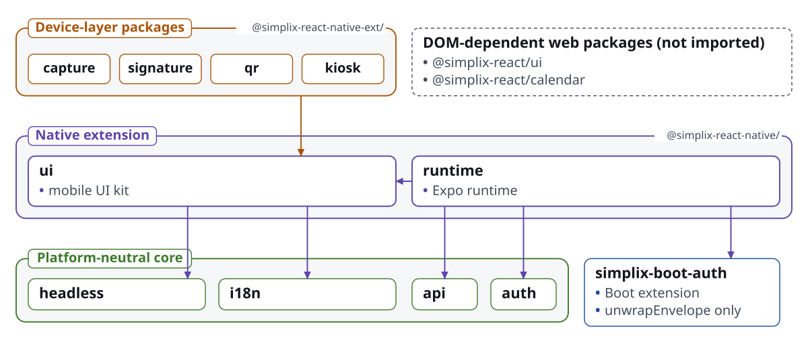

# simplix-react-native

**English** | [한국어](/ko/extensions/native/README.md)

React Native extension of simplix-react. It reproduces the framework philosophy (package-first, OpenAPI-driven, derived hooks, FSD) on React Native (Expo), so native apps start from the same contract and conventions as web apps.

The platform-neutral layers (contract, codegen, Boot envelope mutator logic, i18n core, MSW mocks, headless list/filter logic) are reused from the core `packages/`. This extension adds only what is platform-specific: the mobile UI kit, the Expo runtime glue, and device-layer packages.



## Packages

| Package | Description |
| --- | --- |
| [`@simplix-react-native/ui`](/en/extensions/native/packages/ui/README.md) | Standard kit: layout primitives, page skeletons (`Screen`, `StepFlow`, `MasterDetail`), controls, overlays (sheet-first), `FormFields` / `DetailFields`, `EntityList` + `useEntityFeed`, theme token sheet, built-in en/ko/ja locales |
| [`@simplix-react-native/runtime`](/en/extensions/native/packages/runtime/README.md) | Token store adapters (`expo-secure-store`, AsyncStorage), mutator assembly, app boot (query client with the error policy, error dialog, i18n registration, `msw/native` wiring) |
| [`@simplix-react-native-ext/capture`](/en/extensions/native/packages/capture/README.md) | Camera preview, on-device face detection seam, auto-capture session (guide frame, countdown, retake), photo form-data part for upload |
| [`@simplix-react-native-ext/signature`](/en/extensions/native/packages/signature/README.md) | Drawn / typed signature to PNG upload (same payload contract as the web `SignaturePad`) |
| [`@simplix-react-native-ext/qr`](/en/extensions/native/packages/qr/README.md) | Static QR rendering and QR display for rotating presence tokens (interval re-issue, remaining-validity display) |
| [`@simplix-react-native-ext/kiosk`](/en/extensions/native/packages/kiosk/README.md) | keep-awake, Android Lock Task Mode, idle reset timer, network recovery screen |
| [`simplix-react-native`](/en/extensions/native/packages/meta/README.md) | Meta package installing `@simplix-react-native/ui` + `@simplix-react-native/runtime` in one dependency |

## Consumption model

Unlike web packages (compiled `dist`), RN packages ship **source**: `main`/`exports` point at `src/`, Metro transpiles the TypeScript, and NativeWind extracts `className` utilities by scanning package sources from the consuming app's Tailwind config. There is no build step for these packages: `typecheck`, `lint`, and `test` only.

RN packages never import DOM-dependent web packages (`@simplix-react/ui`, `@simplix-react/calendar`). The core packages they import are platform-neutral: `@simplix-react/api`, `@simplix-react/i18n`, `@simplix-react/auth` and `@simplix-react/headless`. `@simplix-react-native/runtime` also imports `unwrapEnvelope` from the Boot extension `@simplix-react-ext/simplix-boot-auth` to unwrap the Boot envelope.

## Screen grammar (no web-to-RN porting)

Contracts and logic are reused; screen grammar is designed for mobile. Web component names are not carried over:

| Web grammar | RN grammar |
| --- | --- |
| `CrudList.Table` columns + FilterBar + pagination | `EntityList`: card rows, search bar, filter sheet, infinite scroll |
| `ListDetail` side panel | Full-screen push detail + pinned bottom action bar (tablet landscape may opt into `MasterDetail`) |
| `CrudForm` page + popover pickers | Full-screen form: keyboard-avoiding scroll, sheet pickers, `StepFlow` for long forms |
| Dialog-centric interaction | Sheet-first: `AlertDialog` only for destructive confirmation |
| `usePageHeader` registration model | expo-router stack header |

## CLI

- `simplix add-app <name> --native` generates an expo-router app skeleton under `apps/<name>` (NativeWind, boot wiring, a mock toggle read from `EXPO_PUBLIC_ENABLE_MOCKS`) and adds the `public-hoist-pattern` lines for `@simplix-react-native/*` and `@simplix-react-native-ext/*` to the workspace `.npmrc`. `add-app` generates native apps only and fails without `--native`.
- `simplix scaffold <entity> --native [--module <dir>] [--app <dir>]` generates an entity screen set (`EntityList` screen, push detail, full-screen form, expo-router routes, locale skeletons) from the OpenAPI-generated domain package. `--module` names the target module (detected when the workspace has exactly one module), and `--app` names the Expo app under `apps/` that receives the route files (detected when there is exactly one Expo app; with none, only the module screens are generated).

## Build and test

```bash
# Typecheck / lint / test all native packages
pnpm --filter "@simplix-react-native/*" typecheck
pnpm --filter "@simplix-react-native-ext/*" typecheck

# Root pipeline includes these packages automatically
pnpm typecheck && pnpm test
```

---

<p class="page-source"><a href="https://github.com/simplix-framework/simplix-react/blob/main/extensions/native/README.md" target="_blank" rel="noopener noreferrer">View source</a></p>
