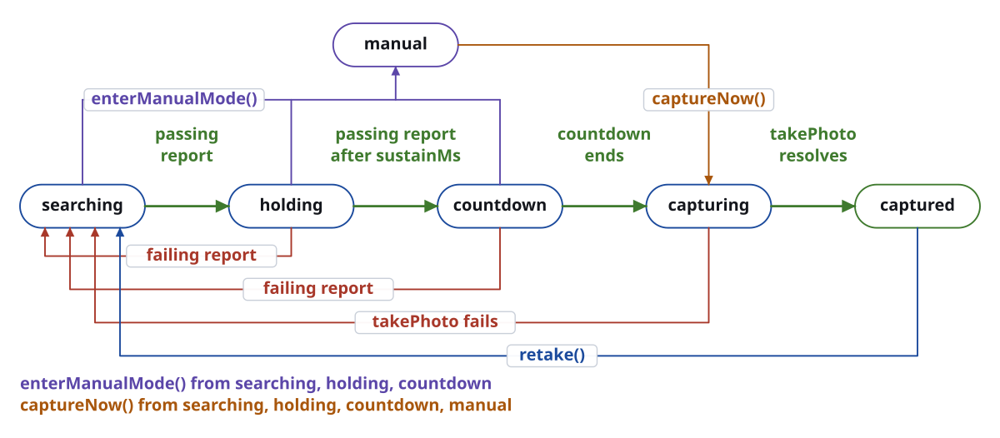

# @simplix-react-native-ext/capture

**English** | [한국어](/ko/extensions/native/packages/capture/README.md)

Auto-capture session for simplix-react-native: camera preview, an on-device face detection seam, composition judgement, sustain window, countdown, retake, a manual fallback, and the form-data part for uploading the photo. The package binds no face detector; the app injects one, and detection stays on the device.

## Installation

```bash
pnpm add @simplix-react-native-ext/capture
```

> **Prerequisites:** Peer dependencies: `@simplix-react-native/ui`, `@simplix-react/i18n`, `expo-camera` (>=16), `react` (>=18), `react-native` (>=0.76).

## Usage

The screen owns the camera permission, wires a detector into the session, and renders the guide frame over the preview until a photo is captured:

```tsx
import { useCallback, useRef } from "react";
import {
  CameraPreview,
  CapturePreview,
  GuideFrame,
  useAutoCaptureSession,
  useDetectorPolling,
  type CameraPreviewHandle,
  type FaceDetectorAdapter,
} from "@simplix-react-native-ext/capture";

export function ArrivalPhoto({ detector, onUpload }: { detector: FaceDetectorAdapter; onUpload: (uri: string) => void }) {
  const cameraRef = useRef<CameraPreviewHandle | null>(null);
  const takePicture = useCallback(async () => {
    const photo = await cameraRef.current!.takePictureAsync();
    return photo.uri;
  }, []);

  const session = useAutoCaptureSession({ takePhoto: takePicture });

  useDetectorPolling({
    detector,
    takeSnapshot: takePicture,
    onFaces: session.reportFaces,
    onDetectorFailure: session.enterManualMode,
    enabled: session.phase === "searching" || session.phase === "holding",
  });

  if (session.phase === "captured" && session.photoUri) {
    return (
      <CapturePreview
        photoUri={session.photoUri}
        onRetake={session.retake}
        onUse={() => onUpload(session.photoUri!)}
      />
    );
  }

  return (
    <CameraPreview cameraRef={cameraRef}>
      <GuideFrame
        phase={session.phase}
        countdown={session.countdown}
        failure={session.failure}
        onCaptureNow={session.captureNow}
      />
    </CameraPreview>
  );
}
```

A detector that pushes results (a frame processor) calls `session.reportFaces` directly and does not use `useDetectorPolling`. Request the permission with `useCameraPermissions()` before rendering the preview; when the camera is unavailable the screen can skip the photo.

## Session phases



| Phase | Meaning |
| --- | --- |
| `searching` | Waiting for a face report that satisfies the composition |
| `holding` | The composition holds; after `sustainMs` the next passing report starts the countdown |
| `countdown` | Counting down from `countdownFrom`, one step per `countdownTickMs`; a failing report aborts to `searching` |
| `capturing` | `takePhoto` is running |
| `captured` | `photoUri` holds the photo; `retake()` returns to `searching` |
| `manual` | Face reports are ignored and `captureNow()` takes the photo |

A failed `takePhoto` calls `onCaptureError` and returns the session to `searching`.

## API Reference

### `useAutoCaptureSession(options)`

Options (`UseAutoCaptureSessionOptions`, which also takes every `CompositionConfig` field):

| Option | Type | Default | Description |
| --- | --- | --- | --- |
| `takePhoto` | `() => Promise<string>` | required | Takes the photo and resolves its local URI |
| `sustainMs` | `number` | `1000` | How long the composition must hold before the countdown |
| `countdownFrom` | `number` | `3` | Countdown start value |
| `countdownTickMs` | `number` | `1000` | Countdown step length |
| `onCaptured` | `(photoUri: string) => void` | none | Called after a successful capture |
| `onCaptureError` | `(error: unknown) => void` | none | Called when `takePhoto` fails |

Result (`UseAutoCaptureSessionResult`): `phase` (`AutoCapturePhase`), `countdown`, `photoUri`, `failure` (`CompositionFailure | null`), `reportFaces(faces)`, `captureNow()`, `retake()`, `enterManualMode()`.

### `evaluateComposition(faces, config?)`

Pure judgement on the largest face in `faces` (`FaceBox[]`, values normalized to `0..1` with the origin at the top left). Returns `CompositionResult`: `{ ok, reason?, face? }`, where `reason` is a `CompositionFailure`: `"no-face"`, `"off-center"`, `"too-small"` or `"too-large"`.

| `CompositionConfig` field | Default | Description |
| --- | --- | --- |
| `centerTolerance` | `0.18` | Maximum distance of the face center from the target point on each axis |
| `targetX` | `0.5` | X of the target point |
| `targetY` | `0.5` | Y of the target point; lower it when the guide sits near the camera at the top of the screen |
| `minFaceRatio` | `0.18` | Minimum of the face box's larger side, as a fraction of the frame |
| `maxFaceRatio` | `0.6` | Maximum of the face box's larger side, as a fraction of the frame |

### `useDetectorPolling(options)`

Samples preview frames on an interval, runs a still-image `FaceDetectorAdapter` (`detect(imageUri): Promise<FaceBox[]>`) and passes the faces to `onFaces`.

| Option | Type | Default | Description |
| --- | --- | --- | --- |
| `detector` | `FaceDetectorAdapter` | required | Detector supplied by the app |
| `takeSnapshot` | `() => Promise<string>` | required | Grabs a frame and resolves its local URI |
| `onFaces` | `(faces: FaceBox[]) => void` | required | Usually `session.reportFaces` |
| `onDetectorFailure` | `(error: unknown) => void` | none | Called on each failed sample from the `failureThreshold`-th consecutive failure on; usually `session.enterManualMode` |
| `intervalMs` | `number` | `800` | Sampling interval |
| `failureThreshold` | `number` | `3` | Consecutive failures before `onDetectorFailure` |
| `enabled` | `boolean` | `true` | Pauses sampling when `false` |

### Components

| Component | Props | Description |
| --- | --- | --- |
| `CameraPreview` | `cameraRef`, `facing` (`"front"` default, or `"back"`), `mirror` (default `true` for the front camera), `onCameraReady`, `children`, `className` | `expo-camera` preview; `children` render as an overlay. `CameraPreviewHandle` is the ref type for `takePictureAsync` |
| `GuideFrame` | `phase`, `countdown`, `failure`, `onCaptureNow`, `anchor` (`"center"` default, or `"top"`), `className` | Face guide, status text, countdown, and the capture button in manual mode |
| `CapturePreview` | `photoUri`, `onRetake`, `onUse`, `busy`, `className` | Captured photo with retake and use-this-photo actions |

`useCameraPermissions` is re-exported from `expo-camera`.

### `capturePhotoFormDataPart(photoUri, fileName?)`

Returns `{ uri, name, type }` for a multipart upload. `fileName` defaults to `"arrival-photo.jpg"`; the type is `image/png` for a `.png` name and `image/jpeg` otherwise. The upload endpoint belongs to the app's generated domain hooks.

### Types

The package exports the prop and option types of the API above: `CameraPreviewProps`, `GuideFrameProps`, `CapturePreviewProps`, `UseDetectorPollingOptions`, `UseAutoCaptureSessionOptions`, `UseAutoCaptureSessionResult`, `AutoCapturePhase`, `FaceBox`, `FaceDetectorAdapter`, `CompositionConfig`, `CompositionFailure`, `CompositionResult`.

## Platform notes

- The package registers its en/ko/ja strings under the `simplix/native-capture` namespace on import.
- Its components use NativeWind `className` utilities, so add the package `src` folder to the app's Tailwind `content`.

---

<p class="page-source"><a href="https://github.com/simplix-framework/simplix-react/blob/main/extensions/native/packages/capture/README.md" target="_blank" rel="noopener noreferrer">Edit on GitHub</a></p>
