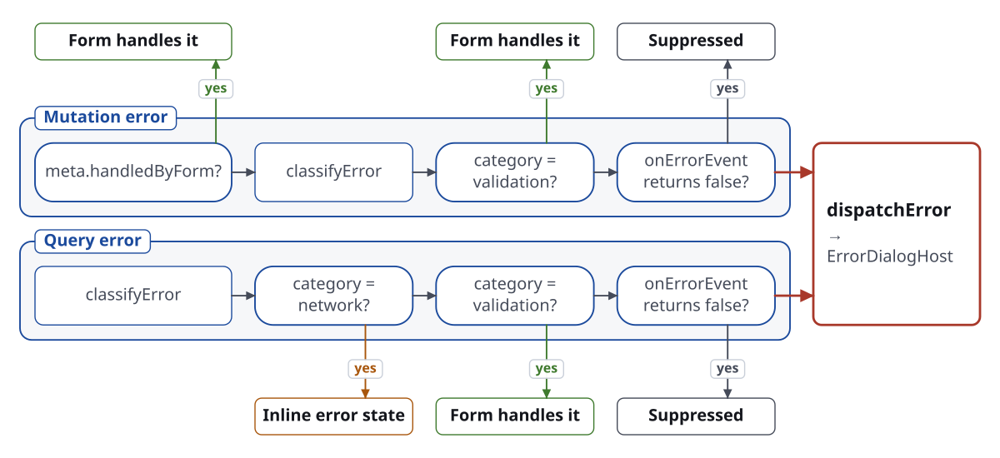

# @simplix-react-native/runtime

**English** | [한국어](/ko/extensions/native/packages/runtime/README.md)

Expo runtime glue for simplix-react-native apps. It provides token stores on device storage, the `boot`-strategy mutator for generated domain packages, a query client with the standard error policy, i18n initialization with locale persistence, the root provider, and `msw/native` mock wiring.

## Installation

```bash
pnpm add @simplix-react-native/runtime
```

> **Prerequisites:** Peer dependencies: `@simplix-react-native/ui`, `@simplix-react/api`, `@simplix-react/auth`, `@simplix-react/i18n`, `@simplix-react-ext/simplix-boot-auth`, `@tanstack/react-query` (>=5), `@react-native-async-storage/async-storage` (>=2), `expo-localization` (>=16), `expo-secure-store` (>=14), `react` (>=18), `react-native` (>=0.76), `react-native-safe-area-context` (>=5). `msw` (>=2) is optional and needed only for `startNativeMocks`.

## Usage

The boot module creates the token store, registers the mutator, and collects the gates the root provider awaits before the first frame:

```ts
// src/bootstrap/boot.ts
import {
  configureNativeBootMutator,
  createNativeI18n,
  createNativeQueryClient,
  createSecureTokenStore,
} from "@simplix-react-native/runtime";

export const i18n = createNativeI18n({
  defaultLocale: "ko",
  supportedLocales: ["en", "ko", "ja"],
});

export const tokenStore = createSecureTokenStore();

configureNativeBootMutator({
  baseUrl: process.env.EXPO_PUBLIC_API_URL ?? "http://localhost:8080",
  getToken: () => (tokenStore.hydrated ? tokenStore.get("access_token") : null),
});

export const queryClient = createNativeQueryClient();

export const bootReady = Promise.all([i18n.i18nReady, tokenStore.hydrate()]);
```

The root layout mounts the provider:

```tsx
// app/_layout.tsx
import { SimplixNativeProvider } from "@simplix-react-native/runtime";
import { Stack } from "expo-router";

import { bootReady, i18n, queryClient } from "../src/bootstrap/boot";

export default function RootLayout() {
  return (
    <SimplixNativeProvider queryClient={queryClient} i18nAdapter={i18n.adapter} ready={bootReady}>
      <Stack />
    </SimplixNativeProvider>
  );
}
```

`simplix add-app --native` generates both files in this shape.

## API Reference

### Token stores

`NativeTokenStore` extends the synchronous `TokenStore` of `@simplix-react/auth` (`get`, `set`, `remove`, `clear`) with `hydrate(): Promise<void>` and a read-only `hydrated` flag. Native storage is asynchronous, so a store keeps an in-memory cache and writes through to storage. Call `hydrate()` once during boot: `get`, `set`, `remove` and `clear` throw until it completes. A failed write is reported to the console and the in-memory value stays in force for the session.

| Function | Storage | Options |
| --- | --- | --- |
| `createSecureTokenStore(options?)` | Device keychain (`expo-secure-store`); keeps its own key index because the store cannot list keys, and replaces characters outside `[A-Za-z0-9._-]` in keys with `_` | `keyPrefix` (default `"simplix.token."`) |
| `createAsyncStorageTokenStore(options?)` | AsyncStorage, for values that are not secret (preferences, device ids) | `keyPrefix` (default `"simplix.store."`) |

### Mutator

`createNativeBootMutator(options)` returns the `OrvalMutator` for the `boot` strategy. `configureNativeBootMutator(options)` builds it and registers it with `configureMutator("boot", ...)` in one call; generated domain packages resolve it through `getMutator("boot")`.

| Option | Type | Default | Description |
| --- | --- | --- | --- |
| `baseUrl` | `string` | required | API origin; native apps always need an absolute origin (for example `"http://10.0.2.2:8080"`) |
| `getToken` | `() => string \| null` | none | Supplies the current token |
| `tokenHeader` | `string` | `"Authorization"` | Header carrying the token |
| `tokenScheme` | `string \| null` | `"Bearer"` | Prefix of the token value; `null` sends the raw token |
| `onUnauthorized` | `(context: UnauthorizedContext) => void` | none | Called on a 401 response with `{ status, url }` |

Each request sends the request locale as `Accept-Language` unless the header is already set. A successful response is unwrapped from the Boot envelope (`unwrapEnvelope`, which throws on a non-SUCCESS envelope). A non-2xx response throws `HttpError` with the body's `message` or the status text; a 401 calls `onUnauthorized` first and then throws as well.

### Query client and error dialog

`createNativeQueryClient(options?)` returns a `QueryClient` (queries: `retry: 1`, `refetchOnWindowFocus: false`) whose caches classify each error with `classifyError` from `@simplix-react/api` and route it:

- A mutation with `meta.handledByForm` is left to the form.
- An event in the `"validation"` category is left to the form fields.
- A query error in the `"network"` category is left to the screen's inline error state.
- `options.onErrorEvent(event)` returning `false` suppresses the dialog.
- Every other event goes to `dispatchError`.



| Export | Description |
| --- | --- |
| `dispatchError(event)` | Shows a `ServerErrorEvent` in the global error dialog; a new event replaces the one shown |
| `clearError()` | Dismisses the shown event |
| `useErrorEvent()` | Subscribes to the shown event (`null` when none) |
| `ErrorDialogHost` | The dialog: the server message as the description and the error code as secondary text. `SimplixNativeProvider` mounts it |

### i18n

`createNativeI18n(options)` takes the options of `createI18nConfig` from `@simplix-react/i18n` without `detection`, plus:

| Option | Type | Default | Description |
| --- | --- | --- | --- |
| `persistLocale` | `boolean` | `true` | Stores the selected locale in AsyncStorage; disable it on shared or unattended devices that must start in the default language |
| `storageKey` | `string` | `"simplix.i18n.locale"` | AsyncStorage key of the stored locale |

It returns `{ adapter, i18nReady }` synchronously. Inside `i18nReady` the locale resolves in this order: the stored locale, the device language (`expo-localization`), `defaultLocale`; a candidate outside `supportedLocales` is skipped. Every locale change is set as the request locale for `Accept-Language`.

### SimplixNativeProvider

The root provider: safe area, `QueryClientProvider`, `I18nProvider`, `SimplixThemeProvider`, `ToastHost`, `ErrorDialogHost` and `OverlayPortalHost`.

| Prop | Type | Description |
| --- | --- | --- |
| `queryClient` | `QueryClient` | Typically from `createNativeQueryClient()` |
| `i18nAdapter` | `II18nAdapter` | Typically `createNativeI18n(...).adapter` |
| `ready` | `Promise<unknown> \| Promise<unknown>[]` | Boot gates; a centered spinner renders until they settle, and a rejected gate is thrown |
| `theme` | `Omit<SimplixThemeProviderProps, "children">` | Forwarded to `SimplixThemeProvider` |
| `children` | `ReactNode` | App content |

### Mock wiring

`startNativeMocks(options)` starts the `msw/native` server with the given handlers and resolves a `NativeMockServer` with `stop()`. `onUnhandledRequest` is `"bypass" | "warn" | "error"` and defaults to `"bypass"`, so unmocked endpoints reach the real server. `msw` is imported dynamically, so a build that never calls it does not bundle it.

```ts
import { startNativeMocks } from "@simplix-react-native/runtime";

if (process.env.EXPO_PUBLIC_ENABLE_MOCKS === "true") {
  await startNativeMocks({ handlers: mockHandlers });
}
```

### Types

The package exports the prop and option types of the API above: `NativeTokenStore`, `SecureTokenStoreOptions`, `AsyncStorageTokenStoreOptions`, `NativeBootMutatorOptions`, `UnauthorizedContext`, `CreateNativeQueryClientOptions`, `CreateNativeI18nOptions`, `SimplixNativeProviderProps`, `StartNativeMocksOptions`, `NativeMockServer`.

## Platform notes

- Load the React Native polyfills msw needs (`react-native-url-polyfill/auto`, `fast-text-encoding`) in the entry file before calling `startNativeMocks`.
- There is no login page to redirect to on a 401: register the recovery the app needs (for example a device re-registration screen) in `onUnauthorized`.

---

<p class="page-source"><a href="https://github.com/simplix-framework/simplix-react/blob/main/extensions/native/packages/runtime/README.md" target="_blank" rel="noopener noreferrer">Edit on GitHub</a></p>
