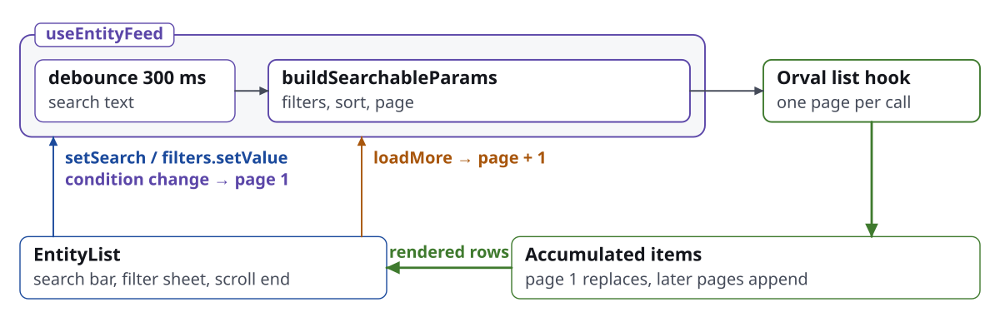

# @simplix-react-native/ui

**English** | [한국어](/ko/extensions/native/packages/ui/README.md)

Standard mobile UI kit for simplix-react on React Native: theme tokens, layout primitives, controls, sheet-first overlays, inputs, page skeletons, the `EntityList` list grammar with the `useEntityFeed` hook, and the `FormFields` / `DetailFields` namespaces. Components are styled with NativeWind utilities against the same token names as the web theme, and the package registers built-in en/ko/ja strings on import.

## Installation

```bash
pnpm add @simplix-react-native/ui
```

> **Prerequisites:** Peer dependencies: `@simplix-react/headless`, `@simplix-react/i18n`, `nativewind` (>=4), `react` (>=18), `react-native` (>=0.76), `react-native-safe-area-context` (>=5), `@react-native-community/datetimepicker` (>=8), `expo-document-picker` (>=13), `expo-image-picker` (>=16).

Add the Tailwind preset after the NativeWind preset, and include the package sources in `content` so NativeWind extracts their classes:

```js
// tailwind.config.js
module.exports = {
  content: [
    "./app/**/*.{ts,tsx}",
    "./node_modules/@simplix-react-native/ui/src/**/*.{ts,tsx}",
  ],
  presets: [
    require("nativewind/preset"),
    require("@simplix-react-native/ui/tailwind-preset"),
  ],
};
```

`simplix add-app --native` generates an equivalent configuration. `SimplixNativeProvider` from `@simplix-react-native/runtime` mounts `SimplixThemeProvider`, `ToastHost` and `OverlayPortalHost`; an app that composes its own root mounts them itself, with `OverlayPortalHost` last.

## Usage

A list screen feeds an Orval-generated list hook into `useEntityFeed` and renders the result with `EntityList`:

```tsx
import { EntityList, useEntityFeed } from "@simplix-react-native/ui";
import { router } from "expo-router";

import { useSearchVisits, type VisitListDTO } from "../domain";

export default function VisitListScreen() {
  const feed = useEntityFeed<VisitListDTO>(useSearchVisits, {
    searchField: "visitorName",
    sort: { field: "scheduledAt", direction: "desc" },
  });

  return (
    <EntityList
      feed={feed}
      keyExtractor={(visit) => String(visit.id)}
      filters={[
        {
          type: "faceted",
          key: "status.in",
          label: "Status",
          multiple: true,
          options: [
            { value: "SCHEDULED", label: "Scheduled" },
            { value: "DONE", label: "Done" },
          ],
        },
      ]}
      renderItem={(visit) => (
        <EntityList.Row
          title={visit.visitorName}
          subtitle={visit.hostName}
          onPress={() => router.push(`/visits/${visit.id}`)}
        />
      )}
      onCreate={() => router.push("/visits/new")}
    />
  );
}
```

`simplix scaffold <entity> --native` generates list, detail and form screens in this shape.

## API Reference

### List grammar



`useEntityFeed<T>(useListHook, options?)` drives an Orval-generated list hook with the searchable serialization of `@simplix-react/headless` (`buildSearchableParams`), the same one the web `useCrudList` uses. It accumulates pages for infinite scroll, debounces the search text by 300 ms, and returns to the first page whenever the search, filters or sort change.

| Option | Type | Default | Description |
| --- | --- | --- | --- |
| `pageSize` | `number` | `20` | Rows per fetch |
| `defaultFilters` | `Record<string, unknown>` | none | Initial filter values keyed by `field.operator` |
| `searchField` | `string` | none | Field the search text filters with the `contains` operator |
| `sort` | `SortState` | none | Fixed sort sent to the backend |
| `transformFilters` | `(filters) => Record<string, unknown>` | none | Transforms filters before serialization (backend-specific formats) |

The result (`UseEntityFeedResult<T>`) carries `items`, `total`, `isLoading`, `isLoadingMore`, `isRefreshing`, `error`, `hasMore`, `loadMore()`, `refresh()`, `search`, `setSearch()`, `filters` (`EntityFeedFilters`: `values`, `setValue`, `setValues`, `clear`, `activeCount`) and `emptyReason`.

`EntityList<T>` renders the feed: card rows in an infinite-scroll list with a pinned search bar, a filter sheet with applied-filter chips, pull-to-refresh, swipe row actions, a floating create button, and an empty or error state chosen by `emptyReason`.

| Prop | Type | Default | Description |
| --- | --- | --- | --- |
| `feed` | `UseEntityFeedResult<T>` | required | State from `useEntityFeed` |
| `renderItem` | `(item: T, index: number) => ReactNode` | required | Row renderer; compose `EntityList.Row` for the standard card row |
| `keyExtractor` | `(item: T, index: number) => string` | required | Row key |
| `filters` | `EntityFilterDef[]` | `[]` | Filter sheet definitions; empty hides the filter button |
| `searchPlaceholder` | `string` | localized | Search bar placeholder |
| `hideSearch` | `boolean` | `false` | Hides the search bar |
| `itemActions` | `(item: T, index: number) => SwipeAction[]` | none | Actions revealed by swiping a row left |
| `onCreate` | `() => void` | none | Shows the floating create button |
| `createLabel` | `string` | localized | Label of the create button |
| `header` | `ReactNode` | none | Content above the list (category tabs, summary strip) |
| `showTotal` | `boolean` | `true` | Shows the total count line |
| `className` | `string` | none | Root class names |

`EntityRow` (also `EntityList.Row`) takes `title`, `subtitle`, `meta`, `status` (`{ tone, label }`), `leading`, `trailing`, `onPress` and `className`. `SwipeableRow` reveals `SwipeAction` items (`{ key, label, tone?, onPress(close) }`) on a left swipe.

`EntityFilterDef` is one of:

| Type | Fields | Committed value |
| --- | --- | --- |
| `FacetedFilterDef` | `type: "faceted"`, `key`, `label`, `options`, `multiple?` | One value, or an array with `multiple` |
| `ToggleFilterDef` | `type: "toggle"`, `key`, `label` | `true` when on, absent when off |
| `TextFilterDef` | `type: "text"`, `key`, `label`, `placeholder?` | The text |
| `DateRangeFilterDef` | `type: "date-range"`, `fromKey`, `toKey`, `label` | Two boundary values |

### Page skeletons

| Export | Description |
| --- | --- |
| `Screen` | Page root: background, bottom safe-area inset, scroll and keyboard behavior. Props `scroll` (default `true`), `padded` (default `true`), `keyboardAvoiding` (default `false`), `className`, `contentClassName`. The expo-router stack header owns the title and actions |
| `StepFlow`, `StepFlow.Step`, `useStepFlow()` | One step per screen with a progress row and a Back/Next footer. `StepFlow` props: `onFinish`, `onCancel`, `hideFooter`, `hideProgress`, `finishLabel`, `className`. `StepFlow.Step` props: `title`, `nextDisabled`. `useStepFlow()` returns `{ index, count, isFirst, isLast, next, back, goTo }` |
| `MasterDetail`, `useIsWideLayout(breakpoint?)`, `MASTER_DETAIL_BREAKPOINT` | Two-pane layout for tablet landscape. Props `master`, `detail`, `placeholder`, `masterWidth` (default `360`), `breakpoint` (default `900`), `className`. Below the breakpoint only the master pane renders; check `useIsWideLayout()` before pushing the detail as its own route |

### Overlays

| Export | Description |
| --- | --- |
| `BottomSheet` | The default interaction surface (pickers, filters, menus). Props `open`, `onClose`, `title`, `maxHeightFraction` (default `0.85`), `children`, `className` |
| `Dialog`, `DialogClose` | Centered modal for small confirmations and single-input prompts. Props `open`, `onOpenChange`, `title`, `description`, `footer`, `children`, `className` |
| `AlertDialog` | Blocking confirmation for destructive or irreversible actions. Props `open`, `onOpenChange`, `title`, `description`, `confirmLabel`, `cancelLabel`, `destructive`, `onConfirm`, `className` |
| `Popover` | Anchored popover for light contextual content on tablets; phone flows use `BottomSheet`. Props `trigger`, `children`, `className` |
| `OverlayPortalHost` | Portal host (`PortalHost` of `@rn-primitives/portal`) for `Dialog`, `AlertDialog` and `Popover` |

### Inputs

`Input`, `usePlaceholderColor`, `Textarea`, `NumberInput`, `Checkbox`, `RadioGroup` (`RadioOption`), `Switch`, `SelectSheet`, `SelectTrigger`, `OptionRows` (`SelectOption`), `ComboboxSheet`, `NativeDateTimePicker` (`DateTimePickerMode`), `Tabs` (`TabItem`), `ActionSheetMenu` (`ActionSheetItem`). `SelectSheet`, `ComboboxSheet` and `ActionSheetMenu` open a `BottomSheet` instead of a dropdown.

### Fields

`FormFields` and `DetailFields` are namespaces with the same consumption shape as the web kit.

- `FormFields`: `FieldWrapper`, `TextField`, `TextareaField`, `NumberField`, `OtpField`, `PasswordField`, `PhoneField`, `CountryField`, `SelectField`, `MultiSelectField`, `ComboboxField`, `CheckboxField`, `SwitchField`, `DateField`, `DateRangeField`, `DateTimeField`, `TimeField`, `ImageField` (`PickedImage`), `FileField` (`PickedFile`), and the country helpers `COUNTRIES`, `countryDisplayName`, `countryFlagEmoji`, `countryFromDeviceZone`, `countryFromTimezone` (`CountryEntry`). Every field takes `CommonFieldProps`: `label`, `labelKey`, `error`, `warning`, `description`, `required`, `disabled`, `className`. The label always sits above the input.
- `DetailFields`: `DetailField`, `TextField`, `StatusField`, `BadgeField`, `BooleanField`, `DateField`, `NumberField`, `PhoneField`, `NoteField`, `ListField`, `LinkField`. Every field takes `CommonDetailFieldProps` (`label`, `labelKey`, `className`) and shows `EmptyValue` for an empty value.

```tsx
import { DetailFields, FormFields } from "@simplix-react-native/ui";

<FormFields.TextField label="Name" value={name} onChange={setName} required />
<DetailFields.TextField label="Name" value={visit.visitorName} />
```

### Controls

`Button` (`buttonVariants`, `buttonTextVariants`; variants `default`, `secondary`, `outline`, `ghost`, `destructive`; sizes `sm`, `default`, `lg`, `icon`, and `touch` for kiosk-grade touch targets), `Label`, `Badge` (`badgeVariants`, `badgeTextVariants`), `StatusBadge`, `StatusDot`, `BooleanBadge`, `EmptyValue`, `Separator`, `Skeleton`, `AlertBanner`, `ToastHost`, and the tone table `STATUS_TONES` (`StatusTone`, `StatusToneToken`). `ToastHost` renders the shared toast store of `@simplix-react/headless` (`addToast`) as bottom-anchored cards dismissed by a tap.

### Layout primitives

`Card`, `Container`, `Flex`, `Grid`, `Heading`, `Section`, `Stack`, `Text`, with `cardVariants`, `headingVariants`, `stackVariants`, `textVariants` and their prop types.

### Theme

`SimplixThemeProvider` injects the color tokens as CSS variables (NativeWind `vars()`), so utilities such as `bg-background` and `text-foreground` resolve against the active preset and color scheme.

| Prop | Type | Default | Description |
| --- | --- | --- | --- |
| `preset` | `ThemePresetName` | `"default"` | `"default"`, `"blue"`, `"green"`, `"krds"`, `"orange"`, `"rose"` or `"violet"` |
| `overrides` | `ThemeTokenOverrides` | none | `{ light?, dark? }` token maps layered over the preset |
| `fonts` | `ThemeFonts` | none | `{ sans?, display?, mono? }` font families registered by the app, applied by `Text` and `Heading` |

`useSimplixTheme()` returns `{ preset, setPreset, colorScheme, setColorScheme, fonts, tokens }`; `setColorScheme` accepts `"light"`, `"dark"` or `"system"`. `useThemeFonts()` returns the fonts (an empty object outside the provider). `BASE_TOKENS`, `PRESET_TOKENS` and `resolveThemeTokens(preset, scheme)` expose the token sheet (`ThemeTokenSheet`, `ColorTokenMap`).

### Utilities

`cn(...inputs)` merges class names with Tailwind-aware conflict resolution. `toTestId(label)` turns a label into a kebab-case `testID` segment.

### Types

Every component and hook exports its prop or option type under its own name with a `Props` or `Options` suffix (for example `EntityListProps`, `EntityRowProps`, `SwipeableRowProps`, `UseEntityFeedOptions`, `ScreenProps`, `StepFlowProps`, `StepProps`, `MasterDetailProps`, `ButtonProps`, `DialogProps`, `TextFieldProps`, `DetailFieldProps`). The context values are `StepFlowContextValue` and `SimplixThemeContextValue`; the variant and size types are `ButtonVariants`, `BadgeVariants`, `CardVariants`, `HeadingVariants`, `StackVariants`, `TextVariants`, `ContainerSize`, `GridColumns` and `GridGap`. `FormFields.TextField` and `DetailFields.TextField` each export their own `TextFieldProps`, and the same holds for the other names the two namespaces share.

## Platform notes

- The package ships TypeScript source; Metro transpiles it and there is no build step.
- The package registers its en/ko/ja strings under the `simplix/native` namespace on import.
- `SwipeableRow` is built on `PanResponder` and `Animated` and needs no gesture-handler package.

---

<p class="page-source"><a href="https://github.com/simplix-framework/simplix-react/blob/main/extensions/native/packages/ui/README.md" target="_blank" rel="noopener noreferrer">View source</a></p>
