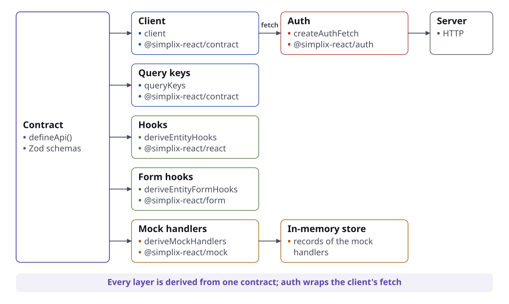

# Overview

**English** | [한국어](/ko/getting-started/overview.md)

## What is simplix-react?

simplix-react is a **package-first React framework** that auto-generates reusable domain packages from OpenAPI specs. It provides a unified pipeline that starts with a single API contract definition and derives type-safe HTTP clients, React Query hooks, form hooks, and MSW mock handlers, which removes boilerplate and keeps your entire data layer in sync.

## Core Philosophy: Define Once, Derive Everything

The central idea behind simplix-react is that your API contract is the **single source of truth**. You define your entities and their operations once using Zod schemas, and the framework derives everything else:



This eliminates the common problem of manually keeping API types, client functions, query hooks, and mock data in sync. When the contract changes, every derived layer changes with it, with full type safety.

## The Pipeline

**Step 1: Define the Contract**

Use `defineApi` with Zod schemas to describe your entities (CRUD resources). Each entity has a schema and a map of operations, each with an HTTP method and a path. An operation named `list`, `get`, `create`, `update`, `delete` or `tree` takes that CRUD role; any other name is a custom operation. `defineApi` returns the contract with its `config`, a typed `client` and `queryKeys` factories.

```ts
import { defineApi, simpleQueryBuilder } from "@simplix-react/contract";
import { z } from "zod";

const taskSchema = z.object({ id: z.number(), title: z.string(), status: z.string() });

const projectApi = defineApi({
  domain: "project",
  basePath: "/api/v1",
  entities: {
    task: {
      schema: taskSchema,
      operations: {
        list: { method: "GET", path: "/tasks" },
        get: { method: "GET", path: "/tasks/:id" },
        create: { method: "POST", path: "/tasks", input: taskSchema.omit({ id: true }) },
        update: { method: "PATCH", path: "/tasks/:id", input: taskSchema.partial().omit({ id: true }) },
        delete: { method: "DELETE", path: "/tasks/:id" },
      },
    },
  },
  queryBuilder: simpleQueryBuilder,
});
```

**Step 2: Derive Hooks**

Pass the contract to `deriveEntityHooks` to get React Query hooks for every entity. Each hook is named `use` plus the operation name, and the `list` operation also gives `useInfiniteList`.

```ts
import { deriveEntityHooks } from "@simplix-react/react";

const hooks = deriveEntityHooks(projectApi);

// hooks.task.useList()
// hooks.task.useInfiniteList()
// hooks.task.useGet(id)
// hooks.task.useCreate()
// hooks.task.useUpdate()
// hooks.task.useDelete()
```

**Step 3: Mock the Backend**

Derive MSW request handlers from the same contract. Combined with in-memory stores, you get a working mock backend with zero server setup. Seed data is keyed by store name, `<domain>_<entity in snake_case>`.

```ts
import { deriveMockHandlers, setupMockWorker } from "@simplix-react/mock";

await setupMockWorker({
  domains: [{
    name: "project",
    handlers: deriveMockHandlers(projectApi.config),
    seed: { project_task: [{ id: 1, title: "Sample", status: "todo" }] },
  }],
});
```

## Who Is It For?

simplix-react is designed for React developers who:

- Build **API-driven applications** with RESTful backends
- Want **type safety** across the entire data layer (contract → client → hooks → mocks)
- Prefer **convention over configuration** to reduce boilerplate
- Need a **mock data layer** for frontend-first development, demos, or offline usage
- Use **TanStack Query** for server state management

## Package Overview

| Package | Description |
| --- | --- |
| `@simplix-react/contract` | Zod-based type-safe API contract definitions. Entry point for `defineApi`. |
| `@simplix-react/react` | Derives TanStack Query hooks from a contract via `deriveEntityHooks`. |
| `@simplix-react/form` | TanStack Form hooks derived from contracts via `deriveEntityFormHooks`. |
| `@simplix-react/mock` | Auto-generated MSW handlers with in-memory stores from contracts. |
| `@simplix-react/auth` | Authentication middleware with Bearer, API Key, OAuth2, and custom schemes. |
| `@simplix-react/access` | Authorization and access control with CASL integration. |
| `@simplix-react/i18n` | Internationalization framework built on i18next. |
| `@simplix-react/ui` | CRUD UI components (list, form, detail, tree, filters). |
| `@simplix-react/api` | Orval mutator singleton for generated domain packages. |
| `@simplix-react/headless` | Platform-neutral logic shared by the web and native UI kits. |
| `@simplix-react/calendar` | Domain-agnostic calendar components (month, week, day, year, agenda, timeline views). |
| `@simplix-react/gantt-core` | Framework-free project scheduling engine. |
| `@simplix-react/gantt` | Gantt chart for React on the scheduling engine. |
| `@simplix-react/process-core` | Framework-free procedure model. |
| `@simplix-react/process` | Procedure lanes for React on the procedure model. |
| `@simplix-react/testing` | Testing utilities for simplix-react applications. |
| `@simplix-react/cli` | CLI for project scaffolding and validation. |

The `simplix-react` meta package depends on these packages, except `headless`.

## Next Steps

- [Installation](/en/getting-started/installation.md): set up simplix-react in your project
- [Quick Start](/en/getting-started/quick-start.md): build your first contract-driven feature
- [TypeScript Setup](/en/getting-started/typescript.md): configure TypeScript for type inference

---

<p class="page-source"><a href="https://github.com/simplix-framework/simplix-react/blob/main/docs/en/getting-started/overview.md" target="_blank" rel="noopener noreferrer">Edit on GitHub</a></p>
