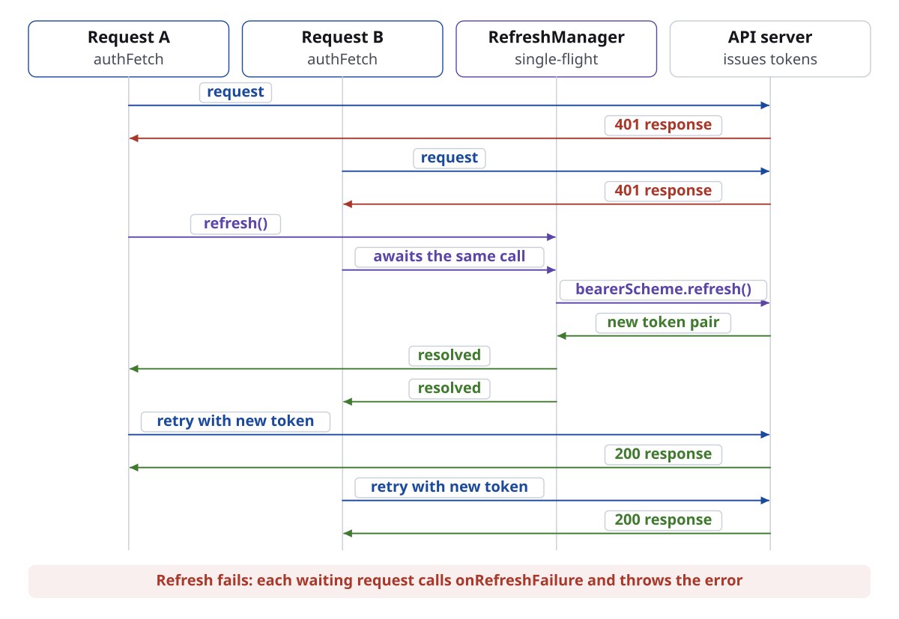

# How to Add Authentication

**English** | [한국어](/ko/guides/authentication.md)

> Set up authenticated API requests using `@simplix-react/auth` with automatic token refresh, 401 retry, and React integration.

## Before You Begin

- You have a contract defined with `defineApi` from `@simplix-react/contract`
- You understand the `FetchFn` type signature: `<T>(path: string, options?: RequestInit) => Promise<T>`
- Install the auth package:

```bash
pnpm add @simplix-react/auth
```

## Solution

### Bearer Token Authentication

The most common setup: attach a Bearer token to every request and refresh it automatically when it expires.

```ts
import { defineApi } from "@simplix-react/contract";
import { createAuth, bearerScheme, localStorageStore } from "@simplix-react/auth";
import { projectConfig } from "./contract";

const store = localStorageStore("myapp:");

const auth = createAuth({
  schemes: [
    bearerScheme({
      store,
      token: () => store.get("access_token"),
      refresh: {
        refreshFn: async () => {
          const res = await fetch("/api/auth/refresh", {
            method: "POST",
            headers: { "Content-Type": "application/json" },
            body: JSON.stringify({
              refreshToken: store.get("refresh_token"),
            }),
          });
          if (!res.ok) throw new Error("Refresh failed");
          return res.json(); // must return a TokenPair: { accessToken, refreshToken?, expiresIn?, expiresAt?, refreshTokenExpiresAt? }
        },
        refreshBeforeExpiry: 60, // proactively refresh 60 seconds before expiry
      },
    }),
  ],
  store,
  onRefreshFailure: () => {
    auth.clear();
    window.location.href = "/login";
  },
});

const projectApi = defineApi(projectConfig, { fetchFn: auth.fetchFn });
```

What happens automatically:

- Every request receives an `Authorization: Bearer <token>` header
- A request made within 60 seconds of the stored expiry refreshes the token before it is sent (set `autoSchedule: true` to refresh in the background instead of on the next request; see [Background Refresh](#background-refresh))
- On a 401 response, a refresh is triggered and the request is retried once (`maxRetries` changes the count)
- Concurrent 401s share a single refresh call (no thundering herd)
- If refresh fails, `onRefreshFailure` fires and the error is thrown



The expiry comes from `expiresIn` (seconds from now) or `expiresAt` (ISO 8601 string or epoch milliseconds) in the returned `TokenPair`. Without either, the token is refreshed only after a 401.

### API Key Authentication

For services that authenticate via a static API key in a header:

```ts
import { createAuth, apiKeyScheme } from "@simplix-react/auth";

const auth = createAuth({
  schemes: [
    apiKeyScheme({
      in: "header",
      name: "X-API-Key",
      key: "sk-your-api-key",
    }),
  ],
});

const api = defineApi(config, { fetchFn: auth.fetchFn });
// Every request includes: X-API-Key: sk-your-api-key
```

For API keys in query parameters:

```ts
apiKeyScheme({
  in: "query",
  name: "api_key",
  key: "sk-your-api-key",
});
// Appends ?api_key=sk-your-api-key to every request URL
```

### OAuth2 Refresh Token Grant

For OAuth2 providers that issue access and refresh tokens:

```ts
import { createAuth, oauth2Scheme, localStorageStore } from "@simplix-react/auth";

const store = localStorageStore("oauth:");

const auth = createAuth({
  schemes: [
    oauth2Scheme({
      store,
      tokenEndpoint: "https://auth.example.com/oauth/token",
      clientId: "my-spa-client",
      scopes: ["openid", "profile", "api"],
      tokenEndpointHeaders: { "X-Custom-Header": "value" },
      tokenEndpointBody: { audience: "https://api.example.com" },
    }),
  ],
  store,
  onRefreshFailure: () => {
    auth.clear();
    window.location.href = "/login";
  },
});

// After the OAuth callback, store the initial tokens:
auth.setTokens({
  accessToken: callbackResponse.access_token,
  refreshToken: callbackResponse.refresh_token,
  expiresIn: callbackResponse.expires_in,
});

const api = defineApi(config, { fetchFn: auth.fetchFn });
```

The `oauth2Scheme` sends a standard `refresh_token` grant to the token endpoint with `application/x-www-form-urlencoded` content type, including `client_id`, `client_secret` when you pass `clientSecret`, and `scope` when you pass `scopes`. It refreshes only after a 401, since it does not read the stored expiry, and it stores the new tokens in the provided store, keeping the old refresh token when the response carries none.

### Custom Authentication (JWE, HMAC, Form-Based)

For non-standard auth flows, use `customScheme` to provide your own header generation and refresh logic:

```ts
import { createAuth, customScheme, localStorageStore } from "@simplix-react/auth";

const store = localStorageStore("jwe:");

const auth = createAuth({
  schemes: [
    customScheme({
      name: "jwe",
      getHeaders: async () => {
        const jwe = store.get("access_token");
        if (!jwe) return {};
        const decrypted = await decryptJwe(jwe, encryptionKey);
        return { Authorization: `Bearer ${decrypted}` };
      },
      refresh: async () => {
        const form = new URLSearchParams({
          grant_type: "refresh_token",
          token: store.get("refresh_token") ?? "",
        });
        const res = await fetch("/auth/token", { method: "POST", body: form });
        if (!res.ok) throw new Error("JWE refresh failed");
        const { accessToken, refreshToken } = await res.json();
        store.set("access_token", accessToken);
        store.set("refresh_token", refreshToken);
      },
      isAuthenticated: () => store.get("access_token") !== null,
      clear: () => store.clear(),
    }),
  ],
  store,
});
```

### Combining Multiple Schemes

Some APIs require both Bearer authentication and an API key. Use `composeSchemes` to merge them:

```ts
import {
  createAuth,
  composeSchemes,
  bearerScheme,
  apiKeyScheme,
  localStorageStore,
} from "@simplix-react/auth";

const store = localStorageStore("myapp:");

const auth = createAuth({
  schemes: [
    composeSchemes(
      bearerScheme({
        store,
        token: () => store.get("access_token"),
        refresh: { refreshFn: myRefreshFn },
      }),
      apiKeyScheme({ in: "header", name: "X-API-Key", key: "sk-abc123" }),
    ),
  ],
  store,
});

// Every request carries both Authorization and X-API-Key headers
```

Headers from later schemes override earlier ones when names conflict. On a refresh, the composed scheme calls the first scheme that has a `refresh` function and stops there.

## Variations

### Choosing a Token Store

| Store | Keeps tokens |
|: |: |
| `memoryStore()` | In memory, until the page reloads |
| `localStorageStore(prefix?)` | In `localStorage`, across browser restarts |
| `sessionStorageStore(prefix?)` | In `sessionStorage`, until the tab closes |
| `createRememberMe(namespace).rememberMeStore(prefix)` | In `localStorage` or `sessionStorage`, by the user's stay-signed-in choice |

The web storage stores prefix every key (`"auth:"` by default), and `clear()` removes only the keys under that prefix. The schemes read and write `access_token`, `refresh_token`, `expires_at` and `refresh_expires_at`.

`createRememberMe` keeps the preference itself outside the token prefix, so signing out does not reset it:

```ts
import { createAuth, bearerScheme, createRememberMe } from "@simplix-react/auth";

const { rememberMeStore, isRemembered, setRemembered } = createRememberMe("myapp");
const store = rememberMeStore("myapp:");

// On the sign-in form, before the credentials are exchanged:
setRemembered(rememberCheckbox.checked);
```

### Auth Configuration Options

`createAuth` and `createAuthFetch` take the same `AuthConfig`:

| Option | Default | Purpose |
|: |: |: |
| `schemes` | required | The schemes whose headers every request carries |
| `store` | none | The store `getAccessToken`, `setTokens`, `clear` and `rehydrate` use |
| `onRefreshFailure` | none | Called with the error when a refresh after a 401 fails |
| `maxRetries` | `1` | Retries after a 401 |
| `is401` | `status === 401` | Decides whether an error is a 401 |
| `onRehydrate` | none | Validates a stored access token in `rehydrate()`; returning `false` clears the tokens |
| `globalHeaders` | none | Headers merged into every request before the scheme headers |
| `fetchFn` | `defaultFetch` | The fetch function the auth headers wrap |

Headers given in the request options override both the global and the scheme headers.

### Background Refresh

With `autoSchedule: true`, `bearerScheme` refreshes on a timer before the token expires, so a page that makes no requests stays signed in:

```ts
import { bearerScheme, createActivityTracker, localStorageStore } from "@simplix-react/auth";

const store = localStorageStore("myapp:");
const activity = createActivityTracker();

const scheme = bearerScheme({
  store,
  token: () => store.get("access_token"),
  refresh: {
    refreshFn: myRefreshFn,
    refreshBeforeExpiry: 60,
    autoSchedule: true,
    minIntervalSeconds: 30,
    activity,
    lockName: "myapp:refresh",
    onScheduledRefreshFailed: () => redirectToLogin(),
  },
});
```

- `activity` makes the schedule refresh only when the user was active since the tokens were last stored; an idle page lets the issuer's idle timeout end the session.
- `lockName` serialises refreshes across every tab that shares the store, using the Web Locks API (`lock` replaces it). A tab that finds the store already refreshed by another uses those tokens.
- A scheduled refresh that fails with a network `TypeError` is retried after `minIntervalSeconds`; any other failure calls `onScheduledRefreshFailed`.
- `auth.setTokens` re-arms the schedule against the new expiry.

### OpenID Connect Sign-In

`createOidcClient` runs the authorization code flow with PKCE against an OpenID Connect issuer and returns a `TokenPair` you hand to `setTokens`:

```ts
import { createOidcClient } from "@simplix-react/auth";

const oidc = createOidcClient({
  issuer: "https://id.example.com/realms/staff",
  clientId: "backoffice",
  redirectUri: `${location.origin}/login/complete`,
  postLogoutRedirectUri: location.origin,
});

// On the sign-in page:
await oidc.signIn({ returnTo: "/users" });

// On /login/complete:
const { tokens, returnTo } = await oidc.completeSignIn(location.href);
auth.setTokens(tokens);

// As the bearer refreshFn:
const refreshFn = () => oidc.refresh(store.get("refresh_token") ?? "");

// On sign-out:
const url = await oidc.signOutUrl();
auth.clear();
if (url) location.assign(url);
```

`completeSignIn` throws an `AuthError` with code `SIGN_IN_FAILED`; its `signInFailure` is `issuer-error`, `not-pending`, `malformed-response` or `token-refused`. For a popup flow instead of a redirect, `openOAuth2Popup({ url, expectedOrigin })` opens the authorization URL and resolves with the message the callback page posts.

### React Integration

Wrap your app with `AuthProvider` to access auth state in components:

```tsx
import { AuthProvider, useAuth, useAuthFetch } from "@simplix-react/auth/react";

// In your app root
function App() {
  return (
    <AuthProvider auth={auth}>
      <Router />
    </AuthProvider>
  );
}

// In any component
function UserMenu() {
  const { isAuthenticated, isLoading, user, login, logout } = useAuth();

  if (isLoading) return null;

  if (!isAuthenticated) {
    return <LoginButton onSuccess={(tokens) => login(tokens)} />;
  }

  return <button onClick={logout}>Logout</button>;
}

// For ad-hoc authenticated requests
function FileUploader() {
  const fetchFn = useAuthFetch();

  async function upload(file: File) {
    const formData = new FormData();
    formData.append("file", file);
    await fetchFn("/api/upload", { method: "POST", body: formData });
  }

  return <input type="file" onChange={(e) => upload(e.target.files![0])} />;
}
```

The `useAuth` hook re-renders when `isAuthenticated` or `user` changes, powered by `useSyncExternalStore`. It also returns `getAccessToken()`.

Pass `userLoader` to `AuthProvider` to load the current user: on mount it calls `auth.rehydrate()`, then `userLoader(accessToken)`, and stores the result with `auth.setUser`. `isLoading` stays `true` until that finishes, and a failed load clears the tokens. After a later sign-in, the provider loads the user again.

```tsx
<AuthProvider auth={auth} userLoader={(token) => fetchCurrentUser(token)}>
  <Router />
</AuthProvider>
```

### Subscribing to Auth Changes (Non-React)

Use `auth.subscribe` to react to auth state changes without React:

```ts
const unsubscribe = auth.subscribe(() => {
  console.log("Auth state changed:", auth.isAuthenticated());

  if (!auth.isAuthenticated()) {
    router.navigate("/login");
  }
});

// Clean up when done
unsubscribe();
```

### Low-Level: fetchFn Only

If you only need an authenticated fetch function without reactive state management, use `createAuthFetch` directly:

```ts
import { createAuthFetch, bearerScheme, memoryStore } from "@simplix-react/auth";

const store = memoryStore();
store.set("access_token", "my-token");

const fetchFn = createAuthFetch({
  schemes: [bearerScheme({ store, token: () => store.get("access_token") })],
});

const api = defineApi(config, { fetchFn });
```

### Error Handling

Auth errors use typed error codes for programmatic handling:

```ts
import { AuthError } from "@simplix-react/auth";

try {
  await auth.fetchFn("/api/protected");
} catch (error) {
  if (error instanceof AuthError) {
    switch (error.code) {
      case "REFRESH_FAILED":
        // All refresh attempts failed: redirect to login
        // error.issuerError holds the issuer's { error, description } when it refused
        break;
      case "SCHEME_ERROR":
        // Scheme-level failure, such as a failed OIDC discovery
        break;
      case "SIGN_IN_FAILED":
        // OIDC sign-in could not be finished; error.signInFailure says why
        break;
    }
  }
}
```

### Testing Authenticated Requests

Use `memoryStore` for deterministic, isolated test auth:

```ts
import { createAuthFetch, bearerScheme, memoryStore } from "@simplix-react/auth";
import { defineApi } from "@simplix-react/contract";

const store = memoryStore();
store.set("access_token", "test-token-123");

const fetchFn = createAuthFetch({
  schemes: [bearerScheme({ store, token: () => store.get("access_token") })],
});

const api = defineApi(testConfig, { fetchFn });
// All requests in tests carry: Authorization: Bearer test-token-123
```

A 401 that no refresh fixes is rethrown as the original error from the fetch function. `TOKEN_EXPIRED` and `UNAUTHENTICATED` are also members of `AuthErrorCode` for your own `customScheme` to throw; the built-in schemes do not throw them.

## Related

- [Authentication Architecture](/en/core-concepts/authentication.md): design decisions and internals
- [Build a Protected App](/en/tutorials/auth-protected-app.md): step-by-step tutorial
- [Custom Fetch Functions](/en/guides/custom-fetch.md): lower-level fetch customization without the auth package
- [Mock Handlers](/en/guides/mock-handlers.md): set up MSW handlers for development

---

<p class="page-source"><a href="https://github.com/simplix-framework/simplix-react/blob/main/docs/en/guides/authentication.md" target="_blank" rel="noopener noreferrer">View source</a></p>
