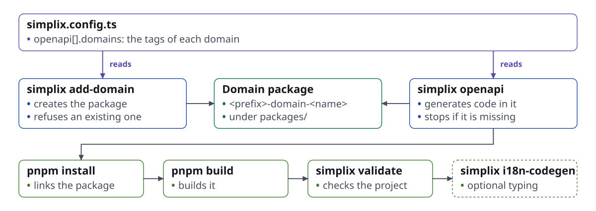

# How to Use the simplix CLI

**English** | [한국어](/ko/guides/cli-usage.md)

> Scaffold projects, add domains and modules, validate structure, generate i18n types, and import OpenAPI specs using the `simplix` command-line tool.

## Before You Begin

- Node.js 18+ and pnpm installed
- Install the CLI globally or use it via `npx`:

```bash
pnpm add -g @simplix-react/cli

# or use without installing
npx @simplix-react/cli <command>
```

## Solution

Every command looks for the project root at or above the working directory (the nearest directory holding `simplix.config.ts`). The global `--root <dir>` option names the root instead, and the plugins declared in that root's configuration are loaded before the command runs.



### simplix init: Create a New Project

Scaffolds a complete monorepo with root configuration, a core package, and an optional demo app:

```bash
simplix init my-project
```

Interactive prompts ask for:

| Prompt | Default | Description |
| --- | --- | --- |
| npm scope | `@my-project` | Package scope (e.g., `@mycompany`) |
| Include demo app? | `true` | Creates `apps/my-project-demo/` |
| Enable i18n? | `true` | Sets up locale files and i18n config |
| Enable auth? | `true` | Sets up authentication |
| Enable access control? | `true` | Sets up authorization |
| Select locales | en, ko, ja | Multi-select from built-in locales (asked only when i18n is enabled) |

Non-interactive mode accepts all defaults:

```bash
simplix init my-project -y
```

Override the scope:

```bash
simplix init my-project --scope @mycompany
```

Skip optional features:

```bash
simplix init my-project --no-demo --no-i18n --no-auth --no-access
```

| Option | Description |
| --- | --- |
| `-s, --scope <scope>` | npm scope for packages (an `@` is added when missing) |
| `--no-demo` | Skip demo app creation |
| `--no-i18n` | Skip i18n setup |
| `--no-auth` | Skip auth setup |
| `--no-access` | Skip access control setup |
| `-y, --yes` | Accept all defaults (non-interactive) |

The command stops when the target directory already exists.

Generated structure:

```text
my-project/
  package.json
  pnpm-workspace.yaml
  turbo.json
  tsconfig.json
  .gitignore
  .claude/CLAUDE.md
  config/typescript/
    base.json
    react.json
  packages/my-project-core/
    src/
      index.ts
      api/
      mock/
      react/
      types/
  apps/my-project-demo/          # if --demo
    src/
      main.tsx
      app/
        i18n/                    # if --i18n
      locales/                   # if --i18n
      routes/
  modules/
```

After scaffolding:

```bash
cd my-project
pnpm install
pnpm build
pnpm dev
```

### simplix add-domain: Add a Domain Package

Creates the skeleton of a domain package under `packages/`, named `<prefix>-domain-<name>` (the prefix is `packages.prefix` from `simplix.config.ts`, else the root package name):

```bash
simplix add-domain inventory
```

| Option | Description |
| --- | --- |
| `--no-i18n` | Skip i18n translations setup |
| `-y, --yes` | Accept all defaults (non-interactive) |

What the skeleton holds depends on the `openapi` entry of `simplix.config.ts`:

- When an `openapi` entry maps this domain name in its `domains`, the package is prepared for generated code (`src/mutator.ts` and the code generation script), and its code comes from `simplix openapi` (or `simplix meta` when the entry has a `meta` block).
- Otherwise the command asks for entity names (comma separated, `inventory` by default; `-y` takes the domain name as the only entity) and writes a hand-written contract, hooks and mock layer for them.

The command stops when the package already exists, and prints the command that regenerates its code.

Generated structure without an `openapi` entry:

```text
packages/my-project-domain-inventory/
  package.json
  tsup.config.ts
  vitest.config.ts
  tsconfig.json
  src/
    index.ts
    schemas.ts
    contract.ts
    hooks.ts
    translations.ts      # if i18n enabled
    locales/             # if i18n enabled
      en.json
      ko.json
      ja.json
    mock/
      index.ts
      handlers.ts
      seed.ts
```

After creation:

```bash
pnpm install
pnpm build
```

Then add the dependency to your app:

```json
{
  "dependencies": {
    "@mycompany/my-project-domain-inventory": "workspace:*"
  }
}
```

### simplix add-module: Add an FSD Module

Creates a Feature-Sliced Design module under `modules/` with features, widgets, shared layers, and optional i18n:

```bash
simplix add-module editor
```

| Option | Description |
| --- | --- |
| `--no-i18n` | Skip locale file generation |
| `-y, --yes` | Non-interactive mode |

Generated structure:

```text
modules/my-project-editor/
  package.json
  tsup.config.ts
  vitest.config.ts
  tsconfig.json
  src/
    index.ts
    features/
      index.ts
    widgets/
      index.ts
    shared/
      lib/
      ui/
      config/
    locales/           # if i18n enabled
      index.ts
      widgets/
        en.json
        ko.json
        ja.json
      features/
        en.json
        ko.json
        ja.json
```

### simplix validate: Validate Project Structure

Runs the validation rule sets over the workspace root, `packages/`, `modules/` and `apps/`:

```bash
simplix validate
```

| Rule Set | Scope | What It Checks |
| --- | --- | --- |
| Root Rules | workspace root | `turbo.json`, scripts, catalog, `tsconfig` |
| Package Rules | packages/, modules/ | `package.json` fields, exports, dependencies, build config |
| Contract Rules | packages/ | API contract schema validity, entity definitions |
| FSD Rules | modules/, apps/ | Feature-Sliced Design layer structure and conventions |
| Import Rules | modules/ | Cross-layer import violations |
| i18n Rules | modules/ | Missing locale keys, locale file consistency |

Auto-fix supported issues. A bare `--fix` repairs package exports only; name the checks to fix more (comma separated), or `all`:

```bash
simplix validate --fix
simplix validate --fix exports,dependencies,i18n
simplix validate --fix all
```

The checks `--fix` accepts are `exports`, `dependencies`, `tsup`, `i18n`, `fsd`, `root`, `tsconfig` and `expo`. Keys listed under `i18n.localeOnlyKeys` in `simplix.config.ts` are neither reported as extra nor removed by `--fix`.

Example output:

```text
simplix validate

  packages/my-project-core
    ✔ package.json has required fields
    ✔ tsconfig.json exists
    ✔ Build config valid

  modules/my-project-editor
    ✔ FSD layers present
    ⚠ Missing locale key: "save_button" in ko.json
    ✖ Import violation: widgets/ imports from features/

  Summary: 1 error, 1 warning, 4 checks passed
```

Exit code is `1` when errors are present, making it suitable for CI pipelines:

```bash
simplix validate || exit 1
```

### simplix i18n-codegen: Generate TypeScript Types from Locale Files

Scans every locale directory of the modules under `modules/` and writes a `keys.d.ts` type definition into each. The keys come from `en.json`, or from the first JSON file when there is no `en.json`, and the type is named after the directory (`locales` gives `LocalesKeys`):

```bash
simplix i18n-codegen
```

For a module with `src/locales/en.json`:

```json
{
  "title": "Editor",
  "actions": {
    "save": "Save",
    "cancel": "Cancel"
  }
}
```

The command generates `src/locales/keys.d.ts`:

```ts
// Auto-generated by simplix i18n-codegen
// Do not edit manually

export type LocalesKeys =
  | "title"
  | "actions.save"
  | "actions.cancel";
```

Watch mode regenerates on file changes:

```bash
simplix i18n-codegen --watch
```

### simplix openapi: Generate Domain Code from an OpenAPI Spec

Parses an OpenAPI specification and generates, with Orval, the schemas, client, hooks, mock layer and `.http` test files of a domain package. The package must exist first: create it with `simplix add-domain`.

```bash
simplix openapi ./specs/petstore.yaml
```

```bash
simplix openapi https://api.example.com/openapi.json --domain pets
```

| Option | Description |
| --- | --- |
| `-d, --domain <name>` | Domain to generate (defaults to every domain) |
| `-e, --entities <names>` | Entities to generate (comma separated, defaults to all) |
| `-o, --output <dir>` | Output directory (defaults to `packages/`) |
| `-f, --force` | Regenerate even if no changes detected |
| `--no-http` | Skip `.http` file generation |
| `--offline` | Read SimpliX Meta from the configured `meta.snapshot` instead of the server |
| `-y, --yes` | Auto-confirm without prompts |

On subsequent runs, the command detects changes against a `.openapi-snapshot.json` file and regenerates only the generated code (`src/generated/`, `src/hooks/`, `src/mock/`). Custom exports in `src/index.ts` are kept. Use `-f, --force` to regenerate even when no changes are detected.

#### Multi-Domain Mode

When your OpenAPI spec contains operations tagged for different domains, you can split the output into multiple packages automatically. Add an `openapi` entry with `domains` to your `simplix.config.ts`. `openapi` is an array of per-spec configurations:

```ts
// simplix.config.ts
import { defineConfig } from "@simplix-react/cli";

export default defineConfig({
  openapi: [
    {
      spec: "./specs/petstore.yaml",
      domains: {
        pet: ["pet"],
        store: ["store"],
        user: ["user"],
      },
    },
  ],
});
```

Each key is a domain name and each value is an array of tag patterns. Patterns can be exact strings or regular expressions wrapped in `/`:

```ts
// Exact match + regex patterns
domains: {
  iam: ["IAM", "Authentication", "/^Auth.*/"],
  billing: ["Billing", "/^Payment.*/"],
}
```

Running `simplix openapi` with this config generates into one package per matched domain:

```bash
simplix openapi https://petstore.swagger.io/v2/swagger.json -y
# → packages/myapp-domain-pet/
# → packages/myapp-domain-store/
# → packages/myapp-domain-user/
```

Operations whose tags match no configured domain are grouped under a fallback domain named after the spec title. That domain has no package, so the command skips its operations with a notice. Domains with zero matching entities are skipped.

### Other Commands

| Command | Description |
| --- | --- |
| `simplix add-app <name>` | Add an app shell to the workspace (`--native` for an Expo app) |
| `simplix init-ui` | Initialize `@simplix-react/ui` with shadcn/ui integration |
| `simplix scaffold <entity>` | Generate CRUD widgets into an FSD module's `widgets/` layer |
| `simplix add-page <kind> <name>` | Add a page of a given kind, drawn from the page templates |
| `simplix generated [paths...]` | Report every generated file as untouched, edited or stale against the current templates; `--all` regenerates them |
| `simplix kit-fence` | Check that the lint config refuses exactly the framework imports the UI kit fences |
| `simplix meta` | Generate domain packages from SimpliX Meta, without Orval |
| `simplix meta-diff <domain>` | Compare a domain's Orval output with its SimpliX Meta output and report where they disagree |
| `simplix meta-info <entity>` | Print what the committed SimpliX Meta offers a screen over an entity (list, sort, search, filters, actions, fields) |
| `simplix check-screen [entity...]` | Judge the generated screens' files against the committed SimpliX Meta; exits 1 on an error |
| `simplix cycles [roots...]` | Report import cycles among source files and dependency cycles between workspace packages |
| `simplix meta-removals [roots...]` | Fail when the SimpliX Meta snapshot loses a type, field, operation or enum value that code still names, compared with a git revision (`--base`, default `HEAD`) |

Run `simplix <command> --help` for the options of each.

## Variations

### Configuration File

Create `simplix.config.ts` at the project root to customize CLI behavior:

```ts
// simplix.config.ts
import { defineConfig } from "@simplix-react/cli";

export default defineConfig({
  plugins: ["@simplix-react-ext/simplix-boot-cli-plugin"],
  packages: {
    prefix: "myapp",
  },
  http: {
    environments: {
      dev: { baseUrl: "http://localhost:3000" },
      staging: { baseUrl: "https://staging.example.com" },
      production: { baseUrl: "https://api.example.com" },
    },
  },
  codegen: {
    header: true,
  },
  openapi: [
    {
      spec: "./specs/api.json",
      profile: "simplix-boot",
      domains: {
        iam: ["IAM", "/^Auth.*/"],
        billing: ["Billing"],
      },
    },
  ],
});
```

| Field | Description |
| --- | --- |
| `plugins` | CLI extension plugin module IDs to load (e.g. `@simplix-react-ext/simplix-boot-cli-plugin`); required when an `openapi` entry references a `profile` |
| `api.baseUrl` | API base URL of hand-written domain packages (default `/api`) |
| `packages.prefix` | Short prefix for generated package names |
| `http.environments` | Named environments for `.http` file generation |
| `codegen.header` | Prepend auto-generated header comment to generated files (default `true`) |
| `i18n.locales` | Supported locale codes (default `["en", "ko", "ja"]`) |
| `i18n.defaultLocale` | Default locale code (default `"en"`) |
| `i18n.localeOnlyKeys` | Keys a locale may hold that the reference locale does not, by locale code |
| `openapi[].spec` | OpenAPI spec file path (relative to project root) or URL |
| `openapi[].profile` | Spec profile preset name registered by a plugin (e.g. `simplix-boot`) |
| `openapi[].domains` | Tag-based domain splitting: domain name → tag patterns (exact or `/regex/`) |
| `openapi[].meta` | SimpliX Meta source and `snapshot` path, read by `simplix meta` and `--offline` |

### CI Integration

Run validation and type checking in your CI pipeline:

```bash
#!/bin/bash
set -e

pnpm install
pnpm build
simplix validate
pnpm typecheck
pnpm lint
pnpm test
```

### Combining Commands for a New Domain Workflow

A typical workflow when adding a new API domain, with `inventory` mapped under `openapi[].domains` in `simplix.config.ts`:

```bash
# 1. Create the domain package
simplix add-domain inventory -y

# 2. Generate from OpenAPI spec
simplix openapi ./specs/inventory.yaml --domain inventory -y

# 3. Install dependencies
pnpm install

# 4. Build the new package
pnpm build

# 5. Validate the project
simplix validate

# 6. Generate i18n types if the domain has locale files
simplix i18n-codegen
```

## Related

- [Internationalization](/en/guides/internationalization.md): i18n setup that `simplix init` scaffolds
- [Testing with Mocks](/en/guides/testing-with-mocks.md): testing against the mock handlers of a domain package
- [@simplix-react/cli source](https://github.com/simplix-framework/simplix-react/tree/main/packages/cli/src)

---

<p class="page-source"><a href="https://github.com/simplix-framework/simplix-react/blob/main/docs/en/guides/cli-usage.md" target="_blank" rel="noopener noreferrer">Edit on GitHub</a></p>
