# `@simplix-react/ui` Design Customization Guide

**English** | [한국어](/ko/guides/consumer-design-customization.md)

> **Prerequisites:** Complete the initial styling setup described in [`consumer-styling-setup.md`](/en/guides/consumer-styling-setup.md): you should already have Tailwind wired up and `@simplix-react/ui/theme.css` imported before following this guide.

This guide explains **how you can change the design** when using `@simplix-react/ui` in your consumer project. The files you edit and the approach you take depend on the scope of your change.

Related documents: [`consumer-styling-setup.md`](/en/guides/consumer-styling-setup.md) (initial setup and design token reference) and [`designs.md`](/en/guides/designs.md) (choosing a design).

---

## Table of Contents

- [Changing the design: which file do you edit?](#changing-the-design-which-file-do-you-edit)
  - [1. You only want to change colors, fonts, and radius](#_1-you-only-want-to-change-colors-fonts-and-radius)
  - [2. You want several color palettes and toggle between them](#_2-you-want-several-color-palettes-and-toggle-between-them)
  - [3. You want one component to look different everywhere](#_3-you-want-one-component-to-look-different-everywhere-eg-only-button-in-a-corporate-style)
  - [4. You want just one specific instance to look slightly different](#_4-you-want-just-one-specific-instance-to-look-slightly-different)
  - [5. You want to restyle the table scrollbar](#_5-you-want-to-restyle-the-table-scrollbar)
  - [6. You want to change the component structure itself](#_6-you-want-to-change-the-component-structure-itself-layout-behavior)
- [Decision tree summary](#decision-tree-summary)
- [What is included in theme/base.css](#what-is-included-in-themebasecss)
  - [Radius definitions](#radius-definitions)
  - [Full structure of theme/base.css](#full-structure-of-themebasecss)
- [Step-by-step theming guide](#step-by-step-theming-guide)
  - [Scenario A: Unify everything under one brand color (most common)](#scenario-a-unify-everything-under-one-brand-color-most-common)
  - [Scenario B: A multi-theme app where users pick a theme](#scenario-b-a-multi-theme-app-where-users-pick-a-theme)
  - [Scenario C: Auto-detect the system dark mode](#scenario-c-auto-detect-the-system-dark-mode)
  - [Key takeaways](#key-takeaways)
- [How the theme select works (Storybook example walkthrough)](#how-the-theme-select-works-storybook-example-walkthrough)
  - [The mechanism in one line](#the-mechanism-in-one-line)
  - [The structure in Storybook](#the-structure-in-storybook)
  - [The flow](#the-flow)
  - [Mechanism mapping](#mechanism-mapping)

---

## Changing the design: which file do you edit?

### 1. You only want to change colors, fonts, and radius

**Copy nothing.** `theme.css` already defines every token. Override the ones you change in your consumer's `src/index.css`, after the `theme.css` import.

**Edit**:
- Set only the values you change in `:root { --primary, --background, --foreground, ... }`.
- To change fonts, set `--font-sans`, `--font-display` or `--font-mono` in `:root` (`theme/base.css` emits them there through a non-inline `@theme`).
- For corner rounding, change only the single `--radius` value: `--radius-sm/md/lg/xl` are derived from it.
- For dark mode variants, set them in a `.dark { ... }` block as well.

Once you set them, **every Button, Input, Card, Badge, and so on follows** (you never touch the component code).

### 2. You want several color palettes and toggle between them

`theme.css` already ships colour presets: `blue`, `clear`, `cobalt`, `forest`, `fresh`, `grape`, `graphite`, `green`, `krds`, `orange`, `rose` and `violet` (`packages/ui/src/theme/presets/`; `THEMES` lists them for a picker). Setting `<html data-color-theme="blue">` activates one.

For a palette of your own:

**Copy**: `packages/ui/src/theme/presets/blue.css` (or whichever preset is closest).

**Edit**:
- Rename the selectors: `:root[data-color-theme='blue']` → `:root[data-color-theme='mybrand']`, and the `.dark` one with it.
- Replace the token values.
- Import the file after `theme.css` and set `<html data-color-theme="mybrand">` in your consumer app.

### 3. You want one component to look different everywhere (e.g., only Button in a corporate style)

**Nothing to copy**. Use a `UIProvider` override. `createOverrides` hands the factory the default implementations, and `withOverride` wraps one with default props and a `className`:

```tsx
import { createOverrides, UIProvider, withOverride } from "@simplix-react/ui";
import { MyDialogContent } from "./my-dialog-content";

const overrides = createOverrides((d) => ({
  Button: withOverride(d.Button, { className: "rounded-full" }),
  Dialog: { Content: MyDialogContent },
}));

<UIProvider overrides={overrides}>
  <App />
</UIProvider>
```

Overridable items are the keys of `UIComponents`: `Input`, `Textarea`, `Label`, `Switch`, `Checkbox`, `Badge`, `Calendar`, `Button`, `Skeleton`, `Stack`, `Flex`, `Grid`, `Heading`, `Text`, `Card`, `SectionShell`, `QueryFallback`, `CrudDelete`, `FieldWrapper`, `DetailFieldWrapper`, and the compounds `Select`, `RadioGroup`, `Dialog`, `Sheet`, `Popover`, `Tooltip`, `DropdownMenu`, `Tabs`, `Command` and `Table`. A partial compound override (`Dialog: { Content }`) keeps the other sub-components (`packages/ui/src/provider/types.ts`).

### 4. You want just one specific instance to look slightly different

**Copy nothing**. Override with the `className` prop:

```tsx
<Button className="bg-emerald-600 hover:bg-emerald-700">Save</Button>
```

The `cn()` utility uses `tailwind-merge` to resolve conflicting classes automatically.

### 5. You want to restyle the table scrollbar

**Copy nothing**. `theme.css` imports `styles.css`, so you cannot swap that file out. Write your own rules for `[data-slot="table-container"]` (and `[data-crud-slot="body"]`) in `src/index.css`, after the `theme.css` import, using `packages/ui/src/styles.css` as the reference.

### 6. You want to change the component structure itself (layout / behavior)

**Copy nothing**. Two approaches:
- (a) Replace the component wholesale with a `UIProvider` override (overridable components only).
- (b) Do not use the simplix component for that case and write your own instead.

Forking the source is discouraged: this package is updated frequently, and forks carry a high merge cost.

---

## Decision tree summary

| What you want | File to edit | Where to edit |
|---|---|---|
| Overall tone, color, font | `src/index.css` | Token values after the `theme.css` import |
| A shipped color theme | (no file) | `data-color-theme` on `<html>` |
| A color theme of your own | A copy of `packages/ui/src/theme/presets/blue.css` | Selector + tokens |
| Another design (`clarity`) | (no file) | `<UIProvider design={...}>` ([designs.md](/en/guides/designs.md)) |
| Replace one component everywhere | (no copy) | `<UIProvider overrides={...}>` |
| A single instance | (no copy) | `className` prop |
| Table scrollbar | `src/index.css` | Rules after the `theme.css` import |

In most cases you are done with **approach 1 alone (override tokens after the `theme.css` import).**

---

## What is included in theme/base.css

`packages/ui/src/theme/base.css`, which `theme.css` imports, holds the base tokens every component reads.

### Radius definitions

**Inside `:root` (line 18)**:

```css
--radius: 0.375rem;
```

**Inside `@theme` (lines 304-307), derived**:

```css
--radius-sm: calc(var(--radius) - 4px);
--radius-md: calc(var(--radius) - 2px);
--radius-lg: var(--radius);
--radius-xl: calc(var(--radius) + 4px);
```

In other words, **when you change only the single `--radius` value**, the `rounded-sm/md/lg/xl` utilities all follow it. You do not need to define the four values separately.

### Full structure of theme/base.css

| Category | Where it is defined |
|---|---|
| Color token pairs (background, primary, muted, destructive, border, and so on) and status colors | `:root` |
| Sidebar tokens | `:root` (lines 72-79) |
| Chart colors `--chart-1` ~ `--chart-5` | `:root` (from line 91) |
| Dark mode overrides | `.dark { ... }` (from line 223) |
| **`--radius` base + sm/md/lg/xl derived values** | `:root` + `@theme` |
| Font families (`--font-sans`, `--font-display`, `--font-mono`) | `@theme` (lines 309-313) |
| Tailwind `--color-*` alias mappings | `@theme inline` (from line 318) |

---

## Step-by-step theming guide

This is the full flow for applying a theme to simplix-react components in your consumer project.

### Scenario A: Unify everything under one brand color (most common)

#### Step 1. Override the token values (`src/index.css`)

```css
@import "tailwindcss";
@import "@simplix-react/ui/theme.css";

:root {
  --radius: 0.5rem;                          /* corner rounding */
  --primary: oklch(0.55 0.22 240);           /* brand blue */
  --primary-foreground: oklch(0.98 0 0);     /* text color on top of primary */
  --ring: oklch(0.55 0.22 240);              /* focus ring follows along too */
}

.dark {
  --primary: oklch(0.65 0.20 240);           /* slightly lighter for dark mode */
}

@layer base {
  body { @apply m-0 font-sans antialiased text-foreground bg-background; }
}
```

#### Step 2. main.tsx

```ts
import "./index.css";
import "@simplix-react/ui";
```

**Done.** Every component (Button, Input, Card, and so on) reflects the brand color. No attribute toggling required.

---

### Scenario B: A multi-theme app where users pick a theme

#### Step 1. Import the presets

`theme.css` already contains every shipped preset, so the entry CSS needs nothing more. A preset of your own is imported after it:

```css
@import "tailwindcss";
@import "@simplix-react/ui/theme.css";   /* base tokens + every shipped preset */
@import "./styles/themes/mybrand.css";   /* :root[data-color-theme='mybrand'], optional */
```

#### Step 2. The theme toggle hook (`src/hooks/use-theme.ts`)

```ts
import { useEffect, useState } from "react";

type Theme = "default" | "blue" | "green" | "rose";
type Mode = "light" | "dark";

export function useTheme() {
  const [theme, setTheme] = useState<Theme>(
    () => (localStorage.getItem("theme") as Theme) || "default"
  );
  const [mode, setMode] = useState<Mode>(
    () => (localStorage.getItem("mode") as Mode) || "light"
  );

  useEffect(() => {
    const root = document.documentElement;
    root.dataset.colorTheme = theme;
    root.classList.toggle("dark", mode === "dark");
    localStorage.setItem("theme", theme);
    localStorage.setItem("mode", mode);
  }, [theme, mode]);

  return { theme, setTheme, mode, setMode };
}
```

`"default"` matches no preset, so the base tokens apply.

#### Step 3. The select UI (`src/components/theme-switcher.tsx`)

```tsx
import { Select, SelectContent, SelectItem, SelectTrigger, SelectValue } from "@simplix-react/ui";
import { useTheme } from "../hooks/use-theme";

export function ThemeSwitcher() {
  const { theme, setTheme, mode, setMode } = useTheme();

  return (
    <div className="flex gap-2">
      <Select value={theme} onValueChange={(v) => setTheme(v as any)}>
        <SelectTrigger className="w-32">
          <SelectValue />
        </SelectTrigger>
        <SelectContent>
          <SelectItem value="default">Default</SelectItem>
          <SelectItem value="blue">Blue</SelectItem>
          <SelectItem value="green">Green</SelectItem>
          <SelectItem value="rose">Rose</SelectItem>
        </SelectContent>
      </Select>

      <button onClick={() => setMode(mode === "light" ? "dark" : "light")}>
        {mode === "light" ? "Dark" : "Light"}
      </button>
    </div>
  );
}
```

#### Step 4. Place it anywhere

```tsx
function App() {
  return (
    <UIProvider>
      <header>
        <ThemeSwitcher />     {/* the user selects here */}
      </header>
      <main>
        {/* every component switches colors according to the selected theme/mode */}
      </main>
    </UIProvider>
  );
}
```

---

### Scenario C: Auto-detect the system dark mode

Make the `useTheme` hook follow the OS setting:

```ts
useEffect(() => {
  const mq = window.matchMedia("(prefers-color-scheme: dark)");
  const apply = () => {
    document.documentElement.classList.toggle("dark", mq.matches);
  };
  apply();
  mq.addEventListener("change", apply);
  return () => mq.removeEventListener("change", apply);
}, []);
```

---

### Key takeaways

| What you want | What you need to do |
|---|---|
| A single brand color | Override the `:root` tokens after the `theme.css` import |
| A multi-theme select | Toggle `data-color-theme` on `<html>` |
| Dark/light toggle | Toggle the `.dark` class on `<html>` |
| Persist the user's choice | `localStorage` + `useEffect` |

**In every scenario you never touch the simplix-react component code.** Once the CSS variables are in place, everything afterward is done by toggling attributes.

The presets are scoped to `:root[data-color-theme='<name>']`, so a `data-color-theme` on a wrapper element below `<html>` does not apply them.

---

## How the theme select works (Storybook example walkthrough)

The following is background on how the theme select UI in Storybook works; you can use the same pattern in a regular React app too. This is included to show the underlying mechanism, not as a required setup step. Reference file: `apps/storybook/.storybook/preview.tsx`.

### The mechanism in one line

state → DOM attribute → CSS cascade → tokens → Tailwind → screen.



When React state changes, the DOM attribute changes, and everything after that runs on **pure CSS mechanisms**. A component does not even know what color it is: it simply declares `bg-primary`.

### The structure in Storybook

#### (1) The select menu definition (lines 51-66)

```ts
globalTypes: {
  colorTheme: {
    description: "Color theme",
    toolbar: {
      title: "Theme",
      icon: "paintbrush",
      items: [
        { value: "default", title: "Default" },
        { value: "blue",    title: "Blue" },
        { value: "green",   title: "Green" },
        { value: "rose",    title: "Rose" },
        { value: "orange",  title: "Orange" },
        { value: "violet",  title: "Violet" },
      ],
      dynamicTitle: true,
    },
  },
}
```

The `value` is the string that becomes the `data-color-theme` value.

#### (2) The initial values (lines 93-97)

```ts
initialGlobals: {
  colorTheme: "default",
  mode: "light",
  locale: "en",
}
```

#### (3) The decorator: redraws the attribute on every render (lines 98-121, providers omitted)

```tsx
decorators: [
  (Story, context) => {
    const colorTheme = context.globals.colorTheme || "default";
    const mode = context.globals.mode || "light";

    return (
      <div
        data-color-theme={colorTheme}
        className={mode === "dark" ? "dark bg-background text-foreground" : "bg-background text-foreground"}
      >
        <Story />
      </div>
    );
  },
]
```

### The flow

1. The user selects "Blue" from the toolbar.
2. Storybook updates `context.globals.colorTheme = "blue"` and **re-runs** the decorator.
3. The decorator re-renders as `<div data-color-theme="blue">`.
4. The browser re-evaluates the CSS cascade. The shipped presets are scoped to `:root[data-color-theme='blue']`, so they match the attribute only on `<html>`; an app sets it on `document.documentElement`, and the preset then replaces tokens such as `--primary` with the blue values. The wrapper `<div>` of the Storybook decorator matches none of them.
5. Every Tailwind utility that reads `var(--primary)` (`bg-primary`, `text-primary`, and so on) immediately shows the new color.

### Mechanism mapping

| Storybook part | Role | Equivalent in a regular React app |
|---|---|---|
| `globalTypes.colorTheme.items` | The list of options in the select menu | The `<SelectItem>` entries |
| `context.globals.colorTheme` | The currently selected value (state) | `useState<Theme>()` |
| `<div data-color-theme={...}>` | Binds the value to a DOM attribute | Set `documentElement.dataset.colorTheme` via `useEffect` |
| The CSS selector `[data-color-theme='blue']` | Fires when the attribute matches | `:root[data-color-theme='blue']` in the shipped preset |
| Tailwind `var(--primary)` | Reacts automatically to token value changes | Same |

---

> **Next step:** See [`consumer-styling-setup.md`](/en/guides/consumer-styling-setup.md) for the initial styling setup and the full design token reference, and [`ui-components.md`](/en/guides/ui-components.md) for the catalog of available UI components you are theming.

---

<p class="page-source"><a href="https://github.com/simplix-framework/simplix-react/blob/main/docs/en/guides/consumer-design-customization.md" target="_blank" rel="noopener noreferrer">Edit on GitHub</a></p>
