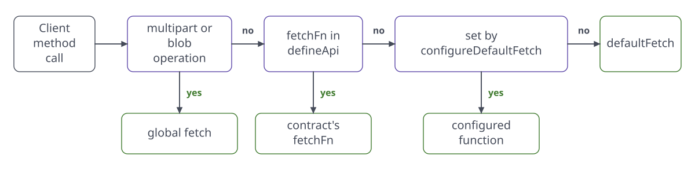

# Custom Fetch Functions

**English** | [한국어](/ko/guides/custom-fetch.md)

> How to customize the HTTP layer for headers, interceptors, and error handling.
>
> **Looking for authentication?** For token-based auth (Bearer, API Key, OAuth2) with automatic refresh and 401 retry, use [`@simplix-react/auth`](/en/guides/authentication.md) instead. This guide covers lower-level fetch customization for cases not covered by the auth package.

## Before You Begin

- You have a contract defined with `defineApi` from `@simplix-react/contract`
- You understand the `FetchFn` type signature: `<T>(path: string, options?: RequestInit) => Promise<T>`
- The built-in `defaultFetch` is `createFetch` with a response transform. It sends `Content-Type: application/json` on a `POST`, `PUT` or `PATCH` request whose body is not `FormData`, sends an `X-Timezone` header with the browser's time zone, unwraps a `{ data: T }` envelope, returns `undefined` for a `204` response and a `Blob` for a response whose content type is not JSON, and throws `ApiError` on non-2xx responses

## Which Fetch Function a Contract Uses



The client decides on every request, in this order:

1. An operation with `contentType: "multipart"` and an input, or with `responseType: "blob"`, calls the global `fetch` directly and skips the steps below, unless it has `transformRequest`
2. The `fetchFn` passed as the second argument of `defineApi`
3. The function set with `configureDefaultFetch`
4. `defaultFetch`

⚠ Headers added by your fetch function are not sent with a request of the first step.

## Solution

### Basic: Build a Fetch Function with `createFetch`

`createFetch` builds a `FetchFn` from options: `baseUrl` (prepended to relative paths), `getToken` (sent as `Authorization: Bearer <token>` unless the request already has an `Authorization` header), `transformResponse` (receives the parsed JSON and `{ path, method }`), and `onError` (receives `{ status, body, path, method }` with the body parsed as JSON when possible; throw your own error from it, otherwise `ApiError` is thrown).

```ts
import { createFetch, defineApi } from "@simplix-react/contract";
import { projectConfig } from "./contract";

const apiFetch = createFetch({
  baseUrl: "https://api.example.com",
  getToken: () => localStorage.getItem("access_token"),
  transformResponse: (json) => (json as { body?: unknown }).body ?? json,
  onError: ({ status, body }) => {
    const envelope = body as { errorCode?: string; message?: string };
    if (envelope.errorCode) {
      throw new Error(`${status} ${envelope.errorCode}: ${envelope.message}`);
    }
  },
});

const projectApi = defineApi(projectConfig, { fetchFn: apiFetch });
```

### Set the Default for Every Contract

`configureDefaultFetch` replaces `defaultFetch` for every contract that has no `fetchFn` of its own, including contracts created before the call.

```ts
import { configureDefaultFetch, createFetch } from "@simplix-react/contract";

// Every contract created without its own fetchFn uses this function
configureDefaultFetch(
  createFetch({
    getToken: () => localStorage.getItem("access_token"),
    transformResponse: (json) => (json as { data?: unknown }).data ?? json,
  }),
);
```

### Add Authorization Headers to `defaultFetch`

```ts
import { defineApi, defaultFetch } from "@simplix-react/contract";
import { projectConfig } from "./contract";

const projectApi = defineApi(projectConfig, {
  fetchFn: async (path, options) => {
    const token = localStorage.getItem("access_token");

    return defaultFetch(path, {
      ...options,
      headers: {
        ...options?.headers,
        Authorization: `Bearer ${token}`,
      },
    });
  },
});
```

### Handle `ApiError` Responses

`defaultFetch` throws `ApiError` for any non-2xx status. `status` is the HTTP status and `body` is the raw response text. Catch it to handle specific HTTP errors:

```ts
import { ApiError } from "@simplix-react/contract";

try {
  const task = await projectApi.client.task.get("nonexistent-id");
} catch (error) {
  if (error instanceof ApiError) {
    console.error(error.status); // 404
    console.error(error.body);   // "Not Found"

    if (error.status === 401) {
      // Redirect to login
      window.location.href = "/login";
    }
  }
}
```

### Request/Response Interceptors

Wrap `defaultFetch` to intercept requests before they are sent and responses after they arrive:

```ts
import { defineApi, defaultFetch, type FetchFn } from "@simplix-react/contract";
import { projectConfig } from "./contract";

function createFetchWithInterceptors(getToken: () => string | null): FetchFn {
  return async <T>(path: string, options?: RequestInit): Promise<T> => {
    // ── Request interceptor ──
    const token = getToken();
    const headers: Record<string, string> = {
      ...((options?.headers as Record<string, string>) ?? {}),
    };
    if (token) {
      headers["Authorization"] = `Bearer ${token}`;
    }
    headers["X-Request-Id"] = crypto.randomUUID();

    console.log(`[fetch] ${options?.method ?? "GET"} ${path}`);

    // ── Execute ──
    const result = await defaultFetch<T>(path, { ...options, headers });

    // ── Response interceptor ──
    console.log(`[fetch] ${path} -> OK`);

    return result;
  };
}

const projectApi = defineApi(projectConfig, {
  fetchFn: createFetchWithInterceptors(() => localStorage.getItem("access_token")),
});
```

### Retry Logic

Add retry behavior for transient failures (5xx, network errors):

```ts
import { defineApi, defaultFetch, ApiError, type FetchFn } from "@simplix-react/contract";
import { projectConfig } from "./contract";

function createFetchWithRetry(maxRetries = 3, delayMs = 1000): FetchFn {
  return async <T>(path: string, options?: RequestInit): Promise<T> => {
    let lastError: unknown;

    for (let attempt = 0; attempt <= maxRetries; attempt++) {
      try {
        return await defaultFetch<T>(path, options);
      } catch (error) {
        lastError = error;

        const isRetryable =
          error instanceof ApiError
            ? error.status >= 500
            : error instanceof TypeError; // network error

        if (!isRetryable || attempt === maxRetries) {
          throw error;
        }

        // Exponential backoff
        await new Promise((resolve) =>
          setTimeout(resolve, delayMs * Math.pow(2, attempt)),
        );
      }
    }

    throw lastError;
  };
}

const projectApi = defineApi(projectConfig, {
  fetchFn: createFetchWithRetry(3, 500),
});
```

### Fully Custom Fetch (No `defaultFetch`)

Replace the entire fetch implementation when the API does not follow the `{ data: T }` envelope convention:

```ts
import { defineApi, ApiError, type FetchFn } from "@simplix-react/contract";
import { projectConfig } from "./contract";

const customFetch: FetchFn = async <T>(
  path: string,
  options?: RequestInit,
): Promise<T> => {
  const res = await fetch(path, {
    ...options,
    headers: {
      "Content-Type": "application/json",
      Accept: "application/json",
      ...options?.headers,
    },
    credentials: "include",
  });

  if (!res.ok) {
    throw new ApiError(res.status, await res.text());
  }

  if (res.status === 204) {
    return undefined as T;
  }

  // No { data } envelope -- return JSON directly
  return res.json() as Promise<T>;
};

const projectApi = defineApi(projectConfig, { fetchFn: customFetch });
```

## Variations

### Token Refresh on 401

```ts
import { defineApi, defaultFetch, ApiError, type FetchFn } from "@simplix-react/contract";
import { projectConfig } from "./contract";

let isRefreshing = false;
let refreshPromise: Promise<string> | null = null;

async function refreshToken(): Promise<string> {
  const res = await fetch("/api/auth/refresh", {
    method: "POST",
    credentials: "include",
  });
  if (!res.ok) throw new Error("Token refresh failed");
  const { accessToken } = await res.json();
  localStorage.setItem("access_token", accessToken);
  return accessToken;
}

const fetchWithRefresh: FetchFn = async <T>(
  path: string,
  options?: RequestInit,
): Promise<T> => {
  const token = localStorage.getItem("access_token");
  const headers = {
    ...((options?.headers as Record<string, string>) ?? {}),
    Authorization: `Bearer ${token}`,
  };

  try {
    return await defaultFetch<T>(path, { ...options, headers });
  } catch (error) {
    if (!(error instanceof ApiError) || error.status !== 401) {
      throw error;
    }

    // Deduplicate concurrent refresh calls
    if (!isRefreshing) {
      isRefreshing = true;
      refreshPromise = refreshToken().finally(() => {
        isRefreshing = false;
        refreshPromise = null;
      });
    }

    const newToken = await refreshPromise!;

    return defaultFetch<T>(path, {
      ...options,
      headers: {
        ...((options?.headers as Record<string, string>) ?? {}),
        Authorization: `Bearer ${newToken}`,
      },
    });
  }
};

const projectApi = defineApi(projectConfig, { fetchFn: fetchWithRefresh });
```

### Adding Base URL Prefix

```ts
import { createFetch, defineApi } from "@simplix-react/contract";
import { projectConfig } from "./contract";

const prefixedFetch = createFetch({
  baseUrl: "https://api.example.com",
  transformResponse: (json) => (json as { data?: unknown }).data ?? json,
});

const projectApi = defineApi(projectConfig, { fetchFn: prefixedFetch });
```

## Related

- [Authentication Guide](/en/guides/authentication.md): set up token-based auth with `@simplix-react/auth`
- [Internationalization Guide](/en/guides/internationalization.md): includes `Accept-Language` header sync via `setRequestLocale`
- [Mock Handlers](/en/guides/mock-handlers.md): set up MSW handlers for development without a backend
- `@simplix-react/contract` exports: `FetchFn`, `ApiError`, `defaultFetch`, `createFetch`, `CreateFetchOptions`, `configureDefaultFetch`

---

<p class="page-source"><a href="https://github.com/simplix-framework/simplix-react/blob/main/docs/en/guides/custom-fetch.md" target="_blank" rel="noopener noreferrer">View source</a></p>
