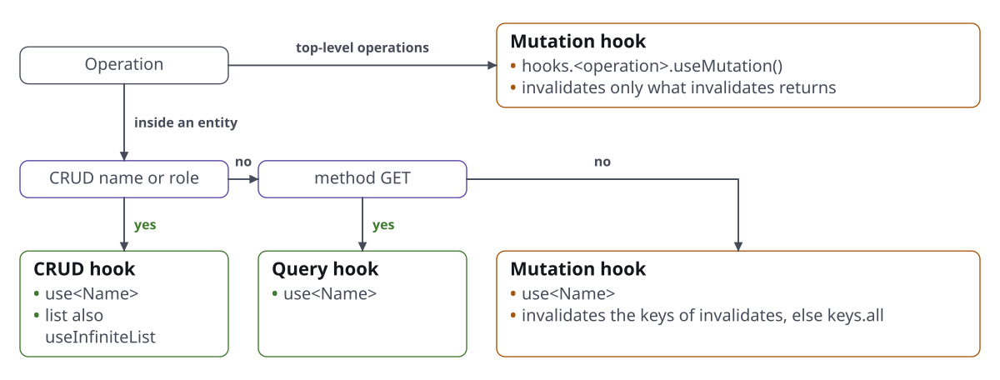

# Defining Custom Operations Beyond CRUD

**English** | [한국어](/ko/guides/custom-operations.md)

> Add non-CRUD endpoints (batch actions, RPC calls, file uploads) to your contract, inside an entity or as a top-level `OperationDefinition`.

## Before You Begin

- Know how to [define entities in a contract](/en/guides/defining-entities.md)
- Understand the difference between CRUD entity methods and custom operations

An entity operation named `list`, `get`, `create`, `update`, `delete` or `tree`, or one that sets `role`, is a CRUD operation. For anything outside that pattern (assigning a task, archiving a project, exporting a report), define the operation in one of these places:

- an operation with any other name in an entity's `operations`, which belongs to that entity (see [Custom Operations Inside an Entity](#custom-operations-inside-an-entity))
- an `OperationDefinition` in the contract's top-level `operations`, which belongs to no entity (the steps below)



## Solution

### Step 1: Define the Operation

An `OperationDefinition` specifies the HTTP method, path, input schema, and output schema. `input` and `output` are both required.

```ts
import { z } from "zod";
import type { OperationDefinition } from "@simplix-react/contract";

const assignTask = {
  method: "POST",
  path: "/tasks/:taskId/assign",
  input: z.object({
    userId: z.string().uuid(),
  }),
  output: z.object({
    id: z.string().uuid(),
    title: z.string(),
    assigneeId: z.string().uuid(),
  }),
} satisfies OperationDefinition;
```

Path parameters use the `:paramName` syntax. They are positionally mapped to function arguments when calling the derived client.

### Step 2: Register in the Contract

Add the operation to the `operations` field alongside your entities.

```ts
import { defineApi, simpleQueryBuilder } from "@simplix-react/contract";

const projectApi = defineApi({
  domain: "project",
  basePath: "/api/v1",
  entities: {
    project: projectEntity,
    task: taskEntity,
  },
  operations: {
    assignTask,
  },
  queryBuilder: simpleQueryBuilder,
});
```

### Step 3: Call the Derived Client

The operation client accepts path parameters as positional arguments, followed by the input payload.

```ts
// POST /api/v1/tasks/task-1/assign
// Body: { "userId": "user-42" }
const result = await projectApi.client.assignTask("task-1", {
  userId: "user-42",
});
// result: { id: "task-1", title: "...", assigneeId: "user-42" }
```

For operations with multiple path parameters, each is passed in order:

```ts
const transferTask = {
  method: "POST",
  path: "/projects/:projectId/tasks/:taskId/transfer",
  input: z.object({ targetProjectId: z.string() }),
  output: z.object({ id: z.string(), projectId: z.string() }),
} satisfies OperationDefinition;

// Path params are positional: projectId, taskId, then the input body
await projectApi.client.transferTask("proj-1", "task-1", {
  targetProjectId: "proj-2",
});
```

### Step 4: Use Derived Hooks

`deriveEntityHooks` gives every top-level operation `hooks.<operation>.useMutation()`, whatever its HTTP method. The hook calls the client with the mutation variable as its only argument, so it fits an operation without path parameters:

```tsx
import { z } from "zod";
import type { OperationDefinition } from "@simplix-react/contract";
import { deriveEntityHooks } from "@simplix-react/react";

const importTasks = {
  method: "POST",
  path: "/tasks/import",
  input: z.object({ source: z.string() }),
  output: z.object({ importedCount: z.number() }),
} satisfies OperationDefinition;

// Registered under `operations: { assignTask, importTasks }` in the contract
const hooks = deriveEntityHooks(projectApi);

function ImportButton() {
  const { mutate, isPending } = hooks.importTasks.useMutation();

  return (
    <button disabled={isPending} onClick={() => mutate({ source: "jira" })}>
      {isPending ? "Importing..." : "Import"}
    </button>
  );
}
```

For an operation with path parameters such as `assignTask`, call the client inside your own `useMutation`:

```tsx
import { useMutation, useQueryClient } from "@tanstack/react-query";

function AssignButton({ taskId }: { taskId: string }) {
  const queryClient = useQueryClient();
  const { mutate, isPending } = useMutation({
    mutationFn: (userId: string) =>
      projectApi.client.assignTask(taskId, { userId }),
    onSuccess: () =>
      queryClient.invalidateQueries({ queryKey: projectApi.queryKeys.task.all }),
  });

  return (
    <button disabled={isPending} onClick={() => mutate("user-42")}>
      {isPending ? "Assigning..." : "Assign"}
    </button>
  );
}
```

### Step 5: Add Cache Invalidation

Use the `invalidates` callback to invalidate relevant queries after the derived `useMutation` succeeds. A top-level operation without `invalidates` invalidates nothing.

```ts
const assignTask = {
  method: "POST",
  path: "/tasks/:taskId/assign",
  input: z.object({
    userId: z.string().uuid(),
  }),
  output: z.object({
    id: z.string().uuid(),
    title: z.string(),
    assigneeId: z.string().uuid(),
  }),
  invalidates: (queryKeys, _params) => [
    queryKeys.task.all,  // Invalidate all task queries
  ],
} satisfies OperationDefinition;
```

The `invalidates` function receives:
- `queryKeys`: a record of all entity query key factories in the contract
- `params`: path parameters; the derived hook passes an empty object

After the mutation succeeds, the hook calls `queryClient.invalidateQueries` for each returned key array.

## Variations

### Custom Operations Inside an Entity

An entity operation whose name is not a CRUD name and which has no `role` is a custom operation of that entity. `output` is optional and defaults to the entity's `schema`. Its hook is `use` + the operation name: a `GET` operation gets a query hook and any other method a mutation hook. When the mutation succeeds, the hook invalidates the keys the operation's `invalidates` returns, or all queries of the entity when it has none. The mutation variable becomes the client function's first argument, so it fills the operation's first path parameter, and the hook cannot send an input of yours beside it. For an operation that needs a path parameter and an input, call the client inside your own `useMutation`.

```ts
const projectEntity = {
  schema: projectSchema,
  operations: {
    list:    { method: "GET",  path: "/projects" },
    get:     { method: "GET",  path: "/projects/:id" },
    archive: { method: "POST", path: "/projects/:id/archive", input: z.object({ reason: z.string() }) },
    stats:   { method: "GET",  path: "/projects/stats", output: z.object({ total: z.number() }) },
  },
} satisfies EntityDefinition;

// Client: path parameters first, then the input
await projectApi.client.project.archive("proj-1", { reason: "done" });

// Hooks: a custom GET is a query, any other method a mutation
const { data: stats } = hooks.project.useStats();
const archive = hooks.project.useArchive();
```

### GET Operations (Queries Instead of Mutations)

A top-level operation with `method: "GET"` still derives a `useMutation` hook. If you need a query-style hook, define the operation inside an entity, or use the client directly with `useQuery`.

```ts
import { useQuery } from "@tanstack/react-query";

const exportReport = {
  method: "GET",
  path: "/projects/:projectId/report",
  input: z.object({}),
  output: z.object({
    summary: z.string(),
    totalTasks: z.number(),
  }),
} satisfies OperationDefinition;

// Manual query hook usage
function useProjectReport(projectId: string) {
  return useQuery({
    queryKey: ["project", "report", projectId],
    queryFn: () => projectApi.client.exportReport(projectId),
  });
}
```

### File Uploads with Multipart

Set `contentType: "multipart"` to send `FormData` instead of JSON.

```ts
const uploadAttachment = {
  method: "POST",
  path: "/tasks/:taskId/attachments",
  input: z.object({
    file: z.instanceof(File),
    description: z.string().optional(),
  }),
  output: z.object({
    id: z.string(),
    url: z.string().url(),
    filename: z.string(),
  }),
  contentType: "multipart",
} satisfies OperationDefinition;
```

The framework converts the input object to `FormData`, appending `File`/`Blob` values and stringifying primitives. The request goes through the global `fetch`, not through the contract's fetch function (see [Custom Fetch](/en/guides/custom-fetch.md)).

```tsx
function FileUploadButton({ taskId }: { taskId: string }) {
  const handleFileChange = async (e: React.ChangeEvent<HTMLInputElement>) => {
    const file = e.target.files?.[0];
    if (file) {
      await projectApi.client.uploadAttachment(taskId, { file, description: "Screenshot" });
    }
  };

  return <input type="file" onChange={handleFileChange} />;
}
```

### Blob Responses (File Downloads)

Set `responseType: "blob"` to receive binary data. This request also uses the global `fetch`.

```ts
const downloadReport = {
  method: "GET",
  path: "/projects/:projectId/export",
  input: z.object({}),
  output: z.instanceof(Blob),
  responseType: "blob",
} satisfies OperationDefinition;

// Usage
const blob = await projectApi.client.downloadReport("proj-1");
const url = URL.createObjectURL(blob);
```

### Targeted Cache Invalidation

Invalidate specific query subsets using the query key factory methods.

```ts
const archiveProject = {
  method: "POST",
  path: "/projects/:projectId/archive",
  input: z.object({}),
  output: z.object({ id: z.string(), status: z.literal("archived") }),
  invalidates: (queryKeys, _params) => [
    queryKeys.project.lists(),   // Invalidate all project list queries
    queryKeys.task.all,          // Invalidate all task queries (children too)
  ],
} satisfies OperationDefinition;
```

Available query key granularity:

| Method | Key | Scope |
| --- | --- | --- |
| `.all` | `[domain, entity]` | All queries for this entity |
| `.lists()` | `[domain, entity, "list"]` | All list queries |
| `.list(params)` | `[domain, entity, "list", params]` | Specific filtered list |
| `.details()` | `[domain, entity, "detail"]` | All detail queries |
| `.detail(id)` | `[domain, entity, "detail", id]` | Specific detail query |
| `.trees()` | `[domain, entity, "tree"]` | All tree queries |
| `.tree(params)` | `[domain, entity, "tree", params]` | Specific tree query |

### All Supported HTTP Methods

The `method` field accepts: `"GET"`, `"POST"`, `"PUT"`, `"PATCH"`, `"DELETE"`. A body is sent for every method except `GET`.

```ts
// PUT -- full replacement
const replaceConfig = {
  method: "PUT",
  path: "/projects/:projectId/config",
  input: z.object({ theme: z.string(), locale: z.string() }),
  output: z.object({ theme: z.string(), locale: z.string() }),
} satisfies OperationDefinition;

// DELETE -- custom delete with body
const bulkDelete = {
  method: "DELETE",
  path: "/tasks/bulk",
  input: z.object({ ids: z.array(z.string()) }),
  output: z.object({ deletedCount: z.number() }),
} satisfies OperationDefinition;

// PATCH -- partial update on a sub-resource
const updateSettings = {
  method: "PATCH",
  path: "/projects/:projectId/settings",
  input: z.object({ notifications: z.boolean().optional() }),
  output: z.object({ notifications: z.boolean() }),
} satisfies OperationDefinition;
```

## Related

- [Defining Entities in a Contract](/en/guides/defining-entities.md): standard CRUD entity setup
- [Parent-Child Entity Relationships](/en/guides/parent-child.md): nested URL construction with `EntityParent`

---

<p class="page-source"><a href="https://github.com/simplix-framework/simplix-react/blob/main/docs/en/guides/custom-operations.md" target="_blank" rel="noopener noreferrer">Edit on GitHub</a></p>
