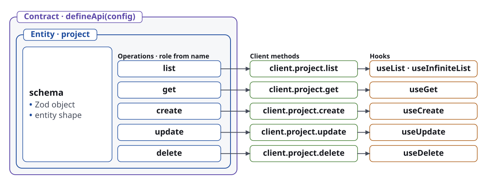

# Defining Entities in a Contract

**English** | [한국어](/ko/guides/defining-entities.md)

> Define type-safe CRUD entities with Zod schemas so the framework can derive clients, hooks, and mock handlers automatically.

## Before You Begin

- Install dependencies: `@simplix-react/contract` and `zod`
- Familiarize yourself with [Zod schema basics](https://zod.dev)

## Solution

### Step 1: Define Zod Schemas

An entity has one schema for the full entity shape. Each operation that sends a body (create, update) takes its own input schema.

```ts
import { z } from "zod";

// Full entity shape returned by the API
const projectSchema = z.object({
  id: z.string().uuid(),
  name: z.string().min(1),
  description: z.string(),
  status: z.enum(["active", "archived"]),
  createdAt: z.string().datetime(),
  updatedAt: z.string().datetime(),
});

// Payload for creating a new project
const createProjectSchema = z.object({
  name: z.string().min(1),
  description: z.string().default(""),
});

// Payload for updating an existing project (all fields optional)
const updateProjectSchema = z.object({
  name: z.string().min(1).optional(),
  description: z.string().optional(),
  status: z.enum(["active", "archived"]).optional(),
});
```

### Step 2: Create an EntityDefinition

An entity combines the schema with a map of operations. Each operation names an HTTP method and a path; `:paramName` placeholders in the path are filled from the arguments of the client method.

```ts
import type { EntityDefinition } from "@simplix-react/contract";

const projectEntity = {
  schema: projectSchema,
  operations: {
    list:   { method: "GET",    path: "/projects" },
    get:    { method: "GET",    path: "/projects/:id" },
    create: { method: "POST",   path: "/projects", input: createProjectSchema },
    update: { method: "PATCH",  path: "/projects/:id", input: updateProjectSchema },
    delete: { method: "DELETE", path: "/projects/:id" },
  },
} satisfies EntityDefinition;
```



The operation name decides its role: `list`, `get`, `create`, `update`, `delete` and `tree` are roles by name, and any other name is a custom operation unless it sets `role` (see [Custom Operations](/en/guides/custom-operations.md)). Each path is appended to the contract's `basePath` when a request is made (`basePath + "/projects"` → `/api/v1/projects`).

`CRUD_OPERATIONS` holds the default method of each CRUD operation (`update` is `PATCH`), so you can spread it and add only the path:

```ts
import { CRUD_OPERATIONS } from "@simplix-react/contract";

const projectEntity = {
  schema: projectSchema,
  operations: {
    list:   { ...CRUD_OPERATIONS.list,   path: "/projects" },
    get:    { ...CRUD_OPERATIONS.get,    path: "/projects/:id" },
    create: { ...CRUD_OPERATIONS.create, path: "/projects", input: createProjectSchema },
    update: { ...CRUD_OPERATIONS.update, path: "/projects/:id", input: updateProjectSchema },
    delete: { ...CRUD_OPERATIONS.delete, path: "/projects/:id" },
  },
} satisfies EntityDefinition;
```

### Step 3: Register in an API Contract

Pass the entity definition into `defineApi` to get a fully typed client and query keys.

```ts
import { defineApi, simpleQueryBuilder } from "@simplix-react/contract";

const projectApi = defineApi({
  domain: "project",
  basePath: "/api/v1",
  entities: {
    project: projectEntity,
  },
  queryBuilder: simpleQueryBuilder,
});
```

### Step 4: Use the Derived Client

The returned contract exposes one client method for every operation of every registered entity.

```ts
// GET /api/v1/projects
const projects = await projectApi.client.project.list();

// GET /api/v1/projects?... (serialized by the queryBuilder)
const active = await projectApi.client.project.list({
  filters: { status: "active" },
});

// GET /api/v1/projects/proj-1
const project = await projectApi.client.project.get("proj-1");

// POST /api/v1/projects
const created = await projectApi.client.project.create({
  name: "My Project",
  description: "A new project",
});

// PATCH /api/v1/projects/proj-1
const updated = await projectApi.client.project.update("proj-1", {
  status: "archived",
});

// DELETE /api/v1/projects/proj-1
await projectApi.client.project.delete("proj-1");
```

### Step 5: Use Query Keys for Cache Management

The contract also generates TanStack Query key factories. Each key starts with the contract's `domain` and the entity name.

```ts
projectApi.queryKeys.project.all;
// → ["project", "project"]

projectApi.queryKeys.project.lists();
// → ["project", "project", "list"]

projectApi.queryKeys.project.list({ status: "active" });
// → ["project", "project", "list", { status: "active" }]

projectApi.queryKeys.project.details();
// → ["project", "project", "detail"]

projectApi.queryKeys.project.detail("proj-1");
// → ["project", "project", "detail", "proj-1"]

projectApi.queryKeys.project.trees();
// → ["project", "project", "tree"]
```

## Variations

### Adding a Filter Schema

Use `filterSchema` to describe the filters a list accepts.

```ts
const projectEntity = {
  schema: projectSchema,
  operations: {
    list: { method: "GET", path: "/projects" },
    get:  { method: "GET", path: "/projects/:id" },
  },
  filterSchema: z.object({
    status: z.enum(["active", "archived"]).optional(),
    search: z.string().optional(),
  }),
} satisfies EntityDefinition;
```

### Giving a Custom Name a CRUD Role

An operation whose name is not a CRUD name takes a role through `role`.

```ts
const projectEntity = {
  schema: projectSchema,
  operations: {
    search: { method: "GET", path: "/projects/search", role: "list" },
    detail: { method: "GET", path: "/projects/:id", role: "get" },
  },
} satisfies EntityDefinition;

// The client method keeps the operation name; the role decides its shape
await projectApi.client.project.search({ filters: { status: "active" } });
await projectApi.client.project.detail("proj-1");
```

### Composite Identity

`identity` names the fields that identify one record (default `["id"]`). Pass an object as the id to fill several path parameters.

```ts
const memberEntity = {
  schema: memberSchema,
  identity: ["projectId", "userId"],
  operations: {
    get:    { method: "GET",    path: "/projects/:projectId/members/:userId" },
    delete: { method: "DELETE", path: "/projects/:projectId/members/:userId" },
  },
} satisfies EntityDefinition;

// A composite id fills every path parameter by name
await projectApi.client.member.get({ projectId: "proj-1", userId: "user-42" });
```

### Multiple Entities in One Contract

A single contract can hold as many entities as needed.

```ts
const projectApi = defineApi({
  domain: "project",
  basePath: "/api/v1",
  entities: {
    project: projectEntity,
    task: {
      schema: taskSchema,
      operations: {
        list:   { method: "GET",    path: "/tasks" },
        get:    { method: "GET",    path: "/tasks/:id" },
        create: { method: "POST",   path: "/tasks", input: createTaskSchema },
        update: { method: "PATCH",  path: "/tasks/:id", input: updateTaskSchema },
        delete: { method: "DELETE", path: "/tasks/:id" },
      },
    },
  },
  queryBuilder: simpleQueryBuilder,
});

// Both entities are available on the client
await projectApi.client.project.list();
await projectApi.client.task.list();
```

### Using a Custom Fetch Function

Replace the built-in HTTP client with your own `FetchFn` through the second argument of `defineApi` (see [Custom Fetch](/en/guides/custom-fetch.md)).

```ts
import { createFetch, defineApi, simpleQueryBuilder } from "@simplix-react/contract";

const projectApi = defineApi(
  {
    domain: "project",
    basePath: "/api/v1",
    entities: { project: projectEntity },
    queryBuilder: simpleQueryBuilder,
  },
  {
    fetchFn: createFetch({
      getToken: () => localStorage.getItem("access_token"),
      transformResponse: (json) => (json as { data?: unknown }).data ?? json,
    }),
  },
);
```

## Related

- [Parent-Child Entity Relationships](/en/guides/parent-child.md): nested URL construction with `EntityParent`
- [Custom Operations Beyond CRUD](/en/guides/custom-operations.md): non-CRUD endpoints inside an entity or with `OperationDefinition`
- [Custom Fetch Functions](/en/guides/custom-fetch.md): headers, error handling and response unwrapping

---

<p class="page-source"><a href="https://github.com/simplix-framework/simplix-react/blob/main/docs/en/guides/defining-entities.md" target="_blank" rel="noopener noreferrer">View source</a></p>
