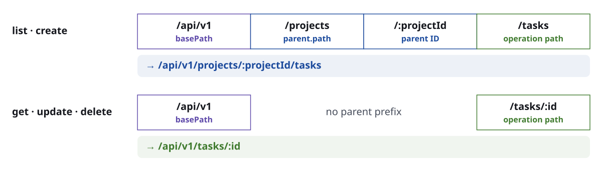

# Setting Up Parent-Child Entity Relationships

**English** | [한국어](/ko/guides/parent-child.md)

> Configure nested entity hierarchies so that child resources are scoped under their parent's URL path (e.g., `/projects/:projectId/tasks`).

## Before You Begin

- Know how to [define a basic entity](/en/guides/defining-entities.md)
- Have a parent entity (e.g., `project`) already defined in your contract

## Solution

### Step 1: Define the Parent Entity

The parent entity is a standard entity definition with no special configuration.

```ts
import { z } from "zod";

const projectSchema = z.object({
  id: z.string().uuid(),
  name: z.string(),
  status: z.enum(["active", "archived"]),
  createdAt: z.string().datetime(),
});

const createProjectSchema = z.object({
  name: z.string().min(1),
});

const updateProjectSchema = z.object({
  name: z.string().min(1).optional(),
  status: z.enum(["active", "archived"]).optional(),
});
```

### Step 2: Define the Child Entity with `parent`

Add the `parent` field to the child entity. This tells the framework how to construct nested URLs.

```ts
const taskSchema = z.object({
  id: z.string().uuid(),
  title: z.string(),
  status: z.enum(["todo", "in_progress", "done"]),
  projectId: z.string().uuid(),
  createdAt: z.string().datetime(),
});

const createTaskSchema = z.object({
  title: z.string().min(1),
  status: z.enum(["todo", "in_progress", "done"]).default("todo"),
});

const updateTaskSchema = z.object({
  title: z.string().min(1).optional(),
  status: z.enum(["todo", "in_progress", "done"]).optional(),
});

const taskEntity = {
  schema: taskSchema,
  parent: {
    param: "projectId",    // Route parameter name
    path: "/projects",     // Parent's URL segment
  },
  operations: {
    list:   { method: "GET",    path: "/tasks" },
    get:    { method: "GET",    path: "/tasks/:id" },
    create: { method: "POST",   path: "/tasks", input: createTaskSchema },
    update: { method: "PATCH",  path: "/tasks/:id", input: updateTaskSchema },
    delete: { method: "DELETE", path: "/tasks/:id" },
  },
} satisfies EntityDefinition;
```

The `parent` configuration puts the parent's path and the parent ID in front of the path of the `list` and `create` operations:



### Step 3: Register Both Entities

```ts
import { defineApi, simpleQueryBuilder } from "@simplix-react/contract";

const projectApi = defineApi({
  domain: "project",
  basePath: "/api/v1",
  entities: {
    project: {
      schema: projectSchema,
      operations: {
        list:   { method: "GET",    path: "/projects" },
        get:    { method: "GET",    path: "/projects/:id" },
        create: { method: "POST",   path: "/projects", input: createProjectSchema },
        update: { method: "PATCH",  path: "/projects/:id", input: updateProjectSchema },
        delete: { method: "DELETE", path: "/projects/:id" },
      },
    },
    task: taskEntity,
  },
  queryBuilder: simpleQueryBuilder,
});
```

### Step 4: Use the Client with Parent ID

For child entities, pass the parent ID as the first argument to `list` and `create`. Without a parent ID they request the operation path alone (`/api/v1/tasks`).

```ts
const projectId = "proj-1";

// List tasks under a project
// GET /api/v1/projects/proj-1/tasks
const tasks = await projectApi.client.task.list(projectId);

// Create a task under a project
// POST /api/v1/projects/proj-1/tasks
const newTask = await projectApi.client.task.create(projectId, {
  title: "Implement feature",
});

// Get, update, and delete use the task's own ID (no parent needed)
// GET /api/v1/tasks/task-1
const task = await projectApi.client.task.get("task-1");

// PATCH /api/v1/tasks/task-1
const updated = await projectApi.client.task.update("task-1", {
  status: "done",
});

// DELETE /api/v1/tasks/task-1
await projectApi.client.task.delete("task-1");
```

### Step 5: Query Key Propagation

When a parent ID is given to `useList` or `useInfiniteList`, it is included in the list query key under the `parent.param` name, so each parent's lists are cached apart.

```ts
// Query key for all tasks under a specific project:
projectApi.queryKeys.task.list({ projectId: "proj-1" });
// → ["project", "task", "list", { projectId: "proj-1" }]

// Invalidating all task queries regardless of parent:
projectApi.queryKeys.task.all;
// → ["project", "task"]
```

### Step 6: Use Derived Hooks with Parent ID

When using `@simplix-react/react`, pass the parent ID to the list hooks and to `useCreate`.

```tsx
import { deriveEntityHooks } from "@simplix-react/react";

const hooks = deriveEntityHooks(projectApi);

function TaskList({ projectId }: { projectId: string }) {
  // useList automatically includes projectId in the query key
  // and scopes the request to /api/v1/projects/:projectId/tasks
  const { data: tasks, isLoading } = hooks.task.useList(projectId);

  // useCreate takes parentId to POST under the correct parent
  const createTask = hooks.task.useCreate(projectId);

  if (isLoading) return <p>Loading...</p>;

  return (
    <div>
      <ul>
        {tasks?.map((task) => (
          <li key={task.id}>{task.title} - {task.status}</li>
        ))}
      </ul>
      <button
        onClick={() =>
          createTask.mutate({ title: "New task", status: "todo" })
        }
      >
        Add Task
      </button>
    </div>
  );
}
```

The `useList` hook automatically disables itself when `projectId` is falsy (undefined or empty string), preventing requests without a valid parent. `useCreate` invalidates every query of the entity (`queryKeys.task.all`) after it succeeds.

## Variations

### Filtering and Sorting with Parent ID

Combine the parent ID with list parameters for filtered queries.

```ts
// List tasks under a project, filtered and sorted
const { data: tasks } = hooks.task.useList(projectId, {
  filters: { status: "todo" },
  sort: { field: "createdAt", direction: "desc" },
});
```

### Nested Paths for Get, Update and Delete

`get`, `update` and `delete` use their own operation path and do not add the parent. When the server nests them too, write the full path and pass an object that fills every path parameter.

```ts
const commentEntity = {
  schema: commentSchema,
  parent: { param: "taskId", path: "/tasks" },
  operations: {
    list: { method: "GET",    path: "/comments" },
    get:  { method: "GET",    path: "/tasks/:taskId/comments/:id" },
    delete: { method: "DELETE", path: "/tasks/:taskId/comments/:id" },
  },
} satisfies EntityDefinition;

// GET /api/v1/tasks/task-1/comments/c-9
await projectApi.client.comment.get({ taskId: "task-1", id: "c-9" });
```

### Named Query Scopes

`queries` declares named parent-based query scopes on the entity definition. It is a declaration only: no package reads it to build requests, query keys or hooks.

```ts
const taskEntity = {
  schema: taskSchema,
  parent: {
    param: "projectId",
    path: "/projects",
  },
  queries: {
    byProject: {
      parent: "project",
      param: "projectId",
    },
  },
  operations: {
    list: { method: "GET", path: "/tasks" },
  },
} satisfies EntityDefinition;
```

### Infinite Scrolling with Parent ID

The `useInfiniteList` hook also supports parent-scoped queries. Each page is `{ data, meta }`, and the next page is requested while `meta.hasNextPage` is true.

```tsx
function TaskInfiniteList({ projectId }: { projectId: string }) {
  const {
    data,
    fetchNextPage,
    hasNextPage,
  } = hooks.task.useInfiniteList(projectId, { limit: 20 });

  return (
    <div>
      {data?.pages.map((page) =>
        page.data.map((task) => (
          <div key={task.id}>{task.title}</div>
        )),
      )}
      {hasNextPage && (
        <button onClick={() => fetchNextPage()}>Load More</button>
      )}
    </div>
  );
}
```

## Related

- [Defining Entities in a Contract](/en/guides/defining-entities.md): basic entity setup
- [Custom Operations Beyond CRUD](/en/guides/custom-operations.md): operations that work alongside parent-child entities

---

<p class="page-source"><a href="https://github.com/simplix-framework/simplix-react/blob/main/docs/en/guides/parent-child.md" target="_blank" rel="noopener noreferrer">Edit on GitHub</a></p>
