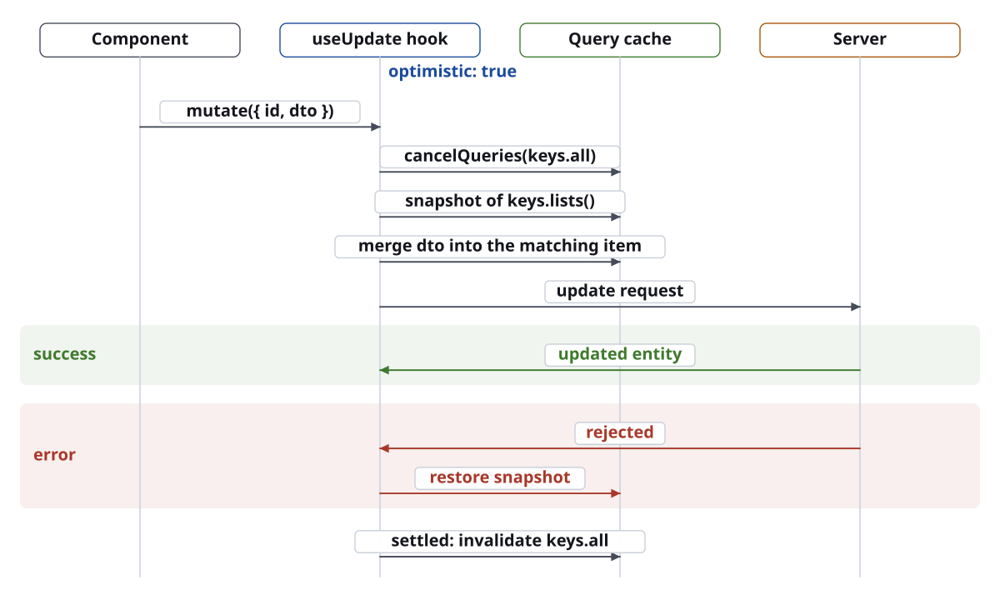

# How to Use React Query Hooks with @simplix-react/react

**English** | [한국어](/ko/guides/react-hooks-reference.md)

> Derive type-safe React Query hooks from an API contract and use them for list, detail, create, update, delete, infinite scroll, tree and custom operations with automatic cache invalidation.

## Before You Begin

- A simplix-react project with a contract defined using `@simplix-react/contract`
- Install dependencies:

```bash
pnpm add @simplix-react/react @tanstack/react-query
```

- Peer dependencies:

| Package | Version |
| --- | --- |
| `@simplix-react/contract` | workspace |
| `@tanstack/react-query` | >= 5.0.0 |
| `@tanstack/react-query-persist-client` | >= 5.0.0 |
| `@tanstack/query-sync-storage-persister` | >= 5.0.0 |
| `react` | >= 18.0.0 |
| `zod` | >= 4.0.0 |

- An existing contract:

```ts
// contract.ts
import { defineApi, simpleQueryBuilder } from "@simplix-react/contract";
import { z } from "zod";

const taskSchema = z.object({
  id: z.string(),
  title: z.string(),
  status: z.enum(["open", "in_progress", "done"]),
  priority: z.number(),
  createdAt: z.string(),
});

const createTaskSchema = z.object({
  title: z.string(),
  status: z.enum(["open", "in_progress", "done"]),
  priority: z.number(),
});

const updateTaskSchema = createTaskSchema.partial();

export const projectContract = defineApi({
  domain: "project",
  basePath: "/api",
  entities: {
    task: {
      schema: taskSchema,
      operations: {
        list: { method: "GET", path: "/tasks" },
        get: { method: "GET", path: "/tasks/:id" },
        create: { method: "POST", path: "/tasks", input: createTaskSchema },
        update: { method: "PATCH", path: "/tasks/:id", input: updateTaskSchema },
        delete: { method: "DELETE", path: "/tasks/:id" },
      },
    },
  },
  queryBuilder: simpleQueryBuilder,
});
```

## Solution

### Step 1: Derive Hooks from a Contract

Call `deriveEntityHooks` with your contract. This generates a complete set of React Query hooks for every entity and operation in a single call.

```ts
import { deriveEntityHooks } from "@simplix-react/react";
import { projectContract } from "./contract.js";

export const hooks = deriveEntityHooks(projectContract);

// hooks.task.useList         : list query
// hooks.task.useGet          : detail query
// hooks.task.useCreate       : create mutation
// hooks.task.useUpdate       : update mutation
// hooks.task.useDelete       : delete mutation
// hooks.task.useInfiniteList : infinite scroll query (comes with the list role)
```

Each hook is named `use` + the operation name with its first letter capitalized (`list` → `useList`, `archive` → `useArchive`). The role of an operation comes from its `role` field, or from its name when the name is `list`, `get`, `create`, `update`, `delete` or `tree`; that role decides the kind of hook. An operation with the `list` role also yields `useInfiniteList`. An entity has only the hooks of the operations it defines.

The return type is `DerivedEntityHooksResult`, which maps each entity name to an `EntityHooks` object and each top-level operation to an `OperationHooks` object.

### Step 2: Fetch a List with useList

`useList` fetches a list of entities. Its calling convention depends on whether the entity has a parent.

**Top-level entity (no parent):**

```tsx
function TaskList() {
  const { data: tasks, isLoading, error } = hooks.task.useList();

  if (isLoading) return <p>Loading...</p>;
  if (error) return <p>Error: {error.message}</p>;

  return (
    <ul>
      {tasks?.map((task) => (
        <li key={task.id}>{task.title}: {task.status}</li>
      ))}
    </ul>
  );
}
```

**With filters and sorting:**

```tsx
const { data: tasks } = hooks.task.useList({
  filters: { status: "open" },
  sort: { field: "createdAt", direction: "desc" },
});
```

**Child entity with parent ID:**

```tsx
// Fetch tasks belonging to a specific project
const { data: tasks } = hooks.task.useList(projectId);

// With filters
const { data: tasks } = hooks.task.useList(projectId, {
  filters: { status: "open" },
  sort: { field: "priority", direction: "asc" },
});

// With filters and query options
const { data: tasks } = hooks.task.useList(
  projectId,
  { filters: { status: "open" } },
  { enabled: isReady },
);
```

For child entities, the query is automatically disabled when `parentId` is falsy. The second argument is read as `ListParams` when it has a `filters`, `sort` or `pagination` key, and as query options otherwise.

The `ListParams` type (from `@simplix-react/contract`):

```ts
interface ListParams<TFilters = Record<string, unknown>> {
  filters?: TFilters;
  sort?: SortParam | SortParam[];
  pagination?: PaginationParam;
}

interface SortParam {
  field: string;
  direction: "asc" | "desc";
}

type PaginationParam =
  | { type: "offset"; page: number; limit: number }
  | { type: "cursor"; cursor: string; limit: number };
```

**Signature:**

```ts
type DerivedListHook<TData> = (
  parentIdOrParams?: string | ListParams,
  paramsOrOptions?: ListParams | Omit<UseQueryOptions<TData[], Error>, "queryKey" | "queryFn">,
  options?: Omit<UseQueryOptions<TData[], Error>, "queryKey" | "queryFn">,
) => UseQueryResult<TData[]>;
```

### Step 3: Fetch a Single Entity with useGet

`useGet` fetches a single entity by ID. The query is automatically disabled when `id` is an empty string or a composite key object with no keys.

```tsx
function TaskDetail({ taskId }: { taskId: string }) {
  const { data: task, isLoading } = hooks.task.useGet(taskId);

  if (isLoading) return <p>Loading...</p>;
  if (!task) return <p>Task not found</p>;

  return (
    <div>
      <h2>{task.title}</h2>
      <p>Status: {task.status}</p>
      <p>Priority: {task.priority}</p>
    </div>
  );
}
```

Pass TanStack Query options as the second argument:

```tsx
const { data: task } = hooks.task.useGet(taskId, {
  staleTime: 5000,
  refetchOnWindowFocus: false,
});
```

The `id` parameter accepts either a string or a composite key object (`EntityId`):

```ts
type EntityId = string | Record<string, string>;
```

**Signature:**

```ts
type DerivedGetHook<TData> = (
  id: EntityId,
  options?: Omit<UseQueryOptions<TData, Error>, "queryKey" | "queryFn">,
) => UseQueryResult<TData>;
```

### Step 4: Create an Entity with useCreate

`useCreate` returns a TanStack Query mutation. For child entities, pass the parent ID as the first argument.

```tsx
function CreateTaskForm() {
  const createTask = hooks.task.useCreate();

  async function handleSubmit(values: { title: string; status: string; priority: number }) {
    await createTask.mutateAsync(values);
  }

  return (
    <form onSubmit={(e) => { e.preventDefault(); handleSubmit(formValues); }}>
      {/* form fields */}
      <button type="submit" disabled={createTask.isPending}>
        {createTask.isPending ? "Creating..." : "Create Task"}
      </button>
    </form>
  );
}
```

For child entities:

```tsx
const createTask = hooks.task.useCreate(projectId);
createTask.mutate({ title: "New task", status: "open", priority: 1 });
```

Pass mutation options as the second argument:

```tsx
const createTask = hooks.task.useCreate(undefined, {
  onSuccess: (data) => {
    console.log("Created:", data);
    navigate(`/tasks/${data.id}`);
  },
  onError: (error) => {
    console.error("Create failed:", error);
  },
});
```

On success, `useCreate` automatically invalidates all queries under the entity's query key scope.

**Signature:**

```ts
type DerivedCreateHook<TInput, TOutput> = (
  parentId?: string,
  options?: Omit<UseMutationOptions<TOutput, Error, TInput>, "mutationFn">,
) => UseMutationResult<TOutput, Error, TInput>;
```

### Step 5: Update an Entity with useUpdate

`useUpdate` accepts `{ id, dto }` as mutation variables. It supports optimistic updates through the `optimistic` option (default `false`).

```tsx
function TaskStatusToggle({ task }: { task: Task }) {
  const updateTask = hooks.task.useUpdate();

  function toggleStatus() {
    const newStatus = task.status === "done" ? "open" : "done";
    updateTask.mutate({ id: task.id, dto: { status: newStatus } });
  }

  return (
    <button onClick={toggleStatus} disabled={updateTask.isPending}>
      {task.status === "done" ? "Reopen" : "Complete"}
    </button>
  );
}
```

**Optimistic updates**: the UI updates instantly and rolls back on error. The hook applies an optimistic update when it is given `optimistic: true`, but the option is missing from the hook's type, so a type-checked call cannot pass it.

How optimistic updates work:



1. All entity queries are cancelled via `queryClient.cancelQueries`, and the data of every list query is kept as a snapshot.
2. In each cached list, the item whose `id` matches (every key of a composite key) is merged with `dto` in place.
3. On error, the previous list data is restored from the snapshot.
4. On settlement (success or error), all entity queries are invalidated.

Your own `onSuccess` still runs. `onMutate`, `onError` and `onSettled` passed in the options are replaced by the hook's own handlers.

**Signature:**

```ts
type DerivedUpdateHook<TInput, TOutput> = (
  options?: Omit<
    UseMutationOptions<TOutput, Error, { id: EntityId; dto: TInput }>,
    "mutationFn"
  >,
) => UseMutationResult<TOutput, Error, { id: EntityId; dto: TInput }>;
```

### Step 6: Delete an Entity with useDelete

`useDelete` accepts the entity ID as the mutation variable.

```tsx
function DeleteTaskButton({ taskId }: { taskId: string }) {
  const deleteTask = hooks.task.useDelete({
    onSuccess: () => navigate("/tasks"),
  });

  return (
    <button
      onClick={() => deleteTask.mutate(taskId)}
      disabled={deleteTask.isPending}
    >
      {deleteTask.isPending ? "Deleting..." : "Delete"}
    </button>
  );
}
```

On success, `useDelete` automatically invalidates all queries under the entity's query key scope.

**Signature:**

```ts
type DerivedDeleteHook = (
  options?: Omit<UseMutationOptions<void, Error, EntityId>, "mutationFn">,
) => UseMutationResult<void, Error, EntityId>;
```

### Step 7: Infinite Scrolling with useInfiniteList

`useInfiniteList` supports both cursor-based and offset-based pagination. The first page is requested as offset page 1 with `limit` items (default `20`). The next page parameter is determined automatically from the response's `meta` field: none when `hasNextPage` is false, `nextCursor` when the server sends one, and otherwise the next page number. The mock handlers of `@simplix-react/mock` count offset pages from 0, so against them the first request (page 1) starts after the first `limit` rows.

```tsx
function InfiniteTaskList() {
  const {
    data,
    fetchNextPage,
    hasNextPage,
    isFetchingNextPage,
  } = hooks.task.useInfiniteList(undefined, {
    limit: 10,
    filters: { status: "open" },
    sort: { field: "createdAt", direction: "desc" },
  });

  const allTasks = data?.pages.flatMap((page) => page.data) ?? [];

  return (
    <div>
      <ul>
        {allTasks.map((task) => (
          <li key={task.id}>{task.title}</li>
        ))}
      </ul>

      {hasNextPage && (
        <button
          onClick={() => fetchNextPage()}
          disabled={isFetchingNextPage}
        >
          {isFetchingNextPage ? "Loading more..." : "Load More"}
        </button>
      )}
    </div>
  );
}
```

For child entities, pass the parent ID:

```tsx
const result = hooks.task.useInfiniteList(projectId, {
  limit: 20,
  filters: { status: "in_progress" },
});
```

The expected server response format (`PageInfo` from `@simplix-react/contract`):

```ts
interface PageResponse<T> {
  data: T[];
  meta: {
    total?: number;
    hasNextPage: boolean;
    nextCursor?: string; // for cursor-based pagination
  };
}
```

**Signature:**

```ts
type DerivedInfiniteListHook<TData> = (
  parentId?: string,
  params?: Omit<ListParams, "pagination"> & { limit?: number },
  options?: Record<string, unknown>,
) => UseInfiniteQueryResult<
  InfiniteData<{ data: TData[]; meta: PageInfo }>,
  Error
>;
```

### Step 8: Fetch a Tree with useTree

An operation with the `tree` role (named `tree`, or any name with `role: "tree"`) produces a query hook. The parameters are passed to the client function and included in the query key.

```ts
const categoryContract = defineApi({
  domain: "catalog",
  basePath: "/api",
  entities: {
    category: {
      schema: categorySchema,
      operations: {
        tree: { method: "GET", path: "/categories/tree" },
      },
    },
  },
});

const catalogHooks = deriveEntityHooks(categoryContract);
const { data: tree } = catalogHooks.category.useTree({ rootId: "electronics" });
```

**Signature:**

```ts
type DerivedTreeHook<TData> = (
  params?: Record<string, unknown>,
  options?: Omit<UseQueryOptions<TData, Error>, "queryKey" | "queryFn">,
) => UseQueryResult<TData>;
```

## Variations

### Query Key Structure

Each entity generates a `QueryKeyFactory` with the following structure:

| Key | Shape | Usage |
| --- | --- | --- |
| `keys.all` | `[domain, entity]` | Invalidates all entity queries |
| `keys.lists()` | `[domain, entity, "list"]` | Invalidates all list queries |
| `keys.list(params)` | `[domain, entity, "list", params]` | Specific filtered list |
| `keys.details()` | `[domain, entity, "detail"]` | Invalidates all detail queries |
| `keys.detail(id)` | `[domain, entity, "detail", id]` | Specific entity by ID |
| `keys.trees()` | `[domain, entity, "tree"]` | Invalidates all tree queries |
| `keys.tree(params?)` | `[domain, entity, "tree", params]`, or `[domain, entity, "tree"]` without params | Tree query |

`useList` puts its `ListParams` (and the parent parameter of a child entity) into `keys.list(...)`. `useInfiniteList` adds `infinite: true`, and a custom GET hook adds `operation: <name>`, so their keys never collide with a plain list.

For the contract example above, query keys look like:

```ts
// All task queries
["project", "task"]

// All task list queries
["project", "task", "list"]

// Filtered task list
["project", "task", "list", { filters: { status: "open" } }]

// Specific task
["project", "task", "detail", "task-1"]
```

### Auto-Invalidation Behavior

Mutation hooks automatically invalidate related queries:

| Hook | Invalidation Scope | Timing |
| --- | --- | --- |
| `useCreate` | `keys.all` (all entity queries) | On success |
| `useUpdate` | `keys.all` (all entity queries) | On settlement (success or error) |
| `useDelete` | `keys.all` (all entity queries) | On success |
| Custom entity mutation | the keys its `invalidates` returns, otherwise `keys.all` | On success |
| Top-level `useMutation` | the keys its `invalidates` returns, otherwise nothing | On success |

No manual `queryClient.invalidateQueries()` calls are needed for standard CRUD operations.

### TanStack Query Options Passthrough

All hooks accept TanStack Query options as their last argument. Query hooks accept all `UseQueryOptions` except `queryKey` and `queryFn`. Mutation hooks accept all `UseMutationOptions` except `mutationFn`; your `onSuccess` runs after the hook's own cache invalidation. `useInfiniteList` takes its options as a plain object spread into `useInfiniteQuery`.

```ts
// Disable a query
const { data } = hooks.task.useList({ enabled: false });

// Custom stale time
const { data } = hooks.task.useGet(taskId, { staleTime: 30_000 });

// Mutation callbacks
const createTask = hooks.task.useCreate(undefined, {
  onSuccess: (data) => console.log("Created:", data),
  onError: (error) => console.error("Failed:", error),
  onSettled: () => console.log("Done"),
});
```

### Custom Operation Hooks

An entity operation whose name is not a CRUD name and which has no `role` is a custom operation. It produces a generic hook:

- **GET operations** produce query hooks. The parameters object is passed to the client function, and the query key is `keys.list({ operation: <name>, ...params })`.
- **POST/PUT/PATCH/DELETE operations** produce mutation hooks. The mutation variables are passed to the client function, and on success the hook invalidates the keys returned by the operation's `invalidates`, or `keys.all` when it has none.

The mutation variable becomes the client function's first argument, so it fills the operation's first path parameter, and the hook cannot send an input of yours beside it. For an operation that needs a path parameter and an input, call the client inside your own `useMutation`. For a custom operation of an entity, the hook calls `invalidates` with a map holding one entry, keyed by the operation name and holding the entity's query key factory, and an empty parameter object: inside the `archive` operation, `queryKeys.archive.all` is the entity's `all` key, and the keys of other entities are not in the map.

```ts
const contract = defineApi({
  domain: "inventory",
  basePath: "/api",
  entities: {
    product: {
      schema: productSchema,
      operations: {
        list: { method: "GET", path: "/products" },
        get: { method: "GET", path: "/products/:id" },
        create: { method: "POST", path: "/products", input: createSchema },
        archive: { method: "POST", path: "/products/:id/archive" },
        search: { method: "GET", path: "/products/search" },
      },
    },
  },
});

const hooks = deriveEntityHooks(contract);

// Custom mutation hook (POST)
const archive = hooks.product.useArchive();
archive.mutate(productId);

// Custom query hook (GET)
const { data } = hooks.product.useSearch({ q: "keyword" });
```

### Top-Level Operation Hooks

Operations defined at the contract root (under `operations`, not under an entity) produce `OperationHooks` with a `useMutation` method. The mutation variable is the client function's only argument: it fills the first path parameter when the path has one, and is the input otherwise:

```ts
const archiveProject = hooks.archiveProject.useMutation({
  onSuccess: () => console.log("Project archived"),
});

archiveProject.mutate("abc");
```

The operation's `invalidates` function receives the query key factories of every entity and returns the keys to invalidate on success. An operation without `invalidates` invalidates nothing.

### Paginated List Unwrapping

`useList` automatically unwraps paginated responses. If the server returns `{ data: T[] }`, the hook extracts and returns just the array:

```ts
// Server returns: { data: [{ id: "1", ... }], meta: { total: 100 } }
// useList returns: [{ id: "1", ... }]
const { data: tasks } = hooks.task.useList();
```

### Keeping Queries Unstuck After a Missed Connectivity Event

React Query pauses a fetch while it believes the browser is offline, and it reads that from a flag written only by the window `online` / `offline` events. The manager detaches those listeners whenever nothing is subscribed to it, so a single missed `online` event leaves the flag stuck and every query paused for the lifetime of the page.

Call `startOnlineStatusSync()` once where the app creates its `QueryClient`. It repairs the flag from `navigator.onLine` at boot and each time the document becomes visible, which is the moment a user returns to a stalled tab. It returns a function that stops the sync, and calling it again replaces the previous registration:

```ts
import { QueryClient, QueryClientProvider } from "@tanstack/react-query";
import { startOnlineStatusSync } from "@simplix-react/react";

const queryClient = new QueryClient();

startOnlineStatusSync();
```

Repairing the flag is the whole fix: the `QueryClient` subscribes to the connectivity manager itself and resumes paused fetches when it flips back to online. Apps generated by `simplix init` already include the call.

To repair the flag once, for example after a connectivity probe of your own succeeds, call `resyncOnlineStatus()`. It returns whether React Query reports the browser as online afterwards. Where `navigator.onLine` does not exist (server rendering, React Native), both functions leave the flag untouched.

```ts
import { resyncOnlineStatus } from "@simplix-react/react";

const online = resyncOnlineStatus();
```

Do not reach for `networkMode: "always"` instead: that makes every query ignore connectivity, so a genuine offline failure surfaces as a confusing error rather than a pause.

### Fetching the Detail of Every Row with useBatchDetails

`useBatchDetails` runs one detail query per item of a list (through `useQueries`) and combines the results. Items whose `extractId` returns `undefined` are skipped. `data` holds the details that resolved successfully, and `isPending` is `true` while any of them is in flight.

```tsx
import { useBatchDetails } from "@simplix-react/react";

const { data: tasks } = hooks.task.useList();
const { data: details, isPending } = useBatchDetails(
  tasks,
  (task) => task.id,
  (id) => ({
    queryKey: projectContract.queryKeys.task.detail(id),
    queryFn: () => projectContract.client.task.get(id),
  }),
);
```

Pass a stable `extractId` (defined outside the component or wrapped in `useCallback`), because the list of ids is recomputed when it changes.

### Persisting Selected Queries with createLocalQueryStore

`createLocalQueryStore` registers the query keys whose cache is written to `localStorage` and kept until it is invalidated. Only registered keys (matched by prefix) with successful data are persisted, so ordinary list and detail queries are never stored.

```tsx
import { QueryClient } from "@tanstack/react-query";
import { PersistQueryClientProvider } from "@tanstack/react-query-persist-client";
import { createLocalQueryStore } from "@simplix-react/react";

const queryClient = new QueryClient();
const store = createLocalQueryStore({ version: "1", storageKey: "app:cache" });

// A query owned by a framework provider: register its key only
store.localQueryKey(["menu", "tree"]);

// A query owned by the app: define it and register its key
const policyQuery = store.localQuery({ key: ["policy"], queryFn: fetchPolicy });

function App() {
  return (
    <PersistQueryClientProvider client={queryClient} persistOptions={store.persistOptions}>
      <Routes />
    </PersistQueryClientProvider>
  );
}
```

`localQuery` returns a `queryOptions` object for `useQuery(policyQuery)`.

| Option | Type | Default | Description |
| --- | --- | --- | --- |
| `version` | `string` | required | Cache-busting token; a mismatch on restore discards the whole persisted cache |
| `storageKey` | `string` | required | `localStorage` key the cache is written under |
| `maxAge` | `number` | 24 hours | Entries older than this are dropped on restore |
| `storage` | `Storage` | `window.localStorage` | Storage backend |

A `LocalQueryDef` has `key`, `queryFn`, `staleTime` (default `Infinity`, refetch only on invalidation) and `gcTime` (default the store's `maxAge`).

## Related

- [Defining Entities in a Contract](/en/guides/defining-entities.md): setting up entity schemas
- [Form Hooks Guide](/en/guides/form-hooks.md): derive TanStack Form hooks for create and update forms
- [Custom Operations](/en/guides/custom-operations.md): defining non-CRUD operations in contracts
- [@simplix-react/react API Reference](https://github.com/simplix-framework/simplix-react/blob/main/docs/api/@simplix-react/react/README.md): full API documentation

---

<p class="page-source"><a href="https://github.com/simplix-framework/simplix-react/blob/main/docs/en/guides/react-hooks-reference.md" target="_blank" rel="noopener noreferrer">View source</a></p>
