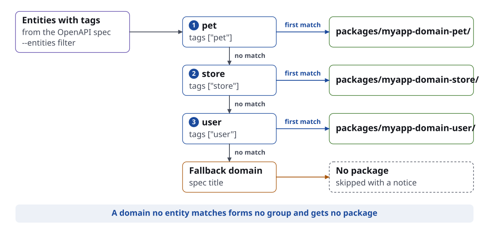

<p align="center">
  
</p>

# @simplix-react/cli

**English** | [한국어](/ko/packages/cli/README.md)

CLI for scaffolding and validating simplix-react projects.

## Installation

Install via the meta package (recommended):

```bash
pnpm add simplix-react
```

When using pnpm, add this to `.npmrc` so `@simplix-react/*` packages are resolvable:

```ini
public-hoist-pattern[]=@simplix-react/*
```

Or install the CLI only:

```bash
pnpm add -D @simplix-react/cli
```

Requires **Node.js 18 or later**.

> **Note:** Projects scaffolded with `simplix init` include the `.npmrc` configuration automatically.

## Quick Start

```bash
# Create a new project
simplix init my-app

# Add a domain package
simplix add-domain inventory

# Add an FSD module
simplix add-module editor

# Validate project structure
simplix validate
```

## Commands

### simplix init

Initialize a new simplix-react project with a monorepo structure (pnpm + Turborepo).

```bash
simplix init <project-name> [options]
```

**Arguments:**

| Argument | Description |
| --- | --- |
| `project-name` | Name of the project to create |

**Options:**

| Option | Description | Default |
| --- | --- | --- |
| `-s, --scope <scope>` | npm scope for packages | `@<project-name>` |
| `--no-demo` | Skip demo app creation | - |
| `--no-i18n` | Skip i18n setup | - |
| `--no-auth` | Skip auth setup | - |
| `--no-access` | Skip access control setup | - |
| `-y, --yes` | Accept all defaults (non-interactive) | - |

A scope given without a leading `@` gets one.

**Example:**

```bash
# Interactive mode
simplix init my-app

# Non-interactive with custom scope
simplix init my-app --scope @mycompany -y

# Without demo app or i18n
simplix init my-app --no-demo --no-i18n -y
```

**Generated structure:**

```text
my-app/
  apps/my-app-demo/       # Demo app (unless --no-demo)
  modules/                # FSD modules directory
  config/typescript/      # Shared TypeScript configs (base.json, react.json)
  package.json
  pnpm-workspace.yaml
  turbo.json
  tsconfig.json
  simplix.config.ts
  .npmrc
  .gitignore
  .oxlintrc.json
```

The demo app holds `src/app/auth/` unless `--no-auth` and `src/app/access/` unless `--no-access`. When i18n is enabled, it includes locale files for the selected locales (`en`, `ko` and `ja` by default).

### simplix add-domain

Add a new domain package under `packages/`, named `<prefix>-domain-<name>`. When an `openapi` entry of `simplix.config.ts` claims the domain, the package is a skeleton whose code `simplix openapi` (or `simplix meta`, when the entry has a `meta` block) generates; otherwise it is written from templates: schemas, a contract, hooks and mock handlers.

```bash
simplix add-domain <name> [options]
```

**Arguments:**

| Argument | Description |
| --- | --- |
| `name` | Domain name (e.g., `inventory`, `topology`) |

**Options:**

| Option | Description | Default |
| --- | --- | --- |
| `--no-i18n` | Skip i18n translations setup | - |
| `-y, --yes` | Accept all defaults (non-interactive) | - |

**Example:**

```bash
# Interactive mode
simplix add-domain inventory

# Without i18n
simplix add-domain inventory --no-i18n -y
```

**Generated structure (without an `openapi` entry):**

```text
packages/<prefix>-domain-<name>/
  src/
    schemas.ts            # Zod schemas
    contract.ts           # API contract
    hooks.ts              # Hooks derived from the contract
    mock/
      handlers.ts         # MSW mock handlers
      seed.ts             # Mock seed data
      index.ts
    translations.ts       # Only if i18n enabled
    locales/<locale>.json # Only if i18n enabled
    index.ts
  package.json
  tsup.config.ts
  vitest.config.ts
  tsconfig.json
```

### simplix add-module

Add a new FSD (Feature-Sliced Design) module under `modules/`. Modules organize UI features using the FSD architecture with `features/`, `widgets/`, and `shared/` layers. A name of the form `<group>/<name>` writes the module into a group directory that `modules.groups` lists, and every package in `modules.dependencies` becomes a dependency of the new module.

```bash
simplix add-module <name> [options]
```

**Arguments:**

| Argument | Description |
| --- | --- |
| `name` | Module name (e.g., `editor`, `maps`, `monitoring`) |

**Options:**

| Option | Description | Default |
| --- | --- | --- |
| `--no-i18n` | Skip i18n locales setup | - |
| `-y, --yes` | Accept all defaults (non-interactive) | - |

**Example:**

```bash
# Interactive mode
simplix add-module editor

# Without i18n
simplix add-module editor --no-i18n -y
```

**Generated structure:**

```text
modules/<prefix>-<name>/
  src/
    features/
      index.ts
    widgets/
      index.ts
    shared/
      lib/
      ui/
      config/
    locales/              # Only if i18n enabled
      index.ts
      features/<locale>.json
      widgets/<locale>.json
    index.ts
  package.json
  tsup.config.ts
  tsconfig.json
```

### simplix validate

Validate project structure, FSD layer rules, import boundaries, package configuration, i18n consistency, and contract completeness.

```bash
simplix validate [options]
```

**Options:**

| Option | Description | Default |
| --- | --- | --- |
| `--fix [checks]` | Auto-fix the named checks, comma separated (`exports`, `dependencies`, `tsup`, `i18n`, `fsd`, `root`, `tsconfig`, `expo`, or `all`). A bare `--fix` repairs package exports only | off |

**Example:**

```bash
# Validate only
simplix validate

# Repair package exports (each entry's `source` and `types`)
simplix validate --fix

# Also repair i18n keys and the workspace root (turbo.json, scripts, TypeScript catalog)
simplix validate --fix exports,i18n,root
```

**Validation rules:**

The validator applies different rule sets to packages and modules:

| Rule Set | Target | Checks |
| --- | --- | --- |
| **Package** | packages/, modules/ | `exports` field, `tsup.config`, React `peerDependencies`, `"type": "module"` |
| **Contract** | packages/ | Every entity has `schema` and `operations`, every custom operation has `input` and `output`, mock handler config |
| **FSD** | modules/ | `features/` does not import from `widgets/`, `shared/` does not import from `features/` or `widgets/` |
| **Import** | modules/ | No cross-module direct imports (must use package exports) |
| **i18n** | modules/ | Missing keys across locales, extra keys, empty values, interpolation variable (`{{var}}`) consistency |

Auto-fixable issues, by the check `--fix` names:

- `exports`: an entry without `source`, and `types` that does not name the source
- `dependencies`: missing `"type": "module"`, React not declared as a peer
- `tsup`: `dts` in `tsup.config.ts`
- `i18n`: missing keys (copied from the reference locale) and extra keys (removed). Plural keys follow each locale's CLDR categories, so a Korean catalogue holds only `_other`
- `fsd`: missing layer folders
- `root`, `tsconfig`, `expo`: turbo.json, root scripts and the TypeScript catalog pin; `baseUrl`; an Expo app's TypeScript version

**Output format:**

```text
simplix validate

  packages/myapp-core
    ✔ Has "exports" field
    ✔ tsup.config exists
    ✔ "type": "module"

  modules/myapp-editor
    ✔ FSD: features/ has no widgets/ imports
    ✖ i18n: Missing key "title" in ko.json (src/locales)

  Summary: 1 error, 0 warnings, 5 checks passed
```

### simplix i18n-codegen

Generate TypeScript type definitions from i18n JSON files. Scans all modules under `modules/` and creates `keys.d.ts` files containing union types of all translation keys.

```bash
simplix i18n-codegen [options]
```

**Options:**

| Option | Description | Default |
| --- | --- | --- |
| `--watch` | Watch for file changes and regenerate | `false` |

**Example:**

```bash
# One-time generation
simplix i18n-codegen

# Watch mode
simplix i18n-codegen --watch
```

The codegen uses `en.json` as the source of truth (falls back to the first JSON file found). It generates a union type of all flattened keys:

```ts
// Auto-generated by simplix i18n-codegen
// Do not edit manually

export type LocalesKeys =
  | "title"
  | "description"
  | "actions.save"
  | "actions.cancel";
```

### simplix openapi

Generate domain packages from an OpenAPI specification with Orval. Supports both file paths and URLs as input. The `openapi` entry of `simplix.config.ts` whose `spec` matches the input supplies the profile, the domains and the CRUD patterns. On subsequent runs, it compares the spec against a snapshot and skips a domain whose spec has not changed unless `--force` is given; it regenerates the generated directories while preserving user-modified files.

```bash
simplix openapi <spec> [options]
```

**Arguments:**

| Argument | Description |
| --- | --- |
| `spec` | OpenAPI spec file path or URL |

**Options:**

| Option | Description | Default |
| --- | --- | --- |
| `-d, --domain <name>` | Domain to generate | Every configured domain |
| `-e, --entities <names>` | Entity names to generate (comma-separated) | All entities |
| `-o, --output <dir>` | Output directory | `packages/` |
| `-f, --force` | Force regeneration even if no changes | `false` |
| `--no-http` | Skip `.http` file generation | - |
| `--offline` | Read SimpliX Meta from `meta.snapshot` instead of the server | `false` |
| `-y, --yes` | Auto-confirm without prompts | - |

**Example:**

```bash
# Generate from a local file
simplix openapi ./specs/inventory-api.yaml

# Generate from a URL with custom domain name
simplix openapi https://api.example.com/openapi.json --domain inventory

# Generate specific entities only
simplix openapi ./spec.yaml --entities product,category

# Force regeneration without prompts
simplix openapi ./spec.yaml --force -y
```

**Generated structure:**

```text
packages/<prefix>-domain-<name>/
  src/
    generated/              # Orval output (regenerated)
      endpoints/            # Request functions and React Query hooks
      model/                # TypeScript types
    generated-meta/         # SimpliX Meta output, when the entry has a meta block (regenerated)
    hooks/                  # Hooks over the generated endpoints (regenerated)
    mock/                   # Mock layer
    schemas.ts              # Zod schemas
    mutator.ts              # Request mutator chosen by the spec profile
    index.ts                # Package entry
  crud.config.ts            # CRUD role mapping (see defineCrudMap)
  http/                     # HTTP client files (unless --no-http)
    http-client.env.json
    <entity>.http
  .openapi-snapshot.json    # Snapshot for incremental updates
  package.json
  tsup.config.ts
  tsconfig.json
```

On a regeneration, `src/generated/`, `src/hooks/` and `src/generated-meta/` are removed and written again. `src/index.ts` is merged rather than overwritten, and an existing `crud.config.ts` is kept.

#### Multi-Domain Mode (Tag-Based Splitting)

When your OpenAPI spec covers multiple domains, you can split entities into separate packages based on operation tags. Configure `domains` on the spec's entry in `openapi` of `simplix.config.ts` to map domain names to tag patterns:

```ts
// simplix.config.ts
import { defineConfig } from "@simplix-react/cli";

export default defineConfig({
  openapi: [
    {
      spec: "https://petstore.swagger.io/v2/swagger.json",
      domains: {
        pet: ["pet"],
        store: ["store"],
        user: ["user"],
      },
    },
  ],
});
```

Each value is an array of tag patterns. Patterns can be exact strings or regular expressions enclosed in `/`:

```ts
domains: {
  iam: ["IAM", "Authentication", "/^Auth.*/"],  // exact + regex
  billing: ["Billing", "/^Payment.*/"],
}
```

When the entry has domains, running `simplix openapi` generates one package per domain:

```bash
simplix openapi https://petstore.swagger.io/v2/swagger.json -y

# Generates:
#   packages/myapp-domain-pet/
#   packages/myapp-domain-store/
#   packages/myapp-domain-user/
```

**Matching rules:**

| Rule | Behavior |
| --- | --- |
| First-match-wins | Each entity is assigned to the first matching domain in config order |
| Fallback domain | Entities with no matching tags go to a fallback domain named after the spec title; `--domain` only selects which groups are generated, and a group without a package is skipped with a notice |
| Empty domain skip | Domains with zero matched entities are not generated |
| Entity filter first | `--entities` filter is applied before domain grouping |
| Independent snapshots | Each domain package maintains its own `.openapi-snapshot.json` |

The run prints how the entities were grouped, for example `Multi-domain mode: pet(3), store(2), user(1)`.



### simplix meta-diff

Compare a domain package's two generated outputs (`src/generated/` from orval and
`src/generated-meta/` from SimpliX Meta) and report where their public names, fields and
query keys disagree. A domain is switched to the meta output only once this command is quiet.

```bash
simplix meta-diff <domain> [options]
```

**Arguments:**

| Argument | Description |
| --- | --- |
| `<domain>` | Domain name, as it is spelled in the `openapi` config |

**Options:**

| Flag | Description |
| --- | --- |
| `--root <dir>` | Project root (default: discovered from the working directory) |
| `--package <dir>` | The domain package directory, when it is not under `packages/` |
| `--expect <file>` | JSON file of renames, required-ness grounds and one-sided names |
| `--json` | Print the findings as JSON |

Both trees must come from the **same** `simplix openapi` run against the same server. A diff taken
across two runs reports whatever the backend changed in between.

Findings come at two levels, and the command exits non-zero when there is an error.

| Finding | Level |
| --- | --- |
| A type, hook, request function, URL builder, `get<Name>QueryKey`, `as const` map, params type or `create<Name>Handlers` factory present in only one output | error |
| A `get<Name>QueryKey` whose returned array changed arity or element order | error |
| A field present in only one output, or whose type changed | error |
| A field required in the orval output and optional in the meta output | error |
| A field required in the meta output with no primitive type and no declared ground | error |
| An enum field moving from a value union to the labeled `{ value, label }` shape | note |
| A field required in the meta output whose type is `boolean` or `number` | note |
| A zod constant present in only one output | note |
| A name difference, required-ness difference or one-sided name declared in `--expect` | note |

Orval's per-operation plumbing (a type per HTTP status, the query-options and mutation-options
builders, the result and error aliases) has no counterpart in the meta output and is excluded
rather than reported. How many declarations were excluded is printed with each tree.

**Expectation file:**

Neither output records why a field is required or why a tag was named the way it was, so what the
project knows is declared rather than guessed.

```json
{
  "renames": [
    {
      "orval": "useGetAvatar",
      "meta": ["useGetPublicUserAvatar", "useGetPublicUserAvatarThumbnail"],
      "reason": "SimpliX Meta follows the @Tag annotation and springdoc does not"
    }
  ],
  "requiredFields": ["UserAccountCreateDTO.email"],
  "ignore": ["BodyObject", "ErrorDetail"]
}
```

A `renames` entry folds into one note only when every name on its `orval` side is present in the
orval output alone and every name on its `meta` side in the meta output alone; a half-true
expectation silences nothing.

**Example:**

```bash
simplix meta-diff org --expect openapi/meta-diff.json
```

### simplix init-ui

Initialize `@simplix-react/ui` with shadcn/ui integration. Installs required shadcn components and generates a `UIProvider` configuration file.

```bash
simplix init-ui [-y]
```

**Options:**

| Flag | Description |
| --- | --- |
| `-y, --yes` | Non-interactive mode |

**Prerequisites:** shadcn must be initialized first (`npx shadcn@latest init`). The command installs these shadcn components: `input`, `textarea`, `select`, `switch`, `checkbox`, `badge`, `calendar`, `label`.

### simplix scaffold

Generate CRUD widgets into an FSD module's `widgets/` layer. Reads entity schema definitions and generates list, form, detail, and tree page components.

```bash
simplix scaffold <entity> [options]
```

**Arguments:**

| Argument | Description |
| --- | --- |
| `<entity>` | Entity name (e.g., `product`, `user`) |

**Options:**

| Flag | Description |
| --- | --- |
| `--module <dir>` | Target FSD module directory (relative to `modules/`) |
| `--output <dir>` | Custom output directory (overrides `--module`, relative to cwd) |
| `--native` | Generate the mobile entity screen set (list, push detail, full-screen form and expo-router routes) |
| `--app <dir>` | Target Expo app under `apps/` for the route files (with `--native`) |
| `--blocks` | Also write a `page.blocks.tsx` file beside the page, once, for the author to write |
| `--menu-group <key>` | The menu group the screen's entry joins (its key in the menu file); default: before the menu marker |
| `--menu-icon <name>` | The icon the screen's menu entry draws, imported into the menu file when it is not yet |
| `--list-presentation <kind>` | How the list draws its rows: `table` (default) or `cards` |
| `--view-toggle` | Give a table list a switch to the cards (a cards list always has one and refuses the flag) |
| `--card-title <column>` | The key of the column that titles a card; default the first column |
| `--status-badge <field>` | The enum or boolean field the detail header draws as the record's badge; default the field named `status`, `state` or `standing` |
| `--text-filter <fields>` | Comma separated text fields that each get a filter the reader types part of (otherwise text fields are left to the keyword search) |

**Example:**

```bash
# Generate CRUD widgets for the "product" entity
simplix scaffold product --module store
```

After writing, `scaffold` runs the commands `generated.after` lists in `simplix.config.ts`.

### Extending a scaffolded form

The generated form template stays minimal on purpose. Each `FormFields.*`
component already accepts the props below directly: extend the generated
file by adding them on the relevant fields. The `useCrudFormSubmit` hook
accepts an optional `validator` for client-side checks.

#### Client-side validation

Wire any sync validator on the `useCrudFormSubmit({ validator })` option.
A failing validator blocks the submit and the server mutation is not
called. Client and server errors are temporally mutually exclusive, so
`fieldErrors` always reflects exactly one source per attempt.

```tsx
// Zod-driven (recommended when schemas-ts.hbs is present):
import { zodToFieldErrors } from "@simplix-react/form";
import { createProductSchema, updateProductSchema } from "@my-app/domain-product";

const { handleSubmit, fieldErrors } = useCrudFormSubmit<ProductFormValues>({
  entityId,
  create: adaptOrvalCreate(_create, { onSettled: invalidate }),
  update: adaptOrvalUpdate(_update, "productId", { onSettled: invalidate }),
  validator: (v) => zodToFieldErrors(isEdit ? updateProductSchema : createProductSchema, v),
  onSuccess,
});

// Imperative rules (no Zod):
validator: (v) => v.name?.trim() ? null : { name: "Name is required" }
```

#### maxLength

`FormFields.TextField` / `TextareaField` / `I18nTextField` / `I18nTextareaField`
accept a literal `maxLength`:

```tsx
<FormFields.TextField
  label={fieldLabel("name")}
  value={values.name}
  onChange={(v) => updateField("name", v)}
  error={fieldErrors?.["name"]}
  maxLength={50}
/>
```

#### placeholder

Every input component accepts a `placeholder`. Prefer i18n keys for any
user-visible text:

```tsx
<FormFields.TextField
  label={fieldLabel("name")}
  placeholder={t("product.placeholders.name")}
  /* ... */
/>
```

`I18nTextField` / `I18nTextareaField` also accept a per-locale object
(`{ en: "...", ko: "..." }`) when each locale needs its own placeholder.

#### min / max (NumberField)

```tsx
<FormFields.NumberField
  label={fieldLabel("priority")}
  value={values.priority}
  onChange={(v) => updateField("priority", v ?? 0)}
  error={fieldErrors?.["priority"]}
  min={0}
  max={100}
/>
```

#### Keeping label translations in sync

Entity field labels resolve through `useEntityTranslation(entity).fieldLabel("...")`
backed by the domain package's `locales/{lang}.json` under `{entity}.fields.*`.
Placeholders, hints, and section titles can live in the same JSON tree
(`{entity}.placeholders.*`, `{entity}.form.sections.*`, etc.) and be read with
`useTranslation("{moduleNamespace}/widgets").t("...")`.

### simplix add-app

Add an Expo (React Native) app with expo-router under `apps/`. The command generates native apps only and refuses to run without `--native`; the web app shell comes from `simplix init`.

```bash
simplix add-app <name> --native [-y]
```

| Option | Description |
| --- | --- |
| `--native` | Generate an Expo (React Native) app with expo-router |
| `-y, --yes` | Accept all defaults (non-interactive) |

### simplix add-page

Generate a page of one kind from the templates of the app that owns it, in the order the [template table](#apps-drawn-by-different-kits) gives.

```bash
simplix add-page <kind> <name> [options]
```

| Argument | Description |
| --- | --- |
| `<kind>` | Page kind: `record-page`, `dashboard-page`, `static-page`, `error-page`, `auth-page` or `app-shell` (the CLI bundles `record-page`, `dashboard-page`, `static-page` and `error-page`; `auth-page` and `app-shell` come from a UI kit) |
| `<name>` | Page name (e.g. `my-profile`, `home`, `not-found`) |

| Option | Description |
| --- | --- |
| `--module <name>` | Module that owns the page (`modules/<name>/src/pages/<page>`); a grouped module is `<group>/<name>` |
| `--app <name>` | App that owns the page (`apps/<name>/src/pages/<page>`), drawn from that app's templates and written to its `storiesDir` |
| `--variant <name>` | Another shape of the kind, drawn from `<kind>.<variant>.hbs` |
| `--blocks` | Also write a `page.blocks.tsx` file beside the page, once, for the author to write |
| `--dry-run` | Print every file the page would write, with its content, and write nothing (the `generated.after` commands do not run) |

### simplix generated

Report every generated file as untouched, edited or stale against the current templates, and what a regeneration merges into each edited one. The merge bases are kept under `.simplix/generated`.

```bash
simplix generated [paths...] [options]
```

| Option | Description |
| --- | --- |
| `[paths...]` | Report only the generated files at these paths or under these directories; with `--all`, regenerate only them |
| `--all` | Regenerate every scaffolded screen and page first: untouched files are rewritten, edited ones merged three-way, and a deleted one stays deleted |
| `--write-conflicts` | With `--all`, write conflict markers into a file whose merge conflicts instead of leaving it alone |
| `--check` | Also exit non-zero on a stale file, a conflict, a file with no base or origin, and an edited file a clean merge would still move |
| `--json` | Print the report as JSON |
| `--share` | Report, per screen, the lines in blocks and edited files against the generated lines, and the customisations two screens repeat |
| `--adopt <path...>` | Record the current render of an edited file as its merge base, after printing the diff between the two |
| `-y, --yes` | With `--adopt`, record without asking once the diffs are printed |
| `--origin <command>` | Record `<command>` (the arguments after `simplix`) as the origin of the generated files at the given paths |
| `--rebase` | With `--adopt`, also take a file that already has a base |

### simplix meta

Generate domain packages from SimpliX Meta, without Orval. Each `openapi` entry with a `meta` block names where SimpliX Meta is read from.

```bash
simplix meta [options]
```

| Option | Description |
| --- | --- |
| `-d, --domain <name>` | Domain to generate (default: every configured domain) |
| `--offline` | Read SimpliX Meta from `meta.snapshot` instead of the server |
| `-f, --force` | Rewrite `crud.config.ts` even where one already exists |
| `--strict` | Exit non-zero, generating nothing, when a tag in SimpliX Meta is claimed by no domain (tags in `meta.ignoreTags` excepted) |

### simplix meta-info

Print what the backend offers a screen over an entity, read from the committed SimpliX Meta: the list and its access, the default sort, keyword search, status counts, aggregates, time range counts, export, actions, filters, and fields drawn masked.

```bash
simplix meta-info <entity> [--json]
```

The entity name is accepted in any case (`EmailLog`, `email-log`, `emailLog`). `--json` prints the answer as JSON.

### simplix meta-removals

Fail when the SimpliX Meta snapshot loses a type, field, operation or enum value that code under the roots still names, unless the acknowledged file lists it. The roots default to `checks.metaRemovals.roots`.

```bash
simplix meta-removals [roots...] [--base <ref>]
```

| Option | Description | Default |
| --- | --- | --- |
| `--base <ref>` | Git revision whose snapshot is the before side | `HEAD` |

### simplix check-screen

Check the generated screens' files against the committed SimpliX Meta: the form carries and marks what the create body requires, long text follows its length, a figure is drawn by the kind its format declares, a reference is drawn by the name field its entity declares, and a frame's sample rows nest it. Exits 1 on an error. Without an entity, every screen read from Meta is checked, and every routed screen of an app that declares `apps.<app>.design` must have its entry or row in that design source.

```bash
simplix check-screen [entity...]
```

### simplix cycles

Report every import cycle among the source files under the given roots, with the edges the bundler keeps (a cycle makes Vite's hot update reload the whole page), and every dependency cycle between the workspace packages' `package.json` files. The roots default to `checks.cycles.roots`.

```bash
simplix cycles [roots...]
```

### simplix kit-fence

Check that the lint config refuses exactly the framework imports the UI kit fences (`simplix.fence` in the kit's `package.json`).

```bash
simplix kit-fence [--lint <file>] [--write]
```

| Option | Description | Default |
| --- | --- | --- |
| `--lint <file>` | The lint config holding the fence | `.oxlintrc.json` |
| `--write` | Write the kit's fence into the lint config instead of checking it | - |

### Global option

| Option | Description |
| --- | --- |
| `--root <dir>` | The project root for every command (default: the nearest directory at or above the working directory holding `simplix.config.ts`). `meta-diff`, `meta-info`, `meta-removals`, `check-screen` and `cycles` also take it as their own option |


## Configuration

The CLI reads an optional `simplix.config.ts` file from the project root. If the file does not exist, default values are used.

```ts
// simplix.config.ts
import { defineConfig } from "@simplix-react/cli";

export default defineConfig({
  plugins: ["@simplix-react-ext/simplix-boot-cli-plugin"],
  api: { baseUrl: "/api/v1" },
  packages: {
    prefix: "myapp",             // Package name prefix (default: derived from root package.json)
  },
  http: {
    environments: {
      development: { baseUrl: "http://localhost:3000" },
      staging: { baseUrl: "https://staging.example.com" },
    },
  },
  codegen: {
    header: true,                // Add auto-generated header to generated files
  },
  openapi: [
    {
      spec: "openapi.json",
      profile: "simplix-boot",
      domains: {                 // Tag-based domain splitting
        iam: ["IAM", "/^Auth.*/"],
        billing: ["Billing"],
      },
    },
  ],
});
```

| Field | Description | Default |
| --- | --- | --- |
| `plugins` | CLI extension plugin modules loaded before any command runs | `[]` |
| `api.baseUrl` | API base path used in code generation | `"/api"` |
| `packages.prefix` | Short prefix for generated package names | Derived from root `package.json` name |
| `http.environments` | Named environments for `.http` files | `{ development: { baseUrl: "http://localhost:3000" } }` |
| `codegen.header` | Prepend auto-generated header comment to generated files | `true` |
| `i18n.locales` | Supported locale codes | `["en", "ko", "ja"]` |
| `i18n.defaultLocale` | Default locale code | `"en"` |
| `i18n.localeOnlyKeys` | Keys a locale may hold that the reference locale does not, by locale code; `validate` neither reports nor removes them | `undefined` |
| `openapi` | One entry per spec (`OpenAPISpecConfig`) | `undefined` (no OpenAPI generation) |
| `openapi[].spec` | OpenAPI document path (relative to the project root) or URL; `simplix meta` needs none | `undefined` |
| `openapi[].profile` | Spec profile name a plugin registered | `undefined` |
| `openapi[].naming` | Naming strategy, over the profile's | The profile's |
| `openapi[].responseAdapter` | Response adapter, over the profile's | The profile's |
| `openapi[].domains` | Tag-based domain splitting map: domain name → tag patterns (exact or `/regex/`); required | - |
| `openapi[].crud` | CRUD role detection patterns (`CrudEndpointPattern` per role) | `undefined` (no CRUD roles) |
| `openapi[].meta.source` | SimpliX Meta endpoint URL or snapshot path | The spec's origin plus the profile's `metaEndpoint` |
| `openapi[].meta.snapshot` | Where the fetched SimpliX Meta is committed, for `--offline` and for the change gate | `undefined` (the meta half runs every time) |
| `openapi[].meta.export` | Domains whose barrel exports `src/generated-meta/` instead of the Orval output | `[]` |
| `openapi[].meta.ignoreTags` | Tags no domain claims on purpose, as glob patterns; not warned about and not refused by `--strict` | `[]` |
| `modules.groups` | Directories under `modules/` that hold modules rather than being one | `[]` |
| `modules.dependencies` | Packages every module `add-module` writes declares as a dependency (name → version range) | `{}` |
| `routes` | The route file a list screen is reached through, by module group (`dir`, `template`, `paths`, `except`, `menu`) | `undefined` (no route written) |
| `scaffold.defaultSortFields` | Fields a generated list may open sorted by, where SimpliX Meta declares no `defaultSort` | `[]` |
| `scaffold.maskedSuffix` | Suffix of a field's masked form; a record with both forms is drawn with the masked one | `undefined` |
| `scaffold.referencePickers` | Per referenced entity, the hook (and `facet` or `facetFor`) a form picker or list filter searches it with | `{}` |
| `scaffold.holders` | Per scaffolded entity, the holders its detail leaves out (`exclude`) | `{}` |
| `references.peeks` | The peek kind a reference opens, by reference stem or entity name | `{}` |
| `generated.format` | The project's formatter, run over every render before it is written or compared | `undefined` (renders used as produced) |
| `generated.after` | Commands run after `scaffold`, `add-page` and `generated --all` have written their files | `[]` |
| `checks.cycles.roots` | Default roots of `simplix cycles` | `undefined` |
| `checks.metaRemovals` | Default `roots`, `snapshot` and `acknowledged` file of `simplix meta-removals` | `undefined` |
| `templates.from` | UI kit package or template directory pages and widgets are drawn from | The one root dependency that is a UI kit (a kit and the base it extends count as one) |
| `templates.storiesDir` | Directory generated design-reference stories are written to | `undefined` (no stories) |
| `templates.story` | Story id and title patterns, and the story file per scaffold key | Storybook's title-derived id under `Generated/{Entity}` |
| `apps.<app>.moduleGroups` | Module groups whose pages are drawn for this app | `[]` |
| `apps.<app>.templates` | The app's `from`, `storiesDir` (`null` writes none) and `story`, each over the top-level key | The top-level `templates` |
| `apps.<app>.design` | The design source every routed screen of the app is checked against | `undefined` (not gated) |

The config file is loaded using [jiti](https://github.com/unjs/jiti), so TypeScript syntax is supported without compilation.

### Apps drawn by different kits

A workspace can hold apps drawn by different UI kits and designed in different references. You state each app's own settings under `apps`; a page reads them when `--app <name>` names the app, or when `--module <group>/<name>` names a group the app lists in `moduleGroups`.

```ts
// simplix.config.ts
import { defineConfig } from "@simplix-react/cli";

export default defineConfig({
  modules: { groups: ["admin", "site", "shared"] },
  templates: { from: "@acme-kits/console-clarity", storiesDir: "../board/screens" },
  apps: {
    "acme-admin": {
      design: { source: "screen-design", manifest: "../board/screen-design.json" },
    },
    "acme-site": {
      moduleGroups: ["site"],
      templates: { from: "@acme-kits/site-clarity", storiesDir: null },
      design: { source: "story-manifest", manifest: "site-design-manifest.json" },
    },
  },
});
```

Templates are read name by name in this order:

| Order | Source |
| --- | --- |
| 1 | `.simplix/templates/<app>/<name>.hbs` |
| 2 | `.simplix/templates/<name>.hbs` |
| 3 | The kit `apps.<app>.templates.from` names, else `templates.from` |
| 4 | Each kit it extends (`simplix.extends`), nearest first |
| 5 | The CLI's bundled template |

A UI kit declares its templates in its `package.json`. A kit whose templates are its family's
shared ones extends the base kit that holds them, and keeps only the templates of its own:

```json
{
  "name": "@acme-kits/console-clarity",
  "simplix": {
    "templates": "templates",
    "extends": "@acme-kits/console-core",
    "id": "clarity"
  }
}
```

| Field | Meaning |
| --- | --- |
| `simplix.templates` | The kit's template directory, relative to the package |
| `simplix.extends` | The kit whose templates are read beneath this kit's, resolved from this kit's own directory |
| `simplix.id` | The short name of the kit that `{{@kit.id}}` stands for |

A base kit's template names the kit the project draws with through the values below, written into the
template before it is rendered. A value with nothing to stand for is refused rather than rendered
as an empty string:

| Token | Value for `@acme-kits/console-clarity` |
| --- | --- |
| `{{@kit.package}}` | `@acme-kits/console-clarity` |
| `{{@kit.label}}` | `console-clarity` |
| `{{@kit.id}}` | `clarity` |

`apps.<app>.design` gates the app's routed screens. `simplix generated` and `simplix check-screen` (run without an entity) exit 1 on a TanStack file route of the app with no design:

| `source` | Manifest | A route is designed by |
| --- | --- | --- |
| `screen-design` | `{ "screens": [{ "app": "<app>", "route": "/path", ... }] }` | an entry with the app's name and the route |
| `story-manifest` | `{ "rows": [{ "route": "/path", "stories": { "<width>": ["<story id>"] } }], "exempt": [{ "route": "/path", "reason": "..." }] }` | a row naming at least one story, or an exemption with its reason |

The route is the id the file's `createFileRoute("...")` call names, so `login_.complete.tsx` is `"/login_/complete"`. The routes are read from `apps/<app>/src/routes` unless `design.routes` names another directory.

`simplix add-page <kind> <name> --app <app> --dry-run` prints every file the page would write, with its content, and writes nothing.

### defineConfig

Identity function that provides type-safe autocompletion for `simplix.config.ts`.

```ts
import { defineConfig } from "@simplix-react/cli";

export default defineConfig({
  api: { baseUrl: "/api/v1" },
  packages: { prefix: "my-app" },
  codegen: { header: true },
});
```

### defineCrudMap

Identity function that provides type-safe autocompletion for per-entity CRUD operation mapping. Use in a `crud.config.ts` file to map entity names to their operation IDs.

```ts
import { defineCrudMap } from "@simplix-react/cli";

export default defineCrudMap({
  pet: {
    list: "findPetsByStatus",
    get: "getPetById",
    create: "addPet",
    update: "updatePet",
    delete: "deletePet",
  },
});
```

## Plugin System

The CLI provides a plugin registry for extending OpenAPI code generation with custom naming strategies, response adapters, and schema adapters.

### Registration Functions

| Export | Kind | Description |
| --- | --- | --- |
| `registerSpecProfile` | Function | Register a named spec profile (naming + response adapter bundle) |
| `registerResponseAdapterPreset` | Function | Register a named response adapter preset |
| `registerSchemaAdapter` | Function | Register a schema adapter for unwrapping wrapper types |
| `registerPlugin` | Function | Register a complete plugin (bulk-registers spec profiles and response adapters) |

### Retrieval Functions

| Export | Kind | Description |
| --- | --- | --- |
| `getSpecProfile` | Function | Get a registered spec profile by name |
| `getResponseAdapterPreset` | Function | Get a registered response adapter preset by name |
| `getSchemaAdapters` | Function | Get all registered schema adapters |

### registerSpecProfile

Registers a named `SpecProfile` that bundles a naming strategy and response adapter configuration. Reference the profile name in `simplix.config.ts` via the `profile` field.

```ts
import { registerSpecProfile } from "@simplix-react/cli";
import type { SpecProfile } from "@simplix-react/cli";

const myProfile: SpecProfile = {
  naming: {
    resolveEntityName: (ctx) => ctx.tag ?? "unknown",
    resolveOperation: (ctx) => ({
      role: "list",
      hookName: `list${ctx.entityName}`,
    }),
  },
  responseAdapter: "raw",
};

registerSpecProfile("my-api", myProfile);
```

Then reference it in config:

```ts
export default defineConfig({
  openapi: [
    { spec: "openapi.json", profile: "my-api", domains: { main: ["*"] } },
  ],
});
```

### registerResponseAdapterPreset

Registers a named response adapter preset for reuse across specs.

```ts
import { registerResponseAdapterPreset } from "@simplix-react/cli";

registerResponseAdapterPreset("my-envelope", {
  unwrapExpression: "data?.result",
  errorAdapterImport: 'import { adaptError } from "./error-adapter"',
  errorAdapterName: "adaptError",
});
```

### registerSchemaAdapter

Registers a schema adapter that can unwrap wrapper types in OpenAPI schemas (e.g., stripping generic envelope types).

```ts
import { registerSchemaAdapter } from "@simplix-react/cli";

registerSchemaAdapter({
  id: "my-wrapper",
  canUnwrap: (schema) => !!schema["x-wrapper"],
  unwrap: (schema) => schema.properties?.data as Record<string, unknown>,
  stripPrefix: (typeName) => typeName.replace(/^Wrapper/, ""),
});
```

### registerPlugin

Convenience function that bulk-registers spec profiles and response adapter presets from a single plugin object.

```ts
import { registerPlugin } from "@simplix-react/cli";

registerPlugin({
  id: "my-backend",
  specs: {
    "my-backend": mySpecProfile,
  },
  responseAdapters: {
    "my-envelope": myResponseAdapterPreset,
  },
});
```

### Type Exports

| Export | Description |
| --- | --- |
| `SimplixConfig` | Project-level configuration for `simplix.config.ts` |
| `OpenAPISpecConfig` | Per-spec OpenAPI configuration within `SimplixConfig.openapi` |
| `CrudEndpointPattern` | CRUD role to HTTP method/path pattern mapping |
| `CrudEntityConfig` | Per-entity CRUD role to operationId mapping |
| `CrudMap` | Entity name to `CrudEntityConfig` mapping (used by `defineCrudMap`) |
| `SpecProfile` | Bundles naming strategy + response adapter as a reusable preset |
| `ResponseAdapterPreset` | Preset definition for a response adapter |
| `ResponseAdapterConfig` | Response adapter configuration (string preset or object) |
| `OpenApiNamingStrategy` | Strategy interface for entity/operation name derivation |
| `EntityNameContext` | Context provided to `resolveEntityName()` |
| `OperationContext` | Context provided to `resolveOperation()` |
| `ResolvedOperation` | Result of resolving an operation (role + hookName) |
| `CliPlugin` | Plugin object for `registerPlugin` |
| `SchemaAdapter` | Schema adapter interface for `registerSchemaAdapter` |
| `I18nEntityInfo` | Entity info for i18n key mapping |
| `I18nDownloader` | Callback for downloading i18n data from a server |
| `OpenAPIMetaConfig` | The `meta` block of an `OpenAPISpecConfig` |
| `SimplixHttpEnvironment` | One environment of `http.environments` |
| `SimplixChecksConfig` | The `checks` block |
| `SimplixTemplatesConfig` | The `templates` block |
| `SimplixAppConfig` | One app's settings under `apps` |
| `SimplixDesignSource` | The `design` setting of an app |
| `ContainerMapping` | A backend container type and the TypeScript type and zod factory it becomes |
| `MetaExtensionOutput` | Files a spec profile's `metaExtensions` produces |

### UI Kit Template Exports

A UI kit's own tests read and render its templates the way the generator does with these exports.

| Export | Kind | Description |
| --- | --- | --- |
| `loadProjectTemplates` | Function | Load the templates in force for a project |
| `resolveKitChain` | Function | The kit a project draws with and every kit it extends, base first |
| `renderTemplate` | Function | Render a Handlebars template with a context |
| `readKitFence` | Function | The imports a kit and the kits it extends fence (`simplix.fence`), with the kit's values written in place of `{{@kit.*}}` |
| `kitFenceOf` | Function | The fence of `readKitFence`, or `undefined` where no kit of the chain declares one |
| `ProjectTemplates` | Type | Template name → template source |
| `KitChain` | Type | The result of `resolveKitChain` |
| `KitLayer` | Type | One kit of a chain |
| `FencedImport` | Type | One restricted import, in the shape `no-restricted-imports` takes |

## Related Packages

Install all packages at once with the meta package:

```bash
pnpm add simplix-react
```

| Package | Description |
| --- | --- |
| [`simplix-react`](https://www.npmjs.com/package/simplix-react) | Meta package (installs all packages below) |
| `@simplix-react/contract` | Zod-based type-safe API contract definitions |
| `@simplix-react/react` | React Query hooks derived from contracts |
| `@simplix-react/form` | TanStack Form hooks derived from contracts |
| `@simplix-react/auth` | Authentication middleware (Bearer, API Key, OAuth2) |
| `@simplix-react/mock` | MSW handlers + in-memory mock stores |
| `@simplix-react/i18n` | i18next-based internationalization framework |
| `@simplix-react/testing` | Test utilities (mock clients, query wrappers) |

---

<p class="page-source"><a href="https://github.com/simplix-framework/simplix-react/blob/main/packages/cli/README.md" target="_blank" rel="noopener noreferrer">Edit on GitHub</a></p>
