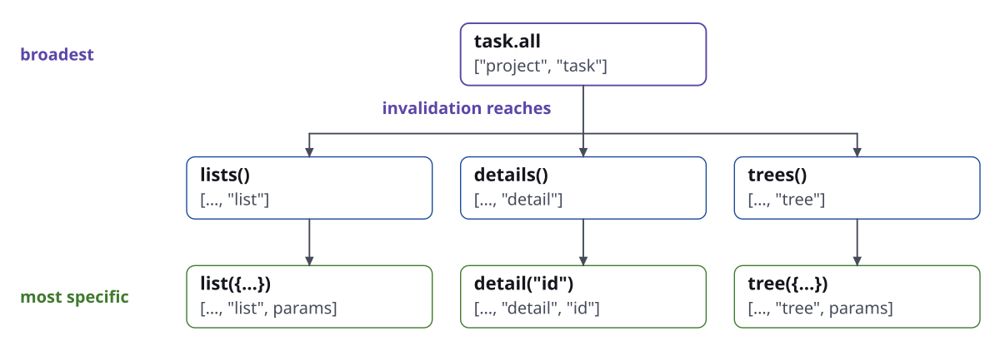

<p align="center">
  
</p>

# @simplix-react/contract

**English** | [한국어](/ko/packages/contract/README.md)

Define type-safe API contracts with Zod schemas. A single contract drives your HTTP client, React Query hooks, and MSW mock handlers.

## Installation

```bash
pnpm add @simplix-react/contract
```

**Peer dependency:** `zod >= 4.0.0`

```bash
pnpm add zod
```

## Quick Example

```ts
import { z } from "zod";
import { defineApi, simpleQueryBuilder } from "@simplix-react/contract";

const taskSchema = z.object({
  id: z.string(),
  title: z.string(),
  status: z.enum(["open", "closed"]),
});

// 1. Define your contract
const projectApi = defineApi({
  domain: "project",
  basePath: "/api/v1",
  entities: {
    task: {
      schema: taskSchema,
      operations: {
        list: { method: "GET", path: "/tasks" },
        get: { method: "GET", path: "/tasks/:id" },
        create: {
          method: "POST",
          path: "/tasks",
          input: z.object({ title: z.string() }),
        },
        update: {
          method: "PATCH",
          path: "/tasks/:id",
          input: z.object({
            title: z.string().optional(),
            status: z.enum(["open", "closed"]).optional(),
          }),
        },
        delete: { method: "DELETE", path: "/tasks/:id" },
      },
    },
  },
  queryBuilder: simpleQueryBuilder,
});

// 2. Use the type-safe client
const tasks = await projectApi.client.task.list();
const task = await projectApi.client.task.get("task-1");
const created = await projectApi.client.task.create({ title: "New task" });
const updated = await projectApi.client.task.update("task-1", { status: "closed" });
await projectApi.client.task.delete("task-1");

// 3. Use query keys for cache management
projectApi.queryKeys.task.all;                      // ["project", "task"]
projectApi.queryKeys.task.lists();                   // ["project", "task", "list"]
projectApi.queryKeys.task.list({ status: "open" });  // ["project", "task", "list", { status: "open" }]
projectApi.queryKeys.task.detail("task-1");          // ["project", "task", "detail", "task-1"]
```

## API Overview

| Export | Kind | Description |
| --- | --- | --- |
| `defineApi` | Function | Creates a contract (`config`, `client`, `queryKeys`) from a config; `options.fetchFn` replaces the fetch function |
| `customizeApi` | Function | Derives a new contract from an existing one with entity operations added, replaced or removed |
| `deriveClient` | Function | Derives a type-safe HTTP client from a contract config |
| `deriveQueryKeys` | Function | Derives TanStack Query key factories from a contract config |
| `buildPath` | Function | Substitutes `:param` placeholders in URL templates |
| `extractPathParams` | Function | Returns the `:param` names of a path in order |
| `interpolatePath` | Function | Substitutes `:param` placeholders and throws when a value is missing |
| `resolveRole` | Function | Returns the CRUD role of an operation from its `role` or its name |
| `defaultFetch` | Function | Built-in fetch with JSON content-type and `{ data }` envelope unwrapping |
| `configureDefaultFetch` | Function | Replaces the fetch function every client without its own `fetchFn` uses |
| `createFetch` | Function | Builds a fetch function with a base URL, a token getter, a response transform and an error callback |
| `ApiError` | Class | Error type for non-2xx HTTP responses |
| `simpleQueryBuilder` | Object | Ready-made `QueryBuilder` for common REST query string patterns |
| `camelToSnake` | Function | Converts camelCase to snake_case |
| `wired` | Function | Pairs a wire-format output schema with a business-data schema |
| `isWiredSchema` | Function | Type guard for a value created by `wired` |
| `CRUD_OPERATIONS` | Object | Default HTTP methods for the `list`, `get`, `create`, `update` and `delete` operations |

### Type Exports

| Export | Description |
| --- | --- |
| `EntityDefinition` | Describes an entity: its schema, its operations and optional `parent`, `queries`, `filterSchema`, `identity` |
| `EntityOperationDef` | Describes one operation of an entity |
| `CrudRole` | Union of the roles an operation can declare with `role` |
| `EntityParent` | Parent resource for nested URL construction |
| `EntityQuery` | Named query scope filtering by parent relationship |
| `TreeNode` | Node of a `tree` response: `{ data, children }` |
| `OperationDefinition` | Describes a top-level operation outside any entity |
| `HttpMethod` | Union of supported HTTP methods |
| `TransformedRequest` | Headers, body or URL returned by `transformRequest` |
| `WiredSchema` | Output schema created by `wired` |
| `ApiContractConfig` | Full configuration input for `defineApi` |
| `ApiContract` | Return type of `defineApi` |
| `ApiPatch`, `EntityPatch` | Patch shape accepted by `customizeApi` |
| `EntityClient`, `EntityClientFn` | Client interface for a single entity and for one of its operations |
| `EntityId` | A string id or a composite key object |
| `QueryKeyFactory` | Structured query key generators for TanStack Query |
| `FetchFn` | Custom fetch function signature |
| `CreateFetchOptions`, `FetchContext`, `FetchErrorContext` | Options and callback contexts of `createFetch` |
| `ListParams` | Filters, sort, and pagination parameters for list queries |
| `SortParam` | Sort field and direction |
| `PaginationParam` | Offset-based or cursor-based pagination |
| `PageInfo` | Server-returned pagination metadata |
| `QueryBuilder` | Interface for serializing list params to URL search params |

Inference helpers (`InferEntityData`, `InferOpInput`, `InferOpOutputData`, `InferOutputData`, `ResolveRole`, `AnyEntityDef`, `AnyOperationDef`) are listed in the [API reference](https://github.com/simplix-framework/simplix-react/blob/main/docs/api/README.md).

## Key Concepts

### Zod Schema → Type Inference

Every contract type is inferred from Zod schemas at compile time. You define schemas once; TypeScript infers the rest:

```ts
import { z } from "zod";

const taskSchema = z.object({
  id: z.string(),
  title: z.string(),
  status: z.enum(["open", "closed"]),
});

// z.infer<typeof taskSchema> → { id: string; title: string; status: "open" | "closed" }
```

The framework uses these inferred types throughout the client, hooks, and mock handlers, so your API types are always in sync with validation logic.

### EntityDefinition

An `EntityDefinition` is the building block for a resource. It holds:

- **`schema`**: the full entity shape returned by the API
- **`operations`**: a map of operation names to `{ method, path, input?, output?, role? }`; the request payload of an operation is its `input` schema
- **`parent`**, **`queries`**, **`filterSchema`**, **`identity`** (optional)

```ts
import { CRUD_OPERATIONS } from "@simplix-react/contract";

const taskEntity = {
  schema: taskSchema,
  operations: {
    list: { ...CRUD_OPERATIONS.list, path: "/tasks" },
    get: { ...CRUD_OPERATIONS.get, path: "/tasks/:id" },
    create: { ...CRUD_OPERATIONS.create, path: "/tasks", input: z.object({ title: z.string() }) },
    update: { ...CRUD_OPERATIONS.update, path: "/tasks/:id", input: z.object({ title: z.string().optional() }) },
    delete: { ...CRUD_OPERATIONS.delete, path: "/tasks/:id" },
    close: { method: "POST", path: "/tasks/:id/close" },
  },
};
```

The role of an operation comes from its `role` field, or from its name when the name is `list`, `get`, `create`, `update`, `delete` or `tree`. The role decides the client method's signature:

| Role | Client call |
| --- | --- |
| `list` | `list(params?)` or `list(parentId, params?)` |
| `get` | `get(id)` |
| `create` | `create(dto)` or `create(parentId, dto)` |
| `update` | `update(id, dto)` |
| `delete` | `delete(id)` |
| `tree` | `tree(params?)` |
| any other operation | path params as positional arguments, then the input |

`id` is a string or, for a path with several params, an object such as `{ projectId: "p1", id: "t1" }`. A custom operation such as `close` above is called as `client.task.close("task-1")`.

### OperationDefinition

For endpoints that belong to no entity (file uploads, RPC-style calls, batch operations), use a top-level `OperationDefinition`:

```ts
import { z } from "zod";
import { defineApi } from "@simplix-react/contract";

const api = defineApi({
  domain: "project",
  basePath: "/api/v1",
  entities: { task: taskEntity },
  operations: {
    assignTask: {
      method: "POST",
      path: "/tasks/:taskId/assign",
      input: z.object({ userId: z.string() }),
      output: z.object({ id: z.string(), assigneeId: z.string() }),
    },
    exportReport: {
      method: "GET",
      path: "/projects/:projectId/export",
      input: z.object({}),
      output: z.any(),
      responseType: "blob",
    },
  },
});

// Path params are positional arguments, input is the last argument
await api.client.assignTask("task-1", { userId: "user-42" });
```

An entity operation and a top-level operation both accept `invalidates`, `contentType`, `responseType`, `transformRequest` and `transformResponse`.

### Nested Entities (Parent Relationships)

Entities can declare a `parent` for nested URL construction:

```ts
const taskEntity = {
  schema: taskSchema,
  parent: { param: "projectId", path: "/projects" },
  operations: {
    list: { method: "GET", path: "/tasks" },
    create: { method: "POST", path: "/tasks", input: createTaskSchema },
  },
};

// Client adjusts URLs based on parent
await api.client.task.list("project-1");
// GET /api/v1/projects/project-1/tasks

await api.client.task.create("project-1", { title: "New task" });
// POST /api/v1/projects/project-1/tasks
```

The parent prefix applies to the `list` and `create` roles. Other operations write the parent segment into their own path (`/projects/:projectId/tasks/:id`).

### Query Keys

The contract automatically derives TanStack Query-compatible key factories with hierarchical structure:



| Factory | Key |
| --- | --- |
| `task.all` | `["project", "task"]` |
| `task.lists()` | `["project", "task", "list"]` |
| `task.list({ ... })` | `["project", "task", "list", { ... }]` |
| `task.details()` | `["project", "task", "detail"]` |
| `task.detail("id")` | `["project", "task", "detail", "id"]` |
| `task.trees()` | `["project", "task", "tree"]` |
| `task.tree({ ... })` | `["project", "task", "tree", { ... }]` |

Invalidating a broader key automatically invalidates all more-specific keys beneath it.

## Guides

### Custom Fetch Function

Replace the built-in HTTP client with custom logic for authentication, logging, or retry:

```ts
import { defineApi, defaultFetch } from "@simplix-react/contract";

const api = defineApi(config, {
  fetchFn: async (path, options) => {
    const token = await getAuthToken();
    return defaultFetch(path, {
      ...options,
      headers: {
        ...options?.headers,
        Authorization: `Bearer ${token}`,
      },
    });
  },
});
```

To change the fetch function of every contract that has no `fetchFn` of its own, build one with `createFetch` and register it with `configureDefaultFetch`:

```ts
import { configureDefaultFetch, createFetch } from "@simplix-react/contract";

configureDefaultFetch(
  createFetch({
    baseUrl: "https://api.example.com",
    getToken: () => localStorage.getItem("token"),
    onError: ({ status, path }) => console.warn(status, path),
  }),
);
```

A function from `createFetch` sets `Content-Type: application/json` on a body that is not `FormData`, adds `Authorization: Bearer <token>` when `getToken` returns a token, adds an `X-Timezone` header, returns `undefined` for a 204 response and a `Blob` for a response that declares a non-JSON content type. `defaultFetch` is `createFetch` with a `transformResponse` that unwraps `{ data }`.

### Custom Query Builder

Implement the `QueryBuilder` interface to match your API's query string conventions:

```ts
import { defineApi } from "@simplix-react/contract";
import type { QueryBuilder } from "@simplix-react/contract";

const springQueryBuilder: QueryBuilder = {
  buildSearchParams(params) {
    const sp = new URLSearchParams();
    if (params.pagination?.type === "offset") {
      // Spring uses 0-based page indexing
      sp.set("page", String(params.pagination.page - 1));
      sp.set("size", String(params.pagination.limit));
    }
    if (params.sort) {
      const sorts = Array.isArray(params.sort) ? params.sort : [params.sort];
      for (const s of sorts) {
        sp.append("sort", `${s.field},${s.direction}`);
      }
    }
    return sp;
  },
};

const api = defineApi({
  domain: "project",
  basePath: "/api/v1",
  entities: { task: taskEntity },
  queryBuilder: springQueryBuilder,
});
```

`simpleQueryBuilder` writes each filter as its own parameter, the sort as `sort=field:direction` (comma-separated), and pagination as `page` and `limit` or `cursor` and `limit`. A `QueryBuilder` may also implement `parsePageInfo(response)` to read `PageInfo` from a response.

### Customizing a Contract

`customizeApi` takes an existing contract and a patch, and returns a new contract with its client and query keys derived again. An operation set to `null` is removed:

```ts
import { customizeApi } from "@simplix-react/contract";

const customApi = customizeApi(projectApi, {
  entities: {
    task: {
      operations: {
        delete: null,
        archive: { method: "POST", path: "/tasks/:id/archive" },
      },
    },
  },
});
```

### Multipart File Uploads

Use `contentType: "multipart"` in an operation definition for file upload endpoints:

```ts
const api = defineApi({
  domain: "project",
  basePath: "/api/v1",
  entities: {},
  operations: {
    uploadAvatar: {
      method: "POST",
      path: "/users/:userId/avatar",
      input: z.object({ file: z.instanceof(File) }),
      output: z.object({ url: z.string() }),
      contentType: "multipart",
    },
  },
});

await api.client.uploadAvatar("user-1", { file: selectedFile });
```

A multipart request and a `responseType: "blob"` request call the global `fetch` directly, not `fetchFn`.

### Error Handling

All client methods throw `ApiError` for non-2xx responses:

```ts
import { ApiError } from "@simplix-react/contract";

try {
  await api.client.task.get("nonexistent");
} catch (error) {
  if (error instanceof ApiError) {
    console.log(error.status); // 404
    console.log(error.body);   // Raw response body
  }
}
```

`error.body` is the response body as a string.

## Related Packages

| Package | Description |
| --- | --- |
| `@simplix-react/react` | Derives React Query hooks from the contract |
| `@simplix-react/form` | Derives TanStack Form hooks from the contract and its hooks |
| `@simplix-react/mock` | Derives MSW mock handlers with in-memory stores from the contract |
| `@simplix-react/testing` | Test utilities built on top of the contract and mock packages |

---

**Next Step** → [`@simplix-react/react`](/en/packages/react/README.md): turn your contract into React Query hooks.

---

<p class="page-source"><a href="https://github.com/simplix-framework/simplix-react/blob/main/packages/contract/README.md" target="_blank" rel="noopener noreferrer">View source</a></p>
