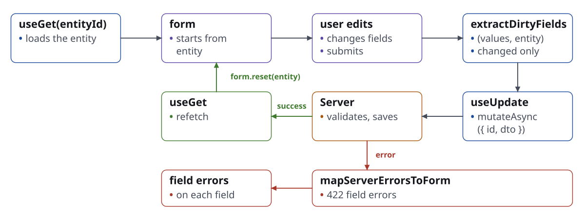

<p align="center">
  
</p>

# @simplix-react/form

**English** | [한국어](/ko/packages/form/README.md)

TanStack Form hooks derived automatically from `@simplix-react/contract` contracts and `@simplix-react/react` hooks.

> **Prerequisites:** Requires a contract defined with `@simplix-react/contract` and hooks derived with `@simplix-react/react`. See [`@simplix-react/react`](/en/packages/react/README.md) first.

## Installation

```bash
pnpm add @simplix-react/form @tanstack/react-form
```

**Peer dependencies:**

| Package | Version |
| --- | --- |
| `@simplix-react/api` | workspace |
| `@simplix-react/contract` | workspace |
| `@simplix-react/react` | workspace |
| `@tanstack/react-form` | >= 1.0.0 |
| `@tanstack/react-query` | >= 5.0.0 |
| `react` | >= 18.0.0 |
| `zod` | >= 4.0.0 |

## Quick Example

```tsx
import { defineApi, simpleQueryBuilder } from "@simplix-react/contract";
import { deriveEntityHooks } from "@simplix-react/react";
import { deriveEntityFormHooks } from "@simplix-react/form";
import { z } from "zod";

// 1. Define the contract
const projectContract = defineApi({
  domain: "project",
  basePath: "/api",
  entities: {
    task: {
      schema: z.object({ id: z.string(), title: z.string(), status: z.string() }),
      parent: { param: "projectId", path: "/projects" },
      operations: {
        get: { method: "GET", path: "/tasks/:id" },
        create: {
          method: "POST",
          path: "/tasks",
          input: z.object({ title: z.string(), status: z.string() }),
        },
        update: {
          method: "PATCH",
          path: "/tasks/:id",
          input: z.object({ title: z.string().optional(), status: z.string().optional() }),
        },
      },
    },
  },
  queryBuilder: simpleQueryBuilder,
});

// 2. Derive React Query hooks
const hooks = deriveEntityHooks(projectContract);

// 3. Derive form hooks: one call covers every entity
const formHooks = deriveEntityFormHooks(projectContract, hooks);

// 4. Use in components
function CreateTaskForm({ projectId }: { projectId: string }) {
  const { form, isSubmitting, submitError, reset } = formHooks.task.useCreateForm!(projectId);

  return (
    <form onSubmit={(e) => { e.preventDefault(); form.handleSubmit(); }}>
      <form.Field name="title">
        {(field) => <input value={field.state.value} onChange={(e) => field.handleChange(e.target.value)} />}
      </form.Field>
      <button type="submit" disabled={isSubmitting}>Create</button>
      {submitError && <p>{submitError.message}</p>}
    </form>
  );
}
```

## API Overview

| Export | Kind | Description |
| --- | --- | --- |
| `deriveEntityFormHooks` | Function | Derives entity form hooks from contract + hooks |
| `extractDirtyFields` | Function | Extracts only changed fields (for PATCH requests) |
| `mapServerErrorsToForm` | Function | Maps server validation errors to form field errors |
| `zodToFieldErrors` | Function | Validates values with a Zod schema and returns one message per field path |
| `DerivedEntityFormHooksResult` | Type | Return type of `deriveEntityFormHooks` |
| `CreateFormOptions` | Type | Options interface for `useCreateForm` |
| `UpdateFormOptions` | Type | Options interface for `useUpdateForm` |
| `CreateFormReturn` | Type | Return type interface for `useCreateForm` |
| `UpdateFormReturn` | Type | Return type interface for `useUpdateForm` |
| `DerivedCreateFormHook` | Type | Create form hook signature |
| `DerivedUpdateFormHook` | Type | Update form hook signature |
| `EntityFormHooks` | Type | Form hook interface for a single entity |

## Key Concepts

### Hook Derivation

`deriveEntityFormHooks(contract, hooks)` reads the entity definitions from the contract and derives form hooks from the entity's hooks. An entity gets `useCreateForm` when it has an operation with the `create` role, and `useUpdateForm` when it has operations with the `update` and `get` roles. Both hooks are optional on `EntityFormHooks`, so call them with `!` or check them first.

```ts
const formHooks = deriveEntityFormHooks(projectContract, projectHooks);
// formHooks.task.useCreateForm  → create mutation + TanStack Form
// formHooks.task.useUpdateForm  → get query + update mutation + TanStack Form + dirty tracking
```

### Auto Dirty-Field Extraction

`useUpdateForm` sends only changed fields to the server by default (`dirtyOnly: true`). It compares the loaded entity with the current form values and extracts only the differences, automatically producing PATCH-friendly requests. In this mode a submit before the entity has loaded does nothing.



### Server Error Mapping

When a submit fails, the hooks call `mapServerErrorsToForm`, which writes the server's validation messages onto the matching fields. It reads the formats `getValidationErrors` from `@simplix-react/api` understands, with any status code.

## Hook Reference

### `useCreateForm`

A form hook for creating new entities. Connects a TanStack Form instance with the create mutation.

```ts
const { form, isSubmitting, submitError, reset } = formHooks.task.useCreateForm!(parentId, options);
```

**Parameters:**

| Parameter | Type | Description |
| --- | --- | --- |
| `parentId` | `string?` | Parent entity ID (for child entities) |
| `options.defaultValues` | `Partial<CreateSchema>?` | Initial form values |
| `options.resetOnSuccess` | `boolean?` | Reset form on success (default: `true`) |
| `options.onSuccess` | `(data) => void` | Success callback |
| `options.onError` | `(error) => void` | Error callback |

**Returns:**

| Property | Type | Description |
| --- | --- | --- |
| `form` | `AnyFormApi` | TanStack Form instance |
| `isSubmitting` | `boolean` | Whether submission is in progress |
| `submitError` | `Error \| null` | Last submission error |
| `reset` | `() => void` | Reset form and error state |

### `useUpdateForm`

A form hook for updating existing entities. Loads the entity with the `get` hook and resets the form each time the entity is refetched.

```ts
const { form, isLoading, isSubmitting, submitError, entity } = formHooks.task.useUpdateForm!(entityId, options);
```

**Parameters:**

| Parameter | Type | Description |
| --- | --- | --- |
| `entityId` | `string` | ID of the entity to update (required) |
| `options.dirtyOnly` | `boolean?` | Send only changed fields (default: `true`) |
| `options.onSuccess` | `(data) => void` | Success callback |
| `options.onError` | `(error) => void` | Error callback |

**Returns:**

| Property | Type | Description |
| --- | --- | --- |
| `form` | `AnyFormApi` | TanStack Form instance |
| `isLoading` | `boolean` | Whether entity data is loading |
| `isSubmitting` | `boolean` | Whether submission is in progress |
| `submitError` | `Error \| null` | Last submission error |
| `entity` | `Entity \| undefined` | Loaded entity data |

## Utilities

### `extractDirtyFields(current, original)`

Compares two objects using deep equality and extracts only the changed fields. Supports Date, arrays, and nested objects.

```ts
import { extractDirtyFields } from "@simplix-react/form";

const dirty = extractDirtyFields(
  { name: "Updated", status: "active", priority: 1 },
  { name: "Original", status: "active", priority: 1 },
);
// → { name: "Updated" }
```

### `mapServerErrorsToForm(error, form)`

Reads field errors from an error with `getValidationErrors` from `@simplix-react/api` and sets them as `onSubmit` errors of the TanStack Form fields; messages for one field are joined with `, `. Returns `true` when it set any error.

Supported error formats, read from the error itself, from `error.data`, or from `error.body` parsed as JSON:

- **Spring Boot:** `{ errorDetail: [{ field, message }] }`
- **Field array:** `{ errors: [{ field, message }] }`
- **Rails:** `{ errors: { [field]: string[] } }`

```ts
import { mapServerErrorsToForm } from "@simplix-react/form";

// Manual usage (automatically called inside hooks)
try {
  await mutation.mutateAsync(data);
} catch (error) {
  mapServerErrorsToForm(error, form);
}
```

### `zodToFieldErrors(schema, values)`

Validates `values` against a Zod schema. Returns `null` when they are valid, otherwise an object from each dotted field path to its first message:

```ts
import { zodToFieldErrors } from "@simplix-react/form";

const errors = zodToFieldErrors(createTaskSchema, { title: "" });
// → { title: "<first Zod message for title>" } when invalid, null when valid
```

## Related Packages

| Package | Description |
| --- | --- |
| `@simplix-react/contract` | Zod-based type-safe API contract definitions |
| `@simplix-react/react` | React Query hooks derived from contracts |
| `@simplix-react/api` | Error utilities that `mapServerErrorsToForm` reads validation errors with |
| `@simplix-react/mock` | MSW mock handlers with in-memory stores derived from contracts |

---

**Next Step** → [`@simplix-react/mock`](/en/packages/mock/README.md): derive mock handlers from the contract.

---

<p class="page-source"><a href="https://github.com/simplix-framework/simplix-react/blob/main/packages/form/README.md" target="_blank" rel="noopener noreferrer">Edit on GitHub</a></p>
