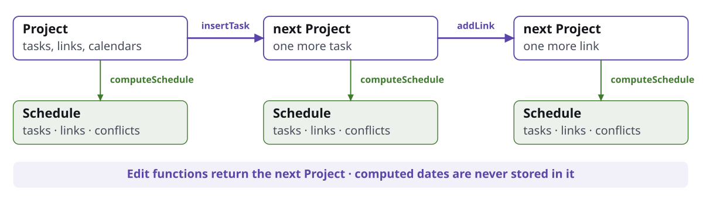

# @simplix-react/gantt-core

**English** | [한국어](/ko/packages/gantt-core/README.md)

Project scheduling engine with no runtime dependency and no UI: working calendars, dependency and constraint scheduling, critical path, baselines, resources and leveling, editing operations with undo, and Microsoft Project XML exchange.

`@simplix-react/gantt` draws a chart on top of it. Use this package alone to schedule on a server, in a worker or in a test.

## Installation

```bash
pnpm add @simplix-react/gantt-core
```

## Quick start

```ts
import { addLink, computeSchedule, createTask, formatLocalDateTime, insertTask, parseLocalDateTime, standardCalendar } from "@simplix-react/gantt-core";
import type { Project } from "@simplix-react/gantt-core";

let project: Project = {
  name: "Launch",
  scheduleFrom: "start",
  start: parseLocalDateTime("2026-03-02T08:00"),
  calendarId: "standard",
  minutesPerDay: 480,
  minutesPerWeek: 2400,
  daysPerMonth: 20,
  defaultStartTime: 480,
  defaultFinishTime: 1020,
  criticalSlackLimit: 0,
  honorConstraints: true,
  calendars: [standardCalendar()],
  tasks: [],
  links: [],
  resources: [],
  assignments: [],
  baselines: {},
};

project = insertTask(project, createTask(project, { id: "design", name: "Design", duration: 5 * 480 }));
project = insertTask(project, createTask(project, { id: "build", name: "Build", duration: 10 * 480 }));
project = addLink(project, { predecessorId: "design", successorId: "build" });

const schedule = computeSchedule(project);
const build = schedule.tasks.get("build");
console.log(build && formatLocalDateTime(build.start)); // 2026-03-09T08:00:00
console.log(build?.critical); // true
```

## Model

A `Project` is plain immutable data. Every operation takes a project and returns a new one, and the computed dates are never stored: `computeSchedule(project)` derives them. A project and a task do store their start, manual, constraint and actual dates.



| Record | Holds |
| --- | --- |
| `Task` | One row. Rows are kept in display order, and `outlineLevel` places a row under the nearest earlier row one level up. A row with rows under it is a summary task. |
| `Link` | A dependency: `FS`, `SS`, `FF` or `SF`, with a lag in working minutes, clock minutes or percent of the predecessor's duration. A negative lag is a lead. |
| `WorkCalendar` | Working time by weekday, with dated work weeks and exceptions, optionally inheriting from a base calendar. |
| `Resource`, `Assignment` | Who works on what, at which share of their time, for how much work. |
| `Baseline` | The dates every task had when the baseline was saved, by number 0 to 10. |
| `CustomField` | A text, number, date or flag field the plan adds to its tasks. |

Instants are whole minutes on the project's own wall clock (`Minutes`). No time zone is applied anywhere; `parseLocalDateTime` reads `YYYY-MM-DD` or `YYYY-MM-DDTHH:MM[:SS]` and drops the seconds, and `formatLocalDateTime` writes `YYYY-MM-DDTHH:MM:00`. `formatLocalDate`, `formatClockTime`, `parseClockTime`, `toCivil`, `fromCivil`, `daysFromCivil`, `dayIndexOf`, `weekdayOfDay` and `MINUTES_PER_DAY` work on the same clock.

## Scheduling

`computeSchedule` returns, for every task, `start`, `finish`, `earlyStart`, `earlyFinish`, `lateStart`, `lateFinish`, `totalSlack`, `freeSlack`, `critical`, the outline number (`wbs`) and the rolled-up progress, plus the state of every link (`violated`, `driving`) and a list of conflicts.

| Input | Effect |
| --- | --- |
| `scheduleFrom: "start"` | Tasks go as early as their links and constraints allow; late dates are read back from the resulting finish. `"finish"` does the reverse from `Project.finish`. |
| Constraint types | `asap`, `alap`, `must-start-on`, `must-finish-on`, `start-no-earlier-than`, `start-no-later-than`, `finish-no-earlier-than`, `finish-no-later-than`. |
| `honorConstraints` | When true a must-start-on, must-finish-on, start-no-later-than or finish-no-later-than date wins over a link, and the link is reported as violated. |
| `deadline` | Caps the late finish, so a missed deadline shows as negative slack and a `deadline-missed` conflict. |
| `mode: "manual"` | The task stays at `manualStart` and `manualFinish`; links into it are checked, not applied. |
| `actualStart`, `actualFinish` | A started task is held at its actual dates. |
| Task and resource calendars | A task works on its own calendar, or on its resources' calendars unless `ignoreResourceCalendar` is set. |
| `elapsed` | The duration or lag is counted on the clock, through nights and weekends. |
| Summary tasks | Take their dates from the tasks under them. A link on a summary task binds every task under it. |
| `splits` | A task pauses after a given amount of work for a given working time. Its finish moves by the pauses, its duration does not, and `TaskSchedule.segments` gives the stretches it works in. |

A project that cannot be scheduled at all (a dependency cycle, a calendar without working time, a reference to a missing record) raises a `ScheduleError` with a `code`. A broken link, constraint or deadline is not an error: the plan is scheduled and the break is listed in `Schedule.conflicts`.

### Agreement with Microsoft Project

The test suite reads plans that Microsoft Project 2002 to 2019 scheduled and saved, schedules them again, and compares the results. For each of the 1,248 automatic tasks in those plans the start, finish, early and late dates, total and free slack and the critical flag are equal.

What the plans exercise is narrow, and the comparison proves no more than that:

| Covered by the saved plans | Not covered by them |
| --- | --- |
| `FS`, `SS`, `FF` and `SF` links with a lag in days or weeks, on 64 linked tasks | Leads, elapsed and percent lags, links on summary tasks |
| As-soon-as-possible and start-no-earlier-than tasks, including a date ahead of the project start | The other six constraint types, deadlines |
| The standard calendar | Calendar exceptions, work weeks, task and resource calendars |
| Projects scheduled from their start | Projects scheduled from their finish |

The right-hand column is tested against values worked out by hand and against invariants over random plans (every link holds, no task loses or gains duration, slack is never negative without a missed date), not against Microsoft Project.

A manually scheduled task takes its dates from the file, so its dates say nothing about the scheduler. Microsoft Project does not derive a manual task's late dates and critical flag from its links the way it does for an automatic task, and those differ.

The sample files come from the MPXJ project (LGPL-2.1) and are not part of this package. `node scripts/fetch-oracle.mjs` fetches them into an ignored directory before the tests run.

## Editing

| Area | Functions |
| --- | --- |
| Rows | `createTask`, `insertTask`, `removeTasks`, `updateTask`, `changeTask`, `taskIndex`, `nextId`, `indentTasks`, `outdentTasks`, `moveTask`, `copyTasks`, `pasteTasks` |
| Dates and progress | `setTaskStart`, `setTaskFinish`, `setTaskStartKeepingFinish`, `setTaskDuration`, `setPercentComplete` |
| Links | `addLink`, `updateLink`, `removeLinks` |
| Resources | `addResource`, `updateResource`, `removeResources`, `assignResource`, `updateAssignment`, `removeAssignments` |
| Project | `updateProject` |
| Calendars | `putCalendar`, `removeCalendar`, `standardCalendar`, `continuousCalendar`, `parseWorkingRanges`, `formatWorkingRanges`, `compileCalendars`, `intersectWorkingTime`, `ELAPSED_TIME` |
| Outline | `buildOutline`, `isAncestor`, `subtreeEnd` |
| Baselines | `setBaseline`, `clearBaseline`, `baselineVariance` |
| Splits | `splitTask`, `clearSplits` |
| Recurring tasks | `addRecurringTask`, `updateRecurringTask`, `recurrenceDays` |
| Custom fields | `addCustomField`, `renameCustomField`, `removeCustomField`, `setCustomValue` |
| Costs | `computeCosts` |
| Progress | `rescheduleUncompletedWork`, `computeEarnedValue` |
| Changes | `diffProjects`, `mergeProjects`, `takeTheirs` |
| Saved plans | `serializeProject`, `parseProject`, `toSavedPlan`, `PLAN_FORMAT`, `PLAN_FORMAT_VERSION` |
| Subprojects | `insertSubproject` |
| Resource load | `findOverallocations`, `resourceUsage`, `levelResources`, `clearLeveling` |
| Text entry | `parseDuration`, `formatDuration`, `parsePredecessors`, `formatPredecessors`, `minutesPerUnit` |
| Undo | `createHistory`, `commit`, `undo`, `redo`, `undoLabel`, `redoLabel` |

Assignments follow the task type: on a fixed-units task a change of work moves the duration, on a fixed-duration task it moves the units, and an effort-driven task shares its work among the resources assigned to it.

`computeCosts` totals work and cost per task: a work resource's hourly `standardRate` for the hours of its assignment, a material resource's rate for its units, a `costPerUse` once per task and the task's own `fixedCost`, added up into summary tasks.

`addRecurringTask` adds a summary task with one task per occurrence of a daily, weekly or monthly recurrence, each held to its day by a start-no-earlier-than constraint.

`levelResources` delays tasks until no work resource is booked beyond its maximum units. It places tasks one at a time in dependency order, higher priority first, and only moves an automatic as-soon-as-possible task that has not started and whose priority is under 1000. `withinSlack` keeps every delay inside the task's total slack, so the project's finish does not move; `split` pauses a task where a conflict begins instead of moving all of it. It returns what it could not resolve. A plan of 400 tasks with 200 assignments levels in about 15 ms.

`rescheduleUncompletedWork` moves work that has not been done to after the status date: a task that has not started gets a start-no-earlier-than constraint there, and a task in progress pauses where its completed work ends.

`computeEarnedValue` measures a plan against a baseline as of the status date: planned value, earned value, actual cost, the schedule and cost variances and the schedule and cost performance indexes, per task, per summary task and for the project. A baseline saves each task's cost as its budget.

`diffProjects` lists what differs between two versions of a plan record by record (added, updated and removed tasks, links, resources, assignments, calendars and custom fields, the row order, plan settings and baselines), which is what a server needs to store an edit without rewriting the plan.

`mergeProjects(base, mine, theirs)` brings changes made elsewhere into a plan edited here: a record only the other side changed is taken, and a record both changed keeps this side's version and is returned as a conflict. `takeTheirs(project, theirs, conflicts)` settles the listed conflicts the other way.

`serializeProject` writes a plan as JSON that names its form and version (`PLAN_FORMAT_VERSION`), and `parseProject` reads it: a plan saved by a later version raises `unsupported-plan-version`, a value that is not a plan raises `invalid-plan`, and a bare project stored before plans carried a version is read as it is.

A resource can carry an overtime rate and standard rates that take effect from a date; an assignment can carry overtime work, which costs the overtime rate and takes no duration, and a work contour, which weights its daily work toward the start, the end or the middle in `resourceUsage`.

## Microsoft Project XML

```ts
import { computeSchedule } from "@simplix-react/gantt-core";
import { readMspdi, writeMspdi } from "@simplix-react/gantt-core/mspdi";

const { project, warnings } = readMspdi(xmlText);
const xml = writeMspdi(project, computeSchedule(project));
```

The exchange code is exported from `@simplix-react/gantt-core/mspdi` alone, so an application that loads it on demand keeps it out of what it loads first.

`readMspdi` returns the plan and a list of warnings for data it did not carry over. `writeMspdi` writes the plan with the computed dates, slack and outline numbers, in the element order of the files Microsoft Project saves. `mspdiExportLosses(project)` lists what of a plan the document has no place for. `parseMspdiDuration` and `formatMspdiDuration` convert the document's duration text, and `parseXml` and `XmlWriter` are the XML reader and writer the exchange uses.

| Exchanged | How it is stored |
| --- | --- |
| Fixed and actual cost of a task, cost per use of a resource, cost of a baseline | Hundredths of the amount, as Microsoft Project stores money |
| Standard and overtime rate of a resource | The amount per hour, or per unit for a material resource |
| Dated standard rates of a resource | The resource's first rate table |
| Overtime work and work contour of an assignment | Flat, back-loaded, front-loaded and bell; another contour is read as flat with a warning |
| Custom text, number, date and flag fields | Microsoft Project's Text1 to Text30, Number1 to Number20, Date1 to Date10 and Flag1 to Flag20, with the field's name as the alias. A field read from a file takes the id `text1`, `number3` and so on |
| Leveling delay | Elapsed time before the start, converted from and to working minutes on the task's calendar |
| Currency code | As it is |

Limits of the exchange:

- Reading every one of the 122 sample files, writing it and reading it back gives the same plan. Whether Microsoft Project opens a written file has not been tried.
- The pauses of split tasks, the colours of single tasks, the rule of a recurring task and timephased data are not exchanged. Custom fields beyond the number Microsoft Project offers per type are not written.
- The scale of money and the values of custom fields are checked against files Microsoft Project saved from known entries. No sample file holds a rate, a rate table, a leveling delay or a work contour other than flat, so those follow the published schema and are checked only by writing and reading back.
- A leveling delay is converted from the task's start in the file, so it reads back exactly when the delayed start lies on a working boundary.

## License

SimpleCORE License 1.0 (SCL-1.0). See [LICENSE](https://github.com/simplix-framework/simplix-react/blob/main/LICENSE); a Korean translation is in [LICENSE_KO](https://github.com/simplix-framework/simplix-react/blob/main/LICENSE_KO).

---

<p class="page-source"><a href="https://github.com/simplix-framework/simplix-react/blob/main/packages/gantt-core/README.md" target="_blank" rel="noopener noreferrer">Edit on GitHub</a></p>
