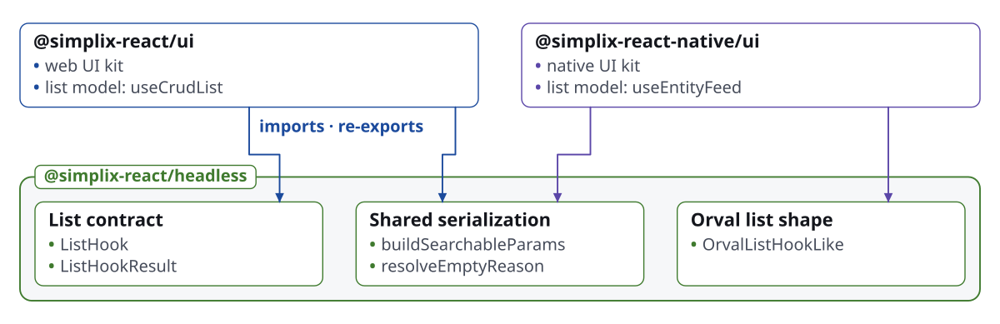

# @simplix-react/headless

**English** | [한국어](/ko/packages/headless/README.md)

Platform-neutral headless logic shared by the web UI kit (`@simplix-react/ui`) and the native UI kit (`@simplix-react-native/ui`). Nothing in this package touches the DOM or React Native: it holds plain TypeScript and React hooks that run on every platform.



## What it provides

| Area | Exports |
| --- | --- |
| Orval adapters | `adaptOrvalList`, `adaptOrvalGet`, `adaptOrvalCreate`, `adaptOrvalUpdate`, `adaptOrvalDelete`, `adaptOrvalOrder`, `LIST_READ_META` |
| Searchable serialization | `buildSearchableParams`, `SEARCHABLE_KEYWORD_PARAM` |
| Filter vocabulary | `SearchOperator`, `makeFilterKey`, `parseFilterKey`, `getFilterLayout`, `insertFilterSeparators`, operator config tables (`dateOperatorConfig`, `selectOperatorConfig`, `textOperatorOrder`, `numberOperatorOrder`) |
| List contracts | `ListHook`, `ListHookResult`, `SortState`, `PaginationState`, `FilterState`, `EmptyReason`, `CrudMutation` |
| Empty-state classification | `resolveEmptyReason`: ranks a non-success query (`"error"`, `"unavailable"`) above the empty-result reasons |
| In-memory filtering | `matchesFilter` |
| Toast store | `addToast`, `removeToast`, `runToastAction`, `useToastStore` (renderers live in each platform kit) |
| Formatting | `formatBytes`, `toBcp47`, `formatDateShort` / `formatDateMedium` / `formatDateTime` / `formatRelativeTime` / `formatDateRange`, `getMonthNames`, `generateYears` |
| Date math | `startOfDay` … `endOfYear`, `addDays` / `subDays`, `isSameDay` / `isSameMonth` / `isSameWeek`, `parseDate`, `asPlainDate` |
| Semantic-kind date/time encoding | `serializeInstant`, `decodeInstant`, `serializeCalendarDate`, `decodeCalendarDate`, `serializeWallClockTime`, `decodeWallClockTime`, `TimeValue` helpers |
| Application time zone and zone dates | `configureAppTimeZone`, `getAppTimeZone`, `useAppTimeZone`, `zoneDayRange` and the other `zone*` helpers, `elapsedSpan`, `periodStanding`, `daysUntilDay` |
| Clipboard and secure-context fallbacks | `copyText`, `installClipboardFallback`, `installRandomUUIDFallback` |
| List and form state | `paginationHandlers`, `useDebouncedValue`, `useOnline`, `missingRequired` |
| Local ids | `generateLocalId` |
| Theme registry | `THEMES`, `ColorTheme`: the color preset manifest shared by web CSS presets and the native token sheet |

The full list with signatures is in the [API reference](https://github.com/simplix-framework/simplix-react/blob/main/docs/api/@simplix-react/headless/README.md).

## Consumption

`@simplix-react/ui` re-exports the list contracts, the Orval adapters, the filter vocabulary, the toast store, the formatting and date helpers and the theme registry, so web consumers import those from `@simplix-react/ui`. Native consumers (and `@simplix-react-native/ui` itself) import from `@simplix-react/headless` directly, as does any consumer that needs an export `@simplix-react/ui` does not re-export, such as `buildSearchableParams` or `matchesFilter`.

```ts
import { adaptOrvalList, buildSearchableParams, SearchOperator } from "@simplix-react/headless";
```

The list state machines are intentionally NOT here: the web page model (`useCrudList`) lives in `@simplix-react/ui`, the native feed model (`useEntityFeed`) lives in `@simplix-react-native/ui`. `useCrudList` consumes the `ListHook` contract, and `useEntityFeed` consumes `OrvalListHookLike`, `buildSearchableParams` and `resolveEmptyReason` from this package.

---

<p class="page-source"><a href="https://github.com/simplix-framework/simplix-react/blob/main/packages/headless/README.md" target="_blank" rel="noopener noreferrer">Edit on GitHub</a></p>
